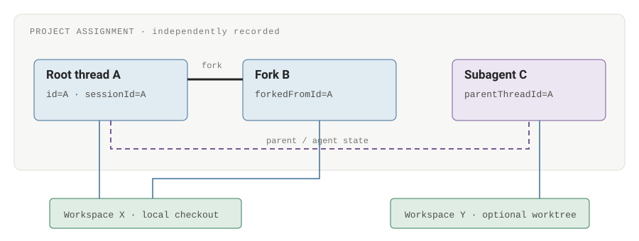
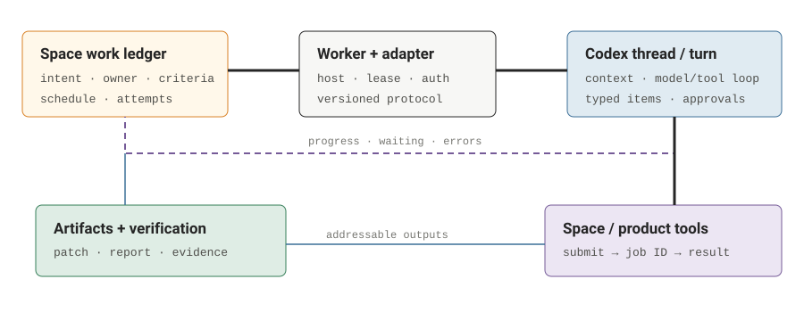

# Anatomy of a Codex session

What a Codex session contains, how it runs, where it persists, and how to control it: threads, turns, items, projects, commands, permissions, forks, SDKs, and background execution. A versioned anatomy for designing an operating system that can route work into Space and other products.

By **Suraj Sharma**, XO Labs · Applied Agent Research. First published 25 September 2026 as *Anatomy of a Codex session* in [sharmasuraj0123/writings](https://github.com/sharmasuraj0123/writings/tree/a5a356d418d45b63d34624b12ec3d7809167b309/codex-session). Subject: codex-cli 0.155.0-alpha.2.6 · macOS arm64 · 42 minute read · 9,269 words / 225 wpm

Source: [`codex-session/index.html`](https://github.com/sharmasuraj0123/writings/blob/a5a356d418d45b63d34624b12ec3d7809167b309/codex-session/index.html) in [sharmasuraj0123/writings](https://github.com/sharmasuraj0123/writings) at `a5a356d`. Brought into this repo on 2026-10-15 with its text, tables and figures unchanged; only the format moved from HTML to Markdown.

## 01 · The word session names several different things

A Codex session is a durable conversation attached to an execution environment, with a controller that can run, pause, resume, branch, and inspect work. That sentence is useful, but it hides the boundaries an operating system needs.

The public control protocol calls the conversation a **thread**. A thread contains **turns**; a turn contains typed **items**. The installed build also has a literal `sessionId` that groups a tree of related threads. A terminal process, a shell command, a project, and a scheduled job are different objects. Giving all of them one “session status” loses information.

This is a companion to [Anatomy of a Claude Code session](2026-10-08-claude-code-session.md). The purpose is to make Codex legible enough to build a session-based operating system around it: discover work, place it on a host, expose it in Space, ask for decisions, and preserve a verified result after the agent stops.

*\[Scope\]* Inspected on 25 September 2026: the macOS arm64 desktop-bundled `codex-cli 0.155.0-alpha.2.6`, generated App Server types, local storage schemas, and the current official manual. “Local schema” means a field or command exists in this build; it does not mean every product exposes it or that its behavior was exercised. “Documented” means an official source describes it. “Proposal” means the design in this essay.

The distinction matters here. The documentation and bundled alpha already disagree about history pagination. Some project and live-settings methods appear only in the experimental schema. Pin the runtime and generate its protocol before building an adapter. [Evidence and limits →](#19-sources-version-boundaries-and-unverified-behavior)

**Figure 1. The objects have different owners and different lifetimes** *\[Synthesis\]*

| Object | Identity / lifetime | What it owns |
|----|----|----|
| Product work item | Space work ID; survives retries and providers | Outcome, acceptance criteria, budget, result and accountable owner. |
| Project | Product project ID; app-server `projectId` where supported | Related work and roots. A repository is one possible source of files. |
| Session tree | `sessionId` in the inspected protocol | Related threads. It is not a process ID or authentication token. |
| Thread | `thread.id`; durable unless ephemeral | Conversation history, lineage, execution defaults and project assignment. |
| Turn | `turn.id`; one agent run | Input, model/tool loop, status, errors and output items. |
| Item | `item.id`; scoped by thread and turn | Message, command, file change, tool call, reasoning summary or another typed event. |
| Executor / environment | Host, process, workspace path, tool handles | Actual files, shell processes, network, credentials and tool execution. |

The upper work-item layer is proposed. Thread, turn, and item are protocol objects. Keep their identifiers separate even when one UI calls each of them a task.

## 02 · Identity, lineage, and the session tree

*\[Local schema\]* `v2/Thread.ts` describes Codex-generated thread IDs as UUIDv7. The string remains opaque to a client: do not derive routing, authorization, or a filesystem location by parsing it. Use the returned identifiers and the host that issued them.

`id` names this conversation. `sessionId` names the shared session tree. `forkedFromId` records a fork source. `parentThreadId` is set for a subagent. Those last two edges carry different meanings: “branched from this history” and “spawned under this agent.” A fork is not automatically a subagent.

`projectId` is a nullable canonical assignment owned by App Server in this build. `cwd` is an absolute working directory. `gitInfo` is captured repository metadata. A title is `name`; a first-message excerpt is `preview`. None of those is a substitute for `id`. Rename a thread without changing its identity; create a fork when you need a distinct conversation.

*\[OS design\]* Store a provider reference such as `{provider, hostId, threadId}`, plus the provider's session and project identifiers as separate attributes. Your global work ID should survive a provider migration. A local path can change during handoff; a branch name can move to a new commit; a title can be edited. They are lookup hints, not durable global keys.

**Figure 2. Three relations that a flat chat list hides** *\[Reconstruction\]*

Black = control; blue = data/workspace binding; dashed purple = agent state. The example intentionally lets two threads share a checkout. A conversation fork alone does not create a filesystem copy.

## 03 · The wire shape: Thread → Turn → Item

*\[Local schema\]* These are reduced structural sketches, not complete JSON responses. Field names come from the generated types. Nullable metadata must stay nullable in your database. In particular, a thread's current model is not proof of the model used by every historical turn.

    Thread {
      id, sessionId, forkedFromId?, parentThreadId?, projectId?,
      name?, preview, createdAt, updatedAt, recencyAt?,
      source, originator?, cliVersion, historyMode,
      cwd, gitInfo?, modelProvider, model?, reasoningEffort?,
      ephemeral, section?, sectionEnteredAt?, status,
      path?, turns: Turn[]
    }
    Turn { id, items: ThreadItem[], status, error, ... }
    ThreadItem = { type: "userMessage", ... }
               | { type: "agentMessage", ... }
               | { type: "commandExecution", ... }
               | { type: "fileChange", ... }
               | { type: "mcpToolCall", ... }
               | ...

`createdAt`, `updatedAt`, and `recencyAt` use Unix seconds in `Thread`. The thread's `path` is explicitly unstable. `ephemeral` says the conversation should not be materialized on disk. `historyMode` records a persistence contract, not a UI preference.

    Turn {
      id: string,
      items: ThreadItem[],
      itemsView: "notLoaded" | "summary" | "full",
      status: "inProgress" | "completed" | "interrupted" | "failed",
      error: TurnError | null,
      startedAt: number | null,        // Unix seconds
      completedAt: number | null,      // Unix seconds
      durationMs: number | null
    }

    ThreadStatus = {type: "notLoaded"}
                 | {type: "idle"}
                 | {type: "systemError"}
                 | {type: "active", activeFlags:
                      ("waitingOnApproval" | "waitingOnUserInput")[]}

`notLoaded` describes runtime loading, not deletion. Archive state is not a variant of `ThreadStatus`. A partial item view must remain distinguishable from an empty turn. `TurnError` contains a message and optional structured details; the declared categories distinguish context exhaustion, usage or rate limits, authorization, sandbox errors, connection problems, and policy failures. A controller should preserve that classification rather than retry every error.

Do not interpret `turns: []` as “this thread has never run.” The generated type says turns are populated for resume, rollback, fork, and reads requesting `includeTurns`; other responses and notifications leave the array empty. Metadata discovery and complete history retrieval are different operations.

### The item union is the anatomy of work

*\[Local schema\]* `UserInput` is an ordered union of text, URL/local images, URL/local audio, skills, and mentions. A message is therefore not necessarily one string. `ThreadItem` includes these families:

- **Conversation:** `userMessage`, `agentMessage`, `plan`, `reasoning`, `hookPrompt`, and standalone function-call output. Agent messages carry text and optional delivery, question, or memory-citation metadata.
- **Execution:** `commandExecution` includes `command`, `cwd`, nullable `processId`, status, aggregated output, exit code, and duration. Display-oriented command classification is not proof that an action is safe.
- **Changes:** `fileChange` carries a changes array and status. Reviewing the actual current diff remains a separate action.
- **Tools:** `mcpToolCall` includes server/tool identity, arguments, plugin/app context, result/error, and timing. `dynamicToolCall` carries client-provided tool results.
- **Delegation:** `collabAgentToolCall` records sender/receiver thread IDs and agent states; `subAgentActivity` records agent-thread activity.
- **Other typed work:** web search, image viewing/generation, sleep, entry/exit from review mode, and context compaction.

An integration should render the types it understands and retain unknown types for inspection. Collapsing every unfamiliar item into assistant prose destroys useful provenance.

A turn's status and a thread's status are also different. A turn can finish while the thread remains available for more work. A thread can be loaded and idle, active, unloaded, or in a system error state. “Waiting for approval” belongs to the active execution state, not your product's final outcome. Persist raw provider state alongside a deliberately small product state machine. [\[L1\]](#19-sources-version-boundaries-and-unverified-behavior)

## 04 · Boot, resume, and the context the model actually receives

*\[Documented + local schema\]* Starting Codex is a sequence of decisions. Select the host and working directory; load authentication and effective configuration; apply organization constraints; discover project instructions and capabilities; start or load a thread; then begin a turn. An App Server connection can exist without an active turn. Resuming a thread can load it without submitting another prompt.

The language model does not receive your whole computer. The harness assembles instructions, conversation context, tool definitions, supplied inputs, and observations. Tool calls add results. Files enter context when they are attached, discovered through supported context features, or read. A sibling thread's transcript is not implicitly the current thread's memory.

`AGENTS.md` is durable project guidance. Codex discovers global guidance and then a chain from the project root to the selected working directory. At each location, `AGENTS.override.md` takes precedence over `AGENTS.md`; configured fallback names can follow. Guidance is assembled at startup. After changing startup guidance, start a new run or deliberately reload through a supported interface; do not assume editing a file rewrites an active model context. [\[D4\]](#19-sources-version-boundaries-and-unverified-behavior)

On resume, history is old but the working tree is current. A file read last week may no longer describe the file now. An earlier test result remains a historical observation. Credentials, permissions, enabled tools, dependencies, and repository state can all differ. A reliable resume prompt asks Codex to inspect those facts again before acting.

*\[OS design\]* Record a launch manifest with runtime version, adapter version, configuration revision, approved capabilities, workspace revision, and input artifact hashes. Keep secrets as references to a credential broker. This gives you a useful execution record without pretending that a transcript is a reproducible machine snapshot.

## 05 · A turn is an asynchronous stream with control points

*\[Documented\]* Submit input with `turn/start`. The response identifies the accepted turn; it is not its final answer. The server emits lifecycle notifications, starts items, streams deltas, completes items, and eventually completes the turn. A tool invocation can require a client decision along the way. The controller must keep reading while the agent is running. [\[D1\]](#19-sources-version-boundaries-and-unverified-behavior)

A command item can carry command text, a working directory, output, exit status, and timing. A file-change item records proposed or applied changes according to its status. MCP and dynamic-tool items have their own argument and result shapes. Agent text and reasoning-related items are separate types. A reasoning summary is not a promise that private internal reasoning is available.

*\[Adapter rule\]* Build your UI from typed items, not by searching the assistant's prose for “done.” Correlate deltas with item IDs and the enclosing turn and thread. An item failure may be recoverable: Codex can inspect the failure and try another command within the same turn. A completed turn may still report that the requested outcome could not be achieved.

**Figure 3. Accepting work and finishing work are different events** *\[Reconstruction\]*

    client → turn/start { threadId, input: [...] }
    server → response { turn: { id, status: "inProgress", ... } }
    server → turn/started
    server → item/started
    server → item/.../delta                 (zero or more)
    server → client approval / tool request (when required)
    client → response to that request       (correlate its request ID)
    server → item/completed                 (repeat for later items)
    server → turn/completed                 (inspect status and error)
    product → verify artifacts and acceptance criteria

Illustrative ordering, not a complete packet capture. Requests and notifications can interleave. Product verification is an additional step after provider execution.

`turn/steer` adds input to the active turn with an `expectedTurnId`. That expected ID protects against accidentally steering a later run. Queueing input means waiting for a later turn; interrupting means requesting the current one stop. None of these operations compensates for a command or external write that already completed.

After a connection loss, “I did not receive completion” means the outcome is unknown. The worker may still be running. Re-read the thread and its turn state before submitting the same side-effecting instruction again. On reconnect, recover a snapshot and reconcile it with the events you retained; do not assume an arbitrary transport supplies a replay cursor.

## 06 · Disk is a set of stores, not one portable session file

*\[Local observation\]* Schema-only inspection found date-partitioned JSONL rollout files, a SQLite state database, a logs database, and a session-name index. Their names and layouts are implementation details from this machine, not an interchange format. No private transcript text, credentials, or real project values are reproduced here.

**Companion reference, 3 October 2026.** [Codex JSON, field by field](../app/codex-json-explorer/) maps the desktop’s `.codex-global-state.json` recursively: objects become folder pages and leaves become sections. It explains observed field types, owning writers, project and thread associations, and cached schemas, with dynamic identifiers replaced by placeholders. This desktop-state file is separate from the session stores below.

    $CODEX_HOME/                     # commonly ~/.codex
      config.toml                   # supported user configuration
      state_5.sqlite                # observed state/index database
      logs_2.sqlite                 # observed logs database
      session_index.jsonl           # id, thread_name, updated_at
      sessions/YYYY/MM/DD/
        rollout-<timestamp>-<thread-id>.jsonl
      worktrees/                    # desktop default, configurable

    <project>/                      # separate from thread history
      AGENTS.md
      .codex/config.toml
      files, dependencies, outputs, Git checkout

The observed `threads` table has a primary `id`, `rollout_path`, `cwd`, `source`, model/provider fields, approval and sandbox fields, archive metadata, Git metadata, `history_mode`, and nullable `project_id`. It also holds presentation and indexing fields. The `projects` and `project_roots` tables preserve an explicit project identity and ordered roots. `thread_spawn_edges` stores parent/child relationships.

Other observed tables include `thread_attachments`, `thread_dynamic_tools`, `thread_sections`, and `project_idempotency_keys`. These names explain why one rollout file is not the whole session. They do not establish what copying a subset would restore. [\[L2\]](#19-sources-version-boundaries-and-unverified-behavior)

**Figure 4. A rollout contains several kinds of records** *\[Local observation\]*

| Observed discriminator | Structural role / selected keys |
|----|----|
| `session_meta` | `id`, `session_id`, `timestamp`, `cwd`, `cli_version`, `source`, `history_mode`, lineage and instruction metadata. |
| `turn_context` | `turn_id`, `root_turn_id`, `model`, `effort`, `workspace_roots`, approval/sandbox policies, collaboration mode and timezone. |
| `response_item` | Typed model-visible history: messages, reasoning-related records, function/custom-tool calls and outputs. Calls and results correlate through `call_id`. |
| `event_msg` | Internal event variants such as `task_started`, `task_complete`, `token_count`, and `thread_settings_applied`. |
| `compacted` | Compaction metadata including `message`, `replacement_history`, window identifiers and token-usage metadata. |
| `token_usage_record`, `world_state`, `inter_agent_communication_metadata` | Additional record families observed in this build; preserve unknown variants when inspecting or exporting. |

Keys and discriminator names came from ten recent rollout files. This is an observed subset, not an exhaustive schema and not the public exec event protocol.

    {
      "ordinal": "<sequence>",
      "timestamp": "<timestamp>",
      "type": "<record discriminator>",
      "payload": {}
    }
    // Reduced shape only. Some records also carry outer metadata.

Internal records, App Server objects, and `codex exec --json` events use different schemas and naming. For example, an internal `task_complete` is not the literal spelling of the public `turn.completed` event. Write a separate decoder for each surface; do not feed them all into one unversioned parser.

**History has its own format version.** The generated `ThreadHistoryMode` permits `legacy` and `paginated`. This build exposes `migrate-rollouts`, whose help describes an inspection mode and explicit `--apply` migration. The current manual still says paginated creation and some full-history operations are unsupported. This essay did not run a migration or prove paginated runtime behavior. The discrepancy is a reason for capability tests, not permission to assume the newer behavior works everywhere.

**Ephemeral does not mean consequence-free.** The thread's ephemeral flag avoids normal durable thread materialization. It does not undo files, erase external service writes, or establish that no other logging exists. Likewise, archive, permanent delete, process exit, and worktree cleanup are distinct operations. Preserve the accepted result outside transient execution state.

*\[OS design\]* Treat these stores as runtime-owned. Export through supported reads, preserve source provenance, and let the runtime maintain indexes and history. A migration between products should transfer a reviewed task description and artifacts unless a documented native migration contract exists. Copying a JSONL file is not a demonstrated process checkpoint, credential transfer, or supported cross-host migration.

## 07 · Projects, directories, repositories, and worktrees

*\[Documented\]* The CLI uses its current directory, or `--cd`, as the local project context. The IDE uses its selected workspace root. The desktop project is an organizational object that can attach local folders. A ChatGPT project carries uploaded or connected context and instructions; it does not itself grant direct access to a local directory. These surfaces share concepts without having identical project objects. [\[D5\]](#19-sources-version-boundaries-and-unverified-behavior)

In the current desktop documentation a local project can have several folders and one primary folder. New chats start from the primary folder; it drives automatic instruction/config discovery and the default Git operations. Secondary folders are available for file work, but do not automatically contribute another instruction/config discovery chain. Remote projects currently support one folder.

*\[Local schema\]* The inspected runtime also has explicit App Server project records and nullable `Thread.projectId`. This is stronger than inferring project membership from a path. Its project-management methods are experimental; do not treat their presence in generated types as proof of a stable public integration contract. See the local schema notes in the source ledger.

A repository stores version history. A checkout contains mutable files. A worktree is a second checkout sharing Git metadata. Many threads may use the same checkout. That allows collaboration and also allows races. A conversation fork preserves a history branch; worktree creation supplies file isolation. Choose both independently.

**Figure 5. What moves when work changes location** *\[Documented / synthesis\]*

| Operation | Conversation | Files and execution |
|----|----|----|
| Resume | Continue a saved thread | Read the currently available workspace; no historical filesystem restore is implied. |
| Fork | Create another conversation from prior history | File isolation is a separate decision. A same-directory fork shares mutable files. |
| Start in a worktree | Choose a conversation and its execution location | Create an isolated Git checkout; setup and ignored dependencies may still be needed. |
| Desktop Handoff | Move a chat with its associated Git state | Product-managed movement between Local / Worktree or matching projects on supported hosts. |
| Archive | Hide or archive the saved conversation | Desktop-managed worktree cleanup may occur separately; preserve deliverables before relying on the checkout. |
| Move project assignment | Change organization metadata through a supported method | Do not assume it moves directories, rewrites Git, or transfers credentials. |

Transcript continuity, project membership, and workspace movement are separate decisions. Handoff is a higher-level product operation, not a synonym for thread/resume.

The desktop app creates managed worktrees under `$CODEX_HOME/worktrees` by default, with a configurable root. A managed worktree usually belongs to one chat; a permanent worktree is its own project and can host several. Setup scripts prepare dependencies. Handoff handles Git constraints such as a branch being checked out in only one worktree. [\[D6\]](#19-sources-version-boundaries-and-unverified-behavior)

Cross-host Handoff requires a matching saved project for the same repository and, for a subdirectory project, the same subdirectory. It interrupts a running response before transferring chat and Git state. The documentation excludes handoff to Codex cloud. Ignored files and remote credentials are separate concerns; a chat ID does not carry a machine with it. [\[D7\]](#19-sources-version-boundaries-and-unverified-behavior)

## 08 · The shell commands that create and manage sessions

*\[Local help\]* The following syntax was checked against `codex-cli 0.155.0-alpha.2.6`. Help was executed; the example work was not. `codex` below means that verified binary on your PATH. This machine's separate npm launcher was broken, so inspection used the desktop-bundled executable directly. [\[L3\]](#19-sources-version-boundaries-and-unverified-behavior)

### Create, continue, branch

    # Interactive work in a chosen directory
    codex -C /path/to/repository

    # Continue a specific saved thread
    codex resume <THREAD_ID>
    codex exec resume <THREAD_ID> "Continue the investigation" --json

    # Branch conversation history into a new thread
    codex fork <THREAD_ID>
    codex exec fork <THREAD_ID> "Explore the alternative" --json

    # Separate filesystem isolation, exposed in the inspected build
    codex --worktree "Implement the change"
    codex fork --worktree <THREAD_ID>

Use an explicit thread ID for a background controller. `resume --last` is convenient for a person but ambiguous under concurrency. Interactive resume/fork pickers are normally directory-scoped; `--all` broadens discovery. `--include-non-interactive` includes exec-created work where supported. If the saved and current directories differ, the UI can ask which to use; an explicit `-C` wins over that preference.

### Run a bounded job and capture its result

    codex exec -C /path/to/repository --sandbox read-only   --json --output-last-message result.txt   "Summarize the repository" > events.jsonl

    codex exec -C /path/to/repository --sandbox read-only   --output-schema schema.json --output-last-message result.json   "Extract the requested project metadata"

    codex exec --ephemeral "Answer this one-off question"

In ordinary exec output, progress goes to stderr and final agent text to stdout; `--json` puts JSONL events on stdout. The public events include `thread.started`, `turn.started`, `turn.completed`, `turn.failed`, `item.started`, `item.updated`, `item.completed`, and `error`. Persist the `thread_id` from `thread.started`. `--output-schema` constrains the final response; it does not change every event into that schema. [\[D12\]](#19-sources-version-boundaries-and-unverified-behavior)

For a non-Git directory, `--skip-git-repo-check` permits exec to run outside a repository. It does not create a project, grant additional filesystem access, or isolate a workspace. Choose permissions explicitly for the actual job. A report that writes files needs a different boundary from a read-only inspection.

### Manage an existing conversation

    # Observed-build queued input for a later run
    codex queue --thread <THREAD_ID> --message "Run the next check"

    # Saved-history lifecycle
    codex archive <THREAD_ID>
    codex unarchive <THREAD_ID>

    # Observed-build shared-daemon session browser
    codex agents

    # Discover actual contracts before integrating
    codex --version
    codex --help
    codex exec --help
    codex app-server generate-ts --out ./schemas
    codex app-server generate-json-schema --out ./schemas

`codex delete <THREAD_ID>` is a distinct permanent-deletion command. Do not implement a dismiss button by calling it when the intended action is archive. The slash-command deletion flow also documents deletion of spawned descendants; inspect the exact operation's scope in the version you ship.

### The top-level command map

**Figure 6. All top-level commands printed by this build’s help** *\[Local help\]*

| Family | Commands | Responsibility |
|----|----|----|
| Run and inspect work | `agents`, `exec`, `review` | Browse daemon sessions; execute a noninteractive task; run a review. |
| Conversation lifecycle | `resume`, `fork`, `queue`, `archive`, `unarchive`, `delete` | Continue, branch, queue input, retain or permanently remove saved work. |
| Runtime interfaces | `app-server`, `exec-server`, `remote-control`, `app` | Client protocol, hosted-harness execution service, remote daemon management, and desktop launch. |
| External capabilities | `mcp`, `plugin` | Manage servers/tools and plugin configuration. |
| Identity and health | `login`, `logout`, `doctor`, `update` | Authentication, diagnosis and runtime maintenance. |
| Environment and cloud | `sandbox`, `cloud`, `apply` | Sandbox commands, cloud task access, and local application of a produced diff. |
| Inspection and maintenance | `debug`, `features`, `migrate-rollouts`, `completion`, `help` | Debugging, feature flags, history migration, shell completion and command help. |

This is the observed top-level help inventory. Subcommand options, aliases, hidden flags, and future versions are separate inventories.

**Figure 7. Launch controls and exec-specific controls** *\[Local help\]*

| Control | Effect / boundary |
|----|----|
| `-C / --cd`, `--add-dir`, `--worktree` | Working root, additional writable roots, and managed Git worktree. A path is not a project ID. |
| `-m / --model`, `--oss`, `--local-provider` | Model/provider selection. A requested model still depends on availability and policy. |
| `-c / --config`, `-p / --profile`, `--strict-config` | TOML overrides, a selected profile file, and rejection of unknown config fields. |
| `--enable`, `--disable` | Feature flags for this invocation; not proof that a feature is supported by the server. |
| `-s / --sandbox`, `-a / --ask-for-approval`, `--approve-for-me` | Execution restrictions, human approval behavior, and automatic approval review. |
| `--dangerously-bypass-approvals-and-sandbox`, `--dangerously-bypass-hook-trust` | Explicit bypass controls exist. They remove named protections; they are not required to build a background adapter. |
| `-i / --image`, `--search`, positional prompt | Input attachment, live search, and initial work. Exec also accepts stdin. |
| `--remote`, `--remote-auth-token-env` | Attach supported interactive/lifecycle commands to a remote App Server; not a universal flag for every subcommand. |
| `--no-alt-screen`, `--help`, `--version` | Presentation and discovery; no work outcome implied. |
| Exec: `--json`, `--output-schema`, `-o / --output-last-message`, `--color` | Event transport, final response shape, final response file, and terminal styling. |
| Exec: `--ephemeral`, `--thread-source`, `--skip-git-repo-check` | Persistence choice, provenance classification, and non-Git eligibility. |
| Exec: `--ignore-user-config`, `--ignore-rules` | Omit those configuration inputs. Authentication still uses Codex home; do not mistake these flags for total isolation. |

Aliases and option availability are versioned. The current profile help describes a separate \$CODEX_HOME/\<name\>.config.toml file. Use help from the binary you launch.

## 09 · The controls inside a running CLI

*\[Documented\]* Slash commands are terminal UI controls. They are not App Server method names, shell executables, or a recommended machine protocol. Availability varies by model, platform, feature flags, and current run state. Use the popup in the actual build for discovery. [\[D2\]](#19-sources-version-boundaries-and-unverified-behavior)

**Figure 8. Session-relevant slash commands, grouped by what they change** *\[Documented\]*

| Concern | Controls | Meaning |
|----|----|----|
| Conversation identity | `/new`, `/clear`, `/resume`, `/fork`, `/rename` | Create, load, branch, or label a conversation. /clear also clears the terminal view; Ctrl+L only clears the view. |
| Context and output | `/compact`, `/mention`, `/ide`, `/diff`, `/review` | Summarize context, attach information, inspect changes, or request a review. |
| Behavior | `/model`, `/plan`, `/goal`, `/personality`, `/fast` | Change execution preferences or ongoing intent. A goal is not a host scheduler. |
| Authority | `/permissions`, `/approve` | Change permitted behavior or explicitly retry a denied action within the applicable policy. |
| Capabilities | `/skills`, `/apps`, `/plugins`, `/mcp`, `/hooks` | Discover workflows and tools; inspect hook trust and server capabilities. |
| Detours and diagnostics | `/side` / `/btw`, `/usage`, `/debug-config` | Use an ephemeral conversation detour; inspect daily/weekly/cumulative token activity; inspect effective configuration layers. Account activity is separate from a thread’s runtime status. |
| State and navigation | `/status`, `/agent` / `/subagents`, `/memories` | Inspect runtime state, navigate agent threads, and configure memory behavior. |
| Background terminals | `/ps`, `/stop` / `/clean` | Inspect background terminals and stop them. These terminal resources are separate from the saved conversation; /ps can be empty when the unified execution tool is not used. |
| End or remove | `/archive`, `/quit` / `/exit` | Archive the current conversation or end the UI. Ending the UI is not a product completion certificate. |

This is a session-oriented map, not a claim to enumerate every UI command. The published command catalog also includes appearance, import, debugging, and platform-specific controls.

`/goal` attaches an outcome that Codex can keep pursuing across turns. The documented controls include edit, pause, resume, and clear. Define acceptance criteria in the goal itself. Long-running mode retains existing permissions; it cannot make an unavailable host or expired credential available. [\[D8\]](#19-sources-version-boundaries-and-unverified-behavior)

A queued instruction and steering input differ. Use queueing when the current turn should finish first; steer when new information should affect ongoing work. A UI keystroke can be rebound, and command menus can be unavailable while running. An integration should use the protocol rather than simulate a keyboard.

## 10 · App Server is the control interface

*\[Documented\]* App Server exposes bidirectional JSON-RPC-style control. Requests carry `id`, `method`, and `params`; notifications omit `id`. The wire omits the usual `jsonrpc` member. Initialize a connection, then send `initialized`. Stdio uses newline-delimited JSON. The documentation currently marks App Server and its WebSocket transport experimental and unsupported for production workloads. This makes it a concrete prototyping interface, with a version and deployment decision still required. [\[D1\]](#19-sources-version-boundaries-and-unverified-behavior)

*\[Local schema\]* The following request shapes match the inspected build. Values are illustrative. The example only demonstrates initialization and thread/turn submission; it is not a complete client, approval handler, or captured successful exchange.

    // Client requests (one JSON object per line on stdio)
    {"id":1,"method":"initialize","params":{"clientInfo":{"name":"space-prototype","title":"Space Prototype","version":"0.1.0"},"capabilities":null}}
    {"method":"initialized"}
    {"id":2,"method":"thread/start","params":{"cwd":"/workspace/project","sandbox":"read-only"}}

    // Substitute the thread.id returned in response 2.
    {"id":3,"method":"turn/start","params":{"threadId":"<thread-id>","input":[{"type":"text","text":"Inspect the project and report findings.","text_elements":[]}]}}

    // Subsequent controls use the actual returned turn ID.
    {"id":4,"method":"turn/steer","params":{"threadId":"<thread-id>","expectedTurnId":"<turn-id>","input":[{"type":"text","text":"Also inspect the failure cases.","text_elements":[]}]}}
    {"id":5,"method":"turn/interrupt","params":{"threadId":"<thread-id>","turnId":"<turn-id>"}}

Request IDs correlate RPC responses; they are not thread IDs or work IDs. The start response also reports resolved execution settings and instruction sources. Read that response instead of assuming every requested override became effective. The `sandbox` enum at thread start uses `read-only` / `workspace-write` / `danger-full-access` in this build. The structured `sandboxPolicy` at turn start is a different type.

**Figure 9. Protocol methods grouped by lifecycle responsibility** *\[Local schema\]*

| Family | Methods in generated types | Maturity / important boundary |
|----|----|----|
| Create and attach | `thread/start`, `thread/resume`, `thread/fork` | Generated by default. Prefer threadId-based resume; path/raw-history routes are unstable or reserved. |
| Discover and hydrate | `thread/list`, `thread/read`, `thread/loaded/list`, `thread/turns/list`, `thread/items/list` | Default-generated here. Paginated behavior differs from current documentation; test the installed history mode. |
| Drive execution | `turn/start`, `turn/steer`, `turn/interrupt` | Start work, target ongoing work, or request interruption. |
| Metadata and attachments | `thread/name/set`, `thread/metadata/update`, `thread/section/move`, `thread/attachment/add`, `thread/attachment/list`, `thread/attachment/remove` | Method presence and field maturity differ. Project assignment is experimental. |
| History maintenance | `thread/compact/start`, `thread/rollback`, `thread/revert`, `thread/inject_items` | Rollback is deprecated. Revert targets paginated history. Neither history rollback nor revert undoes local files. Raw item injection is a specialized integration surface. |
| Retention and subscriptions | `thread/archive`, `thread/unarchive`, `thread/delete`, `thread/unsubscribe` | Archiving, deleting and detaching a subscriber are separate operations. |
| Goals and human-origin actions | `thread/goal/set`, `thread/goal/get`, `thread/goal/clear`, `thread/shellCommand`, `thread/approveGuardianDeniedAction` | A goal is thread-scoped state. `thread/shellCommand` is a human-origin shell surface: it runs unsandboxed with full access and does not inherit the thread sandbox policy. |
| Live configuration | `thread/settings/update`, `turn/settings/update`, `thread/memoryMode/set` | Experimental. Future-turn settings and active-turn-only settings have different scopes. |
| Queue and terminals | `thread/queue/*`, `thread/backgroundTerminals/*` | Experimental. Queue add/list/update/delete/reorder/start; terminal clean/list/terminate. |
| Projects | `project/list`, `project/read`, `project/create`, `project/import`, `project/update`, `project/move`, `project/delete` | Experimental. Move changes sidebar order, not filesystem location. |
| Additional product surfaces | `thread/search`, `thread/searchOccurrences`, `thread/timeline/list`, `thread/realtime/*` | Experimental. Search/timeline and realtime input are distinct from the core text lifecycle. |

Default-generated means “included without --experimental by this alpha binary,” not “stable production API.” This is a session-focused taxonomy; account, configuration, and other non-session method families are not exhaustively listed.

**Do not route autonomous work through the human shell shortcut.** The generated `ThreadShellCommandParams.ts` explicitly says this command evaluates shell syntax unsandboxed with full access. It is not a convenient replacement for the agent’s ordinary sandboxed tool loop. An adapter must expose this capability only under its own explicit human-action contract.

### Approvals are server requests, not just transcript messages

The generated `ServerRequest.ts` includes command and file-change approval, user input, permission approval, MCP elicitation, client tool calls, and authentication-related requests. A client must dispatch the appropriate response shape back to the matching RPC request. Multiple approval callbacks can concern one item; an optional `approvalId` distinguishes them. Do not key pending decisions only by item ID.

The command-approval decision union includes accept, accept-for-session, decline, cancel, and policy-amendment variants. Those choices have different scopes. Persist the exact requested operation and scope in the UI. A policy amendment is not equivalent to approval of one invocation.

Dynamic tools let an integration receive `item/tool/call` with a thread, turn, call ID, tool identity, and arguments, then return `contentItems` and `success`. Their registration is experimental in this build. MCP supplies another route for external capabilities. Neither mechanism supplies your service's transactionality or retry semantics.

### Schema details that affect a controller

`turn/steer` checks `expectedTurnId`. Fork can select a history boundary with `lastTurnId`, or experimental `beforeTurnId`; the former cannot name a turn still in progress, and the two are mutually exclusive. `excludeTurns` can avoid loading full history. Read the returned lineage rather than deriving session-tree identity.

The experimental project type is `{id, name, roots: [{path}], metadata, position, createdAt, updatedAt, recencyAt}`. Metadata values are strings. A thread has zero or one canonical project assignment, while a project can have many threads and multiple ordered roots. The schema does not supply a host ID or prove global uniqueness of root paths. `project/create` and `project/import` require an `idempotencyKey`; import can attach existing thread IDs. Do not infer file movement or cascading thread deletion from project method names alone.

Experimental `thread/metadata/update.projectId` uses omission for unchanged, an empty string to clear, and an existing ID to assign. `thread/list.projectId` uses omission for every project, null for unassigned, and a concrete ID for a filter. The same-looking field has different null semantics in different requests. Generate bindings and validate at the boundary.

## 11 · How to modify a session without confusing the layers

*\[Local schema + documented behavior\]* “Modify the session” can mean sending new information, changing a default, rewriting history, moving files, or changing the product's organization. They have different APIs and consequences.

In the inspected schema, overrides such as `cwd`, `model`, `effort`, `approvalPolicy`, and `sandboxPolicy` on `turn/start` affect that turn and subsequent turns. `outputSchema` and `serviceTierForTurn` are one-turn controls. `turn/steer` accepts input and the expected turn ID, not arbitrary configuration edits. Experimental settings-update methods exist in this build; capability-gate them.

**Figure 10. Choose an operation; inspect its boundaries** *\[Interpretation\]*

**Operation**

This explorer describes effects; it never calls Codex or modifies a real session. History rollback is not a file undo, and no operation here reverses an external side effect.

**Correction is usually a new input.** Send the corrected requirement, its priority, and what prior assumption it replaces. Keep the audit trail. Fork if you want to compare a different approach from the same historical context. Use rollback only when the supported history operation matches your intention, and inspect the workspace independently.

**Configuration is prospective.** A model change cannot revise previous outputs. A tool added later does not retroactively authorize earlier actions. Editing `config.toml` or `AGENTS.md` is not the same operation as mutating a loaded thread's effective configuration. Re-read effective settings through supported interfaces after changes.

**Raw storage editing is not a session API.** JSONL files, SQLite indexes, loaded state, and event subscribers can disagree if one is edited independently. Do not patch IDs, delete transcript lines, or rewrite database rows as an integration mechanism. Use supported lifecycle methods. If you need to transform a transcript for export, produce a separate export with provenance.

## 12 · Instructions, tools, permissions, and configuration

For the file format itself, [What is a TOML file?](https://github.com/sharmasuraj0123/writings/tree/a5a356d418d45b63d34624b12ec3d7809167b309/toml-files) explains keys, tables, types, parsing, and the application rules that turn configuration into behavior.

*\[Documented\]* Four layers answer four questions. Instructions say what the agent should do. Configuration chooses how the harness runs. Tool registration supplies capabilities. Permissions constrain which effects are allowed. A prompt is not a security boundary, and tool availability is not blanket authorization.

The documented configuration order is: explicit CLI flags and overrides; trusted project config layers, closest directory first; a selected profile file; user config; cloud-managed defaults; system config; built-in defaults. Enforced organizational requirements are constraints on the result, not another preference that a flag can override. The profile layout itself can differ across releases, so use the reference for the pinned version. [\[D3\]](#19-sources-version-boundaries-and-unverified-behavior)

For project defaults use `.codex/config.toml`; for personal defaults use `~/.codex/config.toml`. Put instructions in `AGENTS.md`. Put reusable workflows in skills. Package tools and workflows in plugins. Use MCP or app connectors for external capabilities. The more your OS separates these layers, the easier it becomes to explain why a particular session can or cannot perform an action.

Filesystem restrictions, network policy, approval behavior, and tool-specific approvals are separate controls. “Never ask” is an approval policy; it does not imply full filesystem or network access. “Read-only” is an execution restriction; it does not by itself classify every connector action. The adapter must preserve the actual enforced boundary, including organization policy and available tool controls. [\[D9\]](#19-sources-version-boundaries-and-unverified-behavior)

Hooks provide explicit lifecycle extension points. The current docs include session and subagent start/stop, prompt submission, pre/post tool use, permission requests, compaction, stop, and interruption. Non-managed hooks require trust of the exact definition. Matching command hooks can run concurrently, so one hook cannot be assumed to serialize the others. Hooks are useful for integration observations and validation; they do not replace a durable work queue. [\[D10\]](#19-sources-version-boundaries-and-unverified-behavior)

*\[OS design\]* Store a capability manifest with each attempt: readable roots, writable roots, network reach, tool scopes, approval owner, and credential references. Make approval requests durable inbox objects with a thread, turn, and request ID. Expire the decision when that request no longer exists. Never silently convert an old approval into authorization for a new action.

## 13 · Forks, subagents, and context compaction

*\[Local schema\]* A fork and a spawned subagent both create related threads, but their control relationships differ. The schema records fork ancestry separately from agent parentage and includes optional `agentNickname` and `agentRole`. Those are descriptive attributes. Route by thread ID, not a nickname.

Delegation creates another execution context; it does not necessarily create another worktree, new credentials, or a separate permissions domain. Check what the selected runtime actually supplies. Two agents writing the same files can conflict even when their chat histories are perfectly isolated.

*\[Documented\]* Context compaction summarizes or restructures the material carried into subsequent model work. It is a context-management operation, not a verification of old claims or a rollback of tools. The history available to a reader and the exact context supplied to a model are not interchangeable. [\[D1\]](#19-sources-version-boundaries-and-unverified-behavior)

*\[OS design\]* Preserve durable facts in project artifacts: the current specification, decisions, task state, experiment results, and artifact addresses. Link to the turn and item that produced each fact. A summary can be useful and still omit a crucial constraint; the authoritative deliverable should not exist only in compressed chat history.

### Goals, token accounting, and budget are separate state

*\[Local schema\]* `ThreadGoal` has `threadId`, `objective`, `status`, nullable `tokenBudget`, `tokensUsed`, `timeUsedSeconds`, and timestamps. Its statuses include active, paused, blocked, usage-limited, budget-limited, and complete (the wire uses `usageLimited` and `budgetLimited`). None is the same state machine as one turn.

`thread/tokenUsage/updated` carries `threadId`, `turnId`, and `tokenUsage`. That object has cumulative `total`, `last`, and nullable `modelContextWindow`. Each breakdown has `totalTokens`, `inputTokens`, `cachedInputTokens`, `cacheWriteInputTokens`, `outputTokens`, and `reasoningOutputTokens`.

*\[OS design\]* Preserve unavailable values as unavailable. Do not add every token field together: some fields describe components or subsets, not independent usage. Token counts are not a currency cost, an account quota, elapsed human work, or proof of completion. Meter provider usage, worker time, and the product’s budget independently.

A session-based OS needs two graphs. One is conversational lineage: fork and parent edges. The other is work dependency: “this review validates that patch,” “this research unblocks that design,” “these two attempts implement the same work item.” A provider's subagent tree cannot represent every business relationship. Keep the second graph in the product.

## 14 · Choose the integration surface by who owns execution

*\[Documented\]* The CLI, SDKs, App Server, and hosted Agents API are alternative integration surfaces with different ownership boundaries. Do not collapse them into one “Codex API.” In particular, an App Server thread ID is not documented as resumable through the hosted API.

**Figure 11. Choose the surface before designing the adapter** *\[Documented\]*

| Surface | Execution contract | Where it fits |
|----|----|----|
| `codex exec` | A local invocation, with optional JSONL events and saved thread continuation. | Scripts, CI, bounded batch jobs. |
| TypeScript Codex SDK | Server-side `@openai/codex-sdk`: create a thread, run it, resume by ID. | Convenient local automation with a library interface. |
| Python Codex SDK | `openai-codex`: local App Server over JSON-RPC, with a pinned runtime in published builds. | Typed local lifecycle control through sync/async clients. |
| App Server | Bidirectional thread/turn/item protocol, including interactive decisions. | A custom client prototype with rich control; experimental deployment caveats apply. |
| Hosted Agents API | OpenAI runs the harness; application controls API sessions and optionally compute. | A separate hosted backend using its own session identifiers and credentials. |
| Your MCP server | Codex consumes the product’s tools and resources. | Let the agent read Space state or submit work to another product. |

These interfaces share concepts, not a demonstrated common persistence namespace. An SDK is not itself a durable scheduler.

    // Local TypeScript SDK sketch
    import { Codex } from "@openai/codex-sdk";
    const codex = new Codex();
    const thread = codex.startThread();
    await thread.run("Inspect the project");
    await thread.run("Continue with the agreed check");
    // Persist the actual thread ID; resume it in a later process.
    const resumed = codex.resumeThread(savedThreadId);

The current SDK documentation describes a TypeScript package and a Python package. It also says the former `codex mcp-server` and standalone `codex-mcp-server` routes have been removed. A product exposing its own MCP server to Codex is the reverse direction; that remains distinct from embedding Codex as a server. [\[D13\]](#19-sources-version-boundaries-and-unverified-behavior)

### Hosted sessions divide harness from environment

The hosted Agents API keeps the model/tool loop with OpenAI. The application submits work, receives events, and handles its function tools. An environment can be absent, OpenAI-hosted, or self-hosted. A tools-only configuration does not need the same file/executor capabilities as a coding sandbox. This is a different architecture from running the entire local Codex harness yourself. [\[D14\]](#19-sources-version-boundaries-and-unverified-behavior)

For self-hosted compute, the environment runs `codex exec-server` and connects outward using the returned environment ID and remote URL. The application owns provisioning and cleanup. Keep the application credential outside that environment and give the executor its restricted environment credential. Each hosted session has its own environment ID and requires its own executor. Preserve the returned remote URL unchanged on reconnect. A saved session does not guarantee that the executor is currently connected. [\[D15\]](#19-sources-version-boundaries-and-unverified-behavior)

    # Hosted harness + your executor; not desktop thread resume.
    codex exec-server   --remote "<session.environment.remote_url>"   --environment-id "<session.environment.id>"

### Hosted events need their own recovery strategy

Persist the hosted API session ID. Messages to an idle session start work; messages while it is working steer it. Follow root turn outcomes such as completed, failed, or cancelled. Retrieve current required actions when recovering a controller, including function-call IDs and environment connection needs. [\[D16\]](#19-sources-version-boundaries-and-unverified-behavior)

    // Hosted beta API sketch; not local App Server RPC. Untested here.
    // Configure the agent and environment for sessions.create separately.
    const session = await client.beta.agents.sessions.create(sessionConfig);
    // Persist session.id and subscribe before sending more work.
    await client.beta.agents.sessions.events.create(session.id, {
      events: [{
        type: "agent.session.input.message",
        input: [{ role: "user", content: [
          { type: "input_text", text: "Continue the agreed work" }
        ] }]
      }]
    });

The hosted event stream does not replay missed events. Its documented recovery path opens a new stream, buffers it, retrieves saved state/items, rebuilds by item ID, and then applies buffered updates while ignoring already-finalized items. Saved history and intermediate streamed deltas are different evidence. [\[D17\]](#19-sources-version-boundaries-and-unverified-behavior)

Webhooks can wake the product when a session needs action or becomes idle. Verify their signatures and enqueue processing. Idle means ready for input, not verified success. The documented environment connection wait is up to five minutes, and a crash or client disconnect can require retries. That wait is not a durable product queue, and deleting an API session does not automatically shut down your separately provisioned compute. [\[D18\]](#19-sources-version-boundaries-and-unverified-behavior)

*\[Migration boundary\]* No inspected source establishes native import of a desktop/App Server thread into this hosted API by ID. If Space changes backends, retain both native identities and explicitly transfer the accepted specification, relevant history summary, and artifact references. Call that a new attempt with provenance.

## 15 · Background work needs a scheduler and an available host

*\[Documented\]* A stored conversation does not run itself. Desktop scheduled tasks can return to an existing chat or start standalone runs. Local work requires the computer and app to remain available. A Git project can run in a managed worktree; a non-Git project runs directly in its directory. A web scheduled task can use accessible uploads and connected services, but not an arbitrary folder on your laptop. [\[D11\]](#19-sources-version-boundaries-and-unverified-behavior)

Remote control separates the screen from execution. The connected host supplies projects, files, credentials, permissions, and tools. A phone can steer it; the phone does not become the worktree's execution machine. An SSH connection to App Server also requires the runtime and authentication on that host. [\[D7\]](#19-sources-version-boundaries-and-unverified-behavior)

*\[Local schema\]* A shell process has another identity. Experimental background-terminal records expose an item ID, process ID, command, working directory, and optional OS process/resource metadata. `thread/backgroundTerminals/terminate` targets a thread plus process ID. Separately, `command/exec` runs an argument vector without creating a thread or turn; its write, resize, and terminate operations use a connection-scoped process ID and its own execution controls. A live terminal handle is not a durable job identifier.

*\[OS design\]* Distinguish a live worker, a durable schedule, and a durable work item. The scheduler decides when an attempt becomes eligible. The worker holds an execution lease. The work item says what counts as success. A process that keeps running in the background supplies only one of those three.

For a Space-owned queue, pin a worker version, place the task on a host with the required capabilities, prepare its workspace, start or resume its provider thread, and consume the event stream. Persist approvals and results outside the worker. Renew a lease while the worker is healthy. If it disappears, first reconcile provider state; only then decide whether a retry is appropriate.

Goals are useful for an agent's continued pursuit of an outcome. Scheduled tasks are useful for later wakeups. Neither eliminates resource limits, host outages, credential expiry, or the need for a result verifier. Do not advertise “offloaded” work as complete merely because the foreground chat has returned.

## 16 · Two directions of offloading: Space drives Codex; Codex calls Space

*\[Proposed integration\]* The clean boundary is an adapter with two directions. Inbound control lets Space submit and supervise Codex work. Outbound tools let a Codex turn request work from Space or another product. The two should share a work-item ID without sharing ownership of every internal state transition.

**Space → Codex.** A user or event creates a durable work item. Space selects a project binding and worker, starts an attempt, resolves credentials, provisions the workspace, and sends the prompt and permitted tools through the adapter. Codex owns its conversation and model/tool loop. Space consumes observations, exposes decisions in an inbox, and validates the result against the work item's acceptance criteria.

**Codex → Space.** Expose narrow tools such as `submit_work`, `get_work`, `cancel_work`, and `attach_result`. These are proposed names, not existing Codex built-ins. Submission should return a stable work ID and accepted state quickly. Long jobs should complete through an event or later lookup. A tool response saying “accepted” must not be rendered as a finished deliverable.

**Figure 12. A product owns durable intent; a runtime owns an attempt** *\[Proposal\]*

This is an architecture proposal, not a description of an existing Space integration. Thin blue edges carry data; thick black edges carry control; dashed purple edges carry execution state.

The submission contract needs an outcome, project reference, input artifacts, allowed capabilities, expected output schema, deadline or budget, and an idempotency key. The result contract needs its work ID, attempt ID, status, artifact references, verification evidence, and any decision required from the user. Include a correlation ID in both directions so nested offloading can be traced.

Do not leave a synchronous tool call open for hours merely to mimic durable execution. Accept the work into the product's queue, persist it, and expose progress. To wake the originating conversation later, the adapter needs a supported follow-up path and a conflict policy if another turn is already active. Completion of a child job need not interrupt unrelated current work.

If the product performs an external effect, record an operation key before making it. For example, a publishing job should be able to answer “was this exact revision already published?” after a worker crash. Codex transcript replay alone cannot supply exactly-once external behavior.

## 17 · A minimal data model for a session-based OS

*\[Proposal\]* Make the provider thread a resource of an attempt. Make the work item the unit of intent. An attempt can reuse a thread for continuity or fork it for a competing approach. A work item can outlive its original provider, machine, or workspace.

**Figure 13. The product schema keeps intent independent from execution** *\[Proposal\]*

    WorkItem {
      id, project_id, owner_id, objective, acceptance_criteria,
      input_refs[], capability_policy_ref, budget, deadline,
      state, active_attempt_id, verified_result_ref
    }
    Attempt {
      id, work_item_id, provider, adapter_version, runtime_version,
      host_id, provider_project_id?, provider_session_id?, thread_id?,
      turn_ids[], workspace_ref, config_revision,
      lease_owner?, lease_expires_at?, started_at, finished_at?, outcome
    }
    Observation {
      id, attempt_id, thread_id?, turn_id?, item_id?,
      provider_event_type, received_at, raw_event_ref, normalized_state
    }
    Decision {
      id, attempt_id, provider_request_id, action_digest,
      requested_scope, expires_at?, resolved_by?, resolution?
    }
    Artifact {
      id, work_item_id, attempt_id, uri, digest, media_type,
      produced_by_item?, verification_status, verification_evidence_refs[]
    }

All names in this figure belong to the proposed product model. Keep raw provider references alongside normalized state so the adapter can evolve without erasing evidence.

Use explicit product states: `queued → preparing → running → verifying → completed`. Add `waiting_for_input`, `failed`, and `cancelled` with recorded reasons. Keep an attempt's provider state beside this product state. A lost worker is an uncertain attempt until reconciliation, not immediate proof of failed work.

Project bindings map one product project to one or more provider projects, hosts, repositories, and roots. Select the binding for each attempt. This supports a research workspace without Git, a code project with multiple repositories, and a task that produces a document in another product.

Keep schedules outside attempts. A schedule creates work or wakes an existing work item according to an explicit policy. Keep notifications outside raw events: notify on completion, meaningful change, failure, or a required decision. Thousands of token deltas should not become thousands of inbox entries.

Cancellation has two phases. Record the user's cancellation intent and send the provider interrupt or stop operation. Then wait for acknowledgement and reconcile effects. If a publish action already happened, cancelling the worker does not unpublish it. A compensating action needs its own authorization and evidence.

The OS should also own retention. Archive chat history according to policy, retain durable artifacts independently, and expire worker checkouts separately. A provider's storage cleanup schedule should not determine whether an accepted result disappears from the product.

## 18 · What must be proved before the adapter can run unattended

*\[Proposed acceptance suite\]* A first integration should prove recovery and ownership before scaling concurrency. The following are concrete tests for a future implementation; they were not executed as part of writing this article.

**Figure 14. Failure cases that distinguish a chat wrapper from a work system** *\[Proposal\]*

| Exercise | Pass condition |
|----|----|
| Disconnect after turn acceptance | Reconnect discovers the existing turn; it does not submit a duplicate prompt blindly. |
| Crash after an external effect | The operation key finds the prior effect; retry does not duplicate it. |
| Lose the host during a tool call | Attempt becomes uncertain; lease expiry triggers reconciliation and an explicit recovery choice. |
| Approval arrives after interruption | A stale provider request is rejected or expired; it cannot authorize a different action. |
| Fork in the same checkout | UI reports shared files; an isolated run creates a distinct workspace explicitly. |
| Change project or host | Adapter validates the destination binding, files, setup, capabilities, and credentials. |
| Resume after compaction or history migration | Required artifacts remain addressable; adapter supports or cleanly rejects the stored history contract. |
| Turn says completed; tests fail | Product work remains unverified, with test evidence attached. |
| Archive a task and clean its worktree | Accepted artifacts survive independently; the history and cleanup policy are visible. |
| Runtime upgrade changes schema | Contract tests detect the difference; unknown item variants remain preserved rather than silently dropped. |

Success means preserved meaning under failures, not merely a transcript that renders correctly.

The smallest useful prototype is one project, one worker host, one versioned App Server adapter, one durable queue, one approval inbox, and one artifact store. First support create, inspect, follow-up, interrupt, resume, and verify. Add fork and multiple workspaces once lineage and lease handling work. Add cross-host movement only after workspace transfer has its own tested contract.

The design commitment is simple: Codex owns the mechanics of its agent loop; the surrounding product owns durable intent, routing, decisions, and accepted outcomes. That boundary lets Space offload work without making its own identity and reliability depend on the lifetime of a chat window.

## 19 · Sources, version boundaries, and unverified behavior

The research uses two evidence sets: generated contracts and schema-only local inspection from one alpha build, and official documentation retrieved on 25 September 2026. Product integration sections are proposals. No model-backed session was launched to test the commands, and no existing conversation was resumed, migrated, forked, archived, or deleted for this research.

### Local evidence, reproducible without private content

1.  **\[L1\] Generated App Server types.** Executable: `/Applications/ChatGPT.app/Contents/Resources/codex`, version `0.155.0-alpha.2.6`. Generated with `app-server generate-ts --out <directory>`, once without and once with `--experimental`. Exact referenced files: `v2/Thread.ts`, `Turn.ts`, `TurnStatus.ts`, `ThreadStatus.ts`, `ThreadItem.ts`, `ThreadHistoryMode.ts`, `ThreadStartParams.ts`, `ThreadResumeParams.ts`, `ThreadForkParams.ts`, `TurnStartParams.ts`, `TurnSteerParams.ts`, `ThreadRevertParams.ts`, `ThreadRollbackParams.ts`, `ThreadGoal.ts`, `Project.ts`, `ProjectRoot.ts`, `Project*Params.ts`, and root `ClientRequest.ts`, `ServerRequest.ts`, `ServerNotification.ts`. File names after the first are within `v2/` unless noted. Generation establishes declared shapes, not successful execution.
2.  **\[L2\] Storage structures.** Read-only SQLite catalog and table-info inspection of `$CODEX_HOME/state_5.sqlite`; key/discriminator-only inspection of ten recent `sessions/**/*.jsonl` files and `session_index.jsonl`. No private values are published. Tables and rollout variants are observed subsets. The absence of a file on one machine is not a universal guarantee.
3.  **\[L3\] CLI help.** `--version`, `--help`, and help for exec, resume, fork, queue, archive/unarchive/delete, agents, App Server, and history migration. Examples with placeholder IDs are instructions, not evidence of completed jobs. The npm PATH launcher failure was local installation state; it does not characterize Codex installations generally.

### Official documentation

The [official Codex manual](https://developers.openai.com/codex/codex-manual.md) supplied the local documentation snapshot. Its current source links include the relocated `learn.chatgpt.com` documentation. The hosted API pages were opened separately. These are living documents and may change after this snapshot.

1.  **\[D1\] [App Server](https://learn.chatgpt.com/docs/app-server).** Transport and initialization; lifecycle concepts; experimental status. Detailed field and method inventories in this essay use the generated local types, not the documentation examples.
2.  **\[D2\] [Command line and slash controls](https://learn.chatgpt.com/docs/developer-commands?surface=cli).** Published command semantics and in-session controls. The observed binary supplies the command inventory and syntax snapshot.
3.  **\[D3\] [Configuration basics](https://learn.chatgpt.com/docs/config-file/config-basic).** Configuration precedence, trusted project layers, profiles, and distinction from enforced requirements.
4.  **\[D4\] [AGENTS.md instructions](https://learn.chatgpt.com/docs/agent-configuration/agents-md).** Startup guidance discovery and override behavior.
5.  **\[D5\] [Projects and chats](https://learn.chatgpt.com/docs/projects).** CLI/IDE/desktop project scope, primary and secondary local folders, and cloud project context.
6.  **\[D6\] [Git worktrees](https://learn.chatgpt.com/docs/environments/git-worktrees).** Managed and permanent worktrees, setup, handoff, cleanup and restore behavior.
7.  **\[D7\] [Remote connections](https://learn.chatgpt.com/docs/remote-connections).** Host ownership, SSH operation, and cross-host handoff requirements.
8.  **\[D8\] [Long-running work](https://learn.chatgpt.com/docs/long-running-work).** Goal lifecycle and continuing work under existing permissions.
9.  **\[D9\] [Agent approvals and security](https://learn.chatgpt.com/docs/agent-approvals-security).** Execution boundaries and approval policy. Schema-only enumerations may retain compatibility variants absent from current user guidance.
10. **\[D10\] [Hooks](https://learn.chatgpt.com/docs/hooks).** Lifecycle extension points, trust, and concurrent hook behavior.
11. **\[D11\] [Scheduled tasks](https://learn.chatgpt.com/docs/automations).** Standalone runs versus existing-chat schedules, local host requirements, workspace modes.
12. **\[D12\] [Non-interactive mode](https://learn.chatgpt.com/docs/non-interactive-mode).** Exec event stream, output schema, continuation and ephemeral runs.
13. **\[D13\] [Codex SDK](https://learn.chatgpt.com/docs/codex-sdk).** Current local TypeScript/Python integrations and removal of the old Codex-as-MCP-server surface.
14. **\[D14\] [Agents API architecture](https://developers.openai.com/api/docs/guides/agents-api/architecture).** Hosted harness, application, and environment ownership.
15. **\[D15\] [Self-hosted sandboxes](https://developers.openai.com/api/docs/guides/agents-api/environments/self-hosted).** Executor connection, environment identity and credential boundary.
16. **\[D16\] [Run and continue hosted sessions](https://developers.openai.com/api/docs/guides/agents-api/sessions).** Hosted input, steering and turn completion. See also [session management](https://developers.openai.com/api/docs/guides/agents-api/sessions/manage) for required actions.
17. **\[D17\] [Hosted events and items](https://developers.openai.com/api/docs/guides/agents-api/sessions/events).** Event/item identities, missing-event recovery and saved history.
18. **\[D18\] [Hosted session webhooks](https://developers.openai.com/api/docs/guides/agents-api/sessions/webhooks).** Action-required and idle signals; lifecycle/recovery limitations.

### Known disagreements and open questions

The inspected binary exposes paginated-history migration and methods that the manual still limits. Its thread shape uses `section` rather than the documentation's pinning example. Its thread-start sandbox string differs from one documentation example. Project CRUD, certain metadata fields, dynamic tools, and live settings need experimental generation. “Default-generated” is not a release-stability claim.

Not established here: crash-consistent backup/restore guarantees; cross-version transcript compatibility; exact runtime behavior of experimental methods; whether every item type is retained in every history mode; universal cross-surface session discovery; native desktop-to-hosted session import; end-to-end Space execution; deployment latency, cost, or throughput. Those require a pinned adapter and an integration test, not inference from a type declaration.

Provenance. The command inventory, local field names, database structures, and rollout discriminators are sourced from the inspected Codex build. Public behavior is attributed to official documentation. Diagrams reorganize that evidence and are marked as reconstructions. The Space queue, work-item model, lease rules, idempotency contract, and verification suite are original proposals. No private session content or credentials are included. Only documentation retrieval, help, schema generation, and schema/key inspection were used as Codex research actions; hosted jobs, provider mutations, and the proposed OS were not tested. Reading time is measured from the article's text after removing SVG, script, style, and markup, at 225 words per minute.
