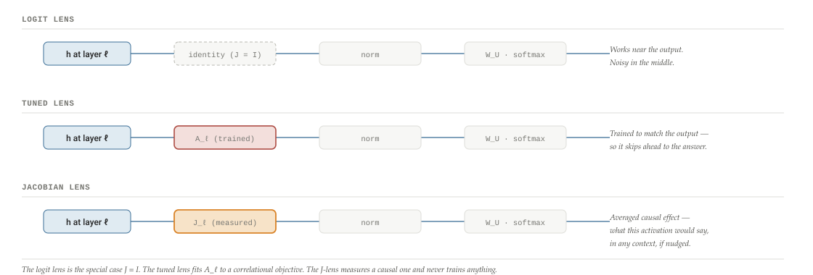
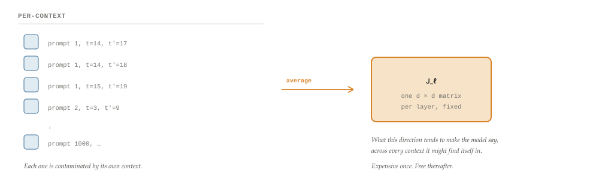
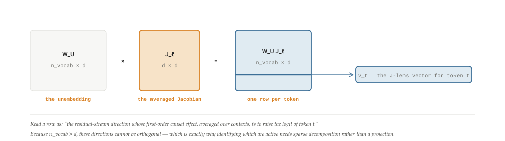
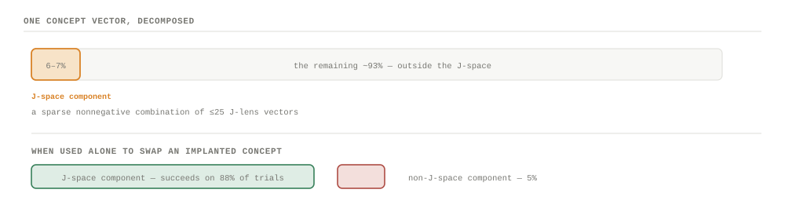
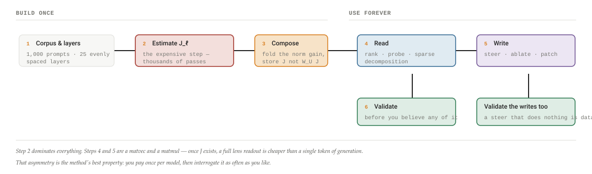
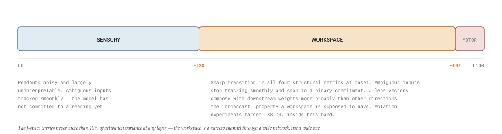

# The J-Space: a construction manual

Anthropic's global-workspace paper reports that a model holds roughly twenty-five concepts at a time in a privileged subspace — under 10% of its activation variance — that it can report on, reason with, and be steered through. The tool that finds it is one averaged Jacobian per layer. A close reading of what a J-space is, then a step-by-step guide to building one: the compute routes, the sparse decomposition, the read and write operations, and the validation protocol.

By **Suraj Sharma**, XO Labs · Interpretability. First published 1 August 2026 as *The J-Space: a construction manual* in [sharmasuraj0123/writings](https://github.com/sharmasuraj0123/writings/tree/a5a356d418d45b63d34624b12ec3d7809167b309/j-space). Subject: transformer-circuits.pub/2026/workspace

Source: [`j-space/index.html`](https://github.com/sharmasuraj0123/writings/blob/a5a356d418d45b63d34624b12ec3d7809167b309/j-space/index.html) in [sharmasuraj0123/writings](https://github.com/sharmasuraj0123/writings) at `a5a356d`. Brought into this repo on 2026-10-15 with its text, tables and figures unchanged; only the format moved from HTML to Markdown.

> **How to read the badges**
>
> Two kinds of claim appear below and they are not equally reliable. *\[from the paper\]* marks equations, procedures and numbers stated in *Verbalizable Representations Form a Global Workspace in Language Models*. *\[reconstruction\]* marks engineering I have worked out to make the method buildable — compute routes, memory budgets, numerical cautions. The paper does not state its implementation strategy or its compute cost, so everything in that category is mine and may differ from what the authors actually did.

## 01 · The claim, and why it needs a new lens

A large model's residual stream at any layer is a vector of several thousand numbers, and almost all of it is inaccessible to the model itself. The paper's claim is that a small, structured slice of that vector is different in kind: it is the part the model can talk about, be asked to focus on, reason over, and have its mind changed about. They call that slice the **J-space**, and they find it with a linear map computed once per layer.

The headline numbers give the shape of the finding. The J-space holds on the order of **25 concepts at a time**. It accounts for **less than 10% of activation variance at any layer**. Ablating it leaves tasks like MMLU, SQuAD, sentiment classification and grammaticality judgement essentially untouched, while multi-hop reasoning, translation and summarization fall apart. It is a small channel that carries the flexible part of cognition and almost none of the automatic part.

To find something like that you need a way of asking an activation "what concept are you?" — and the two standard answers both fail in instructive ways.

The **logit lens** applies the unembedding matrix directly to an intermediate activation: it asks "if the model stopped here, what token would it emit?" That is a fine question near the output and a poor one in the middle of the network, where the residual stream is not yet in output coordinates.

The **tuned lens** fits a per-layer linear map trained to match the model's final output distribution. The paper's objection is sharp and worth quoting: "This objective is correlational rather than causal, and we find that on prompts involving unverbalized intermediate computation the tuned lens tends to 'skip ahead' to the output rather than surface those intermediates." *\[from the paper\]* If you train a probe to predict the answer, it will predict the answer — which is precisely the thing you did not want, because you were looking for the working-out.

The Jacobian Lens asks a third question, and it is a causal one: *if I nudged the model here, what would it say?*

## 02 · Deriving the Jacobian Lens

Start from a perturbation. Take the residual stream at layer ℓ, position *t*, and add a small vector δ. Because of causal masking, that perturbation propagates forward and changes the final-layer residual stream at every position *t′ ≥ t*. The paper: "A small perturbation to h_(ℓ) will propagate through the remaining layers and shift the final-layer residual stream h_(final,t′) at every position t′ ≥ t." *\[from the paper\]*

To first order that relationship is a matrix — the Jacobian of the final activation with respect to the intermediate one. Compose it with the unembedding and you have the first-order effect of the perturbation on the output logits. Average that matrix over source positions, over all later positions, and over a corpus, and you get a single fixed linear map per layer.

J_(ℓ)  =  𝔼_( t, t′≥t, prompt) \[ ∂h_(final,t′) / ∂h_(ℓ,t) \] **h_(ℓ,t)** — residual stream at layer ℓ, token position t, in ℝ^(d). **h_(final,t′)** — residual stream at the last layer, position t′, just before the final normalization and unembedding. **The expectation** runs over the source position t, every subsequent position t′ ≥ t within the context, and a corpus of one thousand prompts sampled from a pretraining-like distribution. **J_(ℓ)** is therefore a single d × d matrix per layer — constant, context-free, computed once. *\[from the paper\]*

The lens itself is then that map, followed by the model's own output head:

lens(h_(ℓ))  =  softmax( W_(U)  norm( J_(ℓ) h_(ℓ) ) ) **norm(·)** is the model's final layer normalization; **W_(U)** is the unembedding. The output is a distribution over the full vocabulary, which the paper reads as a ranked list of the concepts this activation is *disposed to verbalize*. *\[from the paper\]*

Everything else in the paper is a consequence of this one object. And notice its most convenient property: because J_(ℓ) is an expectation and not a per-example quantity, it is *fixed*. Building it is expensive; using it afterwards is a matrix–vector product.

**Figure 1. Three lenses, one shape — what changes is the matrix in the middle**

The paper is generous about its predecessor: "we find the logit lens to be quite useful in practice, and to capture much of the workspace-like structure identified by the J-lens, though with somewhat lower reliability (particularly in earlier layers)." The two "agree closely in the model's last several layers and diverge earlier, with the J-lens recovering interpretable content at depths where the logit lens does not." *\[from the paper\]*

## 03 · Why averaging is the whole trick

If you take one sentence from this piece, take this one. The expectation in the definition of J_(ℓ) is not a variance reduction technique. It is the semantics.

> **The load-bearing sentence**
>
> "The averaging step is key, as it distinguishes representations that are verbalizable — poised to be spoken about, should the occasion arise — from those that merely happen to be verbalized in one particular context." *\[from the paper\]*

An unaveraged Jacobian, computed for one prompt at one position, tells you what this activation is doing *here*. That is a factual claim about a single forward pass, and it is contaminated by everything specific to that context. The averaged Jacobian tells you what this activation would tend to do *across contexts* — which is a modal claim, and it is the one that matches the informal notion of a concept being "available to be reported."

This is the same move a good experimentalist makes when they separate a disposition from an event. Salt is soluble whether or not it is currently dissolving. A representation is verbalizable whether or not it is currently being verbalized. Averaging over t′ ≥ t asks "over all the futures this could have," and averaging over a thousand prompts asks "over all the contexts this could be in."

**Figure 2. One Jacobian is a fact about a context; the average is a disposition**

Causal masking does some of the work for you: for t′ \< t the Jacobian is identically zero, so the sum over source positions at a given readout position automatically restricts to t ≤ t′. §09 turns that observation into a large compute saving.

## 04 · J-lens vectors

The lens gives a distribution over the vocabulary. Reading it backwards gives something more useful: for each token in the vocabulary, the single direction in residual-stream space that most increases that token's logit.

The paper defines them exactly: "We refer to the rows of W_(U) J_(ℓ) as the Jacobian lens (J-lens) vectors at layer ℓ; each J-lens vector is a direction in residual-stream space associated with a single token in the model's vocabulary." *\[from the paper\]*

v_(t)^((ℓ))  =  ( W_(U) J_(ℓ) )_(t,:)  ∈  ℝ^(d) One vector per vocabulary token, per layer. There are n_(vocab) of them in a d-dimensional space and n_(vocab) ≫ d, so the set is **overcomplete** — a frame, not a basis. That is not a defect; it is the premise. Under the superposition hypothesis a model's activations decompose as sparse combinations drawn from an overcomplete set of feature directions, and the J-lens vectors "would then constitute a subframe of this feature frame: a token-indexed subset of the model's feature directions." *\[from the paper\]*

It is worth being clear about what these are not. They are not embedding vectors, and they are not "the direction that represents the concept" in any intrinsic sense. They are *output-facing* directions: the ones that push a specific word out of the model's mouth. That framing is the whole reason the method finds a *verbalizable* workspace rather than a representational one. A concept the model computes over but has no single-token handle for is, by construction, invisible here.

**Figure 3. Where a J-lens vector comes from, dimensionally**

A practical note for anyone implementing this: under RMSNorm the final `norm` is a positive scalar rescale times a learned diagonal gain. The scalar cannot change the ranking of logits, but the gain can — so fold the gain into the unembedding, W̃_(U) = W_(U) diag(g), and take the rows of W̃_(U) J_(ℓ). Skipping this gives you subtly wrong vectors that still look plausible. *\[reconstruction\]*

## 05 · The J-space itself

Now the object in the title. The J-space is not a linear subspace, and the difference matters.

J-space_(k)  =  {  Σ_(i=1..k) c_(i) v_(t_(i))  :  c_(i) ≥ 0  } "the set of points expressible as a sparse nonnegative combination of J-lens vectors." For a sparsity level k, "the J-space corresponds to a union of k-dimensional cones, one for each possible set of k J-lens vectors." *\[from the paper\]*

Three properties follow, and each one is a design decision:

- **Sparse**, so that "what is in the workspace right now" is a short list rather than a dense coordinate vector. k is "typically… no more than 25, which we empirically observed to be the number of J-lens vectors that are meaningfully active at a given time."
- **Nonnegative**, so that a concept is either present with some strength or absent. Negative coefficients would make "the model is thinking about minus-Paris" expressible, which is not a thing.
- **A union of cones, not a subspace**, because the vectors are overcomplete. Any point in ℝ^(d) is in their linear span; the content of the claim is entirely in the sparsity and nonnegativity constraints.

Given an activation — or a steering vector, or an SAE feature direction — you find its J-space component by solving for the best sparse nonnegative reconstruction: "we solve for a sparse nonnegative combination of k J-lens vectors that approximate it well using gradient pursuit… This combination is our approximation of the activation's J-space component, and the coefficients of these vectors are its local J-space coordinates." *\[from the paper\]*

And here is the number that makes the whole paper interesting. That component is *tiny*: "the J-space component typically accounts for only a small fraction of total activation variance (varying by layer, but never more than 10%)." For concept vectors specifically, "across concepts and workspace layers, the J-space component carries a median of only 6–7% of the concept vector's variance, with the remaining ~93% lying outside the J-space." *\[from the paper\]*

Six percent of a vector, and it is the six percent that does the reportable thinking. When they split concept vectors into the J-space part and everything else and used each half to perform a swap, the small part worked on **88%** of trials and the large part on **5%**.

**Figure 4. Six percent of the vector, and nearly all of the leverage**

This is the paper's central dissociation, and it is why "less than 10% of variance" is a headline rather than a caveat. Variance is a measure of how much of the vector something is. It is not a measure of what the vector is for.

## 06 · How it differs from its neighbours

Four comparisons, because knowing what a method is *not* is most of understanding it.

**Figure 5. The J-lens against its relatives**

| Method | What it fits | Objective | Relation to the J-lens |
|----|----|----|----|
| **Logit lens** | nothing — applies W_(U) directly | none | Exactly the special case J_(ℓ) = I. Agrees closely in the last several layers, diverges earlier; "the J-lens recover\[s\] interpretable content at depths where the logit lens does not." |
| **Tuned lens** | a per-layer linear map, trained | match the final output distribution — *correlational* | Optimizes for the wrong thing here: on prompts with unverbalized intermediate computation it "skip\[s\] ahead to the output rather than surface those intermediates." |
| **SAEs** | an overcomplete dictionary, trained on activations | reconstruct activations sparsely | Complementary rather than competing. J-lens vectors "would then constitute a subframe of this feature frame: a token-indexed subset of the model's feature directions." An SAE feature can itself be decomposed into J-space coordinates. |
| **Concept-vector probing** | a direction per concept, from activations | separate concept from baseline | Used *inside* the paper as material, not as a rival: concept vectors are extracted by "recording the residual stream activation prior to the Assistant's response to the prompt 'Tell me about {concept}', mean-subtracted over a baseline set of 100 other concepts" — then split into J-space and non-J-space halves. |
| **Relation Jacobians** (Hernandez et al.) | a linear map per relation | subject → object, e.g. "plays instrument" | Same first-order tool, different target: "The J-lens applies the same first-order approximation to the map from activations to model outputs, rather than to a single relation." |

The through-line: every other method on this list is fitted to *match something*. The J-lens is measured. It has no objective, no training set, no hyperparameters except the corpus — which is why its failure modes are approximation errors rather than overfitting. *\[quotations from the paper\]*

Part II **Building one** *The paper states what a J-space is and what it did with it. It does not state how to compute the thing efficiently, and the naive reading of the definition is computationally hopeless. This part is the construction manual — six steps, with the arithmetic worked out. Everything from here to §14 is reconstruction unless badged otherwise.*

## 07 · Building one: the pipeline

Six steps. Two of them are expensive and four of them are cheap, and knowing which is which determines whether this is a weekend project or a cluster booking.

**Figure 6. The whole build, with its cost profile**

The J-lens "operates post-hoc on frozen models without additional training." There is no optimizer anywhere in this pipeline. Step 2 is measurement, step 3 is linear algebra, and steps 4–6 are queries.

## 08 · Step 1 — layers, corpus, capture points

### The corpus

One thousand prompts sampled from a pretraining-like distribution. *\[from the paper\]* Three things about that choice are worth thinking through before you copy it.

**It is deliberately not task data.** The Jacobian is supposed to capture what a direction does *in general*. If you average over a corpus of arithmetic problems you will get a lens that reads arithmetic well and everything else badly — you will have quietly reintroduced the context-specificity that averaging exists to remove. If your research question is domain-specific, that may be what you want, but then say so: you have built a J-lens *for that domain*, and its readouts are not comparable to anyone else's. *\[reconstruction\]*

**The estimator's variance depends on it.** A thousand prompts with, say, 500 positions each and all valid t′ ≥ t pairs gives on the order of 10⁸ Jacobian terms in the average. That is a lot of averaging, and it is why a matrix this large can be estimated at all. *\[reconstruction\]*

**Chat-formatted models need a decision.** The paper works with Claude models, which are trained with a chat template, but samples "pretraining-like" prompts. If you are reproducing this on an instruction-tuned model, decide explicitly whether your corpus sits inside the chat template or outside it, and hold that decision fixed — the two produce measurably different maps. *\[reconstruction\]*

### The layers

The paper reports "25 evenly spaced layers reindexed to \[0–100\]," so that layer numbers are percentages of depth and results are comparable across models of different sizes. *\[from the paper\]* Adopt this. It costs nothing, and it is the difference between "L38" meaning something and meaning nothing.

Where you capture matters. h_(ℓ,t) is the residual stream — the stream itself, not an MLP or attention output — and h_(final,t′) is the residual stream at the last layer, *before* the final normalization and unembedding, because those are applied separately in the lens equation. Get this wrong and you will double-apply a layernorm and spend a day wondering why your columns are scaled strangely. *\[reconstruction\]*

## 09 · Step 2 — estimating the averaged Jacobian

This is the step the paper does not describe, and the naive reading of the definition is a trap. Written literally, J_(ℓ) is an average over (prompt, t, t′) triples of a d × d matrix. Materializing even one of those matrices costs d backward passes. With d ≈ 8,000 and 10⁸ triples, the literal recipe is off by about eleven orders of magnitude from feasible.

The way out is that **you never need any individual Jacobian — only the expectation**, and expectation commutes with the linear operations you use to probe it. There are two routes, and picking the right one is the single most consequential engineering decision in the build.

### Route A — forward mode (JVP), one column at a time

Push a tangent vector through the network. A forward-mode derivative with tangent e_(j) injected at h_(ℓ,t) returns, at each output position, that position's Jacobian applied to e_(j) — which is column *j*.

The trick is that you can inject the *same* tangent at every source position at once. Because attention is causally masked, the derivative read at position t′ is

∂h_(final,t′)/∂ε  =  Σ_(t) ( ∂h_(final,t′)/∂h_(ℓ,t) ) e_(j)  =  Σ_(t ≤ t′) J^((t,t′)) e_(j) Terms with t \> t′ vanish identically — a later token cannot affect an earlier one. So a single forward pass gives you the sum over exactly the source positions the definition asks for, for free, at every readout position simultaneously. Divide by the number of contributing positions and accumulate. *\[reconstruction\]*

Cost: **d JVPs per layer**, each amortized over the whole corpus. For 25 layers that is 25 d passes — around 200,000 corpus-passes for d = 8,192. Feasible on a cluster, painful otherwise.

### Route B — reverse mode (VJP), one token at a time

Now run it backwards. What you actually want is not J_(ℓ) but its rows composed with the unembedding — the J-lens vectors. And a row is a vector–Jacobian product:

v_(t)^((ℓ))  =  ( W̃_(U) J_(ℓ) )_(t,:)  =  𝔼 \[ ∂ ( u_(t) · h_(final) ) / ∂h_(ℓ) \] ,    u_(t) = W̃_(U)\[t, :\] One backward pass, seeded with the unembedding row for token t as the cotangent, yields that token's J-lens vector — and yields it **at every layer and every source position at once**, because a single backward pass computes gradients with respect to every intermediate activation. Seed the cotangent at all readout positions simultaneously and the sum over t′ ≥ t comes for free too. *\[reconstruction\]*

Cost: **one backward pass per token of interest**, covering all layers. If you want the lens for 2,000 concept tokens, that is 2,000 corpus-passes rather than 200,000.

**Figure 7. Two routes to the same matrix — pick by what you actually need reconstruction** *\[reconstruction\]*

|  | Route A — forward mode | Route B — reverse mode |
|----|----|----|
| **Seed** | tangent e_(j) at h_(ℓ), all source positions | cotangent u_(t) = W̃_(U)\[t,:\] at h_(final), all readout positions |
| **Yields** | column j of J_(ℓ), one layer | the J-lens vector for token t, *every* layer |
| **Passes needed** | d per layer → 25 d total | \|S\| total, where S is your vocabulary subset |
| **For d = 8,192** | ≈ 204,800 corpus-passes | 2,000 for a concept set; ≈ n_(vocab) for the full lens |
| **You get** | the full J_(ℓ) — can lens *any* token, and can apply J to arbitrary vectors | only the rows you asked for — cannot compute J h for a new h |
| **Storage** | d² per layer — 268 MB at fp32, d = 8,192; × 25 layers ≈ 6.7 GB | \|S\| × d per layer — 64 MB for \|S\| = 2,000, all 25 layers |
| **Choose when** | you need full ranked readouts over the whole vocabulary, or want to lens arbitrary directions (steering vectors, SAE features) | you have a fixed concept set and want every layer cheaply — the right default for a first reproduction |

The asymmetry is worth internalizing: forward mode is priced per *input dimension*, reverse mode per *output dimension*. The J-lens has d inputs and n_(vocab) outputs, so the answer depends entirely on how much of the vocabulary you need. Almost every first experiment needs a few thousand tokens, which makes Route B roughly a hundred times cheaper.

### Numerical cautions

- **Accumulate in fp32 or higher.** You are summing 10⁸ terms of wildly varying magnitude. bf16 accumulation will silently lose the tail, and the tail is where the mid-layer structure lives.
- **Decide what to do about t′ = t.** The same-position term is the diagonal of the propagation and is far larger than the rest; leaving it in means your average is dominated by "what does this activation do to its own position's logits," which is close to the logit lens. Report whether you included it. This is a genuine free parameter that the paper's notation (t′ ≥ t) resolves in favour of including it.
- **Choose your position weighting deliberately.** "𝔼_(t, t′≥t)" is ambiguous between uniform over valid (t, t′) pairs and uniform over t then uniform over t′. Late positions have many more valid pairs, so the two differ. Either is defensible; only silence is not.
- **Never materialize W_(U) J_(ℓ).** At 200k × 8,192 × 25 layers it is roughly 80 GB in bf16. Store J_(ℓ) and evaluate readouts right-to-left as W̃_(U) (J_(ℓ) h), materializing individual rows only for the candidates a sparse decomposition actually touches.
- **Split-half your corpus.** Estimate J twice on disjoint halves. If the two disagree, you do not have enough prompts, and no amount of downstream interpretation will fix it.

## 10 · Step 3 — composing the lens

Short step, one subtlety. The lens is softmax(W_(U) norm(J_(ℓ) h_(ℓ))), and the J-lens vectors are the rows of W_(U) J_(ℓ). Those two statements are only consistent if you handle the normalization correctly.

Under RMSNorm, norm(x) = (x / ‖x‖_(rms)) ⊙ g. The division is by a positive scalar, which rescales all logits uniformly and therefore cannot change their ranking — safe to drop when you only care about order. The learned gain g is a diagonal matrix, and it *does* change the ranking. So fold it in once:

W̃_(U)  =  W_(U) diag(g)     v_(t)^((ℓ))  =  ( W̃_(U) J_(ℓ) )_(t,:) With LayerNorm rather than RMSNorm there is also a centering step; fold that in as the projection that removes the all-ones direction, which is standard practice for logit-lens work and carries over unchanged. *\[reconstruction\]*

One more decision: whether to normalize the J-lens vectors to unit length. For *ranking* readouts, do not — the magnitudes carry the information. For *sparse decomposition* and for *cosine-similarity probing*, you must, or the pursuit will select whichever vectors happen to be longest rather than whichever best explain the residual. Keep both versions. *\[reconstruction\]*

## 11 · Step 4 — the three read operations

The paper uses three, and they answer different questions.

**Figure 8. Reading the workspace formulas from the paper** *\[formulas from the paper\]*

| Operation | Formula | Answers | Use when |
|----|----|----|----|
| **Ranked readout** | `softmax(W̃_U norm(J_ℓ h_ℓ))`, sorted | "What is this activation disposed to say?" | Exploration. Produces the familiar per-(position, layer) top-k token list, and the heatmaps that track a pinned token's rank across depth. |
| **Per-token probe** | score or cosine similarity of `h_ℓ` against a single `v_t` | "Is *this specific* concept present, above threshold?" | Hypothesis testing — "we read the score… against a single chosen v_t, without ranking the full vocabulary." Cheap enough to run across every position and layer. |
| **Sparse decomposition** | gradient pursuit for a nonnegative `c` with ‖c‖₀ ≤ k minimizing `‖h_ℓ − Vc‖` | "What is in the workspace right now, as a discrete set?" | Anything quantitative. Yields the J-space component, its local coordinates, and its share of variance. This is the operation that makes "the J-space" measurable rather than rhetorical. |

Expect the first third of the model to be unreadable. The paper is explicit: "in roughly the first third of the model, the readouts are noisy and largely uninterpretable." If your reproduction produces garbage at layer 15, that is a match, not a bug.

### Gradient pursuit, concretely

The paper names the algorithm and does not specify it. Gradient pursuit is a greedy matching-pursuit family: instead of solving an exact least-squares problem on the active set at each step, it takes a gradient step, which keeps each iteration cheap when the dictionary is enormous. The nonnegative variant clips after each step. Here is a working formulation. *\[reconstruction\]*

    V   : (n_vocab, d)  — unit-normalized J-lens vectors at layer ℓ
    h   : (d,)          — the activation to decompose
    k   : sparsity, ≤ 25

    r = h                      # residual
    A = []                     # active atom indices
    c = zeros(k)

    repeat k times:
        s = V @ r                     # correlation of every atom with the residual
        s[A] = -inf                   # don't re-select
        j = argmax(s)
        if s[j] <= 0: break           # nothing left that helps, non-negatively
        A.append(j)

        V_A = V[A]                    # (|A|, d)
        g   = V_A @ r                 # gradient of ½‖h − V_Aᵀc‖² w.r.t. c
        step = (g @ g) / ((g @ V_A) @ (g @ V_A))    # exact line search
        c = maximum(0, c + step * g)  # gradient step, then project to the cone
        r = h - V_A.T @ c

    j_component = V_A.T @ c           # the J-space component of h
    coords      = dict(zip(A, c))     # its local J-space coordinates
    share       = 1 - var(r) / var(h) # the "≤10% of variance" number

Three implementation notes. The `V @ r` line is a 200k × 8k matrix–vector product per iteration — trivial on a GPU, fatal in a loop on CPU, so batch your positions. The line-search step is what distinguishes gradient pursuit from plain matching pursuit and is worth keeping; a fixed step size converges visibly worse. And the `s[j] <= 0` break is not decoration: it is the nonnegativity constraint doing its job, and if it never fires at k = 25 you should suspect your vectors are not normalized.

The paper's justification for k is empirical rather than principled — "we typically choose it to be no more than 25, which we empirically observed to be the number of J-lens vectors that are meaningfully active at a given time." *\[from the paper\]* Reproduce that observation before you adopt the number: sweep k, plot marginal variance explained per atom, and look for the knee. If your knee is at 6 or at 60, you have learned something about your model rather than mis-implemented theirs. *\[reconstruction\]*

## 12 · Step 5 — the three write operations

Reading a workspace is suggestive. Writing to it is what makes the claim causal, and all three interventions in the paper are stated precisely enough to implement directly.

**Figure 9. Writing to the workspace formulas from the paper** *\[formulas from the paper\]*

| Operation | Procedure | Parameters as used |
|----|----|----|
| **Steering** | `h ← h + α v_t` — add a J-lens vector at chosen layers and token positions. | α is swept per experiment; results reported "at each condition's most effective injection strength." A "double strength" setting of α = 2 appears in the generalization experiments. |
| **Ablation** | "At each token position, across a band of layers, we identify the k = 10 most strongly activated J-lens vectors and zero out the residual stream's projection onto each." | k = 10. Three strengths — light, medium, heavy — defined by how wide the layer band is; the battery reported in the paper uses L38–79. Critically, the ablation is *not* applied to tokens that appear in the top-10 of a clean forward pass, so it removes the workspace without simply deleting the answer. |
| **Patching / swapping** | "Given a source token s and target token t, we form V = \[v_s v_t\], read the lens coordinates c = V^(†)h (where V^(†) is the pseudoinverse), and set h_(patched) = h + V(σ(c) − c)" — where σ swaps the two coordinate entries, optionally scaled by α. | The pseudoinverse matters: v_s and v_t are not orthogonal, so a naive subtract-then-add over-corrects. This form exchanges exactly the two coordinates and leaves the orthogonal complement untouched. |

The patch is the most elegant of the three and the one most worth copying into other work. It is a *coordinate exchange*, not an addition: everything outside the two-dimensional span of {v_(s), v_(t)} is preserved bit for bit, which is what makes "the model now thinks it was Paris rather than Rome, and is otherwise unchanged" a defensible description of the intervention.

One warning about ablation that the paper's design already anticipates. Zeroing out projections removes vector norm, and removing norm degrades a model all by itself. Any ablation result therefore needs a **matched-norm control**: perturb by the same magnitude in a direction that is not J-lens-aligned, and show the damage does not follow. The paper runs exactly this control in the experience-reporting experiment, where "matched-norm control perturbations left scores near baseline" while the real ablation moved them dramatically. Without that control, an ablation result is uninterpretable. *\[control from the paper\]*

## 13 · Step 6 — validation

You now have a large matrix and a strong temptation. Before interpreting anything, run these. Several are free, and each one fails in a distinctive way. *\[reconstruction, except where noted\]*

1.  **The identity check.** At the final layer, J_(ℓ) should be approximately the identity — a perturbation at the last layer *is* the perturbation at the output. If it is not, your capture point is wrong, almost certainly by one normalization.
2.  **The logit-lens agreement check.** In the last several layers the J-lens and logit lens should agree closely *\[stated in the paper\]* and should diverge earlier. Measure it as rank correlation over top-k tokens per layer. A lens that agrees everywhere has collapsed to the logit lens; one that agrees nowhere is broken.
3.  **The noise-floor check.** Readouts in roughly the first third of the model should be noisy and largely uninterpretable *\[stated in the paper\]*. This is the check people skip because it looks like failure. It is the expected result.
4.  **Split-half stability.** Two J's from disjoint corpus halves. Compare column-wise cosine and top-k readout overlap. This is your only direct evidence that 1,000 prompts was enough for *your* model.
5.  **The variance property.** Decompose real activations and confirm the J-space component sits under ~10% of variance at every layer. Much higher and your dictionary is too permissive — usually unnormalized vectors, or k set far too large.
6.  **A steering round-trip.** Add α v_(t) at a workspace-region layer and confirm token t rises in the output distribution. This is the minimal proof that your vectors point the way you think they do, and it takes ten minutes.
7.  **Reproduce one dissociation.** The cleanest is the language experiment: on one passage, swap Spanish → French in the lens. Under "explicit report" and "flexible inference" framings this should change the output on essentially all trials; under plain continuation and anomaly detection it should do approximately nothing, despite fluent performance. *\[result from the paper\]* If you can reproduce that double dissociation you have a working J-space; if your swap changes everything or nothing, you do not.
8.  **Find the onset.** Compute the four structural metrics — top-k next-token accuracy, kurtosis, autocorrelation across layers, and effective dimensionality — and look for the sharp transition. The paper puts it around a third of depth (~L38). A model with no visible transition is telling you something interesting or telling you your J is wrong, and you should find out which.

## 14 · A reference implementation

Route B, end to end, in enough detail to port. This is the shape I would write for a first reproduction: a fixed concept set, every layer at once, one backward pass per concept. *\[reconstruction\]*

    # ─── Step 2: estimate the J-lens vectors for a set of tokens ───────────
    #
    # One backward pass per token of interest yields that token's J-lens
    # vector at EVERY layer, summed over readout positions, for one prompt.
    # Average over the corpus.

    LAYERS  = evenly_spaced(n_layers, 25)      # capture points on the residual stream
    TOKENS  = concept_token_ids                # the vocabulary subset you care about
    W_tilde = W_U * g_final                    # fold the final norm gain (§10)

    acc = {(t, l): zeros(d, float32) for t in TOKENS for l in LAYERS}
    n   = {(t, l): 0 for t in TOKENS for l in LAYERS}

    for prompt in corpus:                      # 1,000 pretraining-like prompts
        h = {}                                 # captured residual streams
        out = model.forward(prompt, capture=LAYERS, into=h, requires_grad=True)
        h_final = out.residual_pre_norm        # (seq, d) — BEFORE norm + unembed

        for t in TOKENS:
            u = W_tilde[t]                            # (d,) cotangent
            # seed the same cotangent at every readout position: this performs
            # the sum over t' >= t for free, by causal masking.
            scalar = (h_final @ u).sum()
            grads  = autograd.grad(scalar, [h[l] for l in LAYERS], retain_graph=True)

            for l, gr in zip(LAYERS, grads):          # gr : (seq, d)
                valid = positions_with_at_least_one_successor(prompt)
                acc[(t, l)] += gr[valid].sum(0).float()
                n[(t, l)]   += len(valid)

    V = {l: stack([acc[(t, l)] / n[(t, l)] for t in TOKENS]) for l in LAYERS}
    V_unit = {l: V[l] / norm(V[l], axis=-1, keepdims=True) for l in LAYERS}

    # ─── Step 4: read ──────────────────────────────────────────────────────

    def probe(h_l, l, t):                      # "is concept t present?"
        return cosine(h_l, V_unit[l][index_of[t]])

    def decompose(h_l, l, k=25):               # "what is in the workspace?"
        return gradient_pursuit(V_unit[l], h_l, k=k, nonneg=True)   # §11

    # ─── Step 5: write ─────────────────────────────────────────────────────

    def steer(h_l, l, t, alpha):
        return h_l + alpha * V[l][index_of[t]]

    def ablate(h_l, l, k=10, protect=()):      # zero the top-k projections
        coeffs = V_unit[l] @ h_l
        top    = topk_excluding(coeffs, k, protect)          # protect clean top-10
        for j in top:
            v = V_unit[l][j]
            h_l = h_l - (h_l @ v) * v
        return h_l

    def patch(h_l, l, src, dst, alpha=1.0):    # exchange two coordinates
        Vst = stack([V[l][index_of[src]], V[l][index_of[dst]]]).T   # (d, 2)
        c   = pinv(Vst) @ h_l                                       # lens coords
        return h_l + alpha * (Vst @ (swap(c) - c))

Two things this sketch hides that will cost you a day each. The `retain_graph=True` inner loop over tokens is memory-hungry; in practice you batch the cotangents, which turns \|S\| backward passes into ⌈\|S\|/B⌉ batched ones and is the difference between a week and an afternoon. And `positions_with_at_least_one_successor` is where your position-weighting decision from §09 actually lives — write it explicitly rather than letting a broadcast make the choice for you.

Part III **What you find, and what to distrust** *Back to the paper. Having built the instrument, this is what it reports — and the places its authors say not to lean on it.*

## 15 · What the paper found with it

The argument is not "here is a subspace." It is "here is a subspace with five specific functional properties, each of which is what a global workspace is supposed to have." Each property gets its own intervention experiment, and the numbers are what make the case.

**Figure 10. Five properties, and the experiment behind each all results from the paper** *\[all results from the paper\]*

| Property | Experiment | Result |
|----|----|----|
| **Supports verbal report** | Category naming across 14 categories; swap an implanted concept via its lens vector; introspection protocol asking the model to detect implanted thoughts. | Swapping reliably moved the implanted concept to the top of the output distribution. Split by component: the J-space part of a concept vector — 6–7% of its variance — drove successful swaps on **88%** of trials; the remaining ~93% managed **5%**. |
| **Subject to directed modulation** | Hold a concept in mind while copying text; silently evaluate arithmetic; count line widths while reading; paired questions over identical stimuli. | Target concepts appeared in readouts substantially above baseline under "focus" instructions. "Ignore" instructions sat *below* focus but *above* no-instruction baseline. Task-implicit modulation: "past tense" surfaced only when the model was asked about tense, not when merely computing with it. |
| **Mediates internal reasoning** | Two-hop factual reasoning over 50 prompts (spider legs, rhyming couplets, translation); multi-step arithmetic; swapping the *intermediate* rather than the answer. | Intermediate swaps succeeded on **54%** of trials for Haiku 4.5 and **70%** for Sonnet and Opus 4.5, and were effective about **17% earlier** in the network than answer swaps. Decomposed probes: the J-space component flipped answers on **61%** of trials, the non-J-space component on **28%**. Arithmetic intermediates surfaced in the correct computational order across layers. |
| **Supports flexible generalization** | Sixteen function templates across four categories — "capital of France," "language of France" — with the same argument swapped once and reused across functions. 192 trials. | A single lens-vector swap generalized on **76/192** trials (40%) at α = 1 and **101/192** (53%) at α = 2. Success correlated with the concept's workspace loading; country arguments loaded highest and swapped most reliably. |
| **Selectively mediates flexible, not automatic, cognition** | Same passage, four framings (continuation, anomaly detection, explicit report, flexible inference) with a Spanish → French lens swap; a parallel character-counting design; then a 14-task ablation battery at k = 10 over L38–79. | The sharpest result in the paper. Under explicit report and flexible inference the swap changed the output on **~100%** of trials; under continuation and anomaly detection it had **essentially no effect**, despite fluent performance. Ablation left MMLU, SQuAD, sentiment and CoLA essentially untouched while multi-hop reasoning, translation and summarization fell "well below the level of unablated Haiku 4.5." GSM8K with chain-of-thought was more robust than direct answering. |

The double dissociation in the last row is the load-bearing evidence. A representation that mattered for everything would be unremarkable; a representation that matters for reporting and reasoning and *not* for fluent continuation is a specific, falsifiable structural claim. Note also the direction of the character-counting result: during automatic linewrapping the number tokens were *absent* from the lens entirely and swaps did nothing — the model was counting somewhere the workspace could not see.

A sixth line of evidence concerns the model's own reports about its processing. Ablating the J-space during stream-of-consciousness narration "dramatically reduced experiential language score" on Sonnet 4.5, Opus 4.5 and Opus 4.6, while matched-norm control perturbations left the scores near baseline; the token "thinking" appeared in the J-lens top-10 at **58%** of (position, layer) slots during narration. I report this because it is in the paper and it is measured, and I would treat what it means as genuinely open — as the authors do.

## 16 · Sensory, workspace, motor

The structural half of the argument asks a different question: does this thing *look* like a workspace, geometrically? Four independent statistics — top-k next-token accuracy, kurtosis, autocorrelation across layers, and effective dimensionality — all show a sharp transition at the same depth, about a third of the way through, and the picture that emerges divides the model into three regions.

**Figure 11. Three regions, on the paper's 0–100 depth scale boundaries from the paper** *\[boundaries from the paper\]*

The ambiguous-input experiment is the most elegant of the structural results. Feed a mixed embedding (1−α)e_(B) + αe_(A) and sweep α from 0 to 1. Early layers track the mixture smoothly, as you would expect of a representation that is still a superposition of readings. From the workspace onset the behaviour changes character: the interpretation snaps. Something between L38 and the layer before it decides what the input *is*.

## 17 · Limitations and failure modes

The paper's own list, which is unusually candid, plus the practical ones you will hit.

**Single tokens only.** The J-lens "only identifies vectors associated with concepts that correspond to single tokens." *\[from the paper\]* A great many important concepts do not — every multi-word entity, every phrase-level abstraction. Extensions are mentioned but the base method is vocabulary-shaped, and that shape is inherited by everything it finds. When the lens reports that a concept is absent from the workspace, one live explanation is always "your concept has no single-token handle."

**It is an approximation, and says so.** "The Jacobian lens is an imperfect tool, which we believe only approximately and incompletely captures the model's underlying workspace structure." *\[from the paper\]* It is first-order, and the network is not linear. The averaging that gives the method its semantics also discards all context-dependence, which is real.

**The early layers are a genuine unknown.** "It remains possible that parts of the model's 'true workspace,' not captured by the J-lens, operate in earlier layers." *\[from the paper\]* The instrument is unreliable in the first third; absence of evidence there is not evidence of absence.

**Some computation happens outside the workspace and that is not a bug.** The paper notes the model "may compute over small integers outside the workspace" — the character-counting result is a clean instance. A negative lens result is compatible with "the model is doing this somewhere I cannot see."

And three practical failure modes worth naming for anyone reproducing this: *\[reconstruction\]*

- **Corpus leakage.** Estimate J on a corpus that resembles your evaluation and you will find whatever you were looking for. Keep them disjoint and say so.
- **Unnormalized decomposition.** Gradient pursuit over unnormalized vectors selects long atoms, not explanatory ones. The symptom is a J-space component that explains far more than 10% of variance and a top-k list dominated by high-frequency tokens.
- **Ablation without a matched-norm control.** Removing norm degrades a model on its own. Any ablation result without the control measures damage, not mechanism.

## 18 · What generalizes

Set the workspace claim aside for a moment; the methodological move underneath it is portable, and I think under-appreciated.

**Prefer a measured causal map to a fitted correlational one.** The standard way to ask "what does this activation represent?" is to train a probe. Probes are cheap, and they learn whatever is decodable — including things the model itself never uses. The J-lens asks instead what a direction *does*: it is a derivative, not a fit. It has no training set to overfit, no objective to game, and its errors are approximation errors rather than shortcuts. Any time you are about to train a linear probe to interpret an internal state, it is worth asking whether the corresponding Jacobian is computable instead.

**Average to convert an event into a disposition.** A per-context derivative tells you what happened. An expectation over contexts tells you what a thing *tends to do*, and dispositions are usually the object of interest when we say a system "represents," "knows," or "can report" something. That distinction — verbalizable versus verbalized — is doing the philosophical work in this paper, and it is expressed as an expectation operator.

**Index your dictionary by outputs when you want to study reportability.** The choice to build a frame out of vocabulary-aligned directions is what makes the discovered structure about *saying* rather than about representation in general. That constraint is a limitation and a feature at once, and it is the reason a method this simple found something this specific. The general form: if you want to study which internal states are available to some downstream channel, build your dictionary out of that channel's directions.

**Variance is not importance.** Six percent of a vector, carrying nearly all of the causal leverage in a swap experiment, is a useful corrective to a habit that runs through a lot of analysis. The size of a component and its function are different questions, and the second one requires an intervention to answer.

On the framing the paper leads with, I will echo its own caution rather than add to it. The takeaway is that "language models maintain a small, privileged set of representations that they can report, manipulate, and reason with, amidst a much larger volume of processing that they cannot" — properties that several theories associate with conscious access in humans. The authors then write: "The philosophical implications of this connection are unclear and likely controversial." That seems exactly right, and it is a separate conversation from the one this page is for. What is not in dispute is the practical claim they close on: the workspace "offers a window through which to read, dissect, and shape models' thinking." Building one is the subject of Part II; what to conclude from it is not settled by the construction.

## 19 · Sources

- [*Verbalizable Representations Form a Global Workspace in Language Models*](https://transformer-circuits.pub/2026/workspace/index.html) — Transformer Circuits, 2026. The subject of this page. Every equation, procedure and number badged *\[from the paper\]* above is from it, with the [Methods section](https://transformer-circuits.pub/2026/workspace/index.html#methods) carrying the technical content.
- nostalgebraist, *interpreting GPT: the logit lens* — the J = I special case, and still the right first thing to try.
- Belrose et al., *Eliciting Latent Predictions from Transformers with the Tuned Lens* — the fitted alternative, and the one the paper argues skips ahead.
- Blumensath & Davies, *Gradient Pursuits* (2008) — the sparse-decomposition family named in the Methods, and the source of the line-search step in §11.
- Hernandez et al., on relation Jacobians — the same first-order tool applied to a single relation rather than to the whole output map.

All quotations are from *Verbalizable Representations Form a Global Workspace in Language Models* (transformer-circuits.pub, 2026) unless otherwise attributed, and are marked *\[from the paper\]* inline. Material marked *\[reconstruction\]* — the compute routes in §09, the cost and storage figures in Figure 7, the numerical cautions, the gradient-pursuit formulation in §11, the validation protocol in §13, and the reference implementation in §14 — is my own engineering and is not endorsed by the authors; the paper does not state its implementation strategy or compute cost, and mine may differ from theirs. I have not run this pipeline against a frontier model, so the cost estimates are analytical, not measured. Errors in the reconstruction are mine.
