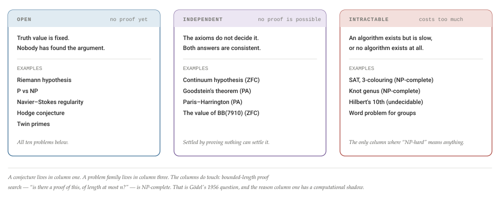
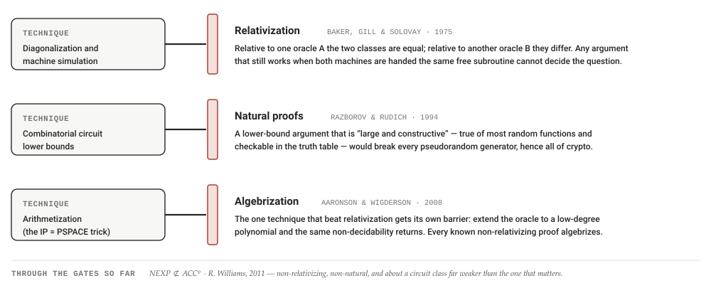
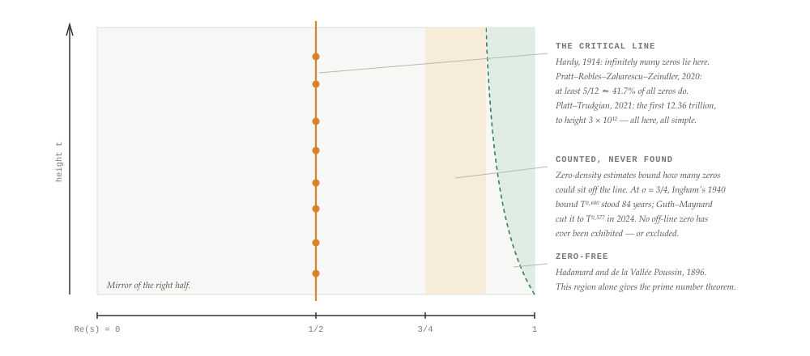
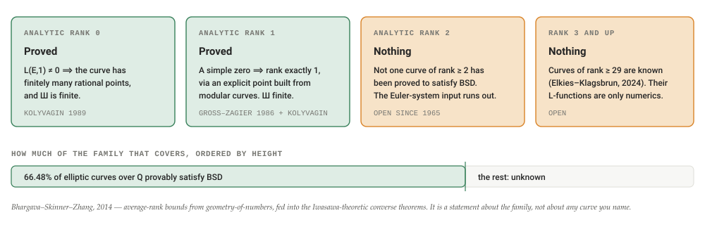
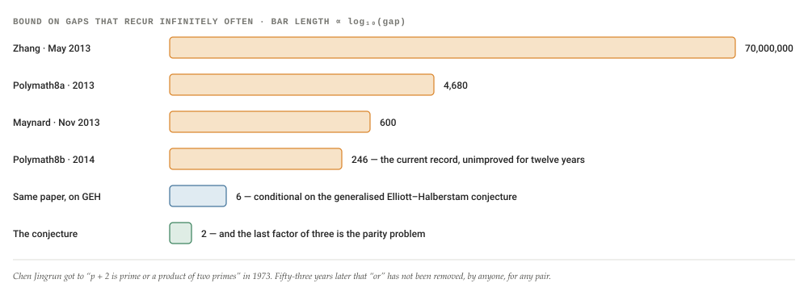
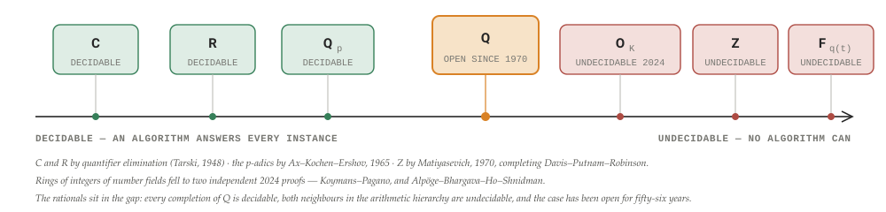
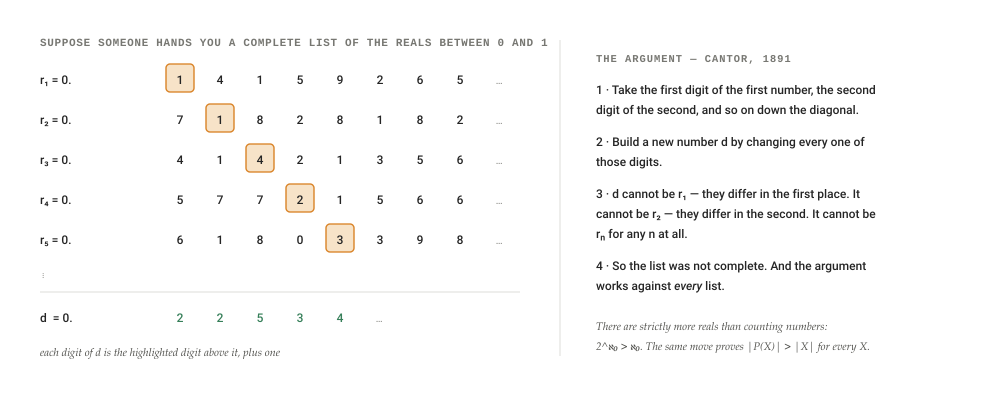
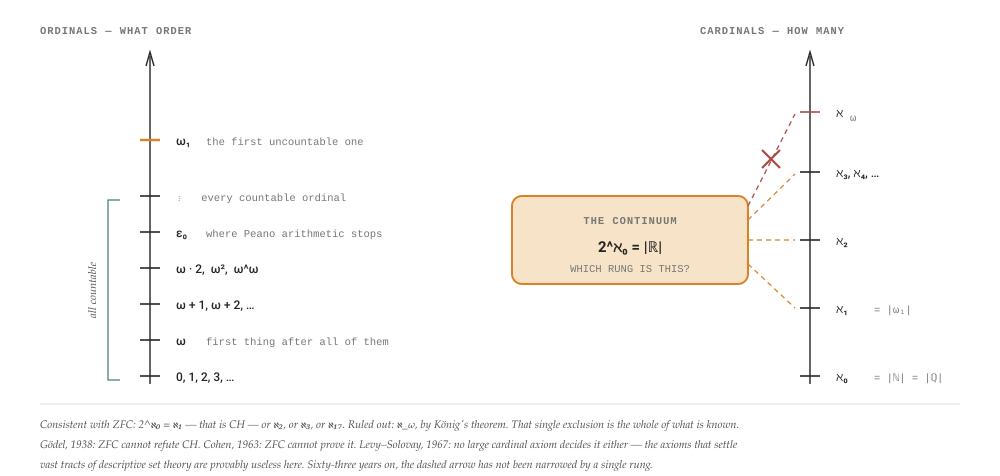

# The ten hardest open problems in mathematics

Ten problems, ranked by how much of mathematics moves when they move: P vs NP, the Riemann hypothesis, Navier–Stokes, Yang–Mills, Birch and Swinnerton-Dyer, Hodge, Langlands, twin primes and Goldbach, abc, and Collatz. What each one actually claims, what has actually been proved as of August 2026, and where the frontier now sits — plus the distinction the phrase “NP-hard” usually hides, the places where mathematics is provably NP-hard or undecidable, the four different kinds of infinity and why one of them cannot be measured, and a dated, checkable forecast of which of the ten falls first.

By **Suraj Sharma**, XO Labs · Notes. First published 21 August 2026 as *The ten hardest open problems in mathematics* in [sharmasuraj0123/writings](https://github.com/sharmasuraj0123/writings/tree/a5a356d418d45b63d34624b12ec3d7809167b309/hardest-problems).

Source: [`hardest-problems/index.html`](https://github.com/sharmasuraj0123/writings/blob/a5a356d418d45b63d34624b12ec3d7809167b309/hardest-problems/index.html) in [sharmasuraj0123/writings](https://github.com/sharmasuraj0123/writings) at `a5a356d`. Brought into this repo on 2026-10-15 with its text, tables and figures unchanged; only the format moved from HTML to Markdown.

## 01 · What “hard” means — and why the Riemann hypothesis is not NP-hard

Three different things get called hard, and they are not neighbours. A problem can be open, meaning nobody has found a proof. It can be independent, meaning no proof exists from the axioms you are using. Or it can be intractable, meaning the answer is perfectly well defined and the machine that finds it would outlive the sun.

The phrase “NP-hard” belongs to the third column and only to the third column. NP-hardness is a property of an infinite family of problems indexed by an input: given *this* graph, is it 3-colourable; given *this* formula, is it satisfiable. It measures how the cost of answering grows as the input grows. The Riemann hypothesis has no input. It is a single sentence, already true or already false, and the machine that prints the right answer runs in constant time — we simply do not know which of the two machines to build. Asking whether the Riemann hypothesis is NP-hard is a type error, in the same way that asking how many kilograms long a road is, is a type error.

But the instinct behind the question is exactly right, and the first person to write it down was Gödel. In a 1956 letter to von Neumann — lost for two decades, rediscovered in 1988 — he asks about a machine that, given a formula and a bound `n`, decides whether a proof of length `n` exists. The obvious method tries every candidate proof, which costs on the order of `2ⁿ` steps. Gödel asks whether the cost could instead be `n` or `n²`, and remarks that if it could, the consequences “would be of the greatest importance”: mathematical reasoning could be mechanised. That letter is P vs NP, fifteen years early, and its subject matter is precisely the search for proofs of theorems.

So the honest version of the question is this. No single conjecture is NP-hard. But *finding a proof of one* — bounded-length proof search — is the canonical NP-complete problem, and every entry on the list below is a bet that human search finds something that exhaustive search never will. If P = NP, nine of the ten entries stop being creative problems and become computations. That is why the first entry is P vs NP: it is not just the hardest problem on the list, it is the problem the list is made of.

**Figure 1. Three kinds of hard, and which column each famous problem is in**

The three columns answer different questions: *has anyone proved it*, *can anyone prove it*, and *what would it cost to compute it*. Nearly every popular article that calls the Riemann hypothesis “NP-hard” has slid from the first column to the third.

### Where the columns do touch

The first and second columns touch in a way worth stating, because it constrains what a resolution of the Riemann hypothesis could even look like. RH is a *Π₁* statement: it is equivalent to “for every `n`, some computable check passes.” Lagarias gave one such form in 2002 — RH holds if and only if the sum of divisors satisfies `σ(n) ≤ Hₙ + exp(Hₙ)·ln(Hₙ)` for every `n ≥ 1`, where `Hₙ` is the harmonic number. Matiyasevich earlier gave a Diophantine equation with the same property. Yedidia and Aaronson went the last mile in 2016 and compiled RH into a concrete Turing machine of 5,372 states that halts if and only if RH is false.

That has a consequence. If RH is false, a counterexample is a finite object, and any reasonable formal system can be handed it and made to verify the falsity. So RH cannot be independent of ZFC in the comfortable way the continuum hypothesis is — you cannot consistently add either answer. If someone proves RH undecidable in ZFC, they have thereby proved RH true, and merely shown that ZFC cannot say so. The same argument applies to Goldbach and to Collatz's no-divergent-orbit half. It does not apply to the twin prime conjecture, which is Π₂: “for every `n` there exists a larger twin pair” has no finite counterexample to exhibit.

> **The ranking, and what it is worth**
>
> Ten is a made-up number and any ranking of open problems is a judgment, not a measurement. Mine weighs four things: how much other mathematics collapses onto the problem if it falls; how long it has resisted people who were not fools; how far the current frontier sits from the actual statement; and whether there is a live research program or only a graveyard of attempts. Under those weights the seven Clay Millennium problems do not automatically outrank everything else — Langlands outranks Hodge on the first criterion and Collatz outranks nothing at all on it, but earns its place on the third.

## 02 · The scoreboard: ten problems on one page

Six of the ten carry a million-dollar Clay prize. One of them has a claimed proof its own field will not accept. One was posed by a schoolteacher and has consumed more amateur effort than the other nine combined. None has fallen.

The Clay Mathematics Institute posed seven Millennium Prize Problems in May 2000. Twenty-six years later, one is solved: the Poincaré conjecture, proved by Grigori Perelman in three arXiv preprints between 2002 and 2003. He declined the Fields Medal in 2006 and the million dollars in 2010. That is the entire hit rate of the most famous prize list in mathematics — one in seven, and the winner did not take the money.

**Figure 2. The ten, with the nearest thing each has to a measured frontier**

| \# | Problem | Posed | Prize | Status | The nearest hard number |
|----|----|----|----|----|----|
| 01 | P vs NP | 1971 | \$1M Clay | *\[open\]* | Best circuit lower bound for an explicit function: `(3 + 1/86)n − o(n)` ≈ 3.012*n* gates. |
| 02 | Riemann hypothesis | 1859 | \$1M Clay | *\[open\]* | At least 5/12 ≈ 41.7% of the zeros provably lie on the critical line; the first 10¹³ checked. |
| 03 | Navier–Stokes | 1934 | \$1M Clay | *\[open\]* | Any singular set has 1-dimensional parabolic Hausdorff measure zero (Caffarelli–Kohn–Nirenberg, 1982). |
| 04 | Yang–Mills mass gap | 1954 | \$1M Clay | *\[open\]* | The theory has been built rigorously in dimensions 2 and 3. The problem asks for dimension 4. |
| 05 | Birch–Swinnerton-Dyer | 1965 | \$1M Clay | *\[partial\]* | At least 66.48% of elliptic curves over **Q**, by height, satisfy it (Bhargava–Skinner–Zhang, 2014). |
| 06 | Hodge conjecture | 1950 | \$1M Clay | *\[open\]* | Known only for `p = 1` (Lefschetz, 1924) and scattered families. The integral version is false. |
| 07 | Langlands program | 1967 | — | *\[partial\]* | The geometric case was proved in 2024 in five papers of roughly 1,000 pages. |
| 08 | Twin primes, Goldbach | 1849, 1742 | — | *\[open\]* | Infinitely many prime pairs differ by at most 246 (Polymath8b, 2014). Target: 2. |
| 09 | abc conjecture | 1985 | IUT prizes | *\[disputed\]* | One published 500-page proof; one published objection; no consensus in 14 years. |
| 10 | Collatz | 1937 | — | *\[open\]* | Verified for every start below 2⁷¹ ≈ 2.4 × 10²¹ (Bařina, 2025). |

The ordering is mine and is argued in §01; the numbers are not. Read the last column as the answer to “what is the strongest true statement anyone can currently write down in the direction of the conjecture” — for four of the ten, that statement is still a computation rather than a theorem.

One pattern is worth naming before the dossiers start. These problems do not fall; their neighbours do. In the last three years the Kakeya set conjecture in three dimensions fell to Hong Wang and Joshua Zahl, the geometric Langlands conjecture fell to a nine-author collaboration, and Hilbert's tenth problem was settled over every ring of integers of a number field — twice, by two independent teams, within months. Each of those was a genuine fifty-year problem. None of them is on this list, because each was a problem the field knew how to attack. The ten below are the ones where the attack itself is missing.

## 03 · P vs NP — the problem that contains the others

Field

Complexity theory

Posed

Cook 1971, Levin 1973\
(Gödel, 1956)

Status

*\[open\]*

If it falls

Cryptography, optimisation, and proof search all change at once

Some problems are easy to check and appear hard to solve. A filled-in sudoku is checked in seconds; finding one takes work. P vs NP asks whether that appearance is real — whether there is any problem at all whose solutions can be verified quickly but not found quickly.

The formal shape: **P** is the class of decision problems a deterministic machine solves in time polynomial in the input length. **NP** is the class where a proposed solution can be *verified* in polynomial time. Every problem in P is in NP, because you can ignore the proposed solution and solve it yourself. The question is whether the containment is strict.

Cook proved in 1971 — and Levin independently in the Soviet Union by 1973 — that a single problem, Boolean satisfiability, is as hard as everything in NP: any NP problem can be re-encoded as a SAT instance in polynomial time. Karp's 1972 paper turned that from a curiosity into a map by showing 21 natural problems, from graph colouring to knapsack to Hamiltonian circuits, are all the same problem in disguise. Thousands more have joined since. They stand or fall together: a polynomial algorithm for any one of them is a polynomial algorithm for all of them, and P = NP.

### What is actually known

Very little, and the little that is known has mostly been about *why* so little is known. Three barrier theorems each eliminate a class of proof technique, and each was published after that technique's most celebrated success.

**Figure 3. Three barriers: the proof techniques that provably cannot settle P vs NP**

Each barrier arrived after the technique's best result, not before it. That is the honest reading of the field's position: we do not have a promising approach that is merely unfinished. We have a catalogue of approaches that are known not to reach.

Against those barriers, here is the frontier in plain numbers. For an explicitly defined Boolean function, the best proved lower bound on general circuit size is `(3 + 1/86)n − o(n)` gates — Find, Golovnev, Hirsch and Kulikov, 2016, improving Blum's `3n` from 1984 by about one part in ninety. Proving P ≠ NP requires a *superpolynomial* bound. The gap between 3.012*n* and `n^log n` is not a gap in degree; it is a gap in kind.

The two results people point to as real movement are both Ryan Williams'. In 2011 he proved `NEXP ⊄ ACC⁰`: some problem in nondeterministic exponential time cannot be computed by constant-depth circuits with modular counting gates. It is a narrow class, but the proof is non-relativizing, non-natural, and works by converting a faster-than-brute-force satisfiability algorithm into a lower bound — a template that has not run out. Then in 2025, in the STOC best paper, he proved that every multitape Turing machine running in time `t` can be simulated in space `O(√(t log t))`. The previous best, `t / log t`, had stood since Hopcroft, Paul and Valiant in 1975. A corollary is a genuine separation: there are explicit problems solvable in `O(n)` space that need more than `n^(2−ε)` time on a multitape machine, which is the first real progress in decades toward P ≠ PSPACE.

> **What the field believes**
>
> In Gasarch's third poll of complexity theorists, in 2019, about 88% expected P ≠ NP — up from 61% in 2002. Belief is not evidence, but the trend is informative: the more the barriers were understood, the more confident the field became about the answer and the less confident about the proof. Scott Aaronson's framing of the stakes has not been improved on: if P = NP, then “everyone who could appreciate a symphony would be Mozart; everyone who could follow a step-by-step argument would be Gauss.” Creative work would reduce to checking.

That is why this problem sits at the top and why the rest of this piece is downstream of it. The Riemann hypothesis has a proof or a counterexample; either is a finite string. The question of whether such strings can be *found* in time proportional to their length, rather than exponential in it, is P vs NP. Gödel asked it in a letter, the field made it precise fifteen years later, and fifty-five years after that the best anyone can prove about an explicit function is that it needs three gates per input bit.

## 04 · The Riemann hypothesis — where the primes actually live

Field

Analytic number theory

Posed

Riemann, 1859\
(eight pages, one aside)

Status

*\[open\]*

If it falls

Thousands of conditional theorems become unconditional

The primes look random up close and regular from far away. The Riemann hypothesis is the precise statement of how regular — it says the error in the prime count is as small as it could possibly be, and it says so by locating the zeros of a single function.

Start with `ζ(s) = 1 + 2⁻ˢ + 3⁻ˢ + 4⁻ˢ + …`, which converges when the real part of `s` exceeds 1. Riemann continued it analytically to the whole complex plane, found a functional equation relating `s` to `1 − s`, and observed that its zeros come in two kinds: the trivial ones at `−2, −4, −6, …`, and the interesting ones, all of which lie in the strip `0 < Re(s) < 1`. The hypothesis is one sentence: **every zero in that strip has real part exactly 1/2**.

The reason that sentence is about primes is the explicit formula. Riemann's own version, cleaned up by von Mangoldt, writes the weighted prime count as a main term minus one oscillating term per zero:

The explicit formula ψ(x) = x − Σ_(ρ) x^(ρ)/ρ − log 2π − ½ log(1 − x⁻²)

Each zero `ρ` contributes a wave whose amplitude grows like `x^Re(ρ)`. A zero at real part 1/2 contributes `√x`. A single zero at real part 0.6 would contribute `x^0.6`, and the primes would be measurably lumpier than anyone's model of them. So RH is exactly the claim that the primes are as evenly distributed as an arithmetic sequence can be. Schoenfeld made the equivalence explicit in 1976: RH holds if and only if `|π(x) − Li(x)| < (1/8π) √x log x` for every `x ≥ 2657`.

**Figure 4. The critical strip: what is proved, what is computed, and what is merely bounded**

The orange line is the hypothesis. Everything proved in 167 years amounts to: infinitely many zeros are on it, at least 41.7% of them are, thirteen trillion of them are, and the region near `Re(s) = 1` is empty. The strip between is controlled by counting arguments that have never produced a single off-line zero and have never excluded one either.

### The two live directions

The first is analytic and incremental. Guth and Maynard's 2024 zero-density theorem is the best recent example: they proved `N(σ,T) ≪ T^(30(1−σ)/13 + o(1))`, which at `σ = 3/4` replaces Ingham's exponent 0.600 with 0.577. That sounds like decimal-grinding until you see what it buys — asymptotics for the number of primes in intervals of length `x^(17/30 + o(1))`, improving Huxley's `x^(7/12)` from 1972. It does not approach RH; it makes the consequences people wanted from RH slightly less dependent on it. Tao's summary at the time was that this was the first improvement in the range near `σ = 3/4` in 84 years.

The second is structural, and it is the reason many people believe RH is true. The same hypothesis, stated for curves over finite fields, is a *theorem* — Weil proved it in 1948 and Deligne generalised it in 1974 as the last of the Weil conjectures. In that setting the zeros are eigenvalues of a genuine operator, Frobenius acting on cohomology, and the location of the zeros is forced by geometry. The Hilbert–Pólya programme asks for the same thing over the integers: an operator whose eigenvalues are the zeta zeros, so that reality of the spectrum forces them onto the line. No one has produced the operator, but the evidence that one exists is striking. In 1972 Montgomery computed the pair correlation of zeta zeros and Dyson recognised it, over tea, as the pair correlation of eigenvalues of large random Hermitian matrices. Odlyzko's later computations at height 10²⁰ matched the random-matrix prediction to several decimal places. The zeros behave like a spectrum. Nobody knows of what.

> **On claimed proofs**
>
> RH attracts more claimed proofs than any other problem here, including from serious mathematicians. Louis de Branges — who really did prove the Bieberbach conjecture in 1985 — has posted several. Michael Atiyah presented one at the Heidelberg Laureate Forum in 2018, five months before his death; it was five pages and was not accepted. The base rate matters when you read the next announcement: in 167 years, the number of claimed proofs that survived expert reading is zero.

## 05 · Navier–Stokes — smoothness, or a fluid that tears

Field

Partial differential equations

Posed

Equations 1822–45\
Leray's gap, 1934

Status

*\[open\]*

If it falls

Either turbulence has a mechanism, or our model of fluids has a hole

The equations of fluid motion have been written down for two centuries and are used every day to design aircraft. Nobody can prove that their solutions continue to exist.

The Clay problem is narrow and precise. Take the incompressible Navier–Stokes equations in three dimensions, on all of space or on a periodic box, with viscosity, no forcing, and smooth initial velocity of finite energy. Prove that a smooth solution exists for all time — or exhibit initial data for which it does not.

The equations ∂ₜu + (u · ∇)u = −∇p + ν Δu,    ∇ · u = 0

Leray proved in 1934 that *weak* solutions always exist — objects that satisfy the equations in an averaged sense. He could not prove they are unique or smooth, and neither can anyone since. The gap is not a technicality. A loss of smoothness means the velocity field goes infinite somewhere in finite time: the model fluid tears. Whether that can happen is the question.

### Why it resists: supercriticality

Tao's diagnosis is the clearest one available. Navier–Stokes has a scaling symmetry: if `u(t,x)` solves it, so does `λu(λ²t, λx)`. The quantity that is conserved — energy — is *weaker* under this rescaling than the quantity that controls smoothness. Zoom in on a potential singularity and the energy you are allowed to use shrinks while the nonlinearity you must control does not. Every proof technique that works by bounding a conserved quantity is therefore structurally short of what it needs, by a definite amount, at every scale. This is what “supercritical” means, and it is why the problem is not merely unsolved but resistant to the entire apparatus that solved the two-dimensional case in the 1960s.

Tao made the diagnosis sharp in 2016 by exhibiting an *averaged* Navier–Stokes equation — same energy identity, same scaling, nonlinearity rearranged — with solutions that blow up in finite time. The construction builds a fluid-flavoured logic gate and assembles a machine that pumps energy into ever-smaller scales ever faster. The message is a barrier theorem in the same spirit as those in §03: no proof of global regularity can rely on energy and scaling alone, because those two facts are consistent with blowup.

**Figure 5. The blowup ladder — every rung that has been climbed, and the one that has not**

- **2D Navier–Stokes**: Global regularity proved . Solutions stay smooth forever. Leray, Ladyzhenskaya — settled by the 1960s.
- **3D NS · weak solutions**: They always exist (Leray, 1934) — and they are not unique (Buckmaster–Vicol, Annals 2019). So weakness is not a route to the answer.
- **3D NS · partial regularity**: Any singular set has 1-dimensional parabolic Hausdorff measure zero (Caffarelli–Kohn–Nirenberg, 1982). A singularity, if one exists, is nearly invisible.
- **Averaged 3D NS**: Finite-time blowup proved (Tao, JAMS 2016). Same energy identity, same scaling — so no proof of regularity can use only those.
- **3D Euler · C 1,α data**: Finite-time blowup proved for axisymmetric flow without swirl (Elgindi, Annals 2021). No viscosity, and the data is rough.
- **3D Euler · smooth + boundary**: Finite-time blowup proved , computer-assisted, self-similar collapse at a boundary stagnation point (Chen–Hou, PNAS 2025 — from Luo–Hou's 2014 numerics).
- **3D NS · smooth, no boundary**: Open. This is the Clay problem, and it is the only rung with viscosity, smooth data, and no wall to focus the flow.

Read it downward: every weakening of the problem — fewer dimensions, rougher data, no viscosity, an averaged nonlinearity, a boundary to press against — has been settled. The last rung differs from the sixth by removing the wall and adding viscosity, and that is the whole remaining distance.

### The machines have arrived first

The most interesting recent development is methodological. For Navier–Stokes without a boundary, the expectation is that no *stable* singularity exists — which means a blowup, if there is one, cannot be found by running a simulation forward. Any numerical error pushes the flow off the blowup trajectory immediately. You have to solve for the self-similar profile directly, and the profile is an unstable solution of a nonlinear eigenvalue problem.

In September 2025 a team including Yongji Wang, Javier Gómez-Serrano and Tristan Buckmaster, working with Google DeepMind, reported the first systematic discovery of families of unstable self-similar singularities across three fluid equations — incompressible porous media, Boussinesq, and Euler with boundary — using physics-informed neural networks. A follow-up in late 2025 pushed the profiles to near machine precision, which is the threshold that matters: computer-assisted proofs of the Chen–Hou kind need residuals small enough to close an interval arithmetic argument. They also found an empirical pattern — the blowup rate λ falls on a clean line against the order of instability — which is the sort of structure that suggests a theorem rather than a coincidence.

None of this touches the Clay problem yet. Every proved blowup so far is for Euler, or for rough data, or with a boundary, or for a modified equation. But for the first time the search for a counterexample is a systematic engineering programme rather than a hope, and it is one of the few places on this list where machine learning has produced mathematics that a proof can be built on rather than a plausible guess.

## 06 · Yang–Mills — a theory nobody has built, a gap nobody can prove

Field

Constructive quantum field theory

Posed

Yang & Mills 1954\
Clay statement 2000

Status

*\[open\]*

If it falls

The strong force acquires a mathematical existence proof

This is the strangest entry on the list, because the object whose properties are in question has never been shown to exist. Physicists have computed with quantum Yang–Mills theory for fifty years and matched experiment to a few percent. Mathematicians cannot yet say what it is that they are computing with.

The problem, as stated by Jaffe and Witten for Clay, has two halves. First, **existence**: for any compact simple gauge group — SU(3), say, the group of the strong interaction — construct a quantum Yang–Mills theory on four-dimensional spacetime satisfying the standard axioms of quantum field theory. Second, **the mass gap**: prove that the theory's lowest excitation above the vacuum has strictly positive mass `Δ > 0`.

The physical content of the second half is the reason the strong force is short-ranged. Its force carriers, the gluons, are massless in the classical theory, exactly as photons are. Massless carriers should give a long-range force, like electromagnetism. The strong force stops at about a femtometre. The quantum theory must therefore generate a mass scale out of nothing but its own self-interaction — and lattice simulations agree, putting the lightest glueball in pure SU(3) at roughly 1.6 GeV. Deriving that number from the theory rather than measuring it in a simulation is the problem.

**Figure 6. Constructive field theory by dimension: where the machinery stops**

- **d = 2 · Yang–Mills**: Constructed. The 2D measure is essentially explicit — Driver, Sengupta, Lévy — and its Langevin dynamic was built rigorously by Chandra, Chevyrev, Hairer and Shen (Publ. IHÉS, 2022).
- **d = 3 · Yang–Mills(–Higgs)**: Constructed by stochastic quantisation, using Hairer's regularity structures. The state space, gauge-invariant observables and the flow all exist as mathematics.
- **d = 4 · φ⁴ scalar theory**: Constructed — and trivial. The continuum limit is a free field (Aizenman 1981, Fröhlich 1982; the marginal 4D case closed by Aizenman–Duminil-Copin, Annals 2021). Existence alone is not the prize.
- **d = 4 · Yang–Mills**: Open. Expected to survive the continuum limit non-trivially because it is asymptotically free (Gross, Wilczek, Politzer, 1973) — but asymptotic freedom is a physics argument, not a construction.

The φ⁴ row is the cautionary one. A four-dimensional theory can be built and turn out to be nothing — the interaction vanishes in the limit. Any Yang–Mills construction has to produce a theory *and* prove it did not evaporate, then find a gap in what remains.

Progress is real but is happening one dimension below the target. The stochastic quantisation programme — Chandra, Chevyrev, Hairer and Shen — treats the Yang–Mills measure as the invariant distribution of a singular stochastic PDE and constructs it by controlling that flow. It works in two and three dimensions. Extending it to four is an active research direction and nobody claims to see the end of it. Sourav Chatterjee's parallel line of work attacks the lattice theory directly, where the mass gap is provable at strong coupling; the difficulty is that the continuum limit lives at weak coupling, and the gap has to survive the trip.

> **A note on the preprint traffic**
>
> Yang–Mills attracts claimed solutions at a rate second only to RH — the arXiv has several, including recent ones asserting a full construction of SU(3) with a positive gap. None has been accepted by the constructive field theory community, and the community is small enough that acceptance would be visible immediately. Treat any such claim as unrefereed until people like Chevyrev, Hairer or Chatterjee say otherwise.

## 07 · Birch and Swinnerton-Dyer — rational points from an L-function

Field

Arithmetic geometry

Posed

Birch & Swinnerton-Dyer,\
1960s, on EDSAC 2

Status

*\[partial\]*

If it falls

Rational points on curves become computable

An elliptic curve is the equation `y² = x³ + ax + b`. Its rational solutions form a group. The conjecture says you can read the size of that group off a completely different object — an analytic function built from counting solutions modulo every prime.

Mordell proved in 1922 that the rational points form a finitely generated abelian group: `E(Q) ≅ Zʳ × (finite torsion)`. The torsion is easy — Mazur classified every possibility in 1977. The integer `r`, the **rank**, is the number of independent rational points of infinite order, and it is the hard part. There is no proven algorithm that computes it. Not a slow one; none.

Birch and Swinnerton-Dyer went looking for one on the EDSAC 2 at Cambridge in the early 1960s — this is one of the first conjectures in history discovered by computer experiment. They counted points modulo each prime `p`, formed the products `∏(Nₚ/p)` for primes up to `X`, and saw them grow like `(log X)ʳ`. Curves with more rational points had more points modulo `p`, on average, by an amount that tracked the rank exactly. Packaged properly, that observation is the conjecture:

The conjecture, weak form ord_(s=1) L(E, s) = rank E(**Q**)

There is a strong form too, which predicts the leading Taylor coefficient exactly, in terms of the real period, the regulator, the Tamagawa numbers, the torsion, and the order of the Tate–Shafarevich group Ш — a group nobody has proved is even finite in general. Note also that stating the conjecture requires `L(E,s)` to make sense at `s = 1`, which is outside its region of convergence. That analytic continuation is a consequence of modularity — Wiles for semistable curves in 1995, Breuil, Conrad, Diamond and Taylor for all of them in 2001. The conjecture became fully well-posed thirty-six years after it was made.

**Figure 7. BSD by rank: two columns proved, the rest untouched**

Two thirds of all elliptic curves satisfy the conjecture, and yet the conjecture is not close to proved — because the two thirds are exactly the curves whose L-function vanishes to order 0 or 1, and every known technique for producing rational points from an L-function produces one point at a time.

The machinery behind the two green columns is worth naming, since it is the template for “analysis controls arithmetic” results everywhere. Gross and Zagier computed the derivative `L′(E,1)` and found it equal, up to explicit factors, to the height of a specific point constructed on a modular curve — a Heegner point. So a simple zero *produces* a rational point of infinite order. Kolyvagin then showed that this one point controls everything: if it is non-torsion, the rank is exactly 1 and Ш is finite. That is an Euler system, and Euler systems are built to handle one order of vanishing. At order 2 there is no known construction that produces two independent points, and that is the entire reason the third column is empty.

## 08 · The Hodge conjecture — the one nobody knows how to believe

Field

Algebraic geometry

Posed

W. V. D. Hodge,\
ICM 1950

Status

*\[open\]*

If it falls

Topology would determine algebraic structure — or, if it fails, it would not

Take a shape cut out by polynomial equations. Some of its holes are traced by smaller shapes that are themselves cut out by polynomials; others are only topological. The Hodge conjecture says you can tell which is which by looking at a linear-algebraic invariant — and that there are no holes of the second kind masquerading as the first.

Precisely: let `X` be a smooth projective complex variety. Hodge theory splits its cohomology into pieces `H^(p,q)` indexed by how many holomorphic and antiholomorphic differentials they involve. Every algebraic subvariety of codimension `p` defines a class living in the piece `H^(p,p)`. The conjecture is the converse: every rational class in `H^(p,p)` is a rational linear combination of classes of algebraic subvarieties.

The case `p = 1` is a theorem, and it predates the conjecture — Lefschetz proved it in 1924 using the exponential sequence, which is why divisors are well understood and nothing else is. Dimension three and below follows by duality. Beyond that: scattered families, partial results for abelian varieties, and no general method.

What makes this entry different from the others is that the evidence points in two directions. The integral version of the conjecture — the same statement with integer rather than rational coefficients — is *false*, shown by Atiyah and Hirzebruch in 1962, with Kollár's 1992 examples confirming that the failure is ordinary rather than exotic. And in 2002 Claire Voisin constructed a compact Kähler manifold with a rational `(p,p)` class that is not a combination of Chern classes of coherent sheaves — killing the natural Kähler generalisation outright. So any proof must use projectivity in an essential way, and the two closest relatives of the statement are known to be wrong.

> **Epistemic status**
>
> This is the entry with the least belief behind it. Deligne, who wrote the official problem description for Clay, is unusually careful to frame it as a working hypothesis rather than a prediction: it organises a great deal of thinking, and the honest position is that there is no strong reason to expect it true beyond the cases already proved. It stays high on this list not because it is likely to be resolved but because resolving it in either direction would reshape how algebraic cycles are understood.

## 09 · The Langlands program — the one that keeps paying out

Field

Number theory, representation theory

Posed

Langlands to Weil,\
a 17-page letter, 1967

Status

*\[partial\]*

If it falls

It has been falling, in pieces, for fifty years — each piece a Fields Medal

This is not a conjecture; it is a translation manual between two branches of mathematics that have no business being related. On one side, symmetries of number systems — Galois groups. On the other, functions with enormous symmetry groups of their own — automorphic forms. Langlands proposed that each object on one side has a partner on the other, matched by their L-functions.

The letter is famous partly for its cover note. Langlands sent seventeen handwritten pages to André Weil in January 1967 and added: “If you are willing to read it as pure speculation I would appreciate that; if not — I am sure you have a waste basket handy.”

The reason it belongs on a list of hardest problems, despite being partly proved, is that it subsumes many of the others. Fermat's Last Theorem is a corollary of one instance: Wiles proved that elliptic curves over **Q** are modular — that is, each has an automorphic partner — and Fermat follows. The Birch and Swinnerton-Dyer conjecture in §07 cannot even be *stated* without that same modularity result. Generalised Riemann hypotheses are statements about automorphic L-functions. Langlands is the frame the rest of the picture hangs in.

**Figure 8. Langlands, case by case: six wins and the one that matters most**

- **Abelian case**: Proved — class field theory. Takagi, Artin, 1920s. The whole program is the non-abelian generalisation of this one theorem.
- **GL(2) over Q**: Proved for elliptic curves. Wiles 1995 (semistable); Breuil–Conrad–Diamond–Taylor 2001 (all). Fermat's Last Theorem is a corollary.
- **GL(n), function fields**: Proved. Drinfeld for GL(2) (Fields Medal 1990), Laurent Lafforgue for all n (Fields Medal 2002).
- **The fundamental lemma**: Proved. Ngô Bảo Châu, 2008 — a technical identity that had blocked the trace-formula approach for twenty years (Fields Medal 2010).
- **Local, p-adic**: Geometrised. Fargues–Scholze, 2021 — local Langlands recast as a statement about sheaves on a moduli space over the Fargues–Fontaine curve.
- **Geometric Langlands**: Proved, 2024. Gaitsgory, Raskin and seven co-authors: five papers, roughly 1,000 pages, thirty years after the conjecture was formulated.
- **Global functoriality**: Open, and the real prize. The general transfer of automorphic forms between groups over number fields. Everything above is a special case or an analogue.

Six green rows in sixty years is an extraordinary rate for a problem of this size — and the orange row is still the whole conjecture. The pattern is instructive: every win came from changing the setting (function fields instead of number fields, sheaves instead of functions) until the statement became geometric enough to attack.

The 2024 geometric proof is the largest single event on this list in the last decade, and it illustrates the pattern exactly. In the geometric setting, the Galois side becomes local systems on a Riemann surface and the automorphic side becomes sheaves on a moduli space of bundles. The conjecture becomes an equivalence of categories, which is a kind of statement that modern homotopy theory has tools for. Gaitsgory and Raskin's team spent thirty years building those tools, and the write-up runs to about a thousand pages across five papers. Nothing in it proves the arithmetic case. But the geometric case is where the arithmetic case's proof techniques have historically been prototyped, which is why the number theorists read it.

## 10 · Twin primes and Goldbach — the tractable-looking ones

Field

Analytic number theory

Posed

Goldbach 1742,\
de Polignac 1849

Status

*\[open\]*

If it falls

The parity barrier in sieve theory would have been broken

Two statements a child can understand. Every even number above two is a sum of two primes. There are infinitely many pairs of primes two apart. Both have been checked into the quintillions. Neither is proved, and the reason is the same in both cases.

The reason has a name: the **parity problem**. Sieve methods — the main technology of prime detection since Brun — work by crossing out multiples and estimating what survives. Selberg observed that they are structurally blind to a distinction that matters: they cannot tell a number with an odd number of prime factors from one with an even number. A prime has one factor; a product of two primes has two. To a sieve those look nearly the same, and the error terms swallow the difference. This is why Chen's 1973 theorem — infinitely many primes `p` such that `p + 2` is prime *or a product of two primes* — has stood for fifty years as the closest anyone gets. That “or” is the parity problem, printed in the statement.

### What Zhang's 2013 result actually did

Yitang Zhang did not defeat the parity problem. He sidestepped it. The trick is to stop asking about a specific pair. Take a carefully chosen set of shifts `{h₁, …, h_k}` and ask for infinitely many `n` such that *at least two* of `n + h₁, …, n + h_k` are prime. That question is reachable by sieve methods, because it does not require identifying which two. It yields a bound on how far apart two primes can be forced to be, and the bound is whatever the width of the shift set is.

Zhang's set gave 70 million. Within eight months the number had fallen by five orders of magnitude, in the most public optimisation exercise in modern mathematics.

**Figure 9. Eight months of descent: the bound on infinitely-recurring prime gaps**

The collapse from 70,000,000 to 246 took eight months and looks like the problem falling. It is not: every one of those steps optimises the same sieve, and the sieve has a floor. Under the strongest conjectured input the method reaches 6 and stops. The step from 6 to 2 needs a different idea.

Goldbach is in the same position from the other side. Vinogradov proved in 1937 that every sufficiently large odd number is a sum of three primes; Helfgott closed the gap to every odd number above 5 in 2013, in a proof of about three hundred pages that experts accept and that has spent an extraordinary time in review. The binary statement — every even number as a sum of *two* primes — is a parity-problem statement, and it has been verified by computer up to 4 × 10¹⁸ without a hint of a method.

## 11 · The abc conjecture — a proof, and no consensus

Field

Diophantine number theory

Posed

Oesterlé 1985,\
Masser 1985

Status

*\[disputed\]*

If it falls

A long list of Diophantine conjectures becomes a corollary

Addition and multiplication are not supposed to cooperate. The abc conjecture makes that precise, and it implies so much of Diophantine number theory that it is the closest thing the subject has to a master key.

Write `rad(n)` for the product of the distinct primes dividing `n`: `rad(72) = rad(2³ · 3²) = 6`. Now take coprime positive integers with `a + b = c`. The conjecture says that for every `ε > 0`, all but finitely many such triples satisfy `c < rad(abc)^(1+ε)`. In words: you cannot have `a`, `b` and `c` all built from small primes to high powers, except rarely. The multiplicative structure of two numbers constrains the multiplicative structure of their sum.

The payoff is the reason it is famous. Fermat's Last Theorem for large exponents follows in a few lines. So do Szpiro's conjecture, Roth's theorem, the Fermat–Catalan conjecture, the infinitude of non-Wieferich primes, and — via a reduction of Elkies — an effective form of Mordell's conjecture, which is to say effective finiteness of rational points on curves of genus at least 2. A proof of abc would collapse a chapter of number theory into a corollary list.

### What happened, in order

In August 2012 Shinichi Mochizuki posted four papers totalling about five hundred pages, developing what he calls inter-universal Teichmüller theory, and deriving abc from it. He had built the theory alone over roughly two decades, in a private vocabulary, and he declined to travel to explain it. Years passed with almost nobody able to report an understanding of the central argument.

In March 2018 Peter Scholze and Jakob Stix spent a week in Kyoto with Mochizuki and then wrote a short report, *Why abc is still a conjecture*, locating a specific gap at Corollary 3.12 — a place where, on their reading, an identification of two copies of an object destroys the very quantitative content the argument needs. Mochizuki published a detailed rebuttal asserting they had misunderstood the setup. Neither side moved. In 2021 the papers were published in PRIMS, the journal of Mochizuki's own institute, where he serves as chief editor.

Since then: a private donor established prizes for work on the theory, including a large one for a paper that decisively identifies a flaw. Kirti Joshi has posted a series of preprints claiming to build a corrected framework and, on that basis, to establish abc; Mochizuki has published rebuttals rejecting them too. As of August 2026 the situation is unchanged in substance: **abc is a theorem in Kyoto and a conjecture everywhere else**, and no third party has publicly reconstructed the disputed step in either direction.

> **Why this one is on the list**
>
> Not because the mathematics is the hardest — it may or may not be — but because it is the field's live experiment in what a proof is. A proof is a social object as well as a formal one: it is a text that competent readers can check. A 500-page argument in a private vocabulary that its author will not translate has not failed to be correct; it has failed to be checkable. This is also the strongest argument on this list for formalisation. Lean or Rocq would not care about vocabulary — a machine-checked IUT would end the dispute in one direction or the other.

## 12 · Collatz — the problem mathematics is not ripe for

Field

Arithmetic dynamics

Posed

Lothar Collatz, 1937

Status

*\[open\]*

If it falls

A technique would exist for orbits with no invariant

Take a whole number. If it is even, halve it. If it is odd, triple it and add one. Repeat. The conjecture is that you always reach 1. That is the entire statement, and it is the reason this problem is dangerous: it is the one on this list that a bright teenager can fully understand in thirty seconds and then lose a decade to.

Erdős's assessment is the standard citation and remains accurate: “Mathematics is not yet ripe for such problems.” He offered \$500.

The heuristic argument for truth is easy and worth doing, because it shows exactly what is missing. Follow an odd number `n`: it becomes `3n + 1`, which is even, so the next step halves it. Model the orbit as a random walk in which each step multiplies by `3/2` or by `1/2` with equal probability. The geometric mean per step is `√(3)/2 ≈ 0.866`. Orbits shrink by about 13% per step on average, so they should all fall to 1, and there should be no cycles and no escapes to infinity. The problem is that Collatz orbits are not random — they are completely determined — and no one can convert the statistics into a statement about every individual `n`.

### The state of the art

Computation has verified every starting value below `2⁷¹ ≈ 2.4 × 10²¹` — David Bařina's 2025 result in the Journal of Supercomputing, run on European supercomputers with a GPU implementation about 1,300 times faster than the naive CPU approach. Krasikov and Lagarias proved that the number of `n ≤ x` that do reach 1 is at least on the order of `x^0.84`.

The strongest theoretical result is Tao's, from 2019: almost all Collatz orbits attain almost bounded values. Precisely — for any function `f` tending to infinity, however slowly, almost all `n` in the sense of logarithmic density have an orbit that dips below `f(n)`. Tao's own description is that this is about as close as one can get to the conjecture without solving it. It still permits a sparse set of exceptional starting values that escape or cycle forever, and “sparse” is not “empty”.

> **The undecidability shadow**
>
> Conway showed in 1972 that the natural generalisation — maps that send `n` to `aᵢn + bᵢ` depending on `n mod k` — is Turing complete; his FRACTRAN language is built from exactly these. Kurtz and Simon later sharpened this: the generalised Collatz problem is Π⁰₂-complete, which is a level of unsolvability *above* the halting problem. So the family Collatz sits in is undecidable, and no method can settle every member. Collatz itself is one member, and a single member of an undecidable family can still be perfectly provable. But it explains why every general technique has failed: a general technique would decide the undecidable.

## 13 · Where mathematics really is NP-hard — and where it is worse

Now the version of the original question that does have answers. There are mathematical problems — real families of them, with inputs — that are provably NP-hard. There are others where no algorithm exists at all. And there are statements that are neither true nor false relative to the axioms we use. Each of these is a different, sharper kind of hard than “open”.

### Undecidable: no algorithm exists

Hilbert's tenth problem, from the 1900 list, asked for a procedure to decide whether a polynomial equation with integer coefficients has an integer solution. The answer, completed by Matiyasevich in 1970 on the back of two decades of work by Davis, Putnam and Julia Robinson, is that no such procedure exists. The proof shows something stronger and stranger: the sets of integers definable by Diophantine equations are exactly the computably enumerable sets. Every program's halting behaviour can be encoded as a polynomial. Number theory contains a general-purpose computer.

Change the ring and the answer changes, and where it changes is one of the most striking pictures in logic.

**Figure 10. “Does this polynomial equation have a solution?” — decidable on the left, impossible on the right**

Note where the wall falls. Over the reals you can decide any polynomial system mechanically; over the integers you cannot decide a single equation. The same question, two number systems apart, moves from a solved algorithm to a proved impossibility — and the rationals, the most natural setting of all, are still unclassified.

The 2024 result is the freshest entry on that spectrum and a good example of how these things actually get done. To prove undecidability over a ring of integers `O_K`, it is enough to show **Z** is Diophantine in `O_K` — that you can pin down the ordinary integers by an equation. Both teams got there through elliptic curves: find a curve whose rank does not grow when you pass from `K` to the extension, and the rank rigidity gives you the definition. Koymans and Pagano used curves with full rational 2-torsion and 2-Selmer groups combined with additive combinatorics; Alpöge, Bhargava, Ho and Shnidman used Selmer groups of hyperelliptic Jacobians. A hundred-year-old logic problem was closed by arithmetic geometry, twice, in the same year.

Undecidability is not confined to number theory. The word problem for finitely presented groups — given two words, do they denote the same element — is undecidable (Novikov 1955, Boone 1958). So is recognising whether a presentation defines the trivial group, and whether two 4-manifolds are homeomorphic (Markov, 1958), and whether a given finite set of tiles can tile the plane (Berger, 1966). In each case the proof is the same shape: the structure is rich enough to simulate a Turing machine, so deciding it would decide halting.

### NP-hard: an algorithm exists and you cannot afford it

Between “decidable” and “undecidable” sits the complexity question, and here are the genuine NP-hardness results a mathematician actually meets.

- **Knot genus is NP-complete.** Given a knot in a 3-manifold and an integer `g`, deciding whether it bounds a surface of genus at most `g` is NP-complete — Agol, Hass and Thurston. A geometric question about surfaces, exactly as hard as satisfiability.
- **Unknot recognition is in NP ∩ co-NP.** Hass, Lagarias and Pippenger put it in NP in 1999; Lackenby proved it is in co-NP in 2021, unconditionally, after Kuperberg's 2011 conditional version. So it is almost certainly *not* NP-complete — and it is still not known to be in P. Deciding whether a tangled loop is secretly a circle sits in one of complexity theory's most interesting gaps.
- **Presburger arithmetic is decidable and unusable.** The theory of the integers with addition but no multiplication has a decision procedure, and Fischer and Rabin proved in 1974 that any such procedure needs doubly-exponential time. Decidability is not the same as tractability, and this is the cleanest example.
- **3-manifold homeomorphism is decidable** — a consequence of geometrisation, so of Perelman — by an algorithm no one would ever run.

### Independent: the axioms do not decide

Hilbert's first problem was the continuum hypothesis: is there a set strictly larger than the integers and strictly smaller than the reals? Gödel showed in 1940 that “no” is consistent with ZFC; Cohen invented forcing in 1963 to show “yes” is too. The problem was not solved; it was dissolved, and Cohen received the only Fields Medal ever awarded for logic. Later came arithmetic examples — the Paris–Harrington theorem in 1977 and Goodstein's theorem, both true statements about the natural numbers that Peano arithmetic cannot prove.

The modern version of this is beautifully concrete. Yedidia and Aaronson compiled mathematics into Turing machines in 2016: a 7,910-state machine whose halting behaviour is independent of ZFC (later trimmed by others to well under a thousand states), a 5,372-state machine that halts if and only if the Riemann hypothesis is false, and a 4,888-state one for Goldbach. That gives an exact, if useless, boundary: knowing the busy-beaver value BB(5,372) would settle the Riemann hypothesis, and BB(7,910) is a specific integer that ZFC cannot determine. For scale, the bbchallenge collaboration proved BB(5) = 47,176,870 in July 2024 and formalised the proof in Rocq — deciding the behaviour of about a hundred million five-state machines. Five states took a two-year distributed effort. The Riemann hypothesis is at 5,372.

> **The through-line**
>
> Gödel's 1956 letter asked how long a machine needs to find a proof of length `n`. Seventy years later we have the full picture of why that question is the hard one: bounded proof search is NP-complete, unbounded proof search is undecidable, and some statements have no proof at either bound. The ten problems in this piece are what remains when you subtract all three kinds of impossibility and are left with statements that are simply, stubbornly, unproved.

## 14 · Infinity — how many there are, and which ones are numbers

The continuum hypothesis appeared in §13 as the standard example of a question the axioms do not decide. It deserves more than a mention, because the thing it is about is not one thing. Mathematics uses at least four different kinds of infinite object, they obey four different arithmetics, and running them together is the most common error in popular accounts of any problem on this list.

### Counting past the end

Galileo noticed the trouble in 1638. Every whole number has a square, and every square is a whole number, so the squares can be matched one-to-one with the numbers they came from — even though the squares are visibly sparser. He concluded that “equal”, “greater” and “less” simply do not apply to infinite collections and moved on.

Cantor's move, two and a half centuries later, was to keep the matching and throw away the intuition: two sets have the same size *by definition* when a one-to-one correspondence exists between them. Then he followed the definition wherever it went. The integers, the even numbers, the primes and the rationals all turn out to have the same size, called `ℵ₀` — you can list the rationals in a zig-zag through the grid of numerators and denominators, and a list is exactly a correspondence with the counting numbers. So do the algebraic numbers, every root of every polynomial with integer coefficients.

And then the reals do not.

**Figure 11. The diagonal argument: why no list can hold every real number**

Half a page, no machinery, and it does not merely defeat this list — it defeats any list you can propose, which is what makes it a proof rather than an observation. The same argument applied to power sets gives an endless tower of infinities, each strictly larger than the last, with no top.

One corollary is worth stating because it is the earliest example of a proof that establishes something about almost every object while exhibiting none of them. Liouville worked hard in 1844 to construct a single transcendental number. Thirty years later Cantor showed that the algebraic numbers are countable and the reals are not, so *almost all* reals are transcendental — the exceptions form a set of size `ℵ₀` inside a set of size `2^ℵ₀`. His proof names no transcendental number at all, and it is still easier than proving that any particular number is one. Whether `e + π` is transcendental is open today.

### Two ladders, not one

The second confusion to clear is that “infinite number” means two different things, and mathematics keeps both. An **ordinal** answers *in what order*; a **cardinal** answers *how many*. For finite sets the two coincide, which is why the distinction feels invented. Past `ℵ₀` they separate immediately.

Count 0, 1, 2, 3, … and then keep going: the first thing after all of them is `ω`, then `ω + 1`, then `ω · 2`, then `ω²`, then `ω^ω`, then the limit of that tower, called `ε₀`. Every one of those is still *countable* — each is just a different way of arranging `ℵ₀`-many things in a row. Ordinal arithmetic is not commutative and this is where you see it: `1 + ω = ω`, because one extra item at the front of an infinite queue changes nothing, while `ω + 1 ≠ ω`, because an item at the *end* creates a last element the original queue never had.

This is not set-theoretic ornament. The ordinal `ε₀` is exactly where Peano arithmetic runs out: Gentzen proved in 1936 that PA is consistent, using transfinite induction up to `ε₀` and nothing stronger, and Gödel's second theorem then tells you PA cannot climb that far itself. Goodstein's theorem — the arithmetic statement from §13 that is true but unprovable in PA — is proved in three lines by assigning ordinals below `ε₀` to the terms of the sequence and observing they strictly decrease. Which countable ordinal a theory can climb to is a measurement of its strength, and it is one of the few genuinely quantitative facts in logic.

**Figure 12. The two ladders, and the rung nobody can locate**

Left ladder: order types, every rung below `ω₁` countable. Right ladder: sizes. The continuum is a specific set of a specific size, and the question of which rung it lands on is not hard in the sense of the other sixteen sections — it is a question the axioms decline to answer.

### The gap nobody can close

Cantor's own conjecture, from 1878, is that there is nothing between: every infinite set of reals is either countable or the size of the whole line, so `2^ℵ₀ = ℵ₁`. He worked on it for the rest of his life. Hilbert put it first on his 1900 list. The answer arrived in two halves, thirty years apart, and neither half is an answer.

Gödel showed in 1938 that if ZFC is consistent, so is ZFC plus CH — he built the constructible universe **L**, an inner model where CH holds, so no proof can refute it. Cohen invented forcing in 1963 to build models where CH fails, so no proof can establish it. CH is *independent*. Cohen received the only Fields Medal ever given for mathematical logic.

What is actually known about the size of the continuum is almost nothing, and it is worth being precise about how little. König's theorem forces the cofinality of `2^ℵ₀` to be uncountable, which rules out `ℵ_ω`. Easton proved in 1970 that apart from monotonicity and that single cofinality constraint, the continuum function on regular cardinals can be set essentially arbitrarily by forcing. So: one nontrivial restriction, and freedom everywhere else.

The interesting part is what happened next, because it is a live argument about whether independence is the end of the discussion. The standard way to settle a question ZFC cannot reach is to add a large cardinal axiom — inaccessible, measurable, Woodin, supercompact — and these are enormously productive: they settle projective determinacy and with it most of the structure theory of definable sets of reals. They cannot settle CH. Levy and Solovay proved in 1967 that large cardinals survive the small forcings used to move the continuum, so any large cardinal consistent with CH is consistent with its negation. The most powerful axioms anyone has found are provably silent on the first question anyone asked.

Hugh Woodin has spent thirty years on the problem from two opposite directions, which is itself the best summary of the state of play. Through the 2000s he developed Ω-logic and argued from it that the continuum should be `ℵ₂` — that CH is false. Around 2010 he shifted to the Ultimate-**L** programme, searching for an inner model compatible with all large cardinals; if the axiom `V = Ultimate-L` holds, CH is true. Both are research programmes resting on unproved conjectures, and the man who understands the question best has argued both sides of it in one career.

### The infinities that are not sizes

Everything above is about cardinality. At least four other objects wear the same symbol and are not cardinals at all.

**Figure 13. A field guide to things called infinity**

| Object | Kind | A rule that holds for it | What it is for |
|----|----|----|----|
| ℵ₀ | Cardinal | `ℵ₀ + ℵ₀ = ℵ₀ · ℵ₀ = ℵ₀` | The size of any set you can list: ℕ, ℤ, ℚ, the algebraic numbers. |
| 2^(ℵ₀) | Cardinal | `2^ℵ₀ > ℵ₀`, and its cofinality is uncountable | The size of the real line. Which ℵ it equals is independent of ZFC. |
| ω | Ordinal | `1 + ω = ω` but `ω + 1 ≠ ω` | Order type of the counting numbers. Addition is not commutative up here. |
| ε₀ | Ordinal | `ε₀ = ω^ε₀`, and it is countable | The proof-theoretic strength of Peano arithmetic — Gentzen, 1936. |
| ω₁ | Ordinal / cardinal | Every ordinal below it is countable; it is not | The first uncountable ordinal; as a cardinal it is ℵ₁. |
| κ inaccessible | Large cardinal | ZFC cannot prove one exists | Grothendieck universes — the foundation the algebraic geometry of §07 and §09 is usually written in. |
| ε \> 0 infinitesimal | Hyperreal | `0 < ε < 1/n` for every natural *n* | Robinson's non-standard analysis, 1966 — Leibniz's calculus, made rigorous. |
| 1/ω, √ω, ω − 1 | Surreal | They form an ordered Field containing ℝ *and* every ordinal | Conway, 1974 — where ordinal arithmetic's asymmetries disappear and division works. |
| ∞ (projective) | A point | `1/0 = ∞` is legal there | One extra point that closes the plane into the Riemann sphere. |
| ±∞ (extended line) | Two symbols | `∞ − ∞` stays undefined | Measure theory and optimisation, where you want limits to have somewhere to land. |
| “→ ∞” | Not an object | Expands to “for every N there is an x with …” | Nothing infinite is involved. Weierstrass removed it from analysis with ε and δ. |

Eleven rows, four incompatible arithmetics. `ω + 1 ≠ ω` while `ℵ₀ + 1 = ℵ₀`; `1/ω` is meaningless for ordinals and perfectly ordinary for surreals; and the infinity in “tends to infinity” is a quantifier wearing a costume.

> **Where this touches the rest of the list**
>
> The inaccessible-cardinal row is not a curiosity. Grothendieck built his algebraic geometry on universes, whose existence is equivalent to a proper class of inaccessible cardinals — an assumption strictly stronger than ZFC. Wiles's proof of Fermat's Last Theorem, via the modularity results that §07 and §09 depend on, was written in that language, which meant that for years the most famous theorem of the century formally rested on axioms beyond standard set theory. Colin McLarty later showed the machinery can be rebuilt in a system barely stronger than Peano arithmetic. The theorem never needed the large cardinals; the convenient language did.

The reason this section sits next to §13 rather than in a different piece is that infinity is where “unsolved” and “unsolvable” trade places. Every problem in the first thirteen sections is a statement that is already true or already false, and the difficulty is ours. The continuum hypothesis is not like that. Its difficulty is in the object, or in our axioms, or in the question — and after ninety years of extremely capable people, the field cannot agree which. That is a different species of hard, and it is the reason the argument in §01 about the Riemann hypothesis matters: RH is `Π₁`, so it cannot escape into this section. Whatever is stopping us there, it is not this.

## 15 · What progress looks like, and what to watch

Reading ten dossiers back to back, the same four moves keep appearing. None of them is “someone had a brilliant idea and proved the conjecture”. That has happened once in this century, to Poincaré, and the man who did it left the profession.

- **Change the setting**: Move 1 Prove the analogue where the geometry is available. RH is a theorem over function fields. Langlands fell in the geometric setting. Euler blows up when you give it a wall. The analogue falls first, every time — and then the translation back is its own thirty-year problem.
- **Prove a barrier**: Move 2 Relativization, natural proofs, algebrization, Tao's averaged equation, the parity problem, Voisin's Kähler counterexample. Each says: this whole family of arguments cannot work. Half the real progress on this list is of this kind, and it reads as bad news only if you thought the field was close.
- **Prove it for almost everything**: Move 3 66.48% of elliptic curves. At least 5/12 of the zeros. Almost all Collatz orbits. Density results are genuine theorems that often cover every case anyone will ever meet — and they stop exactly where the hard cases begin, because the hard cases are sparse.

The fourth move is computation, and it has changed character. It used to mean checking instances: thirteen trillion zeros, Goldbach to 4 × 10¹⁸, Collatz to 2⁷¹. It now also means computer-assisted proof — Chen and Hou's blowup theorem is a rigorous interval-arithmetic argument, the fifth busy beaver value is a Rocq-checked theorem, and the neural networks hunting singularity profiles are aimed at producing objects precise enough for that kind of argument to close around. That is a different thing from evidence. It is a proof whose steps a human did not individually read.

**Figure 14. What would actually count as movement, problem by problem**

| Problem | The next real step | Odds of news this decade |
|----|----|----|
| Navier–Stokes | An unstable self-similar profile computed precisely enough to close a computer-assisted proof — first for Euler without a boundary, then with viscosity. | *\[plausible\]* |
| Langlands | Techniques from the 2024 geometric proof transported to the arithmetic case; further potential-modularity results for abelian surfaces and beyond. | *\[plausible\]* |
| P vs NP | Not the problem — but pushing Williams' time–space simulation further, or extending the ACC⁰ template to a class anyone cares about. | *\[partial only\]* |
| Riemann | Extending the Guth–Maynard large-value machinery to other exponents and to Dirichlet L-functions. The hypothesis itself is not in play. | *\[partial only\]* |
| Yang–Mills | Stochastic quantisation carried from three dimensions to four. Nobody claims to see how. | *\[unlikely\]* |
| BSD | A construction that produces two independent rational points from a double zero. Fifty years of Euler systems have produced one at a time. | *\[unlikely\]* |
| abc | A formalisation of IUT in Lean or Rocq, by anyone, which would decide the dispute mechanically instead of socially. | *\[stalled\]* |
| Twin primes | Something that is not a sieve. The record has stood at 246 for twelve years and the method's floor is 6. | *\[unlikely\]* |
| Hodge | Either a new source of algebraic cycles, or a counterexample. There is no programme in either direction. | *\[unlikely\]* |
| Collatz | Nothing identifiable. Tao's result is the ceiling of the current technique. | *\[unlikely\]* |

The third column is my judgment and nothing more; treat it as a statement about which fields have a live programme, not as a forecast. The ordering by that judgment is almost the reverse of the ordering by fame.

### The machine question

Since this is a research site about agentic systems, the obvious question deserves a direct answer. As of August 2026, no machine has produced a proof of a first-rank open conjecture. What machines have done is real but sits in three narrower roles. **Search**: the neural networks that found unstable singularity profiles for the fluid equations located objects humans had looked for and missed, and the SAT solvers that settled the Boolean Pythagorean triples problem in 2016 produced a 200-terabyte certificate. **Verification**: Flyspeck closed the Kepler conjecture's proof in 2014 after Hales spent a decade on it, because referees could not certify the original; Rocq closed BB(5) in 2024. **Bookkeeping**: mathlib and the formalisation projects that let a proof be checked by someone who does not trust the author — the exact thing missing in §11.

None of those roles is conception. The gap between “found the object” and “knew what to look for” is the whole subject of this piece, and it is, once more, P vs NP wearing different clothes.

## 16 · Which of these will actually be solved?

The previous table says what would count as movement. This one puts numbers on it, because a forecast you cannot check later is not a forecast. Everything in this section is my judgment; the method is stated so you can disagree with it precisely rather than generally.

### Step one: a prior from age alone

Start with no mathematics at all. If you encounter a problem at a uniformly random moment during its unsolved life, and it has already been open for `N` years, then the chance it is solved within the next `t` years is `t / (N + t)`. The derivation is one line: if your observation point sits at a uniform fraction `f` of the total unsolved lifetime, the remaining wait is `N(1 − f)/f`, and asking for that to be at most `t` gives `f ≥ N/(N + t)`. This is Gott's rule, and the same computation gives the familiar 50% band: the remaining wait lies between `N/3` and `3N`.

The age-only prior, with t = 24 years (to 2050) P(solved by 2050) = 24 / (N + 24)    e.g. Riemann: 24/191 = 12.6%

The objection to this rule is well known and I accept it entirely: it is only legitimate when you know nothing else relevant, and here the selection is biased in the worst possible way — these eleven entries are on the list precisely *because* they are famously unsolved. So the prior is not the forecast. It is the baseline I have to argue away from, and the size of the departure is the actual content of the table.

### Step two: two adjustments, in opposite directions

**Up, for a live programme aimed at the statement itself.** Not at an analogue, not at a weakening — at the thing. Navier–Stokes has one: people are computing candidate singularity profiles with the explicit goal of feeding an interval-arithmetic proof. Yang–Mills does not: the stochastic quantisation programme is aimed at dimension three and hopes dimension four comes later.

**Down, hard, for a barrier theorem.** If there is a proved statement saying the available toolkit cannot reach the conclusion, the age-only prior is worthless and should be cut by most of its value. P vs NP has three such theorems. Twin primes has the parity problem. Navier–Stokes has Tao's averaged equation, though that one only blocks proofs of regularity, not counterexamples — which is why my estimate for that entry points at a counterexample.

**Figure 15. A dated, checkable forecast — probability each is resolved by 2050**

| Problem | Open | Age-only prior | My estimate | Why I moved it, and how it would happen |
|----|----|----|----|----|
| abc | 41 yrs | 37% | **30%** | The only entry whose resolution needs no new mathematics — a formalisation of IUT in Lean or Rocq decides it mechanically. Down slightly because nobody has started. |
| Navier–Stokes | 92 yrs | 21% | **25%** | The likeliest next fall, and it would be a *counterexample*. Three rungs below it fell to computer-assisted proof in four years, and that tooling compounds. |
| Twin primes | 177 yrs | 12% | **8%** | Down for parity, up for vigour: additive combinatorics is the most productive area in the field, and it has surprised everyone once already. |
| Birch–Swinnerton-Dyer | 61 yrs | 28% | **8%** | Fifty years of Euler systems produce one point at a time. Rank 2 needs a construction nobody has sketched — but the machinery is active and well funded. |
| Yang–Mills | 72 yrs | 25% | **6%** | Real progress, one dimension short, with no argument that the method survives the fourth. Would arrive as 4D stochastic quantisation plus a gap estimate. |
| Riemann | 167 yrs | 13% | **4%** | Every current line of work improves the consequences of RH rather than approaching RH. A resolution comes from a spectral realisation nobody has today, or not at all. |
| Hodge | 76 yrs | 24% | **4%** | No programme in either direction — but I put half of this mass on a *counterexample*, since the integral and Kähler versions are already false. |
| Langlands functoriality | 59 yrs | 29% | **3%** | The full conjecture, not a case. I would separately put ~55% on another headline case falling by 2050 — that has happened roughly once a decade for sixty years. |
| Collatz | 89 yrs | 21% | **3%** | Tao's result is the ceiling of the density method and there is no second method. The best candidate on the list for “true, and never proved”. |
| Goldbach | 284 yrs | 8% | **2%** | Same parity barrier as twin primes, with none of the recent momentum and a much longer record of resistance. |
| P vs NP | 55 yrs | 30% | **2%** | The largest departure from the prior on the table, and the most defensible: three barrier theorems, and a frontier of 3.012*n* gates against a target of superpolynomial. |

Written 21 August 2026 and falsifiable by waiting. Eleven rows for ten problems — twin primes and Goldbach are listed separately because they could fall independently. The bars are scaled to the largest estimate, not to 100%. The two columns disagree most where the mathematics is best understood — which is the point: age tells you almost nothing once you know why a problem is stuck.

### What the column adds up to

Summing my estimates gives **0.95**. In expectation, slightly fewer than one of these eleven entries falls in the next twenty-four years. That is a deflating number and it should be: the only calibration check available is the record, and the record is one Millennium problem resolved in twenty-six years — about 0.27 per decade, against the 0.40 per decade my table implies. I am forecasting slightly faster than history, on the strength of the computer-assisted proof trend, and I am comfortable defending that but not much more.

Four claims I would actually bet on, stated so they can be checked:

1.  **The next of the ten to fall is Navier–Stokes, and it falls the wrong way.** The Clay problem is stated so that exhibiting blowup wins the prize. Every recent advance — Elgindi, Chen and Hou, the neural-network profile search — is on the blowup side, and the barrier theorem in the area blocks proofs of regularity specifically. If I am right about the mechanism, the headline will read “fluid equations shown to break down”, not “equations vindicated”.
2.  **abc changes status before it changes mathematics.** The dispute is about checkability, not about a missing idea, and formalisation is the tool that resolves exactly that kind of dispute. The likeliest 2030s headline is not a new proof but a verdict on the existing one.
3.  **P vs NP is resolved last, if ever.** It is the only entry where the field has proved, three separate times, that the available techniques cannot get there. Any credible attack will announce itself first as a new lower bound for a circuit class people care about — watch that, not the announcements.
4.  **At least one entry on this list will turn out to be false.** Hodge is the leading candidate, because both of its natural strengthenings already are; abc's fate is a coin-flip on a proof rather than on the statement. The habit of assuming every famous conjecture is true is a sociological fact about mathematicians, not evidence about mathematics.

> **The wildcard, stated honestly**
>
> If machine systems cross into research-level proof production, every number in Figure 15 is too low, and by a lot. I have not priced that in, because I do not know how to, and because the evidence available in August 2026 does not support it: machines have found objects (§05), verified proofs (§15, and BB(5) in Rocq), and formalised existing arguments — none of which is conception. The signal to watch is narrow and unmistakable: a machine-authored proof of a named open conjecture, refereed and accepted, where the idea did not come from a human. Benchmark scores are not that signal. When it arrives, this table should be rewritten rather than adjusted.

## 17 · Sources

Everything above is second-hand: these are the primary and near-primary sources each claim came from.

- [Clay Mathematics Institute — the Millennium Prize Problems](https://www.claymath.org/millennium-problems/) — the official statements, including Jaffe and Witten on Yang–Mills, Deligne on Hodge, Fefferman on Navier–Stokes and Wiles on BSD. If you read one thing from this list, read the official problem descriptions; they are far more candid about the state of the evidence than any summary.
- [Scott Aaronson, “P =? NP”](https://www.scottaaronson.com/papers/pnp.pdf) (2017) — the standard survey, including the barrier theorems and the Gödel letter. [Gasarch's third P vs NP poll](https://www.cs.umd.edu/users/gasarch/BLOGPAPERS/pollpaper3.pdf) (2019) for the belief numbers, and [Find, Golovnev, Hirsch and Kulikov](https://eccc.weizmann.ac.il/report/2015/166/) for the `(3 + 1/86)n` circuit lower bound.
- [Ryan Williams, “Simulating Time With Square-Root Space”](https://people.csail.mit.edu/rrw/time-vs-space.pdf) (STOC 2025, best paper) — `TIME[t] ⊆ SPACE[O(√(t log t))]`, the first improvement on Hopcroft–Paul–Valiant in fifty years.
- [Guth and Maynard, “New large value estimates for Dirichlet polynomials”](https://arxiv.org/abs/2405.20552) (2024) — the zero-density theorem, with [Tao's blog discussion](https://terrytao.wordpress.com/2024/07/07/a-computation-outsourced-discussion-of-zero-density-theorems-for-the-riemann-zeta-function/) as the readable entry point.
- [Chen and Hou, “Singularity formation in the 3D Euler equations with smooth initial data and boundary”](https://users.cms.caltech.edu/~hou/papers/chen-hou-singularity-formation-in-3d-euler-equations-with-smooth-initial-data-and-boundary.pdf) (PNAS, 2025) — the computer-assisted blowup proof, and [“Discovery of Unstable Singularities”](https://arxiv.org/abs/2509.14185) (2025) for the neural-network search that is aimed at the same target without a boundary.
- [Bhargava, Skinner and Zhang, “A majority of elliptic curves over Q satisfy the Birch and Swinnerton-Dyer conjecture”](https://arxiv.org/pdf/1407.1826) (2014) — the source of the 66.48%.
- [Proof of the geometric Langlands conjecture, I–V](https://people.mpim-bonn.mpg.de/gaitsgde/GLC/) — Gaitsgory, Raskin and co-authors, the five papers and the accompanying outline.
- [Polymath8 — bounded gaps between primes](https://michaelnielsen.org/polymath/index.php?title=Bounded_gaps_between_primes) — the wiki that recorded the descent from 70,000,000 to 246 in public, in real time.
- [nLab — inter-universal Teichmüller theory](https://ncatlab.org/nlab/show/inter-universal+Teichm%C3%BCller+theory) — a maintained, link-rich summary of the abc dispute with pointers to Mochizuki's papers, the Scholze–Stix report, the rebuttals and Joshi's preprints. Read the primary documents; the secondary coverage is unreliable in both directions.
- [Terence Tao, “Almost all orbits of the Collatz map attain almost bounded values”](https://arxiv.org/abs/1909.03562) (2019), and [David Bařina's verification to 2⁷¹](https://www.fit.vut.cz/research/result/c197809/.en) (Journal of Supercomputing, 2025).
- [Koymans and Pagano](https://arxiv.org/abs/2412.01768) and [Alpöge, Bhargava, Ho and Shnidman](https://arxiv.org/pdf/2412.04253) (both 2024) — Hilbert's tenth problem over rings of integers, settled twice.
- [Yedidia and Aaronson, “A relatively small Turing machine whose behavior is independent of set theory”](https://arxiv.org/abs/1605.04343) (2016), and the [bbchallenge collaboration's BB(5) = 47,176,870](https://wiki.bbchallenge.org/wiki/BB(5)) (2024, formalised in Rocq).
- [Stanford Encyclopedia of Philosophy — the continuum hypothesis](https://plato.stanford.edu/entries/continuum-hypothesis/) — the reference for §14: Cantor's conjecture, Gödel's and Cohen's halves, and why large cardinals cannot decide it. Shivaram Lingamneni's [“Can we resolve the continuum hypothesis?”](https://cs.stanford.edu/people/slingamn/philosophy/continuum_hypothesis.pdf) is the best short survey of the live positions, and [Woodin's 2018 lecture notes](http://logic.fudan.edu.cn/doc/Event/2018/logicweek/woodin1.pdf) state the Ultimate-**L** programme in his own words. The claim about Grothendieck universes and Fermat is from Colin McLarty, “What does it take to prove Fermat's Last Theorem?”, Bulletin of Symbolic Logic, 2010.
- [J. Richard Gott III, “Implications of the Copernican principle for our future prospects”](https://gwern.net/doc/existential-risk/1993-gott.pdf) (Nature, 1993) — the source of the age-only prior in §16, and of the 50% band. The standard rebuttal, which I accept and quote the substance of, is that the rule cannot be applied when you hold information relevant to the thing's longevity.
- [Wang and Zahl, “Volume estimates for unions of convex sets, and the Kakeya set conjecture in three dimensions”](https://arxiv.org/abs/2502.17655) (2025) — not on the list, but the best recent illustration of what a fifty-year problem looks like when it finally falls.

This is a survey, not original research, and it is written from the literature rather than from the papers' internals: I have not re-derived any result here, and for several of the numbers — Bařina's 2⁷¹, the Chen–Hou publication details, the state of the IUT dispute in 2026 — I relied on the sources linked above and on their abstracts rather than on a full reading. The ten-problem selection, the ordering, the four “moves” in §15, the odds column in Figure 14 and every number in the forecast of §16 are my judgment and are argued, not measured; the dates, bounds, exponents and percentages are not mine and are traceable to the sources. Figures 1, 2, 5, 6, 8, 13 and 14 are summaries I assembled; Figures 3, 4, 7, 9, 10, 11 and 12 are diagrams of results stated in the sources; Figure 15 is a forecast, which is argument rather than evidence, and is dated so that it can be marked. Where a claim is disputed — §11 above all — I have tried to report the dispute rather than adjudicate it. Corrections are welcome at the address below.
