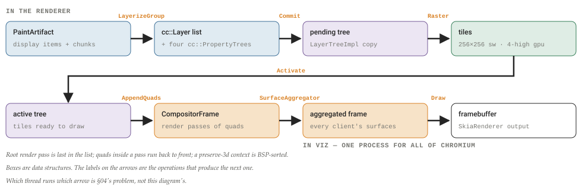

# Blink, taken apart

Chromium's rendering engine is 213,000 files, and 189,644 of them are web tests. This is a teardown of the rest: how third_party/blink is layered and how that layering is enforced, what runs on which thread, how a byte of HTML and a CSS property name become C++ classes, how one BeginMainFrame becomes pixels, and where Blink hands off to V8, to cc, and to //content. Everything is read at chromium/src@f288fed6 — Chrome 156.0.8067.0, 18 September 2026.

By **Suraj Sharma**, XO Labs · Engineering. First published 23 September 2026 as *Blink, taken apart* in [sharmasuraj0123/writings](https://github.com/sharmasuraj0123/writings/tree/a5a356d418d45b63d34624b12ec3d7809167b309/chromium/blink). Subject: `chromium/src@f288fed6` · Chrome 156.0.8067.0 · V8 15.6.19

Source: [`chromium/blink/index.html`](https://github.com/sharmasuraj0123/writings/blob/a5a356d418d45b63d34624b12ec3d7809167b309/chromium/blink/index.html) in [sharmasuraj0123/writings](https://github.com/sharmasuraj0123/writings) at `a5a356d`. Brought into this repo on 2026-10-15 with its text, tables and figures unchanged; only the format moved from HTML to Markdown.

> **How to read the badges**
>
> *\[from the tree\]* marks facts read from a checkout of `chromium/src`, `depot_tools`, or `v8` — quoted with file paths and line numbers. *\[from the docs\]* marks facts from Chromium's own documentation and announcements. *\[reconstruction\]* marks mechanism I have worked out from the sources but which no single file states outright. The closing provenance note says what was not verified.

## 01 · What Blink is, and where it stops

Blink is easier to describe by its edges than by its contents. Three edges matter — where the code is allowed to begin, the exact moment it stops, and the platform it cannot run without — and inside them the engine hands work to four things that are not Blink. Everything here is read at one commit: `chromium/src@f288fed6`, `chrome/VERSION` 156.0.8067.0, checked out 18 September 2026, against the V8 that commit pins — 15.6.19, from `src/DEPS`:344 (`v8_revision` b1747cd8) *\[from the tree\]*.

The engine defines itself in two sentences. "Blink is the browser engine used by Chromium. It is located in `src/third_party/blink`" *\[from the tree\]* (`third_party/blink/README.md`:3-4). The next heading in that file is *Code Policy*, and it does not name a feature set; it names an exclusion, borrowed from the layer underneath: Blink follows the `content` guidelines, "only code that implements web platform features should live in Blink" (same file, :10-11). That is the first edge. Something with no specification behind it does not belong here, however much it looks like rendering.

The positive job list is not in the tree at all. It is in Kentaro Hara's "How Blink works" (2018): implement the specs of the web platform, embed V8 and run JavaScript, request resources from the underlying network stack, build DOM trees, calculate style and layout, embed the Chrome compositor *\[from the docs\]*. That document is sign-in gated and the only source for the list: one engineer's summary, not a fact about the tree. It also warns that "Blink" names two things — the directory `//third_party/blink/`, and a project that also spans `//content/renderer/` and `//content/browser/`. This teardown is about the directory.

The far edge is a moment, not a module. Blink "encompasses all the phases of rendering prior to compositing, culminating in compositor commit" *\[from the docs\]*. Commit is the main thread copying its property trees and display list across to the compositor thread. Everything after it — layerize, raster, activate, aggregate, draw — belongs to cc on the renderer's compositor thread and to Viz in the GPU process, of which there is exactly one for all of Chromium *\[from the docs\]*. Figure 1 puts the rule where that sentence puts it.

**Figure 1. Twelve stages, three lanes, and the one handoff that ends Blink**

Stage names and lanes are the RenderingNG architecture overview's *\[from the docs\]*; Animate and Scroll are the only two it places on either thread. The states under the Blink half are the active-document path of `DocumentLifecycle::LifecycleState`, `core/dom/document_lifecycle.h`:49-82 *\[from the tree\]*, read from the `chromium/main` mirror; the sparse checkout omits it. The header, not `core/layout/README.md`, is the list that is still true — §09 prints both and says why.

The near edge is that none of this runs on its own. "Blink is implemented on top of an abstract platform and thus cannot be run by itself. The Chromium Content module provides the implementation of this abstract platform" *\[from the docs\]*. Porting Chromium to a new operating system is not a Blink job; it happens a layer down.

Inside those edges, Blink addresses exactly four things outside itself.

- **V8**, for script. `renderer/DEPS` puts it bluntly: the include rules end with a bare `"+v8"`, while `//net` is admitted in four lines only — features, cookies, structured headers, storage-access status *\[from the tree\]* (`third_party/blink/renderer/DEPS`:96-99, :121). Blink reaches into the JavaScript engine freely and into the network stack almost not at all.
- **cc**, for compositing. "In the renderer, Blink is the client" *\[from the tree\]* (`cc/README.md`:3-5). Client, not owner: Blink produces the inputs and commits them, and cc decides what becomes a layer and what becomes a texture.
- **`//content`**, for the browser itself: "the core code needed to render a page using a multi-process sandboxed browser" *\[from the tree\]* (`content/README.md`:4-7) — processes, navigation, IPC. It also re-exports Blink: lower modules are reached through embedder APIs, and "Examples of these APIs are the WebKit API and the Content API" (same file, :64-68). That is how Chromium, Android WebView and Opera embed the same engine *\[from the docs\]*.
- **The browser process, directly.** "Blink can use Mojo and directly talk to the browser process. This allows removal of unnecessary public APIs and abstraction layers" *\[from the tree\]* (`third_party/blink/renderer/README.md`:186-187). Mojo is Chromium's IPC system, and two of its nouns recur below: a **message pipe** is "a pair of **endpoints**", and a **mojom** file "describes **interfaces**, which are strongly-typed collections of **messages**" *\[from the docs\]* (`src/docs/mojo_and_services.md`:16-28). The fourth delegation is a subtraction: where a Mojo interface will do, the `//content` indirection is deleted rather than maintained.

So: an exclusion at the top, a commit at the bottom, an abstract platform underneath, and a standing instruction to route around the middle. None of that is a feature list, which is the point: the boundary holds still while the features change.

Ten sections, working inward. Where the code came from and what has been rebuilt under it since 2013 (§02). The directory, and the nine-rung layering three separate gates enforce (§03). Which process, which thread, and the scheduler that decides what the main thread may do next (§04). The public API, read as the residue of input, navigation and loading (§05). How a tag name and a CSS property name become C++ classes that no checked-in file contains (§06). How `.idl` becomes bindings, and what a `v8::Context` costs (§07). One `BeginMainFrame`, unrolled against the spec's step numbers (§08). Style, layout and paint as functions, and the trip to a framebuffer (§09). Where objects live now that the collector moved to V8 (§10). And the four gates a feature passes on its way to a user (§11). Section 12 is what the five mechanisms add up to.

## 02 · The fork, and the two rewrites since

Blink began as a subtraction. It has been rebuilt twice underneath a shipping product, without ever stopping. Three movements: the fork in 2013, three bot-written megacommits that produced today's filenames, and two projects that each ran a decade without a launch date.

### The fork was a deletion

Adam Barth announced Blink on 3 April 2013 as "a new open source rendering engine based on WebKit" *\[from the docs\]*. The reason given was not features. It was the cost of carrying two architectures in one codebase: "Chromium uses a different multi-process architecture than other WebKit-based browsers, and supporting multiple architectures over the years has led to increasing complexity." The first concrete promise in the post is a removal — to "remove 7 build systems and delete more than 7,000 files—comprising more than 4.5 million lines—right off the bat."

The ship dates are ordinary. Beta was 28.0.1500.20 on 23 May 2013, the release that carried "Blink's new threaded HTML parser". Stable was 28.0.1500.71 on 9 July 2013, "for Windows, Macintosh and Chrome Frame platforms"; Chrome for Android followed on 10 July, and Linux only on 30 July, with 28.0.1500.95.

That M28 is the fork milestone has a primary that is not the blog post: the release-tag `DEPS`. At 27.0.1453.93, `DEPS` pins the engine as WebKit subdirectories — `src/third_party/WebKit/Source` plus `Tools/DumpRenderTree` and `LayoutTests`, 663 lines, three `DumpRenderTree` references. At 28.0.1500.71 all of that collapses into a single pin on `src/third_party/WebKit`: 541 lines, zero `DumpRenderTree` references. The two files are sourced; reading the collapse as the boundary is mine *\[reconstruction\]*.

The story that the engine is named after the `<blink>` tag is hedged where it is written — "Rumor has it…" on developer.chrome.com — and has no 2013 primary behind it. Print the hedge, not the anecdote.

**Figure 2. Twenty-eight years of lineage, and what shipped underneath the rewrites**

![Two stacked timelines. The top band runs KHTML 1998 and WebKit 2001, then, after an axis break, the Blink announcement in April 2013, Chrome 28 stable in July 2013, BlinkNG from 2014, Onion Soup from November 2015, the Reformat blink, Blink Rename and Great Blink mv megacommits in 2016, 2017 and 2018, and the reference tree f288fed6 in September 2026. The bottom band plots four subsystem lanes on the same 2013 to 2026 scale: Slimming Paint milestones M45, M58, M67, M75 and M94 with a separate tip-of-tree flip in October 2021; LayoutNG 77, then 93, then the 102, 103, 106, 108 cluster in 2022; Oilpan from the 2013 branch through unified heap M74, the V8 library at M94, pointer compression at M106 and ElementSpace in 2026; and Fontations 128, 133, 136 and 145.](2026-10-15-chromium-blink/fig-02-lineage.svg)

Both bands share one scale from 2013 to 2026. Every date and milestone number is sourced; entries the sources date only by year sit at that year's midpoint, so read the clusters as order, not as months *\[reconstruction\]*. The hollow ring is the one qualifier: M94 is the milestone CompositeAfterPaint was switched on in from the server, not the tip-of-tree flip — §09 prints the launch thread and the commit that flipped it. Layout and paint are §09's subject and Oilpan is §10's; here the four lanes are evidence that the rebuild shipped in pieces.

### Three bots wrote today's filenames

Between 2016 and 2018, three mechanical commits reshaped the tree without changing behaviour. "Reformat blink" ran clang-format over all of `third_party/WebKit` on 1 October 2016 (`1c8e1a7719e9`). "The Blink Rename" converted identifiers to Chromium style on 9 April 2017 (`1c4d759e4425`), with one carve-out: web-exposed methods stay `namedLikeThis()`, to match the JavaScript bindings. "The Great Blink mv" moved `Source/` to `third_party/blink/renderer` on 7 April 2018 and renamed every file to snake_case (`0aee4434a4db`).

The third one is checkable in a single command. At `f288fed6` there are 13,249 `.h` and `.cc` files under `third_party/blink/renderer`, and not one of them has a capital letter anywhere in its basename *\[from the tree\]* (`git ls-tree -r --name-only HEAD`, filtered). The directory `third_party/WebKit` is gone.

### Two projects, ten years, no launch date

BlinkNG started in 2014 against a diagnosis rather than a feature: "leaky abstraction barriers", reentrant entry points, layout running during style. Its replacements are stated as rules — a uniform point of entry, functional stages with defined inputs and outputs, immutable outputs once a stage has finished, and lifecycle assertions that make the rules checkable while the engine runs *\[from the docs\]*. Figure 2 shows it as a single tick in 2014, which is the point: what it produced is the pipeline §08 walks.

Onion Soup started in November 2015. The founding design doc is bylined "esprehn@, Nov. 2015"; it was presented at BlinkOn 5 in San Francisco on 10–11 November 2015, and announced on blink-dev by Elliott Sprehn on 9 December 2015 under `crbug.com/561879`. Kentaro Hara drove it from "Onion Soup 2.0" in 2017 onward. The definition has not moved since: "migrate web-platform features from //content/renderer/ to Blink and massively simplify the abstraction layers".

The number usually attached to it needs care. Hara wrote in 2020 that "there were 64 directories in //content/renderer/" when the project started. Measured at release tags, `content/renderer` held 29 top-level directories at M47 — December 2015, the quarter Onion Soup began — and peaked at 31 at M49 and M50. It was never 64. Adding `content/child` and `content/common` brackets the number without hitting it — 62 at M47, 66 at M49, 65 at M50 — and `content/child` was itself folded away during the project, so read 64 as a recollection of the whole surface rather than a directory count. The end state is countable without hedging: at `f288fed6`, `//content/renderer` is 7 subdirectories and 231 files *\[from the tree\]*.

Neither project had a ship date, and neither stopped the release train. That constraint explains the rest of this teardown: a layer boundary you can fail a build on, a lifecycle asserted on every frame, and an API surface that shrinks one CL at a time are what a rewrite looks like when it must be done in public, with the engine running.

## 03 · The tree, and the order it keeps

Blink's layering is not a convention that senior engineers remember and new ones absorb. It is nine lines in one README, and it is enforced three separate ways: a `DEPS` file in almost every directory, a presubmit script that audits identifiers, and two clang plugins added to the compiler command line. Two of those gates stop a change before it lands. The third fails the build.

Start with the scale; it decides what the word "Blink" covers. At `f288fed6` the whole of `chromium/src` is 507,507 files and `third_party/blink` is 213,000 of them — 42% *\[from the tree\]*. Every count here is `git ls-tree -r` at that commit: "file" means a blob tracked in git. Of those 213,000, 189,644 are web tests — 89% of Blink — of which 96,670 sit under `web_tests/external/wpt` — Chromium's two-way mirror of web-platform-tests, "the primary shared test suite where all browser engines are collaborating" *\[from the docs\]* (`src/docs/testing/web_platform_tests.md`:7-14) — and 28,217 are platform-specific baselines under `web_tests/platform/`. The engine proper is `renderer/`: 18,997 files — 7,124 `.cc`, 6,125 `.h`, and 1,702 of the `.cc` files end in `_test.cc`. The thing people mean when they say "the engine" is just under a tenth of the directory that carries its name.

Inside `renderer/`, three directories hold almost everything: `core/` 9,191 files across 73 subdirectories (`css` 1,165, `html` 1,056, `layout` 854), `modules/` 5,163 across 121 feature directories, `platform/` 3,783 across 38. The rest is small and load-bearing — `bindings/` 588, `build/` 182, `controller/` 61, `extensions/` 22, plus seven loose files. `public/`, the entire embedder API, is 1,560 files including 360 `.mojom`; `common/` is 359. Figure 3 draws the tree by area on the left and the order it keeps on the right.

**Figure 3. What is actually in the directory, and the nine-rung order the rest of it obeys**

![Two panels. On the left, an area treemap of third_party/blink's 213,000 files: a dominant web_tests block of 189,644 files subdivided into external/wpt, platform baselines and the rest; a thin renderer band of 18,997; and a hairline band for public, perf_tests, manual_tests, tools and common. Below it the renderer band is exploded into core, modules, platform, bindings, build, controller and extensions. On the right, nine stacked layer rows from public/web down to //base and V8, with a single downward arrow beside them and, to their right, the DEPS file and line number that enforces each edge; underneath, a panel showing web_string.h presenting an opaque handle outside Blink and WTF types inside INSIDE_BLINK.](2026-10-15-chromium-blink/fig-03-tree-and-order.svg)

Left-hand areas are proportional to file counts measured with `git ls-tree -r` at `f288fed6` *\[from the tree\]*; the four rightmost slivers are drawn to scale and are therefore almost invisible, which is the finding. The nine rows are quoted from `renderer/README.md`:119-129, and every annotation is a real line in a real `DEPS` file. Row colours are mine *\[reconstruction\]*; the README lists an order, not a palette.

The order itself is nine bullets under one heading. "Dependencies only flow in the following order:" — `public/web`, `controller/`, `extensions/`, `modules/` and `bindings/modules`, `core/` and `bindings/core`, `platform/`, `public/platform`, `public/common`, "`//base`, V8 etc." *\[from the tree\]* (`third_party/blink/renderer/README.md`:119-129). `build/` sits outside the stack entirely: "a stand-alone directory" (same file, :133).

Enforcement one is `DEPS`. There are 237 under `third_party/blink`, and they are not documentation: `CheckUnwantedDependencies` "runs checkdeps on `#include` and import statements added in this change. Breaking `-` rules is an error, breaking `!` rules is a warning" *\[from the tree\]* (`src/PRESUBMIT.py`:3555-3558). The lower you go, the narrower the licence. `controller/DEPS` opens with a bare `"+base"` — the only one of the five stacked `renderer/` layers that does; `extensions/` ships no `DEPS` file at all. `core/` enumerates 27 individual `base/` paths and bans `modules` and `bindings/modules` outright (:111, :113). `platform/`, at the bottom, names 51 `base/` paths one at a time — 43 headers and 8 directories — and bans everything above it. Its first four and last four lines are the whole policy, from `third_party/blink/renderer/platform/DEPS`:1-4 and :97-100:

    include_rules = [
        # To only allow a subset of base/ in Blink, we explicitly list all
        # directories and files instead of writing 'base/'.
        "+base/allocator/buildflags.h",
    …                       lines 5-96: 50 more "+base/…" entries, then build,
                            device, gpu, mojo, mozilla, net, partition_alloc,
                            services, skia, third_party, ui, url, webp
        "-third_party/blink/renderer/bindings",
        "-third_party/blink/renderer/core",
        "-third_party/blink/renderer/modules",
    ]

Enforcement two reads identifiers rather than includes. `audit_non_blink_usage.py` carries an allowlist with reasons attached: `std::.+` and `GURL` are permitted, but the comments say they are "discouraged but still needed for interop with `blink/common`" and that "discouraged usages for data members are checked in clang plugin" (:1012-1021). Its `disallowed` list is blunter: the first entry is `(base|WTF)::Bind(Once|Repeating)` with the advice "Use `blink::BindOnce` or `blink::BindRepeating`" (:1115-1119) *\[from the tree\]*.

Enforcement three is the compiler. `renderer/BUILD.gn` defines `config("config")` at :85, and inside it adds `check-blink-data-member-type` (:104-111) and `blink-gc-plugin` (:113-121) to `cflags`. `BlinkDataMemberTypeChecker` holds a nine-entry table of discouraged types with the replacement each should use — `GURL` → `KURL`, `std::vector` → `blink::Vector`, and seven more — applies it only under `/third_party/blink/renderer/`, never to tests, and emits "'%0' is discouraged for data members in blink renderer. Use %1 if possible." The escape hatch, `ALLOW_DISCOURAGED_TYPE(reason)`, is visible in the diff. `blink-gc-plugin` checks the Oilpan rules §10 sets out, one diagnostic per rule: "\[blink-gc\] Class %0 must derive from GarbageCollected in the left-most position.", "\[blink-gc\] Raw pointer field %0 to a GC managed class declared here:" *\[from the tree\]* (`tools/clang/plugins/BlinkDataMemberTypeChecker.cpp`:22-39, :44-50; `tools/clang/blink_gc_plugin/DiagnosticsReporter.cpp`:14, :51 — both on `main`; `tools/clang/` is outside the sparse checkout).

The top of the same file defines `config("inside_blink")` (:33-50) whose entire payload is two defines, `BLINK_IMPLEMENTATION=1` and `INSIDE_BLINK` (:36-37). That macro is what lets one header be two headers. `WebString` is a `scoped_refptr<StringImpl>` the embedder cannot look into — unless the macro is set, in which case it converts freely to and from WTF's string types. From `third_party/blink/public/platform/web_string.h`:43-45 and :167-177:

    #if INSIDE_BLINK
    #include "third_party/blink/renderer/platform/wtf/forward.h"  // nogncheck
    #endif
    …
    #if INSIDE_BLINK
      WebString(const String&);
      WebString& operator=(const String&);
      operator String() const;

      operator StringView() const;

      WebString(const AtomicString&);
      WebString& operator=(const AtomicString&);
      operator AtomicString() const;
    #endif

The quiet part is in the README itself: the three big directories are not a theory of the web. "Note that specs do not have a notion of 'core', 'platform' or 'modules'. The distinction between them is for implementation convenience to avoid putting everything in a single `core/` entity (which decreases code modularity and increases build time)" *\[from the tree\]* (`renderer/README.md`:58-61). The rule of thumb that follows is three lines long: tightly coupled to HTML, CSS and DOM → `core/`; conceptually depends on core → `modules/`; core depends on it → `platform/` (:62-66). And then, immediately: "Note that some of these guidelines are violated (at the time of writing this), but the code should gradually change and eventually conform" (:68-69).

One more rule has the same shape. Under "Threading model" in that README (:189-196), cross-thread communication "should be done with a message passing model"; a shared memory model "is strongly discouraged", and the reason given is not taste. "Historically, shared memory programming patterns in Blink have been one of the major sources of use-after-free security bugs and stability issues (e.g., WebAudio, memory access via `CrossThreadPersistent`)" *\[from the tree\]* (:198-200). Which thread anything runs on is the next section.

## 04 · Processes, threads, and the scheduler

Blink has one main thread. The DOM, style, layout, and every piece of JavaScript outside a worker run on it. So the engineering is not in the thread. It is in the scheduler deciding what that thread may do next. Three questions: which process, which thread, which object.

### Which process

Blink runs only inside a sandboxed renderer, and it does not choose which one. That is a browser-side decision, built on three abstractions *\[from the docs\]* (`docs/process_model_and_site_isolation.md`:80-131). **SiteInfo** is the security principal, "typically a 'site' (i.e., scheme plus eTLD+1)". **SiteInstance** is a principal instance, which "roughly corresponds to the agent cluster concept in the spec, although they do not match exactly". **BrowsingInstance** is the browsing context group. The rule: two documents with the same principal in the same browsing context group must share a process, because they have synchronous access to each other.

How much ships depends on the platform. Desktop runs full site-per-process, from Chrome 67, at roughly 10–13% memory overhead; Android with at least 2 GB of RAM runs partial isolation, from Chrome 77, at 3–5%; low-RAM Android, WebView and iOS get none *\[from the docs\]* (same file, :141-195, and chromium.org's Site Isolation page). Since 127.0.6483.0 desktop also splits off sandboxed same-site iframes (same file, :453-459).

### Which thread

`renderer_main.cc` names the thread `CrRendererMain` at line 202 and builds the Blink main-thread scheduler at 219-221; `platform.EnableSandbox()` is at 255 *\[from the tree\]*. The scheduler exists before the sandbox closes. (Files outside the sparse checkout are read at `chromium/main`, 22 September 2026.)

That thread gets one V8 isolate — a shipping fact, not a structural one. The scheduler interface already assumes several: `MainThreadScheduler::ForEachMainThreadIsolate` takes a callback per isolate "bound to the main thread" (`platform/scheduler/public/main_thread_scheduler.h`:78-81). The feature that would create them is MBI, Multiple Blink Isolates: give each `AgentSchedulingGroup` its own IPC channel and, in time, its own isolate. `enum class MBIMode` has three values. `kLegacy` keeps the process-wide channel and leaves the group "effectively a pass-through". `kEnabledPerRenderProcessHost` gives each group a channel, one per process. `kEnabledPerSiteInstance` allows "potentially multiple AgentSchedulingGroups per RenderProcessHost", and charges for it: "Ordering between the AgentSchedulingGroups in the same render process is not preserved" (`content/public/common/content_features.h`:216-235). `kMBIMode` is `FEATURE_ENABLED_BY_DEFAULT` only under an `MBI_MODE_*` buildflag and `FEATURE_DISABLED_BY_DEFAULT` otherwise, under a comment that is not ambiguous: "DO NOT USE! The feature is not yet fully implemented. See crbug.com/1111231." (`content_features.cc`:710-718) *\[from the tree\]*, both files on `main`.

The compositor thread comes later, and is optional: `RenderThreadImpl::InitializeWebKit` calls `InitializeCompositorThread()` only `if (!command_line.HasSwitch(switches::kDisableThreadedCompositing))` (`content/renderer/render_thread_impl.cc`:839-840). It creates a Blink `NonMainThread` of `ThreadType::kCompositorThread` at `base::ThreadType::kPresentation` (`platform/scheduler/common/thread.cc`:76-80) — and on Linux and ChromeOS it asks the browser to apply that priority: "This is not possible inside the sandbox" (same file, :98-107).

Workers are the third family, and the exception to everything above. Each `WorkerThread` borrows a `WorkerBackingThread`, "a WebThread with Oilpan and V8" — Oilpan is Blink's garbage collector, §10's subject — so own isolate, own heap (`core/workers/worker_backing_thread.h`:22-25). Terminating one gives JavaScript a `kForcibleTerminationDelay = base::Seconds(2)` grace, then stops it (`worker_thread.cc`:84). Pausing one enters a nested event loop where "Only the none pausable tasks will execute" — the typo is in the tree (`PausingAndFreezing.md`:56-57). Figure 4 nests all three.

**Figure 4. Three nested containers — process, thread, object**

![Three panels read left to right. The first shows one browser process above two sandboxed renderer processes and one Viz process. Two dotted fans zoom into the second panel, which shows the threads inside a single renderer: CrRendererMain, the compositor thread, the IO thread, and N worker threads each with their own isolate and Oilpan heap. A second fan zooms from CrRendererMain into the third panel, the main-thread object graph: AgentSchedulingGroup contains a WebView and blink::Page, which owns a FrameTree of LocalFrame and RemoteFrame; under LocalFrame sits LocalDOMWindow, which points at a WindowAgent holding an EventLoop and microtask queue.](2026-10-15-chromium-blink/fig-04-containers.svg)

The dotted fans are zooms. Every box and label comes from the tree or its docs; the arrangement is mine *\[reconstruction\]*. One isolate per main thread is the shipping case, because MBI is off unless a buildflag turns it on *\[from the tree\]*; the `AgentSchedulingGroup` box at the head of the third panel is the unit MBI would multiply.

### The scheduler

A task is a `base::OnceClosure`: "if a task has started, it can't be interrupted until it completes. The scheduler can only choose a new task to run from the eligible tasks or can elect not to run any task at all" *\[from the tree\]* (`platform/scheduler/TaskSchedulingInBlink.md`:31-34). All the control is in the choosing, which is why posting is fenced in. Almost every main-thread task goes through `FrameScheduler::GetTaskRunner(TaskType)` so that the scheduler can freeze, throttle, or prioritise one frame (same file, :38-47), and `base::SingleThreadTaskRunner::GetCurrentDefault` is "**banned** in `blink/` and `content/renderer/`" because tasks posted to it "lack any attribution" (same file, :69-77).

`TaskType` carries 79 concrete values (`grep -cE '^\s+k[A-Za-z0-9_]+ = [0-9]+,'` over `public/platform/task_type.h` at `f288fed6`), and the header's own "Next value: 88" comment is already wrong: 88 and 89 are taken. `FrameSchedulerImpl::CreateQueueTraitsForTaskType` is one 182-line switch (`frame_scheduler_impl.cc`:487-668) turning each into `QueueTraits`: deferrable, throttleable, intensively throttleable, pausable, freezable, plus a prioritisation type. Delayed JavaScript timers are throttleable; immediate ones only deferrable.

Prioritisation then lands on a ladder of exactly eleven rungs — the right half of Figure 5. `platform/scheduler/common/task_priority.h`:14-31 *\[from the tree\]*:

    enum class TaskPriority : base::sequence_manager::TaskQueue::QueuePriority {
      // Priorities are in descending order.
      kControlPriority = 0,
      kHighestPriority = 1,
      kExtremelyHighPriority = 2,
      kVeryHighPriority = 3,
      kHighPriorityContinuation = 4,
      kHighPriority = 5,
      kNormalPriorityContinuation = 6,
      kNormalPriority = 7,
      kDefaultPriority = kNormalPriority,
      kLowPriorityContinuation = 8,
      kLowPriority = 9,
      kBestEffortPriority = 10,

      // Must be the last entry.
      kPriorityCount = 11,
    };

Input queues sit at `kHighestPriority` unconditionally. The compositor queue is the one that moves, and what moves it is a `UseCase` state machine — nine states, `kNone` and `kEarlyLoading` through `kCompositorGesture` to `kDiscreteInputResponse` (`main_thread/use_case.h`:16-53) — fed by a `UserModel` of four constants — 100 ms of escalation after input, a 300 ms median gesture "based on two weeks of Android usage data", a 2000 ms window in which another gesture is likely, 50 ms of maximum deferral (`user_model.h`:21-39). A compositor gesture drops the queue to `kLowPriority`; a main-thread gesture, touchstart, or discrete input raises it to `kHighestPriority` (`main_thread_scheduler_impl.cc`:2915-2943). Two safety valves sit above: `kDefaultRenderingStarvationThreshold`, 100 ms without a frame, and `kRenderBlockingStarvationThreshold`, 500 ms (`main_thread_scheduler_impl.h`:118-119, :124-125).

Idle tasks take what is left: "typically less than 10ms" after BeginMainFrame, "typically up to 50ms" when no frames are expected, a 1 ms floor (`common/idle_helper.h`:36-41, :71-73) — and none at all ten seconds after the renderer's widgets are hidden (`kEndIdleWhenHiddenDelayMillis = 10000`, `main_thread_scheduler_impl.h`:551).

The docs get one background number wrong. `TaskSchedulingInBlink.md`:142 reads "On mobile all pages are frozen after five minutes in the background." That was true from 2019 until M143. The constant today is `kDefaultDelayForBackgroundTabFreezing = base::Minutes(1)` (`page_scheduler_impl.cc`:55-56), and the branch that uses it runs only when `blink::features::kStopInBackground` is enabled (same file, :850-851) — `FEATURE_ENABLED_BY_DEFAULT` under `IS_ANDROID && !IS_CAST_ANDROID && !IS_DESKTOP_ANDROID`, `FEATURE_DISABLED_BY_DEFAULT` everywhere else (`blink/common/features.cc`:2251-2261). So on desktop no page freezes itself; only the embedder can, via `PageSchedulerImpl::SetPageFrozen()`. The five minutes that survives belongs to a different mechanism — intensive wake-up throttling, grace period `5 * 60` seconds, or `60` once the page has loaded (`platform/scheduler/common/features.h`:40-41).

**Figure 5. The hierarchy, the ladder, and a backgrounded page's clock**

![Left: a five-step hierarchy from MainThreadSchedulerImpl through AgentGroupScheduler, PageScheduler and FrameScheduler down to MainThreadTaskQueue with its QueueTraits bits. Right: the eleven-rung TaskPriority ladder from kControlPriority at zero to kBestEffortPriority at ten, with four annotations showing which queues land on which rung. Bottom: a piecewise timeline of a backgrounded page marking full throttling at ten seconds, freezing at one minute on Android only, and one wake-up per minute after the intensive-throttling grace period.](2026-10-15-chromium-blink/fig-05-scheduler.svg)

Rungs and constants are verbatim from the headers named above *\[from the tree\]*; the four arrows are cases `ComputePriority` and `ComputeCompositorPriorityFromUseCase` return literally. Uncoloured rungs I did not trace *\[reconstruction\]*. The clock is the corrected one: one minute, not five.

### Which object

`blink::Page` "roughly corresponds to a tab or popup window in a browser. It owns a tree of frames" *\[from the tree\]* (`core/page/page.h`:112-115). That tree mixes two kinds of frame, and the split is a security statement, not a layout one: "A remote frame is always cross-site; a local frame may be either same-site or cross-site" (`public/web/web_frame.h`:60-62). A `RemoteFrame` holds no DOM. Only a local root gets a widget — `InitializeFrameWidget` "must be a LocalRoot" (`public/web/web_local_frame.h`:275-279) — so only a local root owns a `cc::LayerTreeHost`.

One thing here is routinely misread. `LocalDOMWindow` *is* the `ExecutionContext`: `class CORE_EXPORT LocalDOMWindow final` `: public DOMWindow, public ExecutionContext, …` (`core/frame/local_dom_window.h`:115-116). `core/execution_context/README.md`:10 still says the opposite — "inherited by Document instead of DOMWindow/LocalDOMWindow for historical reasons". That sentence is stale; the header is the tree.

Above the window sits the agent, the HTML spec's formalism in C++. One `WindowAgentFactory` per group of documents "mutually reachable via `window.opener`, `window.frames` or others" (`core/execution_context/window_agent_factory.h`:22-24) hands out one `WindowAgent` per `AgentClusterKey`, and each `Agent` owns a `scheduler::EventLoop` and a microtask queue (`agent.h`:30-37, :52, :57). Which answers the third question: a task does not run "on the main thread" so much as on a frame, inside a page, inside an agent — and every one of those nouns is a knob the scheduler can turn.

## 05 · The boundary with the embedder

Page, frame, window: every noun §04 ended on has a counterpart in the browser process, and the headers that name the pairs are the public API. That API has exactly one intended consumer. As a library interface it explains nothing. As the residue of the three flows that cross a process line — input, navigation, loading — it falls into shape.

The contract is sixteen lines of `third_party/blink/public/README.md` *\[from the tree\]*: "we consider all other files in Blink to be implementation details, which are subject to change at any time without notice" (:4-7). "The primary consumer of this API is Chromium's Content layer" (:9-11). There is no ABI; the API exists "to insulate the rest of the Chromium project from internal changes to Blink" (:16-19). One consumer, compiled together, renegotiable at will.

It is "organized into three parts" (:24-28). `public/common` is shared by browser and renderer, the only one dropping the `Web` prefix (:30-36, :87-89). `public/platform` is the abstract sandboxed platform Blink calls *down* into, centred on the pure-virtual `Platform` (:38-43). `public/web` is what the embedder calls *into*, centred on `WebView` (:45-49). The fourth is named inside the first: "public `.mojom` files live in `blink/public/mojom`" (:34-35).

Measured at `f288fed6`, `grep -c virtual` returns 110 in `public/platform/platform.h`, 115 in `web_local_frame_client.h`, 166 in `web_local_frame.h`, 69 in `web_view.h`. `WebPreferences` is 178 top-level data members, 130 of them `bool`. `public/mojom` holds 360 `.mojom` files across 150 directories *\[from the tree\]*.

### Boot, then a page

`RenderThreadImpl::InitializeWebKit` constructs a `RendererBlinkPlatformImpl`, calls `blink::Initialize()`, then `InitializeCompositorThread()` unless `--disable-threaded-compositing` (`content/renderer/render_thread_impl.cc`:810-851, on `main`). Order matters: "Must be called on the thread that will be the main thread" (`public/web/blink.h`:52-61). A page arrives when the browser asks. `AgentSchedulingGroup::CreateWebView` calls `WebView::Create`, handing it a `PageBroadcast` associated receiver and the agent-group scheduler; "The WebView is kept alive as long as the `page_handle` mojo interface is alive" (`public/web/web_view.h`:138-155, :103-104).

Each browser object has a counterpart. `RenderFrameImpl` implements `blink::WebLocalFrameClient`, one of its eight bases (`content/renderer/render_frame_impl.h`:182-190, on `main`); inside Blink `WebLocalFrameImpl` wraps `LocalFrame`, and `LocalFrameClientImpl` forwards back out. The seam embedders customise is `ContentRendererClient` (`content/public/renderer/content_renderer_client.h`:96-122), where Chrome, `content_shell` and Android WebView differ — and almost nowhere else. Figure 6 pairs five.

**Figure 6. Five pairings across the process line**

| Browser object | Mojo interface | Renderer / Blink object | What crosses |
|----|----|----|----|
| `RenderViewHostImpl` | `blink.mojom.PageBroadcast` — 12 methods | `WebView` → `Page` | Lifecycle state, `WebPreferences` |
| `RenderFrameHostImpl` | `LocalFrame` (57) ↔ `LocalFrameHost` (77) | `RenderFrameImpl` → `WebLocalFrameImpl` → `LocalFrame` | "handled directly in Blink without passing through content" |
| `RenderWidgetHostImpl` | `blink.mojom.WidgetInputHandler` | `WidgetBase` → `WebFrameWidgetImpl` | Events down, result state back |
| `NavigationRequest` | `content.mojom.NavigationClient` | `RenderFrameImpl` → `DocumentLoader` | Response head, body pipe, factory bundle |
| `RenderFrameHostImpl` | `BrowserInterfaceBroker` | `blink::Platform`, frame brokers | Everything else, one at a time |

Method counts computed over the interface bodies declared at `public/mojom/frame/frame.mojom`:283-291, :863-871 and `page/page.mojom`:99 *\[from the tree\]*; the choice of rows is *\[reconstruction\]*.

One subtlety governs it. Mojo "guarantees strict ordering within each message pipe" but not *between* pipes, which "cannot necessarily share a common FIFO at all times" (`docs/mojo_ipc_conversion.md`:88-91). Anything ordered with navigation rides a channel-associated interface on the `IPC::Channel` pipe (:105-116), and in Blink must be posted to `kInternalNavigationAssociated = 63`: "all AssociatedRemotes/AssociatedReceivers should use this task type" (`public/platform/task_type.h`:246-252). Ordering is a property of which pipe and which task queue you picked, not of the API.

### Input

An input event crosses twice, on two threads. `RenderWidgetHostImpl::Forward{Mouse,Wheel,Keyboard,Gesture}Event` (`content/browser/renderer_host/render_widget_host_impl.h`:272-276, on `main`) feeds `InputRouterImpl`, client of the gesture, wheel, touch and pinch queues and the `TouchActionFilter` (`components/input/input_router_impl.h`:47-56, on `main`), which calls `WidgetInputHandler::DispatchEvent`. The reply is the ack: `(source, updated_latency, state, overscroll?, touch_action?)` (`public/mojom/input/input_handler.mojom`:567-572).

The renderer receives it on the compositor thread. `WidgetInputHandlerImpl` "will live on the compositor thread and proxy events to the main thread … so that events stay in order relative to other events" (`platform/widget/input/widget_input_handler_impl.h`:26-29, on `main`). `InputHandlerProxy` asks `cc::InputHandler` and returns one of six dispositions, the whole of that thread's authority over an event (`input_handler_proxy.h`:121-161, on `main`). `DID_HANDLE` and `DROP_EVENT` both end the event here, the second because the compositor "has determined the main thread doesn't care about the event either". `DID_NOT_HANDLE` forwards, and the browser waits. `DID_NOT_HANDLE_NON_BLOCKING` forwards too, but "the compositor has determined it shouldn't be cancellable (e.g. the event handler is passive)", so the event is "acked to the browser" before the main thread sees it — the mechanism behind `{ passive: true }`: a passive listener cannot hold a scroll. `DID_NOT_HANDLE_NON_BLOCKING_DUE_TO_FLING` is that decision reached from a touchstart during a fling. `REQUIRES_MAIN_THREAD_HIT_TEST` asks for a second try "with an ElementId provided by a hit test in Blink". Three inputs pick between them: the listener properties Blink pushed up, the element's `touch-action`, and whether a scroll node is already latched *\[reconstruction\]*. That settles a contradiction in Chromium's accounts of scrolling: the browser *synthesizes* the `GestureScroll` stream, the renderer compositor *latches* it (`cc/input/input_handler.h`:301-307):

      // Selects a ScrollNode to be "latched" for scrolling using the
      // |scroll_state| start position. The selected node remains latched until the
      // gesture is ended by a call to ScrollEnd.  Returns SCROLL_STARTED if a node
      // at the coordinates can be scrolled and was latched, SCROLL_ON_MAIN_THREAD
      // if the scroll event should instead be delegated to the main thread, or
      // kScrollUnknown if there is nothing to be scrolled at the given
      // coordinates.

What the compositor will not resolve goes up the `MainThreadEventQueue` to `WebFrameWidgetImpl::HandleInputEvent`, `blink::EventHandler`, `EventTarget::DispatchEvent` — where `EventPath::Initialize` runs `CalculatePath`, `CalculateAdjustedTargets` (retargeting), and a numbering pass recording the nearest closed shadow tree so `composedPath()` can hide it (`core/dom/events/event_path.cc`:90-231). The compositor knew in advance what was there: Blink pushes four `EventListenerClass` values against four properties, `kNone` through `kBlockingAndPassive` (`cc/input/event_listener_properties.h`:12-34). Figure 7 draws the route.

**Figure 7. One input event, three threads, and an ack that loses information twice**

Boxes, threads and enum sizes come from files cited here *\[from the tree\]*; the layout is *\[reconstruction\]*. The notes under the main-thread lane are where the ack stops being true.

The ack narrows twice: `DispatchEventResult` → `WebInputEventResult` (4 values) → `InputEventResultState` (7); the browser mostly reads one bit (`public/platform/web_input_event_result.h`:10-20; `public/mojom/input/input_event_result.mojom`:16-31). Two losses. `WidgetEventHandler::HandleInputEvent` returns `kHandledSystem` for every `mousedown`, `mousemove` and `mouseleave` whatever script did, under a "FIXME: WebKit seems to always return false on mouse events processing methods" (`core/input/widget_event_handler.cc`:53-121). And the `click` from `pointerup` has its result discarded, while the mouse event just above it is merged (`core/input/pointer_event_manager.cc`:1220-1227, :1272-1286) — so `preventDefault` on a click never reaches the `mouseup` ack. The browser calls the renderer hung after 15 seconds on desktop, 5 on Android (`input::kHungRendererDelay`, `components/input/input_constants.h`:12-21, on `main`).

### Navigation, then loading

Navigation crosses outward first: `FrameLoader::StartNavigation` reaches `WebLocalFrameClient::BeginNavigation`, which the embedder may refuse — "totally valid to ignore the request and abandon the navigation entirely" (`public/web/web_local_frame_client.h`:343-361). Usually it becomes `FrameHost::BeginNavigation`; a `NavigationRequest` moves through a twelve-value `NavigationState` machine to `DID_COMMIT` (`content/browser/renderer_host/navigation_request.h`:150-210, on `main`) and calls `NavigationClient::CommitNavigation`; back down, `RenderFrameImpl::CommitNavigation` → `WebNavigationControl::CommitNavigation` (`public/web/web_navigation_control.h`:43-50) → `DocumentLoader::CommitNavigation`, which creates the `Document`, `DocumentParser` and `LocalDOMWindow`. The renderer's reply is the event: the browser's "receipt of this acknowledgement … marks the authoritative *commit* time" (`docs/navigation.md`:82-88).

Loading is renderer-driven: a `ResourceFetcher` per `DocumentLoader`, a `ResourceLoader` per `Resource`, a `blink::URLLoader` over a factory from the `ChildURLLoaderFactoryBundle` handed over at commit — on unfreezable task runners, because "having frozen loaders for a long time confuses the network service" (`renderer/platform/loader/README.md`:5-24). The browser decided where the document could go; the renderer fetches the rest.

## 06 · How names become classes

What the renderer fetches is text. Two formats of it enter Blink and leave as C++ objects: tag names and CSS property names. One toolchain handles both, and both id spaces are build artifacts. `HTMLTag::kDiv` and `CSSPropertyID::kWidth` are in no checked-in file. To read them you run the generator.

That toolchain is `third_party/blink/renderer/build/scripts`; `scripts.gni` is its index *\[from the tree\]*. `blink_python_runner` runs a generator with `build/scripts`, `third_party`, `third_party/pyjson5/src` and `tools` on `PYTHONPATH` (:124-163); `template("css_properties")` gives every CSS generator the same three inputs — `css_properties.json5`, `computed_style_field_aliases.json5`, `runtime_enabled_features.json5` — plus a `gperf` binary (:261-284). Each generator is a Python class over one json5 file plus Jinja templates. Every generated constant below comes from running them on the `f288fed6` inputs, not from a checked-in header *\[reconstruction\]*.

### The HTML front door

`core/html/html_tag_names.json5` has 153 tag entries. `make_element_factory.py` derives each class as namespace + UpperCamelCase(name) + "Element" unless the entry sets `interfaceName` (:112-119), which collapses 153 tags onto 90 classes: 47 are plain `HTMLElement`, 5 legacy tags are `HTMLUnknownElement`, h1–h6 share `HTMLHeadingElement`. Thirteen tags sit behind runtime flags; the three that can be origin-trialled get an `OrUnknown` suffix — `kFencedframeOrUnknown` (`name_utilities.py`:78-82) — because the tokenizer has no document to ask.

Four generators read that file. `make_element_factory.py` emits `html_names.{h,cc}` — one `HTMLQualifiedName` per tag, `enum class HTMLTag` whose `kUnknown = 0` is explicit because "comparing to 0 saves an instruction on some hardware", and `TagToQualifiedName()` (`templates/make_qualified_names.h.tmpl`:27-57) — plus `html_element_factory.{h,cc}`. `make_element_lookup_trie.py` emits `LookupHtmlTag()`, a 2,093-line switch on length then characters, no hash. `make_element_type_enum.py` emits `ElementType` — `kIsNotElement` plus 166 element enumerators, 90 HTML + 64 SVG + 12 MathML — and `make_element_type_helpers.py` emits the `DowncastTraits` behind `IsA<HTMLDivElement>` and `HtmlElementTypeForTag()` (`templates/element_type_helpers.h.tmpl`:21,42). Names cost up front: `CoreInitializer` reserves 968 static `QualifiedName`s (`kQualifiedNamesCount`), 460 of them HTML attributes — 407 plus 53 ARIA.

The runtime chain is short. `HTMLTokenizer` (76 states) emits tokens; `AtomicHTMLToken` calls `LookupHtmlTag` once and caches both the tag and the `AtomicString`; `HTMLTreeBuilder` is `switch (token->GetHTMLTag())` over 21 insertion modes; `HTMLConstructionSite::CreateElement` builds the element. That last step is where a parser stops being a parser: it resolves the custom-element registry for the intended parent, and when a definition exists it runs a microtask checkpoint, opens a `CEReactionsScope`, calls the author's constructor synchronously, then re-applies the token's attributes one at a time. From `core/html/parser/html_construction_site.cc`:1224-1236 and :1305-1339, abridged:

    Element* HTMLConstructionSite::CreateElement(
        AtomicHTMLToken* token,
        const AtomicString& namespace_uri) {
    …
      // "4. Let local name be the tag name of the token."
      QualifiedName tag_name =
          ((token->IsValidHTMLTag() &&
            namespace_uri == html_names::xhtmlNamespaceURI)
               ? static_cast<const QualifiedName&>(
                     html_names::TagToQualifiedName(token->GetHTMLTag()))
               : QualifiedName(g_null_atom, token->GetName(), namespace_uri));
    …
      bool will_execute_script = definition && !is_parsing_fragment_;
      if (will_execute_script) {
    …
        if (0u == reentry_permit_->ScriptNestingLevel()) {
          document.GetAgent().event_loop()->PerformMicrotaskCheckpoint();
        }
        CEReactionsScope reactions(document.GetAgent().isolate());
        element = definition->CreateElement(
            creation_document, tag_name,
            GetCreateElementFlags().SetCreatedByParser(false, nullptr));

The parser feeding it yields on a budget *\[from the tree\]*: 250 tokens per pump (`kDefaultMaxTokenizationBudget`), 10 ms of time widening to 500 ms on desktop and 50 ms on Android after 6 yields (2 on Android), and `1e7` — no limit in practice — for `file://` and `chrome-extension://`. The constants "were chosen using experiment data from the field to optimize Core Web Vitals metrics". The history is an arc, not a contradiction: Chrome 28 shipped a threaded parser in 2013, `ForceSynchronousHTMLParsing` became the default in M96, the background parser was deleted on 2 February 2022 (`4dbb35444d`), and `kThreadedPreloadScanner` is still off. The 2026 parser is main-thread, budget-and-yield.

Figure 8 runs both doors side by side, call for call, with the two id spaces under them; its right-hand column is the next subsection.

**Figure 8. Two front doors, and the id spaces behind them**

![Two parallel sequences over a shared bottom strip. The left column follows the text div class=x from HTMLTokenizer through LookupHtmlTag, AtomicHTMLToken, HTMLTreeBuilder and HTMLConstructionSite::CreateElement, which branches into a custom-element definition path and a plain HTMLElementFactory path. The right column follows the text width: 50% from CSSTokenizer through ConsumeDeclaration, the gperf hash, CSSPropertyID::kWidth, Width::ParseSingleValue and ApplyValue. Below both, one bar shows 153 HTML tags collapsing onto 90 C++ classes, and one bar shows the CSSPropertyID number line from 0 to 829.](2026-10-15-chromium-blink/fig-08-front-doors.svg)

Both columns are the call order in the tree *\[from the tree\]*; the counts come from running the tree's own generators at `f288fed6`. Segment widths are for legibility, not to scale; the 101-to-88 split is *\[reconstruction\]* from the `interfaceName` rule.

### The CSS front door

`core/css/css_properties.json5` is 11,136 lines, 75 documented parameters, 828 entries: 568 longhands, 141 shorthands, 119 aliases (106 of them `-webkit-`), 33 internal, 82 runtime-flagged. The ids come from a sort, not from file order. `css_properties.py` starts at 2 — 0 is `kInvalid`, 1 is `kVariable` (:274-276) — and orders longhands then shorthands on (−priority, internal-visited first, name) (:341-373) *\[from the tree\]*. So `kColorScheme = 2` … `kZoom = 43` are the 42 high-priority properties — the generated header `static_assert`s that span is 41 (`css_property_names.h.tmpl`:92-96) — `kLastCSSProperty = 710`, aliases run 711–829, `kNumCSSPropertyIDs = 830`. `kCSSPropertyIDBitLength` is 10 because 829 needs ten bits; `kMaxShorthandExpansion` is 19 because `font` expands to 19 longhands.

Name lookup is a gperf perfect hash. `make_css_property_names.py` emits 825 (name, id) pairs and ORs `kNotKnownExposedPropertyBit` (0x8000) into the 110 that are not unconditionally web-exposed, so the common name pays for no exposure check at all. From `core/css/parser/css_property_parser.cc`:352-400, abridged:

      if (length >= 3 && property_name[0] == '-' &&
          UNSAFE_BUFFERS(property_name[1]) == '-') {
        return CSSPropertyID::kVariable;
      }
      if (length > kMaxCSSPropertyNameLength) {
        return CSSPropertyID::kInvalid;
      }
      char buffer[kMaxCSSPropertyNameLength];
      if (!QuasiLowercaseIntoBuffer(property_name, buffer)) {
        return CSSPropertyID::kInvalid;
      }
      const char* name = buffer;
      const Property* hash_table_entry = FindProperty(name, length);
    …
      int id_and_exposed_bit = hash_table_entry->id_and_exposed_bit;
      if (id_and_exposed_bit & kNotKnownExposedPropertyBit) {
        // The property is behind a runtime flag, so we need to go ahead
        // and actually do the resolution to see if that flag is on or not.
        // This should happen only occasionally.

What the id indexes is generated too. `make_css_property_subclasses.py` emits 671 `final` classes into `longhands.h` and 157 into `shorthands.h`, each with a constexpr constructor baking the id, an OR of up to 34 flag names and the repetition separator into a 16-byte `CSSProperty` (`css_properties.h.tmpl`:35-81). `make_css_property_instances.py` lays them out in one `alignas(kCSSPropertyUnionBytes)` union array `kCssProperties[]` indexed by `CSSPropertyID` (`css_property_instances.h.tmpl`:27-53), so `GetPropertyInternal(id)` is pointer arithmetic and a `reinterpret_cast` — which is why the template's own comment says "multiple inheritance is forbidden" (`css_property_instances.cc.tmpl`:19-23). The style builder is no longer its own file: 441 `ApplyInitial` and 424 `ApplyValue` bodies expand inline into `longhands.cc`. CSS alone is about 50,978 generated lines.

Both doors end the same way. A name is matched once, becomes a small integer, and is never compared as text again: the tree builder switches on `HTMLTag`, the cascade indexes `kCssProperties[]` by `CSSPropertyID`. The price is that the definitive list of either is a build output — grep for `kZoom` and you find callers, never the line that assigns it 43.

## 07 · Bindings, contexts, and running script

Those two front doors are not the only generated surface in this tree, or the largest. Blink's JavaScript-facing surface is compiled, not written. The build reads 2,242 `.idl` files — 892 core plus 1,350 modules — and emits 5,862 generated C++ paths. The question that follows, what a `v8::Context` costs, was also answered at build time and frozen into a blob.

### The compiler

The input lists are `idl_in_core.gni` and `idl_in_modules.gni`, declared at `idl_in_core.gni`:7 and :874 *\[from the tree\]*. A third list, `idl_in_extensions_webview.gni`, adds four more when `use_blink_extensions_webview` is on. The tree holds 893 core `.idl` files. The extra one is `core/css/css_nested_declarations_rule.idl`, which appears in no build list — found by diffing `git ls-files` against the `.gni` *\[reconstruction\]*.

Three programs turn those into C++. `collect_idl_files.py` parses each file with `//tools/idl_parser` into `IDLNode` ASTs and pickles them per component. `build_web_idl_database.py` takes ASTs to mutable IRs to immutable public objects, saved as one `web_idl_database.pickle` (`scripts/web_idl/README.md`:54-89). `generate_bindings.py` reads that pickle and writes `v8_*.{h,cc}` — split into eleven per-kind GN actions (async iterator, callback function, callback interface, dictionary, enumeration, interface, namespace, observable array, sync iterator, typedef, union) because they "run in parallel on RBE, each on its own worker, instead of generating all types in a single monolithic action" (`bindings/BUILD.gn`:186-292). Out come 2,243 core and 3,619 modules paths.

The middle step is a fixed phase order, and the driver prints it in comments. From `bindings/scripts/web_idl/idl_compiler.py`:99-152, abridged:

    def build_database(self):
        ...
        # Merge partial definitions.
        self._merge_partial_interface_likes()
        self._merge_partial_dictionaries()
        # Merge mixins.
        self._merge_interface_mixins()
        # Process inheritances.
        self._process_interface_inheritances()
        # Assign v8::CppHeapPointerTag values
        self._assign_tags()
        # Make groups of overloaded functions including inherited ones.
        self._group_overloaded_functions()
        self._calculate_group_exposure()
        ...
        return Database(self._db)

One extra input makes this more than a transliteration. The database action is passed `--runtime_enabled_features ../platform/runtime_enabled_features.json5` (`bindings/BUILD.gn`:100-134), so the compiler can ask `is_context_dependent()` — true when a feature is an origin trial or carries `browser_process_read_write_access` (`web_idl/runtime_enabled_features.py`:47-73). That answer routes each property into one of three installers. Every generated `V8Foo` carries a `WrapperTypeInfo`, an `InstallInterfaceTemplate`, and the three installers named at `bind_gen/interface.py`:4312-4320 — unconditional, context-independent, context-dependent — plus an `InstallPropertiesPerFeature(ScriptState*, mojom::blink::OriginTrialFeature)` for properties that appear when a trial switches on mid-life (:7421-7424). Figure 9 lays the three programs out in dependency order and opens one generated class.

**Figure 9. From .idl to v8\_\*.cc , and what one generated class contains**

Programs, file names and the eleven actions are *\[from the tree\]*; the counts are grep totals over the four `.gni` lists at `f288fed6`. Box order is the data dependency in `BUILD.gn`, not a measured timeline — the eleven actions are concurrent, and nothing here is drawn to duration.

### The context

A `ScriptState` is "in a 1:1 relationship with `v8::Context`", and the header states the rule that follows without hedging: "you cannot store ScriptState on a DOM object that has an IDL interface because the DOM object can be accessed from multiple worlds", and a leak between worlds means "leaking any JavaScript objects from one Chrome extension to another Chrome extension, which is a severe security bug" (main `platform/bindings/script_state.h`:34-41,71-78) *\[from the tree\]*. The count is arithmetic: N frames × M worlds, "one context is created for each pair of (frame, world)" (`V8BindingDesign.md`:185-199). Creation is lazy in one direction only — `WindowProxyManager`'s constructor builds the main-world proxy in its initializer list, isolated worlds live in a `HeapHashMap<int, Member<WindowProxy>>` filled on first lookup, and `GetWindowProxy()` calls `InitializeIfNeeded()`, so merely asking for a world's proxy creates its context (`window_proxy_manager.h`:51-55,65,80-81; `.cc`:97-106,125-140).

The global that context gets is a split window: V8's `JSGlobalProxy`, plus a prototype chain Blink wires by hand. The header draws it, at `bindings/core/v8/window_proxy.h`:105-125:

    // ====== LocalWindowProxy ======
    // Since a LocalWindowProxy can represent a same-origin or cross-origin frame,
    // the entire prototype chain must be available:
    //
    //   outer global proxy
    //     -- has prototype --> inner global object
    //     -- has prototype --> Window.prototype
    //     -- has prototype --> WindowProperties [1]
    //     -- has prototype --> EventTarget.prototype
    //     -- has prototype --> Object.prototype
    //     -- has prototype --> null
    //
    // [1] WindowProperties is the named properties object of the Window interface.
    //
    // ====== RemoteWindowProxy ======
    // Since a RemoteWindowProxy only represents a cross-origin frame, it has a much
    // simpler prototype chain.
    //
    //   outer global proxy
    //     -- has prototype --> inner global object
    //     -- has prototype --> null

Seven entries against three. A `RemoteWindowProxy` needs no more, because any access "will fail the security check, by definition" and is redirected through the cross-origin interceptors (:127-129). Six lifecycle states track the proxy across that (:240-253). The inner global is 1:1 with a Document with exactly one documented exception — the initial empty document, reused if the new Document is same-origin (:64-68) — and `ShouldReuseDOMWindow()` is that exception in code: initial empty document, `CanAccess`, matching cross-origin-isolation keys (main `core/loader/document_loader.cc`:2663-2703). Its caller explains why anyone would want it: "when a script calls window.open("..."), the browser gives JavaScript a window synchronously but kicks off the load in the window asynchronously. Web sites expect that modifications that they make to the window object synchronously won't be blown away when the network load commits" (:2852-2859).

What all of this costs was settled in 2017. The V8 context snapshot is a build-time blob of exactly two contexts (`kNumOfWorlds = 2`: main world with a cached `HTMLDocument` wrapper, one isolated world) plus the `FunctionTemplate`s of six interfaces per world — Window, WindowProperties, HTMLDocument, Document, Node, EventTarget, which is the Window prototype chain plus the document chain (`modules/v8/v8_context_snapshot_impl.cc`:62-92,117-149). It is taken with stable, experimental and test features all turned off, because "it's easier to add properties than removing ones" (:418-452), and the generator is linked with identical-code folding off: "ICF breaks 1:1 mappings of the external references for V8 snapshot" (main `tools/v8_context_snapshot/BUILD.gn`:113-127). The intent to implement claimed context initialization "1.6-3 times faster" *\[from the docs\]*; the 1.6 MB it adds to an Android binary is why it is desktop-only. Figure 10 holds the two chains against each other and shows which half of the pair a navigation replaces.

**Figure 10. One proxy, many globals: what survives a navigation and what does not**

Chains, state names and the eager/lazy split are *\[from the tree\]* (`window_proxy.h`:64-68,105-129,240-253; `window_proxy_manager.cc`:97-106,125-140). The 3×3 grid is an illustration at an arbitrary size *\[reconstruction\]*; real N and M are whatever the page and its extensions ask for.

### The script

Running a `<script>` is a queue with a compiler decision at the end. `ScriptLoader::PrepareScript` produces a `ClassicPendingScript` whose ready states run `kWaitingForResource` → `kWaitingForCacheConsumer` → `kReady` (main `core/script/script_loader.cc`:512,864,999; `core/script/classic_pending_script.h`:93-100); `PendingScript::ExecuteScriptBlockInternal` pushes `document.currentScript` and calls `RunScript()` under a comment that says what it is: "This is where the script is compiled and actually executed" (main `core/script/pending_script.cc`:299-315). That reaches `V8ScriptRunner::CompileAndRunScript` (`bindings/core/v8/v8_script_runner.cc`:534), which computes a tuple of `(CompileOptions, ProduceCacheOptions, NoCacheReason)` (:613) and runs the result inside a `V8RunMicrotasksScope` behind a depth guard: `kMaxRecursionDepth = 44`, "arrived at arbitrarily", crbug.com/449744 (`v8_script_runner.cc`:76-78,484-497).

Two decisions hang off that tuple. The first is whether V8 is handed the source as a stream, and `ResourceScriptStreamer::TryStartStreamingTask` lists its refusals in the comment above itself: the encoding is "invalid (not UTF-8 or one-byte data)", the script is "too small to check for a byte-order marker" — literally fewer than `kMaximumLengthOfBOM = 4` bytes buffered — "a code cache for this script already", and "V8 failed to create a script streamer" *\[from the tree\]* (`script_streamer.cc`:914-927, one early return each at :982, :1006 and :1073) — the third meaning streaming and the code cache are alternatives, not a stack. Refusals are a histogram-stable enum: `NotStreamingReason` has 30 numbered values, from `kAlreadyLoaded` to `kNonModuleWithWasmMimeType`, under a comment warning that "the enum values were used in histograms and thus do not change existing enum values when modifying" (`script_streamer.h`:57-95); with `kBackgroundResourceFetch` `ENABLED_BY_DEFAULT` and `background-script-response-processor` true (main `blink/common/features.cc`:201-211), streaming now starts from the loader's background thread rather than the main one. The code cache is Blink-managed metadata on the HTTP-cache entry, tagged code (0), timestamp (1) or compile hints (2) in `kCacheTagKindSize = 2` bits beside V8's `CachedDataVersionTag` (`v8_code_cache.cc`:36-50). What `GetCompileOptionsInternal` does with it is a ladder of early returns (:352-526). No handler, caching off, or a non-inline script shorter than `kMinimalCodeLengthForNonInlineScript = 1024` characters (:360, tested at :454-460): nothing. A cache entry already present: `kConsumeCodeCache` (:466-471). Otherwise a timestamp decides — hot means younger than `kHotHours = 72` (:61-69) — a cold or missing one returning `ProduceCacheOptions::kSetTimeStamp` (:489-515) and a hot one `kProduceCodeCache` (:519-526). That is three visits: the first writes a timestamp and nothing else, a second within 72 hours writes the cache, a third consumes it. Production runs after execution — `GetCompileOptions` at `v8_script_runner.cc`:613, `RunCompiledScript` at :630, `ProduceCache` at :667 — so the functions V8 compiled lazily during that second run are the ones in the blob, and a script loaded once and never again costs a timestamp.

A DOM call lands in a function generated at build time, installed into a context whose shape was frozen into a blob at build time, invoked under a counter that stops at 44. Almost nothing on that path was typed by a person.

## 08 · One frame, unrolled

"Update the rendering" is not something Blink decides to do. It is a task `cc` posts onto Blink's main thread, and almost everything the HTML spec calls the event loop happens inside that one task or in the gaps between two of them. Three mechanisms meet there: tasks, microtasks, and the frame.

### Tasks

The spec's per-event-loop task queues do not exist. Blink says so in a comment, in `platform/scheduler/public/event_loop.h`:40-46 *\[from the tree\]* — read from the `chromium/main` mirror, which the sparse checkout omits:

    // The specification says an event loop has (non-micro) task queues. However,
    // we process regular tasks in a different granularity; in our implementation,
    // a frame has task queues. This is an intentional violation of the
    // specification.
    //
    // Therefore, currently, EventLoop is a unit that just manages a microtask
    // queue: <https://html.spec.whatwg.org/C#microtask-queue>

Queues hang off frames because the thing the scheduler needs to freeze, throttle and prioritise is a frame, not an event loop (§04). What is left of `scheduler::EventLoop` is one microtask queue and the bookkeeping the spec attaches to it.

### Microtasks

Each `blink::Agent` owns a `scheduler::EventLoop` wrapping a `v8::MicrotaskQueue`, constructed as `v8::MicrotaskQueue::New(isolate, kScoped)` in the `WindowAgent` constructor (`core/execution_context/window_agent.cc`:12-16), and bound to every window context at creation on both the `v8::Context::New` path (`bindings/core/v8/local_window_proxy.cc`:349-352) and the `FromSnapshot` path *\[from the tree\]*. Per-agent queues landed 2022-10-05 (CL 3928076), shipped in M108, and lost their kill switch on 2023-08-16.

Two things drain the queue. V8 drains it when the outermost `kRunMicrotasks` scope exits — the policy is `kScoped`, set on every isolate Blink creates at `bindings/core/v8/v8_initializer.cc`:889. And `MainThreadSchedulerImpl::OnTaskCompleted` performs a checkpoint before it does anything else, for a reason the comment states plainly: "Microtasks may detach the task queue and invalidate `|queue|`" (`platform/scheduler/main_thread/main_thread_scheduler_impl.cc`:2621-2624) *\[from the tree\]*.

That is the whole of the timing rule web developers learn by example. Microtasks run *between* two listeners of a browser-dispatched click, because each listener's scope exits at depth zero; they do not run between the same two listeners when script calls `el.click()`, because the caller's scope is still open and the depth never returns to zero. This is not an inference from the code: the HTML spec states the consequence in a note under "clean up after running script", and Jake Archibald demonstrated it in 2015 *\[from the docs\]*. Figure 11 draws both traces.

Three caveats ride along. Blink's own `V8RunMicrotasksScope` wrapper (landed 2026-03-03, commit `1be1a11d01`) silently degrades to `kDoNotRunMicrotasks` while the event loop has microtasks paused — which a frame in the back/forward cache does. V8's `~MicrotasksScope` skips the drain entirely when an exception is pending. And `kScoped` is set twice over: on the isolate's default queue and on each agent's queue.

### The frame

Anything that dirties rendering ends at the same call. `LocalFrameView::ScheduleAnimation` (`core/frame/local_frame_view.cc`:4040-4048) hands to `ChromeClientImpl`, then `WidgetBase`, then `LayerTreeHost::SetNeedsAnimate`. That sets a bit. It schedules nothing.

The task arrives from the other side. At the next viz `BeginFrame`, if `SchedulerStateMachine::ShouldSendBeginMainFrame` passes — visible, not deferred, at most one per impl frame, no commit already in flight (`cc/scheduler/scheduler_state_machine.cc`:505-552) — `ProxyImpl` packages the compositor's scroll deltas and mutator events and posts `ProxyMain::BeginMainFrame` (`cc/trees/proxy_impl.cc`:806-851). It goes onto the agent-group scheduler's compositor queue, `TaskType::kMainThreadTaskQueueCompositor = 38`, whose priority is not fixed: `kVeryHigh` after 100 ms without a main frame, `kExtremelyHigh` after 500 ms of render-blocking starvation, `kHighest` while waiting after discrete input *\[from the tree\]*. The ladder itself is §04's subject.

Inside that one task the order is fixed. `cc/trees/proxy_main.cc`:354-377, comments and one UI-resource branch trimmed:

    layer_tree_host_->WillBeginMainFrame();

    // See LayerTreeHostDelegate::BeginMainFrame for more documentation on
    // what this does.
    layer_tree_host_->BeginMainFrame(frame_args);

    // Updates cc animations on the main-thread.
    layer_tree_host_->AnimateLayers(frame_args.frame_time);

    DCHECK(!layer_tree_host_->in_commit());

    // See LayerTreeHostDelegate::MainFrameUpdate for more documentation on
    // what this does.
    layer_tree_host_->RequestMainFrameUpdate(true /* report_cc_metrics */);

`BeginMainFrame` flushes rAF-aligned input — events `MainThreadEventQueue` held back so they land inside the frame task; rAF is `requestAnimationFrame` — and then runs `Page::Animate` → `PageAnimator::ServiceScriptedAnimations`; `RequestMainFrameUpdate` is `UpdateLifecycle(kAll)` → `UpdateAllLifecyclePhases`. Script therefore runs before style and layout, in that order, every frame. The top band of Figure 11 is that order, with spec step numbers under it.

`ServiceScriptedAnimations` is written against the spec's step numbers, and the numbers are in the comments: 6 reveal, 7 autofocus, 8 resize, 9 scroll, 10 media queries, 11 animations and queued events, 12 fullscreen, then `requestVideoFrameCallback`, then 14 animation frame callbacks (`core/page/page_animator.cc`:205-351) *\[from the tree\]*. Since a rewrite that landed 2023-02-27 each step runs for *all* documents before the next one starts, rather than all steps for one document. Before any of it, the page's `AnimationClock` is frozen at the frame time, coarsened through `TimeClamper` to 100 µs — 5 µs only when the page is cross-origin isolated — so every timestamp read during the frame agrees.

Steps 16 through 21 are `LocalFrameView::UpdateLifecyclePhasesInternal`: a loop of style and layout, pre-paint, IntersectionObserver delivery and ResizeObserver delivery, repeated until nothing dirties layout again; then step 21 marks paint timing for every non-throttled document, then paint runs (`core/frame/local_frame_view.cc`:2515-2563, 2650-2668, 2715-2718). The whole loop sits under `BlinkLifecycleScopeWillBeScriptForbidden` with one hole that ships: ResizeObserver callbacks are wrapped in `ScriptForbiddenScope::AllowUserAgentScript` (:2650-2661). A second such wrapper, around the container-query change steps (:2679), is gated on `ElementMatchContainer`, whose status in `runtime_enabled_features.json5` is `test` — off in a release build *\[from the tree\]*. In shipping Chrome, ResizeObserver is the only place author script runs inside the lifecycle.

The spec task has 23 top-level steps as of the 2026-09-21 Living Standard *\[from the docs\]*. Blink's copy of it is one `PostTask` deep.

**Figure 11. One ProxyMain::BeginMainFrame , band by band — and where microtasks drain**

![A wide timeline of one ProxyMain::BeginMainFrame task, divided into eleven bands left to right: ApplyCompositorChanges, ApplyMutatorEvents, WillBeginMainFrame, rAF-aligned input, Page::Animate to ServiceScriptedAnimations, AnimateLayers, UpdateAllLifecyclePhases, mark paint timing then paint, UpdateLayers, commit with the main thread blocked, and DidBeginMainFrame running post-lifecycle steps. A second row gives each band its HTML spec step number and a third row flags whether author script can run in it. Below, two microtask traces: a browser-dispatched click drains the queue between its two listeners, while el.click() from script defers both drains to the end of the outer scope.](2026-10-15-chromium-blink/fig-11-begin-main-frame.svg)

The band order is `cc/trees/proxy_main.cc`:341-377 read top to bottom *\[from the tree\]*. Two of the spec numbers are the code's own annotations — 6 through 12 and 14 in `core/page/page_animator.cc`:205-351, and 21 in `core/frame/local_frame_view.cc`:2715 (`// 21. For each doc of docs, mark paint timing for doc.`) *\[from the tree\]*. The 16 over the lifecycle loop, the 19 over post-lifecycle IntersectionObserver delivery and the 22 under commit are mine, read off the spec's step list *\[reconstruction\]*. The "runs script?" row is read off the scopes: `BlinkLifecycleScopeWillBeScriptForbidden` over the lifecycle, `AllowUserAgentScript` around ResizeObserver, and the fact that JavaScript IntersectionObservers post a task rather than deliver in place. The two traces under the bands are the same pair of listeners reached two ways; the drain points follow from the `kScoped` policy and the depth-zero rule, and the spec states the browser-dispatched case outright *\[from the docs\]*. Widths encode order only — no band here was measured.

## 09 · Style, layout, and pixels

Steps 16 through 21 of that task are this section. BlinkNG's method fits in one sentence: make every stage a function from immutable inputs to immutable outputs. Style produces a `ComputedStyle` nobody may edit. Layout produces a `PhysicalFragment` with no pointer to its parent. Paint produces a `PaintArtifact`. Each output is the next run's cache, which is why an incremental frame is cheap.

### The lifecycle is an enum

The stages are not a convention. They are states, and the stages assert on them — `core/dom/document_lifecycle.h`:49-82 *\[from the tree\]*, read from the `chromium/main` mirror the sparse checkout omits (blank lines elided, two pairs of states joined):

    enum LifecycleState {
        kUninitialized, kInactive,
        // When the document is active, it traverses these states.
        kVisualUpdatePending,
        kInStyleRecalc,
        kStyleClean,
        kInPerformLayout,
        kAfterPerformLayout,
        kLayoutClean,
        kInCompositingInputsUpdate,
        kCompositingInputsClean,
        // In InPrePaint step, any data needed by painting are prepared.
        // Paint property trees are built and paint invalidations are issued.
        kInPrePaint,
        kPrePaintClean,
        // In InPaint step, paint artifacts are generated and raster invalidations
        // are issued.
        // In CAP, composited layers are generated/updated.
        kInPaint,
        kPaintClean,
        // Once the document starts shutting down, we cannot return
        // to the style/layout/compositing states.
        kStopping, kStopped,
      };

Cite the header, not `core/layout/README.md`: the older document still names `InPreLayout` and `InLayoutSubtreeChange` states that no longer exist.

### Style

Three phases *\[from the tree\]*. **Index**: a `RuleSet` buckets each rule by its right-most compound selector, so `p.cname` lands under the class `cname` and is never considered for anything else. **Match**: `ElementRuleCollector` tries the candidate lists against one element and `SelectorChecker` decides (`core/css/style-calculation.md`:74-79, 89-100). **Cascade**: `StyleCascade` folds the survivors into an immutable `ComputedStyle` whose storage is generated from the same `css_properties.json5` as §06's property classes. The fold can run more than once: "It is valid to call Apply multiple times (up to 15), and each call may provide a different filter" (`core/css/resolver/style_cascade.h`:105-110).

Invalidation is set-based and deliberately over-approximate. Each RuleSet compiles its selectors into `InvalidationSet`s; a DOM mutation either marks nodes immediately or schedules sets pushed just before the next recalc (`core/css/style-invalidation.md`:122-152).

The user-agent sheet is the constant part. `core/html/resources/html.css` is 2,655 lines: about 340 style rules by brace depth at `f288fed6`, 67 `@supports blink-feature(…)` blocks — 41 positive, 26 negated — and the UA-only quirky-em unit `__qem`. It is parsed once per renderer process in `kUASheetMode`, concatenated with `LayoutTheme`'s platform extras, then intentionally leaked: `LEAK_SANITIZER_IGNORE_OBJECT(sheet)` (`core/css/css_default_style_sheets.cc`:98-137). Nineteen `IDR_UASTYLE_*` sheets ship in `blink_resources.grd`; SVG, MathML and the media controls are parsed only when an element that needs them is first styled (:375-400). Author sheets get the opposite treatment: in lazy mode the parser skips each declaration block with a SIMD scan whose own comment claims it is "much, much faster (something like 10x), since we don't need to run the full tokenizer" (`core/css/parser/find_length_of_declaration_list-inl.h`:15-16).

### Layout

LayoutNG made layout a function too. The contract is one template, `core/layout/layout_algorithm.h`:43-61 *\[from the tree\]*:

    // Base class template for all layout algorithms.
    //
    // Subclassed template specializations (actual layout algorithms) are required
    // to define the following two functions:
    //
    //   MinMaxSizesResult ComputeMinMaxSizes(const MinMaxSizesInput&);
    //   const LayoutResult* Layout();
    //
    // ComputeMinMaxSizes() should compute the min-content and max-content intrinsic
    // sizes for the given box. The result should not take any min-width, max-width
    // or width properties into account.
    //
    // Layout() is the actual layout function. Lays out the children and descendants
    // within the constraints given by the ConstraintSpace. Returns a layout result
    // with the resulting layout information.
    template <typename InputNodeType,
              typename BoxFragmentBuilderType,
              typename BreakTokenType>
    class CORE_EXPORT LayoutAlgorithm {

Inputs: a `BlockNode` with its `ComputedStyle` and children, a `ConstraintSpace`, a break token. Output: a `LayoutResult` wrapping an immutable `PhysicalFragment`. Reading anything outside that tuple is a bug, because results are cached on the box and reused whenever the constraint space compares equal and the node is not marked for layout (`core/layout/layout_ng.md`:17-38, 75-95). That cache is what brought flex and grid "back to O(n), resulting in predictably linear performance" *\[from the docs\]*. Fragments carry no upward references, so unchanged subtrees survive and only the spine is rebuilt.

It shipped in pieces *\[from the docs\]*: Chrome 77 for block and inline layout, floats and out-of-flow positioning; 93 for grid, which is where the exponential case was fixed; 102 for core fragmentation; 103 for flex and grid fragmentation; 106 for tables; 108 for printing, after which "the legacy engine is no longer used to perform layout". Carry the next sentence too — "we do rely on some legacy data structures for JavaScript APIs that read layout information, such as `offsetLeft` and `offsetTop`". Legacy layout ended at 108; legacy data structures did not. Even the prefix is gone: no `NGBlockNode` or `NGConstraintSpace` identifier survives under `third_party/blink`.

Text is a pipeline inside layout: `ComputedStyle` → `FontDescription` → `Font` → `FontCache` → `SimpleFontData` → `SkTypeface` *\[from the tree\]*. `RunSegmenter` first cuts the string into runs of constant script, render orientation and emoji presentation (`platform/fonts/shaping/run_segmenter.h`:24-39). `HarfBuzzShaper` is built over the whole paragraph and shapes windows of it with full context, falling down `FontFallbackIterator`'s seven-value ladder that ends at `kOutOfLuck` (`platform/fonts/font_fallback_iterator.h`:72-80). `NGShapeCache` holds `kMaxSize = 2048` entries of `kMaxTextLengthOfEntries = 30` code units (`platform/fonts/shaping/ng_shape_cache.h`:133-134). Since Chrome 145 none of it runs on FreeType: `build/config/freetype/freetype.gni` changes from "Blink needs a recent … FreeType" at tag 144 to "Blink no longer needs FreeType" at 145.

### Pre-paint and paint

Pre-paint walks the layout tree exactly once, from the root frame view and across frame boundaries, in document order — "important for efficiently computing DOM-order hierarchy such as the parent containing block" (`core/paint/README.md`:215-222). It does two things: issue paint invalidations, and build the four property trees. Transform, clip, effect, scroll; parent pointers only (`platform/graphics/paint/README.md`:38-42); stored per `FragmentData` in an `ObjectPaintProperties` of 42 node slots (`kNumFields = kClipAlias + 1`, `kClipAlias = 41`, at `core/paint/object_paint_properties.h`:176-179).

Paint then walks the fragment tree in the order CSS 2.1 appendix E describes — the paint README links that page at lines 26-27 — across five phases: background, forced-colors backplate, float, foreground, outline (`core/paint/paint_phase.h`:32-47). "There is only one `PaintController` for the entire `LocalFrameView`" (`core/paint/README.md`:395-396). It cuts the display-item list into paint chunks, each a run of items sharing one `PropertyTreeState`. The resulting `PaintArtifact` is immutable, and it is also the cache the next paint diffs against (`platform/graphics/paint/paint_artifact.h`:17-26). Figure 12 takes a small page through all of it.

**Figure 12. One page, four property trees, five display items, two layers**

Measured: the four tree kinds, the 42 node slots, the five paint phases, the sparsity rule and its 10000 constant, all read in the tree *\[from the tree\]*. Reconstructed: this particular page, its chunk boundaries and which two layers come out *\[reconstruction\]* — I did not trace a real document through `LayerizeGroup`.

### Out to the screen

CompositeAfterPaint moved layerization after paint, which is why the paragraph above never mentions a layer. `PaintArtifactCompositor` makes one `PendingLayer` per chunk and merges neighbours unless a direct compositing reason, an overlap, or sparsity forbids it: `platform/graphics/compositing/pending_layer.cc`:205-206 tests `merged_area − (home_area + guest_area) ≤ kMergeSparsityAreaTolerance`, constant `10000`, scaled by the device pixel ratio squared at :302. Worst case the algorithm has "an O(n^2) running time, where n is the number of `PaintChunks`" (`platform/graphics/compositing/README.md`:31-32).

Downstream is cc, then Viz. Figure 13 follows the data structures rather than the threads.

**Figure 13. From PaintArtifact to a framebuffer, one data structure at a time**

Every box and every arrow is named in the tree *\[from the tree\]*: the artifact and `LayerizeGroup` in `platform/graphics/paint/paint_artifact.h`:17-26 and `platform/graphics/compositing/paint_artifact_compositor.cc`:846; the cc half — layer list, pending and active trees, tiles, commit, raster, activate, `AppendQuads`, `CompositorFrame` — in `docs/how_cc_works.md`:31-49, 190-207, 231-253, 334-360; aggregation, draw and the framebuffer in `docs/life_of_a_frame.md`:38-42, 56-57. The tile numbers are defaults from `cc/trees/layer_tree_settings.cc`:17 and `cc/layers/tile_size_calculator.cc`:64-66; Android, ChromeOS and Mac raise them.

The history behind that picture is usually told wrong. The chain is M45 display items → M58 property trees inside Blink → M67 paint chunks → M75 a layer list instead of a layer tree → M94 CompositeAfterPaint, and "following launch, 22,000 lines of c++ were removed", with −1.3% total Chrome CPU and "3.5%+" on 99th-percentile scroll update claimed for the whole 2015–2021 project as lower bounds *\[from the docs\]*. But M94 is the milestone a Finch trial turned it on in, not the milestone the code flipped *\[reconstruction\]*. Finch is Chrome's server-side configuration system: it enables a `base::Feature` in the field without a new binary, and §11's second gate is where that lands in Blink. The launch thread's agreed schedule reads "Oct 6: Enable at TOT in M96" after the first plan was withdrawn there as "too aggressive", and the flip from status "test" to "stable" landed on 2021-10-27 in commit `1479240c28d2`, past the M96 branch point.

Six years of work, and the deliverable is a shape rather than a speed-up.

## 10 · Oilpan, and what is left of WTF

Every object those stages produce is allocated somewhere, and Blink has two answers. The first one moved out of the building: Blink's garbage collector is no longer written in Blink. The directory that still carries its name is an adapter onto a library that lives in V8.

`third_party/blink/renderer/platform/heap` is 42 files at the top level, 69 counting `collection_support/` and `test/`. Exactly 27 lines in it are `using` aliases onto `cppgc::`, and those 27 lines are the entire type surface a Blink author touches. The other roughly 5,900 lines — 5,862 counted over the top-level headers and sources plus `collection_support/`, tests excluded — are glue: `ThreadState`, six custom heap spaces, heap collections over WTF's containers, trace traits, cross-thread handles, a memory-dump provider *\[from the tree\]*.

`platform/heap/member.h`:21-28 and :70-78 is the adapter in miniature — three aliases, and one assertion that the wrapper never grows:

    template <typename T>
    using Member = cppgc::Member<T>;

    template <typename T>
    using WeakMember = cppgc::WeakMember<T>;

    template <typename T>
    using UntracedMember = cppgc::UntracedMember<T>;
    …
    // We should never bloat the Member<> wrapper.
    // NOTE: The Member<void*> works as we never use this Member in a trace method.
    static_assert(kBlinkMemberGCHasDebugChecks ||
                      sizeof(Member<void*>) <= sizeof(void*),
                  "Member<> should stay small!");

The carve-out began in early 2020; the library launched in V8 v9.4 and was switched on for Blink in M94 *\[from the docs\]*. On 24 September 2021 *heap: Remove Oilpan in Blink* (commit `0e8ab8bb7a15`) deleted the in-tree collector — 23,206 lines across 120 files. Throughput rose: an allocation microbenchmark moved from 40,660 to 46,451 allocations per millisecond on Linux (1.14×) and 32,038 to 34,559 on Windows (1.08×). Two numbers that travel with this story need scoping. "Around 30k targets" is the pre-carve-out pain point that motivated the work, not a cost of the M94 integration; "\>400 unit tests" counts cppgc's stand-alone core suite, not Blink's.

### What Blink links against now

cppgc is mark-and-sweep with limited compaction, incremental and concurrent in both marking and sweeping, conservative when the stack is not empty. Pages are 2¹⁷ bytes = 128 KiB; an object over half a page — 64 KiB — goes to a large-object space; every object carries an 8-byte header holding a 14-bit `GCInfoIndex`, an in-construction bit, a 15-bit size and the mark bit. The heap sits in a 4 GiB cage, 16 GiB with `CPPGC_ENABLE_LARGER_CAGE`, which is what lets `Member<T>` be a 32-bit offset rather than a pointer. Compression became the default in Chrome 106, for −21% P50 and −33% P99 Oilpan memory on Windows and −6% / −8% on Android; concurrent sweeping, in M78, had already cut main-thread sweeping time by 25–50%, 42% on average *\[from the docs\]*. Figure 14 puts a single object inside all three of those — the cage, the page, the compressed pointer.

**Figure 14. Where a Blink object physically lands**

Space names and indices from `platform/heap/custom_spaces.h`:22-59; sizes, shifts and the cage from `v8/include/cppgc/internal/api-constants.h`:33-56; the bitfields from `v8/src/heap/cppgc-internal/heap-object-header.h`:32-57 *\[from the tree\]*. Object sizes inside the page are illustrative, not measured *\[reconstruction\]*.

The aliases buy a vocabulary whose rules are positional. A raw pointer is legal only on the stack, where conservative scanning finds it; an on-heap field must be a `Member`; an off-heap field must be a `Persistent`. `blink-gc-plugin` — the second of §03's two compiler plugins — rejects the rest at compile time. Figure 15 is the whole vocabulary in one table: eight handles, where each is legal, and what it does to the collector.

**Figure 15. Eight ways to hold a garbage-collected object**

| Handle | Where allowed | Keeps alive | Cleared on death | Traced | Write barrier |
|----|----|----|----|----|----|
| `T*` | Stack only — locals, parameters, returns | Yes, conservatively | No | By the stack scan | None |
| `Member<T>` | On-heap field, own thread | Yes | No | In `Trace()` | Dijkstra |
| `WeakMember<T>` | On-heap field, own thread | No | Yes → `nullptr` | In `Trace()` | Dijkstra |
| `UntracedMember<T>` | On-heap field, custom weakness only | No | No | Must not be | None |
| `Persistent<T>` | Off-heap field, own thread | Yes — a root | No | As a root | None — root |
| `WeakPersistent<T>` | Off-heap field, own thread | No | Yes → `nullptr` | As a root | None — root |
| `CrossThreadPersistent<T>` | Off-heap, into another thread's heap | Yes — a root | Weak variant clears | As a root | None — root |
| `CrossThreadHandle<T>` | Another thread; deref only on the owner | Yes — a root | Weak variant clears | As a root | None — root |

The first five columns come from `platform/heap/BlinkGCAPIReference.md`:272-399 *\[from the docs\]*; the write barriers from the policy arguments in `v8/include/cppgc/member.h`:569-596 *\[from the tree\]*. "As a root" and "None — root" on the persistent rows are mine: `BasicPersistent` takes no write-barrier policy and is documented as "always a GC root from the point of view of the GC" in `v8/include/cppgc/persistent.h`:353-362 *\[reconstruction\]*.

### The bridge to JavaScript

One inheritance edge carries it. `ScriptWrappable` derives from `v8::Object::Wrappable`, itself a `cppgc::GarbageCollected<Wrappable>`, and stores the main-world wrapper inline as a `TraceWrapperV8Reference<v8::Object>`; other worlds' wrappers live in `DOMDataStore`'s ephemeron map, a `HeapHashMap<WeakMember<const ScriptWrappable>,` `TraceWrapperV8Reference<v8::Object>>` *\[from the tree\]*. Both halves are cppgc objects, so a V8 major GC marks one combined graph rather than two. That is what makes "who owns this DOM node" answerable: no C++ owner does — the combined graph does.

### What is still PartitionAlloc

Everything else belongs to PartitionAlloc, and WTF is the library sitting on it. A `StringImpl` header is three 32-bit words — reference count, length in code units, a 24-bit cached hash plus 8 flag bits — followed inline by the `LChar` or `UChar` array, so a string is one allocation. `AtomicString` interns those `StringImpl`s until equality is pointer equality; the table is "thread safe and there is a single table for all threads", lock-guarded, not per-thread. Buffer and FastMalloc bucket sizes "are chosen to keep the worst-case memory overhead less than 10%" *\[from the tree\]*.

Which allocator you get is a five-way decision, stated as prose in `wtf/Allocator.md`:95-132: script-exposed (derives from `ScriptWrappable`) → Oilpan; lifetime simpler under GC → Oilpan; very high allocation rate with no cycles → PartitionAlloc via `USING_FAST_MALLOC`; stack-only → `STACK_ALLOCATED()`; part of another object → `DISALLOW_NEW()`.

> **The example is stale; the rule is not**
>
> `wtf/Allocator.md`:112-113 ends that guideline with "we allocate Strings and LayoutObjects on PartitionAlloc", and `wtf/allocator/Allocator.md`:7-9 still describes a "LayoutObject partition" that "is a `ThreadUnsafePartitionAllocator`". Half of that has been wrong for five years. `LayoutObject` has been `GarbageCollected<LayoutObject>` since 13 August 2021 (reland \#4, `77d6cb6241`, bug 1030176), allocated in `LayoutObjectSpace`, `kSpaceIndex = 4` — a space added 31 March 2021 (`5c902fed1aa0`), four and a half months earlier. `LayoutPartition`, the last `ThreadUnsafePartition`, was deleted on 6 December 2021 (`cc3b7598a441`). The Strings half is still true: `string_impl.cc` allocates through `Partitions::BufferMalloc`.

## 11 · Flags, tests, and shipping a feature

None of the machinery so far is on for everyone at once. In Blink a feature's existence is a row in a json5 file. Its reach is a status string inside that row. And a line in `TestExpectations` is how the project admits, in public, that it is not done.

The file is `platform/runtime_enabled_features.json5`: 7,514 lines declaring **1,227** features *\[from the tree\]*. Parsed rather than grepped, the shape is 564 rows with a plain-string status `"stable"`, 301 `"experimental"`, 90 `"test"`, 90 carrying a per-platform status dictionary — only 22 of which default to stable — and 182 with no status at all. Ninety-five rows name an origin trial, 188 set `base_feature: "none"` and so have no Finch killswitch, 79 declare `depends_on`, 26 `implied_by`, and 3 a `custom_enable_check`. Those counts are a json5 parse at `f288fed6`, not a line grep: grepping `^\s*name: ` undercounts by two, because two rows omit the space after the colon.

One row, at `runtime_enabled_features.json5`:516-530, carries most of the vocabulary at once:

    {
      name: "AIRewriterAPI",
      status: {
        "Win": "experimental",
        "Mac": "experimental",
        "Linux": "experimental",
        "ChromeOS": "experimental",
        "default": "",
      },
      origin_trial_feature_name: "AIRewriterAPI",
      origin_trial_os: ["win", "mac", "linux", "chromeos"],
      origin_trial_allows_third_party: true,
      base_feature_status: "enabled",
      copied_from_base_feature_if: "overridden",
    },

Status buys reach, and nothing else (`RuntimeEnabledFeatures.md`:20-29, which prints the matrix as a table): no status is on by default anywhere, `test` in `content_shell` under `--run-web-tests`, `experimental` also under `--enable-experimental-web-platform-features`, `stable` everyone *\[from the docs\]*. `make_runtime_features.py` then flattens all 1,227 rows into one `bool feature_states_[kFlagIndexCount]` array indexed by an `enum FlagIndex : uint16_t`, and looks names up by binary search over a NUL-separated constexpr string pool — small integers, not pointers, so the table needs no relocations (`templates/runtime_enabled_features.h.tmpl`:29-52, `.cc.tmpl`:76-124). Accessors fold in `depends_on` (false if any parent is off) and `implied_by` (true if any parent is on). Every feature gets a `<feature>Enabled(const FeatureContext*)` overload, but for most rows it is an inline forward to the context-free check (`runtime_enabled_features.h.tmpl`:77-81). Origin-trial features get no context-free `<feature>Enabled()` at all — only `<feature>EnabledByRuntimeFlag()` and an out-of-line context overload — and the comment at `runtime_enabled_features.h.tmpl`:86-94 says that runtime-flag form "is almost always the incorrect check."

The token that satisfies that context is a base64 structure: one version byte (`0x02` or `0x03`), a 64-byte Ed25519 signature, a 4-byte big-endian payload length, and a JSON payload of `origin`, `feature` and `expiry` (`public/common/origin_trials/origin_trials_token_structure.md`:10-61) *\[from the docs\]*. How long it may keep working, the documentation does not agree on. The launching-features page says an initial trial "may only run for 12 milestones of Chromium", extensions "for 6 milestones at a time"; running-an-origin-trial says trials "can run for up to 6 milestones (~24 weeks)." Neither page carries a date. I print the contradiction rather than pick a winner.

**Figure 16. Four gates between a json5 row and a user**

- **1 · The user's switch**: about:flags , --enable-blink-features= / --disable-blink-features= . Disable is applied later and wins regardless of order.
- **2 · The remote switch**: base::Feature under Finch, copied into the Blink flag by UpdateStatusFromBaseFeatures , subject to copied_from_base_feature_if . 188 rows opt out: base_feature: "none" .
- **3 · The C++ check**: RuntimeEnabledFeatures::XEnabled() — one bool in feature_states\_\[kFlagIndexCount\] , with depends_on and implied_by folded in. 1,227 rows, 79 + 26 edges.
- **4 · The per-origin switch**: XEnabled(const FeatureContext\*) — every row carries this overload, but only for origin-trial rows is it out-of-line and ending in a signed token check; the rest inline-forward to gate 3. 95 rows.

| status | content_shell --run-web-tests | --enable-experimental-web-platform-features | stable release | rows |
|----|----|----|----|----|
| *missing* | No | No | No | 182 |
| `test` | Yes | No | No | 90 |
| `experimental` | Yes | Yes | No | 301 |
| `stable` | Yes | Yes | Yes | 564 |
| per-platform dict | whichever row the current platform's string names; 22 of the 90 default to stable |  |  | 90 |

Matrix columns transcribed from `RuntimeEnabledFeatures.md`:20-29, minus its fifth column (a non-web-exposed feature with no status can still be turned on from the command line); every count measured by a json5 parse at `f288fed6`. Ordering the four gates into one stack is mine *\[reconstruction\]*; the tree draws it nowhere.

The second gate is the tests. `run_web_tests.py` drives `content_shell --run-web-tests`; the suppression file for that run, `web_tests/TestExpectations`, is 9,228 lines — 6,817 non-comment, 6,398 tagged with a `crbug.com` link, 5,219 naming something under `external/wpt/`, 1,449 naming a `virtual/` path *\[from the tree\]*. `web_tests/VirtualTestSuites` declares 194 virtual suites that re-run existing directories under extra flags. The one that matters for shipping is `stable` — owner blink-api-owners\@chromium.org, expires `"never"` — which re-runs `webexposed` and fifteen other bases under `--stable-release-mode`. An accidental change to the shipped API surface lands as a diff in a text file owned by the people who vote on API changes.

On bots those tests shard 5 / 2 / 1 / 18 across `blink_web_tests`, `blink_wpt_tests`, `chrome_wpt_tests` and `headless_shell_wpt_tests`. The two suites driven by `run_web_tests.py` pass `--num-retries=3` explicitly, so their failures always retry three times (`infra/config/targets/tests.star`:313-338); the two `run_wpt_tests.py` suites do not. `[ Slow ]` buys 5× the usual timeout. WPT is synced both ways by LUCI cron builders — edits under `external/wpt` upstream within 24 hours, and CLs over 1,000 files are never exported — and since the September 2024 PSA that half is migrating from `content_shell` to `wptrunner`, with 2000+ regressions reported on each platform at the time.

The last gate is a vote. A ChromeStatus entry comes first; an Intent to Prototype goes to blink-dev and needs no LGTM; Ready for Developer Testing follows; an optional Intent to Experiment needs one LGTM; an Intent to Ship needs three, from the API owners in `third_party/blink/API_OWNERS` — a 24-line file naming ten current owners, two at non-Google addresses, and eight emeritus in comments. If an intent sits blocked for 5 days with no open feedback, you escalate to blink-api-owners-discuss\@chromium.org. Roughly 2 milestones after it has stuck, the row comes back out of the json5 *\[from the docs\]*.

Every gate in Figure 16, and every line in `TestExpectations`, is machine-checked. The last gate is ten people reading email. The json5 row is what connects them: the generator reads it, the bindings compiler reads it, the `stable` suite catches what it lets through, and you delete it once the vote has held.

## 12 · What it teaches

Nineteen thousand files stay tractable for five reasons. Each is a mechanism in this tree with a path attached, not a slogan, and every claim below is a callback.

**One: boundaries are enforced by tooling.** `renderer/README.md`:119-129 draws a strictly downward order — `public/web` → `controller/` → `extensions/` → `modules/` → `core/` → `platform/` → `public/platform` → `public/common` → `//base` and V8 — and nobody can violate it, because `public/DEPS`:6-13 bans `renderer/bindings`, `renderer/core` and `renderer/modules` outright, `audit_non_blink_usage.py`:1115-1119 rejects `base::BindOnce` at presubmit, and `renderer/BUILD.gn`:104-121 loads two clang plugins, `check-blink-data-member-type` and `blink-gc-plugin`, onto the compiler command line wherever `clang_use_chrome_plugins` is on *\[from the tree\]*. The same file defines `INSIDE_BLINK` at :33-50, which is why `web_string.h`:167-177 presents two different APIs from one header (§03). The inversion is the lesson: the document describes what the build enforces, not the other way round.

**Two: stages are functions.** BlinkNG's rules — uniform entry, functional stages, immutable outputs, lifecycle assertions — turned "when may I read this?" into an assertion on `DocumentLifecycle`, whose active path runs `kVisualUpdatePending` to `kPaintClean` (`core/dom/document_lifecycle.h`:49-82). Immutability is what makes the caches sound rather than clever: a `LayoutResult` can be cached on its `LayoutBox` keyed by the `ConstraintSpace` that produced it, and the immutable `PaintArtifact` doubles as the cache for the next paint (§09). Caching is downstream of immutability, not bolted onto it.

**Three: generate what repeats.** 828 CSS property entries, 153 HTML tags collapsing onto 90 classes, 2,242 build-listed IDL files (892 in `idl_in_core.gni` plus 1,350 in `idl_in_modules.gni`) and 1,227 feature flags in a 7,514-line `runtime_enabled_features.json5` are all json5 rows, compiled into C++ by generators under `renderer/build/scripts` and `renderer/bindings/scripts` (§06, §07, §11). For CSS alone that is about 50,978 generated lines — `longhands.{h,cc}` 33,310 plus `shorthands.{h,cc}` 5,677 plus `css_property_instances.{h,cc}` 11,991. State the cost honestly: you cannot read this tree without running the generator, and this post had to.

**Four: migrations end with a deletion.** Slimming Paint ran five milestones, M45 to M94, and "following launch, 22,000 lines of c++ were removed" *\[from the docs\]*. LayoutNG ran six — Chrome 77, 93, 102, 103, 106, 108 — after which the legacy engine no longer performs layout; what survives is a set of legacy data structures behind two JavaScript properties, not a second layout engine (§02, §09). The Oilpan carve-out ended on 24 September 2021 with "heap: Remove Oilpan in Blink", `0e8ab8bb7a15`, minus 23,206 lines (§10). Fontations ended with "In Chrome 145 we removed FreeType from Blink" *\[from the docs\]*, corroborated in the tree by the FreeType build comment flipping to "Blink no longer needs FreeType" between the 144 and 145 tags. None of the four ended with a second live code path kept just in case.

**Five: documentation decays faster than code, so cite the code.** This teardown routed around six in-tree documents. `core/execution_context/README.md`:10 still says `Document` inherits `ExecutionContext`; `LocalDOMWindow` does. `core/layout/README.md`:9-14 lists lifecycle states (`InLayoutSubtreeChange`, `InPreLayout`) that no longer exist. `wtf/Allocator.md`:109-113 and `wtf/allocator/Allocator.md`:5-9,36-38 put `LayoutObject` on PartitionAlloc, five years after it became garbage-collected. `TaskSchedulingInBlink.md`:139-146 says mobile pages freeze after five minutes; the constant is one minute. `platform/fonts/README.md`:165-203 documents a word cache that was deleted in 2025. `docs/how_cc_works.md`:40 still says Blink "will set property trees and layer list directly", five years after CompositeAfterPaint shipped. Each was true when written; each is now a trap.

Four things stay open. Whether MBI is enabled in any shipping build — the flag is disabled by default unless an `MBI_MODE_*` buildflag is set, and which buildflags a released Chrome carries is not readable from source (§04). Whether `kThreadedPreloadScanner`, still `FEATURE_DISABLED_BY_DEFAULT`, has ever been Finch-enabled (§06). Which of chromium.org's two origin-trial durations is current: twelve milestones with six-milestone extensions, or "up to 6 milestones (~24 weeks)" — two undated pages disagree (§11). And the milestone in which SVG text moved onto LayoutNG: `svg_text_layout_algorithm.cc` exists on `main`, no ship announcement does.

An engine this size is legible only because its boundaries, its stages and its generated surfaces are all things a machine can check — and that is a transferable design decision, not a Chromium peculiarity.

## 13 · Sources

Everything above is auditable. Every source, and what it was used for. Group B paths are relative to `third_party/blink/` unless they start with `src/docs/`.

### A. The subject

- **`chromium/src` at `f288fed6c601ae22461c9c9d8189004050abfaeb`**, checked out 2026-09-18 *\[from the tree\]* — the tree everything is read at. `chrome/VERSION` reads `MAJOR=156 MINOR=0 BUILD=8067 PATCH=0`, so "Chrome 156.0.8067.0".
- **`v8/include/v8-version.h`** — the isolate Blink embeds. Read at the revision `src/DEPS`:344 pins, `v8_revision b1747cd8`, where it says 15.6.19; the standalone `v8` clone's own HEAD (`315d9c94`, 2026-09-16) reads 15.6.0 and is not the revision this Chromium commit builds against. With `v8/DEPS`, `tools/release` and `infra` for the release plumbing.
- **`depot_tools`** — the fetch and checkout tooling; `git sparse-checkout list` is how I know which files the clone omits.
- **The generators, run locally on the `f288fed6` inputs** — `renderer/build/scripts/core/css/properties/make_css_property_subclasses.py` is where the generated CSS property classes and their line counts come from; no generated file is in the tree.
- **The GitHub mirror of `chromium/main`**, fetched 2026-09-18, 09-21 and 09-22 — everything the sparse clone leaves out: most of `core/{html/parser,dom,layout,paint}`, `content/renderer/`, the scheduler implementation files, and `web_tests/VirtualTestSuites`.

### B. In-tree documents, quoted

- `README.md`, `renderer/README.md`, `public/README.md` — what Blink is, the layer order, the API contract.
- `renderer/platform/DEPS`, `public/DEPS`, `renderer/controller/DEPS` — the machine-checked edges of that order.
- `renderer/BUILD.gn` — `INSIDE_BLINK` and the two clang plugins.
- `tools/blinkpy/presubmit/audit_non_blink_usage.py` — the allow-list that polices STL, GURL and `base::` use.
- `src/docs/process_model_and_site_isolation.md` — SiteInfo, SiteInstance, BrowsingInstance, and which platforms isolate.
- `renderer/platform/scheduler/TaskSchedulingInBlink.md` — task types, the posting rule, the (stale) freezing delay.
- `renderer/core/execution_context/PausingAndFreezing.md` — pause semantics and the nested run loop.
- `src/docs/mojo_ipc_conversion.md`, `src/docs/navigation.md`, `renderer/platform/loader/README.md` — message ordering, the navigation handoff, the resource-loading path.
- `renderer/bindings/scripts/web_idl/README.md`, `renderer/bindings/core/v8/V8BindingDesign.md` — IDL compilation and the wrapper/context design.
- `renderer/platform/RuntimeEnabledFeatures.md`, `public/common/origin_trials/origin_trials_token_structure.md` — flag statuses and the signed-token format.
- `renderer/core/css/style-calculation.md`, `renderer/core/css/style-invalidation.md` — matching, the cascade, and what dirties what.
- `renderer/core/layout/layout_ng.md`, `renderer/core/layout/block_layout.md` — fragments, constraint spaces, the layout algorithm shape.
- `renderer/core/paint/README.md`, `renderer/platform/graphics/paint/README.md`, `renderer/platform/graphics/compositing/README.md` — pre-paint, property trees, display items, chunks.
- `src/docs/how_cc_works.md` — where Blink stops and cc begins.
- `src/docs/testing/web_platform_tests.md`, `web_tests/TestExpectations` (9,228 lines), `web_tests/VirtualTestSuites` (mirror) — how tests run and how failures are recorded.
- `renderer/platform/wtf/text/README.md` — what is left of WTF's string story.
- `API_OWNERS` — the ten names that can grant a ship LGTM.

### C. Chromium and V8 publications *\[from the docs\]*

- [The Blink launch post](https://blog.chromium.org/2013/04/blink-rendering-engine-for-chromium.html) (2013-04-03) — the fork's stated motive and the "7,000 files / 4.5 million lines" number.
- [Chrome 28 beta](https://blog.chromium.org/2013/05/chrome-28-beta-more-immersive-web.html) and the [Chrome 28 stable](https://chromereleases.googleblog.com/2013/07/stable-channel-update.html) posts — the dates Blink reached beta and stable.
- [BlinkNG](https://developer.chrome.com/docs/chromium/blinkng), [RenderingNG](https://developer.chrome.com/docs/chromium/renderingng) and the [fragmentation article](https://developer.chrome.com/docs/chromium/renderingng-fragmentation) — the two rewrites, stage by stage.
- [chromium.org/blink](https://www.chromium.org/blink/), [slimming-paint](https://www.chromium.org/blink/slimming-paint/), [launching-features](https://www.chromium.org/blink/launching-features/), [api-owners](https://www.chromium.org/blink/guidelines/api-owners/), [running-an-origin-trial](https://www.chromium.org/blink/origin-trials/running-an-origin-trial/) — the embedding claim, paint history, and the shipping process.
- [Site Isolation](https://www.chromium.org/Home/chromium-security/site-isolation/) — the per-platform posture and the memory cost.
- v8.dev on [the Oilpan library](https://v8.dev/blog/oilpan-library), [pointer compression](https://v8.dev/blog/oilpan-pointer-compression), [high-performance C++ GC](https://v8.dev/blog/high-performance-cpp-gc), [code caching](https://v8.dev/blog/improved-code-caching) and [compile hints](https://v8.dev/blog/explicit-compile-hints) — cppgc's design and V8's compile-time story.
- [Memory safety in fonts](https://developer.chrome.com/blog/memory-safety-fonts) — the Fontations/Skrifa migration milestones.
- [The HTML Living Standard event-loop processing model](https://html.spec.whatwg.org/multipage/webappapis.html#event-loop-processing-model) — the spec text "update the rendering" implements.

### D. Threads, commits and release tags

- blink-dev `mE1IbfrKupY` (Onion Soup, 2015-12-09) and `d8LMrlnba8o` (the V8 context snapshot).
- platform-architecture-dev `L8D46_Yabyc` and `2De10giTga8` (Onion Soup's scope and the "64 directories" recollection), `nWgolZEdmIA` (the Oilpan-through-V8 PSA and its allocation benchmark).
- paint-dev `PNOQR4gwfrY` — the CompositeAfterPaint launch plan, including the ordering its author withdrew.
- The release-tag `DEPS` for 27.0.1453.93 and 28.0.1500.71 — 663 lines with `WebKit/Source`, `DumpRenderTree` and `LayoutTests` pins, against 541 lines with one `WebKit` pin.
- Commits `1c8e1a7719e9`, `1c4d759e4425`, `0aee4434a4db` (reformat, rename, the Great Blink mv); `0e8ab8bb7a15` (Oilpan removed from Blink); `77d6cb6241` and `5c902fed1aa0` (LayoutObject to cppgc, and its space); `cc3b7598a441` (the last ThreadUnsafePartition); `1479240c28d2` (CompositeAfterPaint flipped on); `4dbb35444d` (the background parser deleted); `fffc79af056c` (freezing delay to one minute); `1be1a11d01` (`V8RunMicrotasksScope`).

**Provenance.** *Sourced and exact.* Every citation of the form `path:lines` without a qualifier was read in `chromium/src` at `f288fed6`; file and directory counts come from `git ls-tree` at that commit. *Sourced but drifting.* Citations marked "main" were fetched from the GitHub mirror of `chromium/main` on 2026-09-18, 09-21 or 09-22 because the sparse checkout omits the file — the content is current, but line numbers may drift a few lines from `f288fed6`. *Reconstruction.* The reading that M28 is the fork milestone is mine, inferred from the two release-tag `DEPS` files rather than from any announcement; so is every figure that composes facts from several files, and each such caption says so. *Not verified.* Four Google Docs sit behind sign-in — among them "How Blink works" (last updated 2018-08-14) and "Life of a Pixel" — so every architecture claim sourced to them is single-sourced. Field state is invisible from source: whether MBI, `kThreadedPreloadScanner`, `kInputOnViz` beyond Android, or cppgc's young generation are enabled in any shipping build. Which of chromium.org's two origin-trial duration pages is current is unresolved, and neither is dated. Two milestones are missing: when SVG text moved onto LayoutNG, and when Oilpan became always-on for all of Blink. And there is no lines-of-code figure for Blink as a whole anywhere in this post, because the clone is blob-less: it can count lines only in the files the sparse checkout actually holds, and for everything else file counts are all it can answer.
