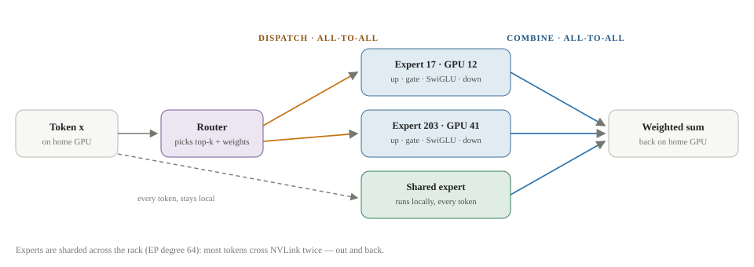
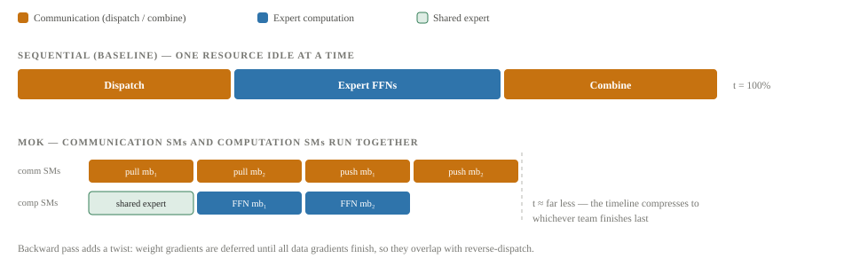
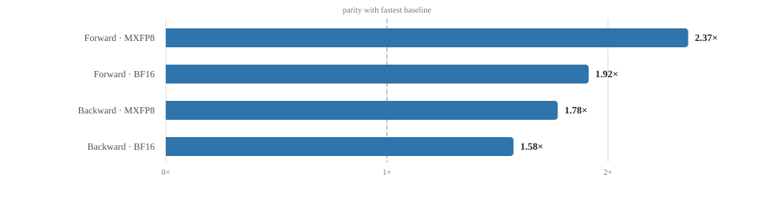
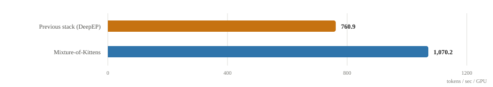

# Mixture of Kittens

An XO Research illustrated explainer on Mixture-of-Kittens, Cursor's open-source MoE training megakernel for NVIDIA NVL72 racks.

By **Suraj Sharma**, XO Labs · Systems Research Notes. First published 5 August 2026 as *Mixture of Kittens* in [sharmasuraj0123/writings](2026-10-15-mixture-of-kittens.md).

Source: [`research/mixture-of-kittens/index.html`](https://github.com/sharmasuraj0123/writings/blob/a5a356d418d45b63d34624b12ec3d7809167b309/research/mixture-of-kittens/index.html) in [sharmasuraj0123/writings](https://github.com/sharmasuraj0123/writings) at `a5a356d`. Brought into this repo on 2026-10-15 with its text, tables and figures unchanged; only the format moved from HTML to Markdown.

XO Labs · Systems Research Notes

# Mixture of Kittens

**Cursor fused an entire mixture-of-experts layer—every expert computation and every cross-GPU transfer—into one deterministic kernel.** This explainer walks through how Mixture-of-Kittens (MoK) works: why the MoE layer eats half of training time, how pull-based communication beats push, how ring buffers delete CPU synchronization, and what a 1.41× end-to-end speedup means at the scale of tens of thousands of GPUs.

Author  
Suraj Sharma

Published  
5 August 2026

Source  
[cursor.com/blog/mixture-of-kittens](https://cursor.com/blog/mixture-of-kittens)

Reading  
About 18 minutes

Status  
Research note

1 · Introduction

## The last bottleneck

When Cursor profiled the training runs behind Composer, one layer kept dominating the bill: the mixture-of-experts layer, consuming more than half of end-to-end training time.

On 4 August 2026, Cursor's research team (Stuart Sul, Nash Brown, Henry Wildermuth, William Lin, and Federico Cassano) open-sourced **Mixture-of-Kittens (MoK)** — the kernel they built to fix that. It is a training kernel for MoE layers on NVIDIA's GB300 NVL72 racks that fuses *all* MoE communication and computation into a single, fully deterministic megakernel. It already powers Composer training across tens of thousands of GPUs, and the name is a wink at the "Kittens" lineage of tile-based CUDA kernel frameworks.

The core insight is that earlier optimization passes attacked the wrong half of the problem. Making expert matrix multiplies faster doesn't help when the GPUs spend their time waiting on *communication* — the all-to-all shuffles that move every token to its experts and back. And on GB300 hardware there is a second trap: the integrated Grace CPUs are relatively slow, so any design that requires the CPU to coordinate the GPUs pays a heavy synchronization tax.

MoE share of training time \>50% of end-to-end training time before MoK, depending on workload.

Kernel-level speedup 2.37× MXFP8 forward pass vs the fastest public baseline.

End-to-end production gain 1.41× tokens/sec/GPU vs Cursor's previous DeepEP-based stack.

License Apache-2 fully open-sourced at github.com/cursor/mixture-of-kittens.

The thesis of MoK: stop treating communication and computation as separate phases run by separate kernels, and instead schedule both on the same chip, at the same time, from inside one kernel.

2 · Background

## MoE on a rack of 72 GPUs

To see what MoK fuses, you first need the anatomy of a mixture-of-experts layer and the shape of the machine it runs on.

MoK targets DeepSeek-V3-style MoE layers: one **shared expert** that sees every token, plus a large pool of **routed experts**. For each token, a small router network picks the top-k experts and assigns each a weight. Every selected expert runs the same feed-forward recipe — an up projection, a gate projection, a SwiGLU activation, and a down projection — and the outputs are averaged back together using the router weights.

The catch is **expert parallelism (EP)**. With hundreds of experts, no single GPU holds them all; the experts are sharded across a group of GPUs (the EP degree — 64 in Cursor's benchmarks). A token that lives on GPU 3 but routes to an expert stored on GPU 41 has to physically travel there and back. That creates the two all-to-all communication steps that dominate MoE cost: **dispatch** (send each token to the GPUs holding its experts) and **combine** (send the expert outputs back to the token's home GPU).

**Figure 1. One token's trip through an expert-parallel MoE layer**

*Conceptual system map*

The two all-to-all steps (dispatch, combine) bracket every routed expert's feed-forward computation. The standard stack runs the three stages sequentially — communicate, compute, communicate — leaving whichever resource is idle at each moment wasted.

The machine matters too. A GB300 NVL72 rack wires 72 Blackwell GPUs into a single NVLink domain, so any GPU can read or write any other GPU's memory at high bandwidth without going through the network stack. Racks talk to each other over InfiniBand/RoCE. MoK is built to exploit exactly this topology — and to keep the slow Grace CPUs out of the critical path entirely.

#### Dispatch / Combine

The two all-to-all transfers: tokens out to the GPUs holding their experts, expert outputs back to each token's home rank.

#### Expert parallelism

Sharding routed experts across a group of GPUs. The EP degree is the number of GPUs that collectively hold one full copy of the expert weights.

#### Megakernel

A single kernel that fuses what would normally be many kernel launches, scheduling work at the level of individual SM tasks instead of kernel boundaries.

#### SM (streaming multiprocessor)

The GPU's unit of execution — a Blackwell die has 148. MoK hand-partitions them between computation and communication roles.

3 · Communication direction

## Push or pull

Over NVLink, a transfer can be initiated from either end: the sender can push tokens into the receiver's memory, or the receiver can pull them out of the sender's. MoK's first design decision is choosing the right direction for each of the four MoE transfers.

The trade-off has three ingredients. **Scheduling:** a push-based dispatch has to compute, for every token, a three-part address — `{src_index, dst_rank, dst_index}` — which requires sorting token assignments across all ranks. A pull-based dispatch only needs `{src_rank, src_index}`: each GPU independently figures out what to fetch. MoK's schedule kernel ends up costing less than 3% of total MoE runtime.

**Bandwidth:** pushing sends fewer total bytes, but under expert imbalance it skews traffic in one direction while the reverse lanes idle. Because NVLink bandwidth is bidirectional, pull-based dispatch — which spreads load across both directions — delivers up to 29% higher NVLink utilization when experts are imbalanced. **Signalling:** a GPU receiving pushed tokens must wait for readiness signals from all 71 peers before it can trust its buffers; a pulling GPU needs no cross-GPU signals at all. Cursor measured dispatch initiation at 18 µs pull-based versus 103 µs push-based — a 5.8× difference.

Pull-based dispatch latency 18 µs no cross-GPU signalling required.

Push-based dispatch latency 103 µs waits on signals from 71 peers first.

NVLink utilization gain +29% pull vs push when dispatching under expert imbalance.

No single direction wins everywhere, so MoK mixes them — pull where scheduling and signalling dominate, push where it complements the buffers the previous phase already laid out:

| Transfer | Pass | Direction | Why |
|----|----|----|----|
| Dispatch | Forward | PULL | Two-column schedule, zero cross-GPU signalling, balanced bidirectional traffic. |
| Combine | Forward | PUSH | Results stream straight back to known home-rank slots as experts finish. |
| Reverse-combine | Backward | PULL | Mirrors forward dispatch's structure and advantages. |
| Reverse-dispatch | Backward | PUSH | Mirrors forward combine's structure. |

Direction chosen for each of the four MoE transfers {.data-table}

4 · Granularity

## The right grain

Overlapping communication with computation means chopping the token stream into minibatches. Too fine, and the tensor cores starve; too coarse, and the overlap disappears.

A **minibatch** is the number of tokens sent per communication round. If a minibatch is tiny, each expert GEMM has too little work to fill the chip. If it is huge, computation can't start until a long transfer finishes and the overlap collapses back toward the sequential baseline. Cursor's heuristic: a minibatch should be big enough that each GEMM launches at least **two full waves** of work — where a wave is one round of every SM on the die executing a tile simultaneously.

T  ≥  (2 · C · 128 · 256) ⁄ min(2I, H)

- `T` — minibatch size: tokens per communication round
- `H` — model hidden dimension; `I` — expert intermediate dimension
- `C` — number of SMs on the GPU (148 on Blackwell)
- `128 × 256` — the output tile each SM computes per wave

Worked example from the post: for a Kimi-class shape (H = 7168, I = 2048) on a 148-SM Blackwell die, the bound gives T ≥ 2368 tokens. Cursor's microbenchmarks found peak throughput around 2560 tokens per minibatch — closely matching the two-wave prediction, which is the kind of agreement that suggests the model of the hardware is right, not just lucky.

5 · Inter-SM overlapping

## Splitting the chip

Inside the megakernel, the 148 SMs are partitioned into two teams: computation SMs that run expert FFNs, and communication SMs that move tokens. Both run simultaneously, handing off minibatch by minibatch.

The reason this works is the Tensor Memory Accelerator (TMA): TMA-driven loads and stores are so efficient that **less than a third of the SMs can saturate NVLink bandwidth**, leaving the rest free to do math. In the forward pass, communication SMs start pulling the first minibatch while computation SMs warm up on the shared expert — which needs no communication at all and fits neatly into the gap before the first routed tokens arrive. From then on it is a relay: each arriving minibatch is signalled ready, computed, and pushed back as the next one streams in.

**Figure 2. Sequential baseline vs MoK's overlapped schedule**

*Schedule comparison*

Minibatch-grained hand-off between the two SM teams. The shared expert — which needs no communication — fills the dead time before the first routed minibatch arrives.

The backward pass is the harder half. It must replay forward activations, and it produces two kinds of gradients: data gradients (needed immediately by the previous layer) and weight gradients (needed only at the optimizer step). MoK delays the weight-gradient GEMMs until all data gradients are done, which both frees them to overlap with reverse-dispatch communication and keeps the accumulation order stable.

6 · Memory

## Ring token buffers

How big should the landing buffer for incoming tokens be? Under expert imbalance you don't know until the tokens arrive — and asking the CPU is exactly the synchronization MoK exists to avoid.

The classic options are all bad: over-allocate worst-case buffers (wastes gigabytes), drop tokens that overflow (hurts the model), or synchronize with the CPU to size buffers exactly (stalls on the slow Grace cores). MoK's answer is a fixed-size **ring buffer** of a few hundred megabytes, cycled through at minibatch granularity. Tokens stream into ring regions called **macrobatches**; when the write cursor reaches the end it wraps around to regions whose tokens have already been consumed. No drops, no CPU, bounded memory.

Two refinements squeeze the ring harder. **Dispatch–combine interleaving:** the combine for one macrobatch overlaps with the dispatch of the next in the same ring region, so a region is refilling the moment it drains. **Reversed ring:** the forward pass walks macrobatches in reverse order, so the activations still sitting in the ring when the layer finishes are precisely the ones the backward pass wants first — minimizing how much must be recomputed or replayed.

The ring buffer is the piece that makes the megakernel viable at all: it converts "we can't know buffer sizes without the CPU" into "we never need to know them."

7 · Implementation

## The megakernel dividend

Fusing everything into one kernel isn't just about shaving launch overhead — it's what makes the SM partitioning, the determinism, and the precision tricks possible at all.

#### Bitwise determinism

The same input produces bitwise-identical output regardless of hardware scheduling. That makes ablations trustworthy and keeps on-policy RL post-training honest — the sampled policy is exactly the trained policy.

#### Cluster Launch Control

CLC lets the kernel yield SMs to higher-priority streams without finishing, so intra-rack NVLink work overlaps with inter-rack InfiniBand/RoCE (RDMA) instead of serializing behind it.

#### MXFP8 fused quantization

Both BF16 and MXFP8 modes; activation quantization is fused directly into dispatch, the expert GEMMs, and SwiGLU. The shared expert stays BF16 for stability.

#### Cheap router gradients

Router weight gradients come from a SonicMoE-style inner-product formulation, avoiding materializing full down-projection outputs just to differentiate the router.

#### Tunable SM split

The ratio of computation to communication SMs is a tuning knob, set separately for forward and backward passes to match their different comm/compute balance.

#### Task-level fusion

Work is scheduled at the SM-task level rather than at kernel boundaries — no launch gaps, and the partitioning is enforced in software rather than hoped-for via CUDA streams.

The open-source release is a working production artifact, not a paper artifact: Apache-2.0, CUDA sources in `csrc/`, a thin op layer (`mok/ops.py`) and a functional API (`mok/functional.py` — `schedule()`, `forward()`, `backward()`, `mxfp8_quantize()`), with benchmarks and torchrun-based tests. It requires Blackwell SM100/SM103 hardware (GB200/GB300 NVL72), CUDA 13.0+, Python 3.12+, and PyTorch 2.10+.

8 · Evidence

## The numbers

Cursor benchmarked MoK two ways: the MoE layer in isolation on a single NVL72, and end-to-end production training across multiple racks.

The isolated benchmarks ran at EP degree 64 with 2048 tokens per GPU, against four public baselines — NCCL + PyTorch, DeepEP + PyTorch, DeepEP + TransformerEngine, and HybridEP + Megatron (NVIDIA's recommended stack) — across four production-scale model shapes:

| Model shape       | Routed experts | Hidden (H) | Intermediate (I) | Top-k |
|-------------------|----------------|------------|------------------|-------|
| Kimi K2.7 Code    | 384            | 7168       | 2048             | 8     |
| GLM-5.2           | 256            | 6144       | 2048             | 8     |
| Qwen3.5-397B-A17B | 512            | 4096       | 1024             | 10    |
| DeepSeek-V4-Pro   | 384            | 7168       | 3072             | 6     |

Model shapes used in the MoE layer benchmarks {.data-table}

**Figure 3. Peak speedup over the fastest public baseline**

*MoE layer · single NVL72 · EP 64 · 2048 tokens/GPU*

Best-case speedups of the fused MoK layer against the fastest of four public baselines (NCCL+PyTorch, DeepEP+PyTorch, DeepEP+TransformerEngine, HybridEP+Megatron), per pass and precision. Hover a bar for detail.

**Figure 4. End-to-end training throughput**

*Production training · 512 GPUs · multiple NVL72 racks*

Cursor's production run: swapping the DeepEP-based MoE stack for MoK lifted whole-run throughput from 760.9 to 1,070.2 tokens/sec/GPU — a 1.41× end-to-end gain, on top of a stack that was already heavily optimized.

The gap between "2.37× on the layer" and "1.41× end to end" is Amdahl's law doing its usual work — the MoE layer was a bit over half the runtime, and MoK collapses most of that share. That the end-to-end number is this close to the theoretical ceiling is the strongest evidence the fusion approach is sound.

9 · Analysis

## Why it matters

Beyond the speedup, MoK is interesting for what it says about how frontier infrastructure gets built in 2026.

- **Determinism is becoming a feature, not a nicety.** Bitwise-reproducible training makes ablations trustworthy and is close to a requirement for clean on-policy RL — a signal about where post-training is heading across the industry.
- **The abstraction stack is collapsing.** Cursor skipped NCCL, skipped the communication libraries, and wrote directly against the hardware. Their stated reason: AI coding agents changed the economics. "Agents automated the simpler tasks (e.g., single-operator kernels) and helped us get through the harder ones (e.g., writing a distributed MoE megakernel) much faster and with a very small team."
- **Co-design with the rack, not the chip.** Every major decision — pull vs push, TMA-driven comm SMs, CLC yielding, avoiding the Grace CPUs — is specific to the NVL72 topology. The unit of optimization is now the 72-GPU rack.
- **Open source as a competitive statement.** An application company (an IDE maker!) shipping state-of-the-art training kernels under Apache-2.0, with maintenance plans, signals how vertically integrated the leading AI labs have become — and invites the field to standardize on their layer.

The kernel is the paper: MoK's deepest claim is that the boundary between "ML research" and "systems engineering" has dissolved — the fastest path to a better model ran through a hand-partitioned SM schedule and a ring buffer.

10 · Sources

## References

1.  Sul, S., Brown, N., Wildermuth, H., Lin, W., Cassano, F. "Mixture-of-Kittens: our open-source MoE megakernel for NVL72s." Cursor Research Blog, 4 August 2026. [cursor.com/blog/mixture-of-kittens](https://cursor.com/blog/mixture-of-kittens)
2.  Mixture-of-Kittens source repository (Apache-2.0). [github.com/cursor/mixture-of-kittens](https://github.com/cursor/mixture-of-kittens)
3.  DeepSeek-AI. "DeepSeek-V3 Technical Report" — the MoE layer architecture (shared + routed experts, top-k routing, SwiGLU FFNs) that MoK targets. [arxiv.org/abs/2412.19437](https://arxiv.org/abs/2412.19437)
4.  DeepSeek-AI. "DeepEP" — the expert-parallel communication library used in Cursor's previous production stack and as a benchmark baseline. [github.com/deepseek-ai/DeepEP](https://github.com/deepseek-ai/DeepEP)
5.  NVIDIA. "GB300 NVL72" — the 72-GPU NVLink-domain rack architecture MoK is co-designed with. [nvidia.com/en-us/data-center/gb300-nvl72](https://www.nvidia.com/en-us/data-center/gb300-nvl72/)
6.  Announcement thread by Stuart Sul, 4 August 2026. [x.com/stuart_sul](https://x.com/stuart_sul/status/2084670945713893725)
