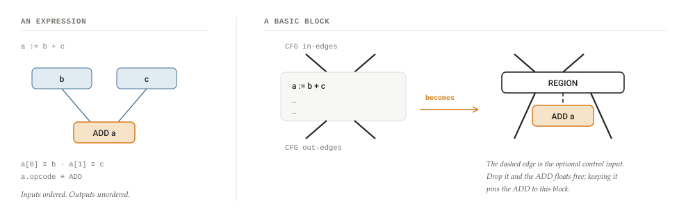
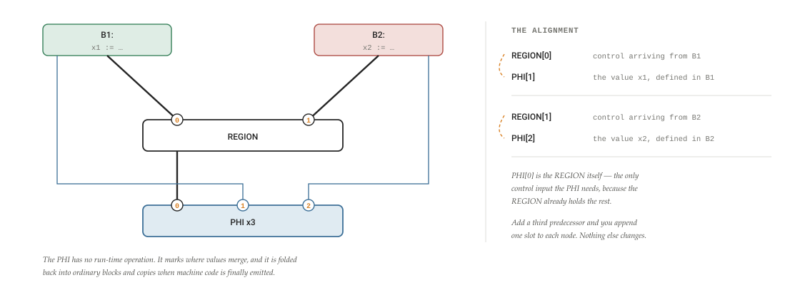
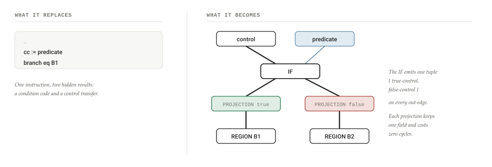
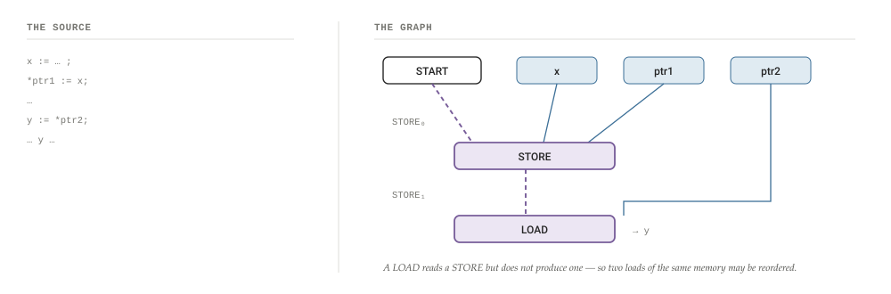
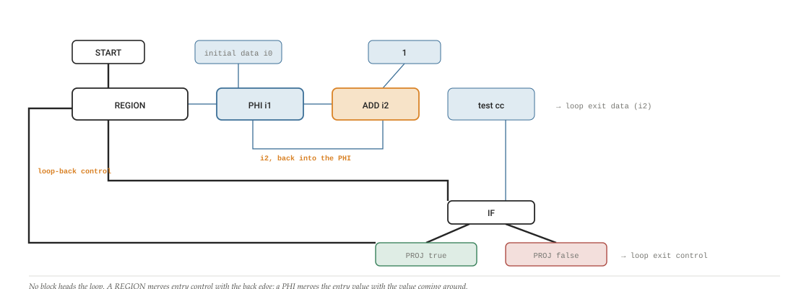
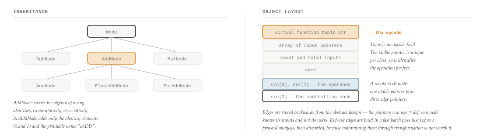
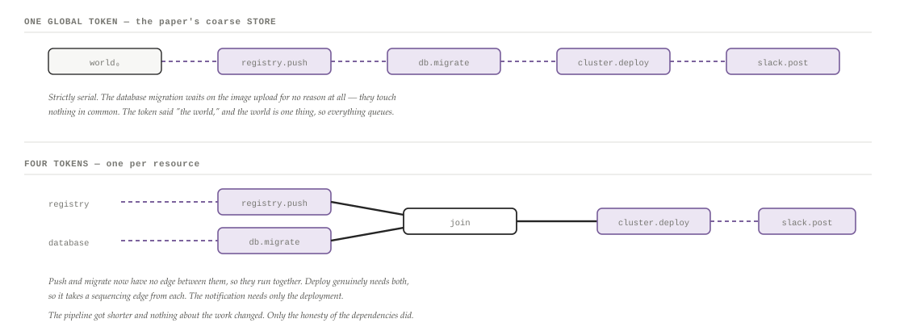

# One Graph, No Boxes

A close reading of Click and Paleczny's 1995 paper, the origin of the Sea of Nodes — every structural figure redrawn and worked through, from REGION nodes and PHI alignment to memory-as-a-value, the Petri-net execution model, and the experiment whose result surprised its own authors. Then the part that isn't in the paper: the general recipe inside it, and how to apply it to any data you will ever model.

By **Suraj Sharma**, XO Labs · Paper Reading. First published 1 August 2026 as *One Graph, No Boxes* in [sharmasuraj0123/writings](https://github.com/sharmasuraj0123/writings/tree/a5a356d418d45b63d34624b12ec3d7809167b309/chromium/sea-of-nodes-paper). Subject: Click & Paleczny, *A Simple Graph-Based Intermediate Representation*, IR'95, pp. 35–49

Source: [`chromium/sea-of-nodes-paper/index.html`](https://github.com/sharmasuraj0123/writings/blob/a5a356d418d45b63d34624b12ec3d7809167b309/chromium/sea-of-nodes-paper/index.html) in [sharmasuraj0123/writings](https://github.com/sharmasuraj0123/writings) at `a5a356d`. Brought into this repo on 2026-10-15 with its text, tables and figures unchanged; only the format moved from HTML to Markdown.

## 01 · Why read a paper from 1995

Most influential systems papers are influential because of an algorithm. This one is influential because of a deletion. Click and Paleczny looked at the standard two-level structure every compiler used — a control-flow graph of basic blocks, each holding a list of instructions — and removed the top level. Then they removed the lists. What was left was a graph, and the graph turned out to be enough.

The paper is fifteen pages, it is written plainly, and its abstract promises almost nothing: "a graph-based intermediate representation (IR) with simple semantics and a low-memory-cost C++ implementation." The sentence that matters is the fourth one: "We represent the CFG and basic blocks with the same vertex and edge structures."

That representation is now called the *Sea of Nodes*, and it went on to become the IR of HotSpot's C2 server compiler, of GraalVM, of the Firm compiler framework, and — for more than a decade — of V8's TurboFan. If you have run Java or JavaScript at speed, you have run code shaped by this paper.

This is a close reading. Every one of the paper's structural figures is redrawn here in a consistent visual language, each with a worked example, and the paper's own numbers are reported as it reported them. If you want the gentle version first, the [short explainer](2026-10-15-sea-of-nodes.md) covers the same idea in ten minutes without the source. The final third of this piece is not in the paper at all: it is the general recipe hiding inside it, and where else it applies.

> **Reading conventions, theirs and mine**
>
> The paper writes opcodes in `SMALLCAPS`, refers to a node's inputs with array syntax (`x[0]` is the node defining *x*'s first input), and underlines special values like *control* and *store*. I keep the opcode names. In every diagram below: **thin blue** is a data edge, **thick black** is a control edge, **dashed purple** is the memory/store chain, and a badge like paper fig. 3 tells you which of the paper's own figures a drawing corresponds to.

## 02 · The setup, and the notation

The paper is careful to define its object before doing anything with it. The representation is "a directed graph with labeled vertices and ordered inputs but unordered outputs." Unpack that slowly, because all four properties do work later:

- **Vertices are labeled, edges are not.** The label is the opcode. An edge carries no information at all — it is a bare pointer. This is a deliberate implementation constraint, and §05 shows what they do when they genuinely need a labeled edge.
- **Inputs are ordered.** `x[0]` and `x[1]` are different things, which is what lets a `SUB` node know which operand is the minuend.
- **Outputs are unordered.** "Each node defines a value based on its inputs and operation, and that value is available on all output edges." A node does not know or care who reads it. The only operation on outputs is to iterate them.
- **Values include abstract quantities.** Not just integers and pointers, but "the state of memory, I/O with the outside world or control." That sentence is the whole paper in miniature. Control is not a structure that contains the graph. Control is a *value flowing through it*.

The starting assumption is that the program is already in a simple canonical form — one primitive operation per assignment, in SSA form, so each name is assigned exactly once and different versions carry subscripts. The paper is not about getting to SSA; it is about what to do once you are there.

The first figure is deliberately trivial. An expression `a := b + c` is one node labelled `ADD` with two inputs.

**Figure 1. An expression, and the death of the basic block paper figs. 1–2**

"We handle both kinds of dependences with the same mechanism, removing this distinction to simplify our representation." A `REGION` node takes a control value from each predecessor and produces one merged control. Every primitive node *may* take a control input to say which block it is in — and the paper flags immediately that this edge "is not always required. Removing it enables a number of global optimizations but requires a more complex serialization operation for output."

That footnote-sized remark is the seed of everything the representation is later praised and blamed for. An operation with no control edge is not in any block. It has no location. Thirty years of "the sea of nodes lets code float" descends from one optional pointer.

## 03 · Removing a level: REGION nodes

It is worth pausing on why merging the two levels is more than tidiness. In a conventional compiler, a control-flow graph and the instructions inside it are different data structures with different algorithms. You write a dominator computation over blocks and a def-use analysis over instructions. Two worlds, two vocabularies, and a constant translation cost at the boundary.

Once a block is just a node, the boundary disappears. A pass that walks nodes walks control flow for free. A transformation that replaces a node with a cheaper equivalent works identically whether the node was an `ADD` or a `REGION`. The paper reports the practical consequence in its conclusion: "The consistent treatment of control and data edges simplifies the intermediate representation and implementation of the compiler."

The paper also notes, almost in passing, that this handles the control flow that textbooks find awkward. "Irreducible loops are handled very naturally. A second `REGION` (and a second set of `PHI` nodes) marks the second entry into the loop. Unstructured control flow is also handled naturally; `REGION` nodes mark places where control flow merges and `IF` nodes are places where control flow splits." There is no special case, because there was never a structure to violate.

## 04 · PHI nodes, and the alignment trick

Here is the paper's neatest piece of design, and the one most worth stealing.

The program is in SSA form, so where two branches assign the same variable, a φ-function merges them: `x3 := φ(x1, x2)`. But a φ-function is meaningless on its own — you have to know *which* input corresponds to *which* incoming path. Take the wrong one and the program is wrong.

The obvious encoding is to make each input a pair: `(value, incoming block)`. The paper rejects it in one sentence — "This is an ungainly structure with complicated semantics" — and does something better. The `PHI`'s first input is the `REGION` it belongs to. Its remaining inputs are *positionally aligned* with that `REGION`'s control inputs: "The *i*th data input to the `PHI` node matches the *i*th control input to the `REGION` node."

The pairing still exists. It has simply been split across two nodes and encoded in the input order, which costs nothing to store and nothing to check.

**Figure 2. A PHI and its REGION, aligned by position paper fig. 3**

The paper's stated reason for doing it this way is *compositionality*: an instruction should carry everything needed to reason about it. Its footnote is worth memorizing as a design principle in any field — "A non-compositional representation is difficult to transform correctly because changing an instruction may require information not directly associated with the instruction."

That is also the paper's main criticism of its predecessors. Of the Program Dependence Graph: it "lacks the control information required at merges for an execution model." Of Alpern, Wegman and Zadeck's value graph: it "lacks control information at φ-functions and therefore does not have a model of execution." Both had the graph. Neither could say what happens at a join, so neither could be *run*. One extra edge is the difference between a diagram of a program and a program.

## 05 · IF nodes, tuples, and projections

A branch becomes an `IF` node taking control and a predicate. It has to produce two different things — control-if-true and control-if-false — and here the paper collides with its own rule that edges carry no labels.

The obvious fix is to label the outgoing edges. They refuse: "This requires edges to carry information and has a direct (negative) impact on our implementation. We prefer to keep our edges very lightweight."

So instead, a multi-output node produces a *tuple*, the same tuple on every outgoing edge, and small `PROJECTION` nodes pull out the piece each consumer wants. A projection holds one field index and has no run-time cost — the paper notes they "execute" in zero cycles.

**Figure 3. A branch, and the projections that unpack it paper figs. 4–5**

This pattern generalizes past branches. Any operation with several results — a subtract that also sets condition codes, a call that returns a value *and* a new memory state *and* a new I/O state — emits a tuple and is unpacked by projections. It is how the paper keeps one uniform edge type while modelling instructions that do more than one thing.

## 06 · Memory as a value

Everything so far handles pure computation and control. The hard part of any real program is memory, and the paper's answer is radical in its simplicity: "We treat memory like any other value, and call it the `STORE`."

There is one abstract value representing the entire state of memory. The `START` node produces the first one. A `LOAD` takes a `STORE` and an address and produces an ordinary value. A `STORE` node takes a `STORE`, an address and a value, and produces a *new* `STORE`. And because memory is now just a value, `PHI` nodes merge it at joins exactly like anything else.

No new machinery was needed. Ordering between memory operations falls out of ordinary data dependence: the second store cannot happen before the first, because it consumes what the first produced.

**Figure 4. The store, threaded as a value paper fig. 6**

Read the dashed line as "the state of memory after you ran." The `STORE` node consumes `STORE₀` and produces `STORE₁`; the `LOAD` consumes `STORE₁`, which is exactly the constraint the program requires and nothing more.

The consequence is stated with unusual honesty: "The lack of anti-dependences is a two-edged sword." Because a `LOAD` does not produce a new store, loads between two stores are free to reorder — a real win. But nothing in the graph forbids a schedule in which two different versions of memory are live at the same time, "requiring that all of memory be copied."

Their fix is a lovely bit of engineering pragmatism. The serialization pass "treats memory like a type of unique machine register with infinite spill cost." The scheduler already knows how to avoid spilling expensive registers; make memory the most expensive register imaginable and the existing machinery will never choose a schedule that copies it. And, they add, "for the `STORE` it always succeeds."

Then they volunteer the weakness. "This design of the `STORE` is very coarse. A better design would break the global `STORE` into many smaller, unrelated `STORE`'s. Every independent variable or array would get its own `STORE`." One global memory token means every write orders against every read of anything. That is correct and badly over-constrained, and §13 will argue this is the most transferable lesson in the paper.

I/O gets the same treatment with one difference: a `READ` produces a new I/O state, where a `LOAD` does not produce a new store. That single extra dependence "completely serializes I/O" — which is what you want, since you cannot un-print a line. And subroutines are "simple instructions that take in many values and return many values": control, store, I/O state, plus arguments and results, unpacked by projections.

## 07 · A model of execution

Having thrown away the control-flow graph, the authors owe us an answer to "what does it mean to run this?" Their answer is that there are two subgraphs with two different semantics, sharing one data structure.

**Control is a Petri net.** A single token moves from node to node, and it is only ever at a `REGION`, an `IF`, or `START`. When it reaches `STOP`, execution halts. Because the graph was built from a control-flow graph, "we are assured only one suitable target exists on all the current node's outgoing edges" — the token is never ambiguous about where to go.

**Data is not a Petri net.** There is no data token. "Data values are available in unlimited amounts on each output edge," and a node's output is "an immediate reflection of their inputs and operation." The paper's phrase for this is my favourite in the whole document: in an acyclic graph, "changes ripple from root to leaf *at the speed of light*." Only when data has settled does the control token move on.

The two meet at exactly two node types.

**Figure 5. Two semantics in one graph**

#### Control subgraph

Token-based, one token, Petri-net semantics. Lives only at `START`, `REGION`, `IF`, `STOP`. Moving the token is what "time passing" means.

#### Data subgraph

No tokens. Values are always present and always current on every output edge. Nothing "executes"; a node simply *is* its inputs combined by its operation.

| Meeting point | Reads | Produces | Behaviour |
|----|----|----|----|
| `PHI` | control + several data values | one data value | Unlike other data nodes, it changes output only when its `REGION` is visited: it *latches* the value on the matching control input. The token is not consumed. |
| `IF` | control + one predicate | a tuple: `{control, ∅}` or `{∅, control}` | The projections downstream therefore yield either the token or nothing at all — which is precisely how a branch "not taken" is expressed without a special case. |

One invariant keeps the model well-founded: "We never build a graph with a loop of only data-producing nodes; every loop has either `PHI` or `REGION` nodes." A cycle of pure data would have no defined value. A cycle through a `PHI` has one, because the `PHI` only updates when control arrives.

## 08 · The loop, in full

Everything up to here is componentry. This is the figure that makes it click: a whole loop, in one graph, with no blocks anywhere.

    Start:  i0 := initial data
    loop:   i1 := φ(i0, i2)
            i2 := i1 + 1
            cc := test(i2)
            branch eq loop
            … i2 …

**Figure 6. A counted loop as a single graph paper fig. 7**

Look at what is *not* in this picture: any statement about where `ADD` or `test` live. They have data inputs and nothing else. A later pass decides they belong in the loop body — and if `ADD`'s inputs had turned out to be loop-invariant, the same pass would have placed it outside the loop with no special "hoisting" logic at all.

## 09 · The implementation: an opcode is a vtable pointer

Half the paper is about C++, and it is the half that explains why the design survived contact with a real compiler.

The problem they are solving is stated as a complaint about their own earlier version: "The C version used large switch statements to branch on the operation. This spread out the semantics of any individual operation into many disjoint sections of code. Adding a new operation was painful; each switch had to be altered individually."

So: one C++ class per opcode, inheriting behaviour. And then the move that makes the whole thing cheap — the class `Node` has *no opcode field*. "The virtual function pointer is unique to each class; we use it as the node's opcode."

**Figure 7. How an operation becomes a class, and what a node costs paper figs. 8, 9, 12**

Two more implementation details worth stealing. Value numbering is a hash table over nodes, and the hash and comparison are *virtual* — so `ADD` can declare itself commutative and hash its inputs in any order, while a constant folds its literal into the hash. Algebraic identities are a virtual `Identity()` that returns an equivalent existing node: integer subtract returns its left input when the right is zero. "To make the intermediate representation understand a new kind of operation we need only to define a new class… We do not need to make any changes to the optimization code itself."

And because a parse-time optimizer creates nodes it will immediately throw away, allocation has to be nearly free. They replace `operator new` with an arena: bump a high-water mark, and on delete, check whether the freed object was the last one allocated and if so simply un-bump the pointer. Allocation is an inlined test and increment; deallocation of the common case is a comparison. "The very fast allocation-deallocation cycle allows a parse-time optimizer to quickly perform naive node creation which may be reversed by an immediately following optimization."

One loose end they handle carefully: SSA is a compiler fiction, and real machines have registers. Rather than deleting φ-functions, they "make them merge exactly the same set of names" — assign every value a unique virtual register, insert a `COPY` on every φ input, give the copy the φ's destination name, and let a register allocator sort it out. They are candid that "this `COPY` insertion method is very naive. A robust compiler requires a coalescing phase afterwards."

## 10 · Optimizing while you parse

The last idea in the paper is the one with the most surprising payoff. Because building the graph gives you use-def information immediately, you can optimize *during parsing*, before any global analysis runs at all.

The rule is a single sentence: "every time the parser builds a new node but before the node is referenced by any other node, the parser attempts to replace the new node with an existing node that computes the same value." The new node is asked, via those virtual functions, three questions — are you a constant? are you an algebraic identity on some other node? does an equal operation on equal inputs already exist? — and if any answers yes, the fresh node is deleted and the old one used instead.

The paper is precise about why this is weaker than global analysis: it must be *pessimistic*, "because we do not know what the not-yet-parsed program will do." It is a peephole — but a peephole over a graph rather than over a sequence, and that changes what it can see. The window "looks over the program graph instead of sequential instructions, providing the compiler with access to related instructions far away in the program text."

> **The detail that makes it work**
>
> "During value-numbering we ignore the control input to computing nodes that do not cause exceptions. This allows value-numbering to find nodes in different control regions to be the same." Two identical computations in different branches can therefore be merged into one — which immediately creates a node that dominates nothing and lives nowhere. That is legal only because a later Global Code Motion pass will choose a block for it, and GCM "relies solely on dependence information and does not need any prior legal ordering of instructions."

## 11 · The result that surprised the authors

The experiment: 52 procedures across a dozen applications — mostly FORTRAN, plus the C constraint solver *cplex*, including *doduc*, *tomcatv*, *matrix300* and *fpppp* from SPEC89 — compiled to the ILOC virtual assembly language and run on a simulator that counts cycles. Every application ran to completion and produced correct results.

Two questions. Does parse-time peephole optimization save compile time? And how much code quality do you lose by using *only* the peephole instead of a full global analysis?

The first answer is modest: 108.8 seconds with the peephole pass versus 116.1 seconds without, across all applications — a 6.3% saving on total compile time.

The second answer is the interesting one.

**Figure 8. Cycles on the ILOC virtual machine — a selection paper figs. 15–16**

| Routine | No optimization | Parse-time peephole + GCM | Full global analysis + GCM | Peephole vs. global |
|----|----|----|----|----|
| `doduc/bilan` | 3,137,306 | 536,432 | 524,407 | +2% |
| `doduc/cardeb` | 883,190 | 168,165 | 168,165 | — |
| `doduc/deseco` | 11,436,316 | 2,182,909 | 2,165,334 | +1% |
| `doduc/pastem` | 2,233,270 | 625,336 | 589,076 | +6% |
| `fpppp/efill` | 4,166,782 | 2,046,512 | 1,927,529 | +6% |
| `fpppp/fpppp` | 115,738,146 | 26,871,102 | 26,871,102 | — |
| `matrix300/saxpy` | 47,540,000 | 13,340,000 | 13,340,000 | — |
| `cplex/xaddrow` | 39,109,805 | 16,345,264 | 16,345,264 | — |
| `tomcatv/tomcatv` | 1,287,422,939 | 248,494,642 | 240,688,724 | +3% |
| `svd/svd` | 12,895 | 4,596 | 4,438 | +4% |

The distance from column two to column three is a factor of two to six. The distance from column three to column four is zero to six percent. Across the whole suite, full global analysis bought 1.9% fewer cycles in total and 0.8% on average over the peephole. The authors' own reaction: "Rather surprisingly, this means that most constants and common subexpressions are easy to find."

Sit with that for a moment, because it is a finding about *engineering effort*, not just about compilers. A cheap local rule, applied relentlessly at construction time over a representation that exposes the right relationships, got within one percent of an expensive global analysis. The representation did the work that the algorithm would otherwise have had to do.

The lesson is not "skip the global analysis." The paper explicitly says the peephole is "not a replacement for global analysis or optimistic transformations." The lesson is that **if your structure makes the common case obvious, your clever pass only has to handle the rare case** — and you will be surprised how rare the rare case is.

## 12 · What the paper does not claim

A good paper is legible about its own edges, and this one is. Four things it does not do:

**It does not schedule.** Once you allow nodes to float, something must eventually decide where they go, and that algorithm — Global Code Motion — is a separate paper by the same author in the same year. This paper only says GCM "orders instructions by setting the control input to some `REGION` node, thus selecting a basic block. Other dependences determine the order within the basic block." The sea of nodes is half a system; the scheduler is the other half.

**It does not solve aliasing.** One global `STORE` is admitted to be "very coarse." The fix is named but not built: split memory per variable or array, and "add some understanding of pointers."

**It does not evaluate readability.** There is no discussion of debugging a graph with no canonical order, no visualization tooling, no developer-experience section. In fairness nobody wrote those sections in 1995. It is nonetheless the axis on which the design would later be judged.

**It does not measure cache behaviour.** The ILOC virtual machine has "1 cycle latencies for all operations, including `LOAD`s," and the authors say plainly that "our machine model does not include a memory hierarchy… we can not measure the effects of memory access patterns." Thirty years later that omission is where the design's real cost turned up.

> **The postscript**
>
> In 2025, after more than a decade of running TurboFan on this representation, the V8 team published *Land ahoy: leaving the Sea of Nodes* and moved to a conventional control-flow graph. Their measurements: roughly 3× the L1 cache misses on average and up to 7× in some phases, nodes revisited about once every twenty visits, and — the deepest objection — that in a language dominated by side effects, almost every node is pinned to an effect chain anyway, so "SoN is just CFG where pure nodes are floating." The replacement halved compile time. I wrote about that [here](2026-10-15-sea-of-nodes.md).
>
> This does not retire the paper. It calibrates it. The technique pays in proportion to how much of your work is pure — which is exactly the variable §13 asks you to measure before adopting it.

## 13 · The general technique

Strip out the compiler vocabulary and what is left is a way of representing *any* process over *any* data. Here is the whole method, with nothing about programs in it:

1.  Make every operation a node.
2.  Draw an edge from a node to each input it genuinely needs.
3.  Record no other ordering.
4.  Where order matters but no data flows, add a second edge type — a **sequencing edge**.
5.  Where operations touch shared state, thread a **state token** through them: each one consumes the previous state and produces the next.
6.  Decide placement, ordering and parallelism as late as possible, from the edges alone.

That is it. Steps 1–3 are the graph. Step 4 is `REGION` and `IF`. Step 5 is the `STORE`. Step 6 is Global Code Motion. And the four gifts the paper gets from this structure are available to you in any domain, because none of them is about compilation:

**Figure 9. Four properties, and what each one buys outside a compiler**

| Property of the graph | In the paper | Everywhere else |
|----|----|----|
| **A node is identified by its operation and inputs** | Value numbering by hash table — two equal nodes become one | Content-addressed caching. Build systems that hash inputs and skip work. Memoization. Merkle deduplication. Query planners folding identical subqueries. The cache key *is* the node identity. |
| **A node nobody points at is unreachable** | Dead code elimination becomes not visiting it | Tree-shaking. Pruning a pipeline to the tasks a requested output actually needs. Lazy evaluation. Not fetching data no view renders. |
| **Independent nodes have no edge between them** | Instructions reorder freely | Parallelism, for free and provably safe. Anything with no path between it can run at the same time — this is what a job scheduler, a GPU kernel launcher, and `make -j` are all reading. |
| **Placement is decided last** | Global Code Motion picks a block | Deciding *where* work runs — which machine, which batch, which frame, eagerly or on demand — without changing what the work is. Operator fusion, predicate pushdown, and lazy loading are all this move. |

None of these is an algorithm you add. Each is a consequence of having written down the dependencies and nothing else. That is the trade the representation offers: give up the convenience of an order, get these four back.

The mapping into other domains is unusually direct once you know what to look for. The three edge types keep their meanings; only the nouns change.

**Figure 10. The same structure, eight times over**

| Domain | A node is | A value edge is | The state token is | "Two equal nodes" means |
|----|----|----|----|----|
| **Spreadsheet** | a cell | a formula reference | volatile functions — `NOW()`, `RAND()`, anything reading outside the sheet | a shared sub-formula computed once, and a recalculation order that is just a topological sort |
| **Build system** | a target or action | an input file or artifact | non-hermetic steps — network access, timestamps, the machine's own state | a cache hit. Bazel and Nix are this idea taken literally: identity by content hash |
| **Data pipeline** | a transform or model | an upstream table | writes to warehouses, external APIs, notification sinks | one materialized intermediate instead of three copies of the same CTE |
| **Reactive UI** | a signal or derived value | a dependency read during evaluation | DOM mutation, fetches, local storage | memoization; and "nobody points at it" means don't recompute it this frame |
| **ML graph** | a tensor operation | a tensor | RNG state, parameter mutation, collectives across devices | common-subexpression elimination in the graph compiler; and placement becomes kernel fusion and device assignment |
| **Query planner** | a relational operator | a column or relation dependency | writes, sequences, anything non-deterministic | a shared scan; and "decide placement last" is exactly predicate pushdown and join reordering |
| **Incremental compiler** | a query (rustc, Salsa, Adapton) | a sub-query's result | reading the filesystem | a memoized result; re-run only the cone downstream of what actually changed |
| **Agent orchestration** | a task or tool call | an artifact a later task consumes | everything that touches the world — files written, messages sent, money spent | a cached tool call; and scheduling decides which agent runs it, when, and how many at once |

Notice which column is doing the real work. The value edges are easy and every system already has them. What separates a system that gets the four properties from one that only draws a pretty diagram is whether it models the *state token* honestly — and how finely.

### A worked example outside compilers

Take an ordinary deployment pipeline, written as it usually is — as a sequence, because that is how we type.

    artifact = compile(src)
    report   = test(artifact)
    image    = package(artifact)
    registry.push(image)
    db.migrate(schema)
    cluster.deploy(image)
    slack.post("shipped")

Now classify every line the way the paper would. Three of them are **pure**: `compile`, `test` and `package` read their inputs and produce a result, and given the same inputs they produce the same result. Four of them are **effectful**: they change the world.

The pure ones immediately get all four properties. They can be content-addressed, so an unchanged `src` means `compile` never runs. They can be skipped entirely if nothing downstream is requested. `test` and `package` both depend only on `artifact`, so they can run at the same time — the graph says so, and no one had to declare it.

The effectful ones are where the design decision lives, and where most real pipelines quietly leave a third of their wall-clock on the floor.

**Figure 11. One state token, or four — the paper's own unfinished idea, applied**

This is precisely the improvement Click and Paleczny describe and do not implement: "A better design would break the global `STORE` into many smaller, unrelated `STORE`'s. Every independent variable or array would get its own `STORE`." Substitute "resource" for "variable" and you have the single highest-leverage change available to most pipelines, orchestrators, and job systems.

### Three warnings, earned the hard way

**Measure your purity ratio before you commit.** Every benefit above accrues to pure nodes. If nine of your ten operations touch shared state, you will build an elaborate dependency graph that is, in practice, the sequence you started with plus overhead. This is exactly what happened to V8: JavaScript is mostly effects, so the freedom the representation offers went largely unclaimed. Count the pure nodes first. If it is most of them — as in a build system, a spreadsheet, a query planner, a tensor graph — the trade is excellent. If it is few, keep your list.

**Granularity of the state token is the whole game.** One token for "the world" is always correct and usually far too strong. It is the same mistake as a single global lock, and it costs the same thing: serialization you did not need. Split the token per resource, per table, per key — as finely as you can prove safe. The paper knew this in 1995 and left it undone; most systems I have read leave it undone too.

**Budget for readability from day one.** A structure with no canonical order has no natural way to be printed, diffed, reviewed, or explained to the person debugging it at 2am. The paper contains no tooling section; V8's retrospective is largely *about* the absence of one. If you adopt this, build the viewer before you build the second optimization.

## 14 · A recipe you can apply to anything

Eight questions. If you can answer all eight about your domain, you have the representation; the rest is implementation.

1.  **What is one operation?** Pick the smallest unit you would ever want to cache, skip, or parallelize. That granularity is your node, and it is hard to change later.
2.  **What does each operation truly need?** Not what precedes it in your current script — what it would fail without. Those are your value edges, and the gap between the two lists is the speedup you are leaving on the table.
3.  **Which operations are pure?** Same inputs, same output, no trace left behind. Be strict; "mostly deterministic" is not pure. Count them, and let the ratio decide whether to continue.
4.  **Where does order matter without data flowing?** Conditionals, gates, "only if the previous step succeeded." These get sequencing edges — the analogue of the paper's `REGION` and `IF`.
5.  **What shared state exists, and how finely can you split it?** One token per independent resource. This is the question worth spending a day on.
6.  **What identifies a node?** Operation plus inputs, hashed. That is your dedup key, your cache key, and your incremental-rebuild key all at once. Get the virtual-hash trick right — declare which operations are commutative, which literals belong in the hash.
7.  **Where do merges happen, and what is the rule there?** This is the paper's compositionality point, and the thing most hand-rolled DAGs get wrong. A join must say which input wins under which condition — not merely that a join occurred.
8.  **Who decides placement, and when?** Name the scheduler. Its policy — as late as possible, as shallow as possible, closest to the data — is a separate, replaceable decision, and keeping it separate is most of the value.

The paper is thirty-one years old and it is still teaching, but not the lesson its title advertises. The lesson is not "use a graph." Everyone uses a graph. The lesson is that a representation which records *only what is true* — no more order than the problem requires, and every ordering that does exist made explicit as an edge you can point at — hands you optimizations you never wrote, and hands the expensive clever pass a much smaller problem.

That holds for instructions in a compiler, cells in a spreadsheet, targets in a build, tasks in a pipeline, and units of work handed to an agent. The nouns change. The four properties do not.

## 15 · Sources

- [Cliff Click and Michael Paleczny, *A Simple Graph-Based Intermediate Representation*](https://www.oracle.com/technetwork/java/javase/tech/c2-ir95-150110.pdf) — Proceedings of the ACM SIGPLAN Workshop on Intermediate Representations (IR'95), San Francisco, January 1995, pp. 35–49. The subject of this piece; fifteen pages, and every quotation above is from it.
- Cliff Click, *Global Code Motion / Global Value Numbering*, PLDI '95 — the scheduling half of the system, referenced throughout the paper as "\[9\]" and not included in it.
- [Land ahoy: leaving the Sea of Nodes](https://v8.dev/blog/leaving-the-sea-of-nodes) — V8, 2025. The thirty-year field report, and the source of every number in the postscript.
- [v8.dev/docs/turbofan](https://v8.dev/docs/turbofan) — V8's index of TurboFan design documents and talks.
- [The Sea of Nodes, explained simply](2026-10-15-sea-of-nodes.md) — the short version of the idea, if you arrived here first.

All quotations are from the IR'95 paper unless attributed to V8. Figures 1–8 above are redrawings of the paper's own figures in a consistent visual language, with the correspondence marked on each; Figure 8's cycle counts are a selection from the paper's Figure 16, reproduced exactly, with the "peephole vs. global" column rounded from the paper's own percentages. Figures 9–11 and the recipe in §14 are not in the paper — they are my generalization of it, and any error in that extrapolation is mine.
