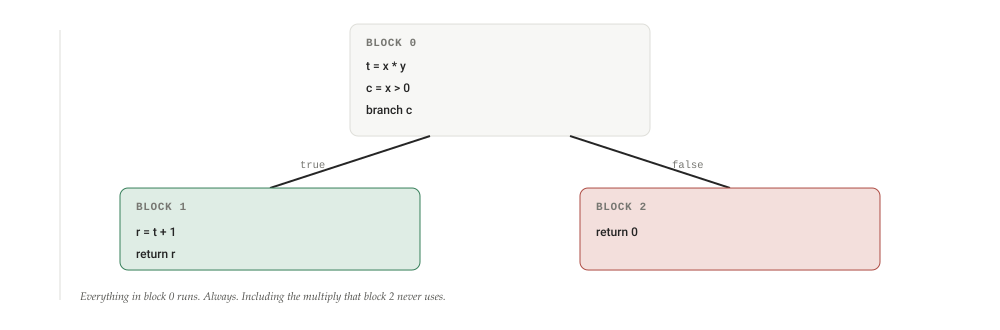
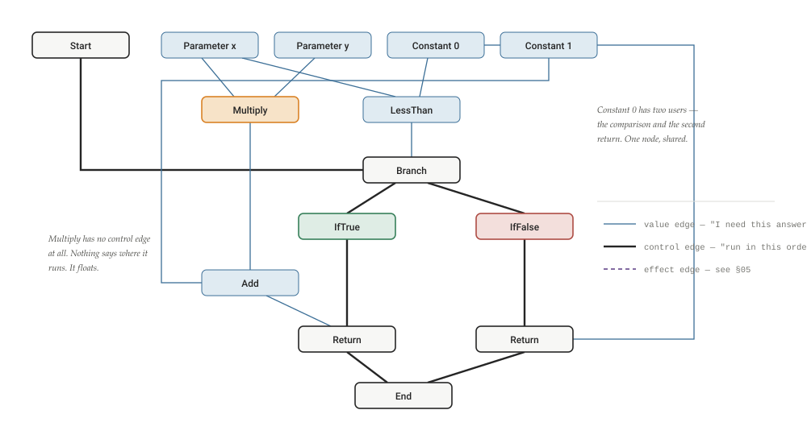
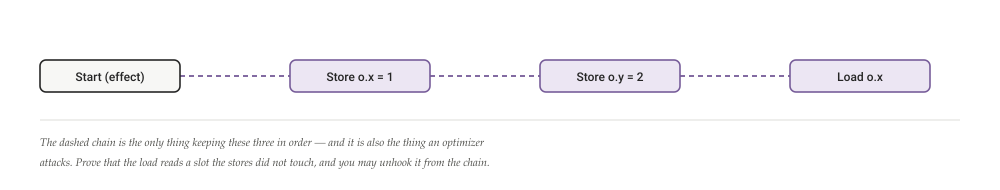

# The Sea of Nodes, explained simply

Compilers usually write your program down as a list of instructions in boxes. V8's TurboFan threw the list away and kept only the dependencies. What that means, the three kinds of edges it needs, why pure instructions float, how the graph becomes a program again — and why V8 eventually sailed back to shore.

By **Suraj Sharma**, XO Labs · Notes. First published 1 August 2026 as *The Sea of Nodes, explained simply* in [sharmasuraj0123/writings](https://github.com/sharmasuraj0123/writings/tree/a5a356d418d45b63d34624b12ec3d7809167b309/chromium/sea-of-nodes). Subject: V8 TurboFan · Click & Paleczny, 1995

Source: [`chromium/sea-of-nodes/index.html`](https://github.com/sharmasuraj0123/writings/blob/a5a356d418d45b63d34624b12ec3d7809167b309/chromium/sea-of-nodes/index.html) in [sharmasuraj0123/writings](https://github.com/sharmasuraj0123/writings) at `a5a356d`. Brought into this repo on 2026-10-15 with its text, tables and figures unchanged; only the format moved from HTML to Markdown.

## 01 · The one question a compiler must answer

When you write a program, you write it in an order. But most of that order is an accident of typing. The compiler's job is to figure out which parts of the order actually matter — and then to take every liberty with the rest.

Look at this function.

    function f(x, y) {
      const t = x * y;
      if (x > 0) {
        return t + 1;
      }
      return 0;
    }

You wrote `const t = x * y` on the first line. Does it have to run first? No. It has to run before `t + 1`, because `t + 1` needs its answer. That is the only real constraint. In fact, if `x` is not greater than zero, the multiplication never needs to happen at all — the function returns `0` and `t` is never read.

So the compiler wants to know: *what must happen before what?* Everything it can do to make your code faster — moving work out of loops, deleting work nobody needs, computing something once instead of twice — is downstream of that one question.

The Sea of Nodes is one answer to it, and it is a very direct one: **store the dependencies, and nothing else.**

## 02 · The usual answer: a list, inside boxes

Nearly every compiler you have heard of uses a **control-flow graph**, or CFG. You chop the program into straight-line runs of instructions — *basic blocks* — and draw arrows between the blocks to show where control can go next. Inside each block, the instructions are a list, in order.

**Figure 1. The same function as a control-flow graph**

This picture is easy to read, and that is its great virtue. Its vice is that it over-promises: it says `t = x * y` runs before `c = x > 0`, which is not true of the program — only of the way we wrote it down. And it pins the multiply into a block that runs on every call, even the ones that never look at the result.

A CFG compiler can still fix both of those. It just has to work for it: run an analysis to prove the two instructions are independent, run another to prove the multiply is safe to move, then move it. The information is recoverable. It simply is not *written down*.

## 03 · The idea: keep only what depends on what

Cliff Click and Michael Paleczny proposed the alternative in 1995, in a paper called *A Simple Graph-Based Intermediate Representation*. The move is easy to state:

> **The whole idea**
>
> Make every single instruction its own node in a graph. Draw an edge from a node to each value it needs. Do not record any other order. An instruction may run at any point where its inputs are ready.

No blocks. No lists. Just nodes and the edges between them — hence the name. V8's own description is exactly this: "Nodes in Sea of Nodes are single instructions (rather than basic blocks), and edges represent value uses."

Here is our function again, drawn that way.

**Figure 2. The same function as a sea of nodes**

Read the arrows as "needs". `Add` needs the multiply and the constant 1. `Return` needs the add. Nowhere does the graph claim the multiply happens before the comparison, because nothing about the program requires that. The order you typed is gone, and only the truth is left.

## 04 · Three kinds of edges

Value edges alone are not enough. Two things in a real program have no data dependency and still cannot be shuffled.

The first is **control**. A `return` does not consume the answer of a `branch`, but it certainly matters which one happens. V8 puts it plainly: control nodes "typically don't have value dependencies between each other… Thus, in order to represent control-flow, we need a new kind of edge, *control edges*, which impose some ordering on nodes that don't have value dependency."

The second is **effects**. Writing to memory, calling a function, throwing — these change the world, and the world has an order. Two stores to the same object do not pass a value between them, but swapping them changes what the program means.

**Figure 3. The three edges, and what each one is protecting**

| Edge | Reads as | Exists because | Example nodes |
|----|----|----|----|
| **Value** | "I need your answer" | You cannot add two numbers before you have them. | `Add`, `Multiply`, `Constant`, `Parameter`, `Phi` |
| **Control** | "I run after you" | Branches and returns must happen in a definite order, even though no value passes between them. | `Start`, `Branch`, `IfTrue`, `IfFalse`, `Merge`, `Return`, `End` |
| **Effect** | "the world was in your state when I ran" | Reads and writes to memory must not be reordered past each other. | `Store`, `Load`, `Call`, `EffectPhi` |

A node can carry all three. A property store has value inputs (the object and the value), a control input (the branch it lives under), and an effect input (the last thing that touched memory). Pure arithmetic has only value inputs — which is exactly what lets it float.

## 05 · Effects, the part people trip on

Effect edges are the least intuitive of the three, so here they are on their own. Take:

    function g(o) {
      o.x = 1;
      o.y = 2;
      return o.x;
    }

Three memory operations. No values flow between them — `o.y = 2` does not consume anything the first store produced. And yet you may not run them in any order you like: if the read of `o.x` floated above the write to `o.x`, the function would return the wrong thing.

So the compiler threads them onto a chain. Each effectful node takes the previous one as an input, in the order the program demands. V8's phrasing: "Similarly to control nodes, effectful operations often have no value dependencies, but still cannot run in a random order," so "we need a way to impose an order (= a schedule) on effectful operations."

**Figure 4. The effect chain, threaded through three memory operations**

That is what "load elimination" means in a sea of nodes: rewriting the effect chain. Here a smart pass can notice that `Load o.x` follows a store of `1` to the very same slot, delete the load, and use the constant directly.

## 06 · What floats — and why that is the whole trick

Go back to Figure 2 and look at the `Multiply` node. It has two value edges coming in, and one going out. It has no control edge and no effect edge. Nothing in the graph says where it runs.

That is not an oversight. It is the point. A node with only value edges is **pure**: it reads nothing, writes nothing, and always gives the same answer for the same inputs. A pure node is not *anywhere* in the program. It is available to anyone who wants its answer, and it costs nothing until somebody asks.

So the multiply is free to slide. It could run at the top of the function, or inside the true branch, or — if a later pass proves the branch is always taken — anywhere in between. In the CFG picture the compiler would need an analysis and a transformation to move it. In the sea of nodes it never had a home to be moved out of.

> **The one-sentence version**
>
> A control-flow graph says *where every instruction is*, and optimizations work by moving them. A sea of nodes never says where anything is, and optimizations work by deciding — as late as possible — where it should go.

## 07 · Three things you get for free

"For free" is doing real work in that heading. These are optimizations that a CFG compiler implements as passes, and a sea of nodes gets as properties of the data structure.

**Figure 5. Three optimizations that stop being passes**

- **Common subexpressions**: Falls out of sharing Compute x \* y twice in a function and both expressions want a node with the same operation and the same inputs. Build the graph so that such a node is reused rather than duplicated, and the second multiply simply never exists. In a CFG this is a pass called global value numbering.
- **Dead code**: Falls out of reachability A node that nothing points at is dead. Not "detected as dead" — it is unreachable from the graph's root, so when you walk from End backwards to emit code, you never visit it. Deleting dead code becomes not visiting it.
- **Code motion**: Falls out of floating Hoisting a computation out of a loop, or sinking it into the one branch that uses it, are the same operation here: a choice made when the graph is finally laid out. Nothing has to be lifted, because nothing was pinned down.

The pattern is the same in all three: an optimization that a conventional compiler performs becomes something the representation cannot express the un-optimized version of.

## 08 · Turning the sea back into a program

A CPU will not execute a graph. At some point the compiler has to pick an order, and that pass is called **scheduling**. Its rule is short — V8 states it in one line: "each instruction should be scheduled after its value, control and effect inputs."

Everything else is judgment. Among all the legal positions for a floating node, which one is best? Usually: as late as possible, and as shallow as possible. Late, so that work is not done before anyone needs it. Shallow, so that work is not done inside a loop when it could be done outside one.

Apply that to our function and something nice happens.

**Figure 6. Before and after scheduling — the multiply sinks into the branch that wants it**

#### As written

    block 0:
      t = x * y      // always
      c = x > 0
      branch c

    block 1:          block 2:
      r = t + 1         return 0
      return r

#### As scheduled

    block 0:
      c = x > 0
      branch c

    block 1:          block 2:
      t = x * y         return 0
      r = t + 1
      return r

Calls that take the false branch no longer multiply. Nobody wrote a "sink pure computations into their uses" pass to make this happen — the scheduler simply placed a floating node at its latest legal position, and that position turned out to be inside the branch.

## 09 · The catch, and why V8 left

All of the above is true, and V8 spent more than a decade running on it, and in 2025 V8 published a post titled *Land ahoy: leaving the Sea of Nodes* explaining why they were moving off it. That post is the most useful thing written about the representation, precisely because it is written by people who shipped it.

The complaints are worth understanding, because each one is the shadow of a benefit.

**You cannot read it.** A graph with no order is a graph with no place to start reading. V8's phrasing is blunt: "Manually/visually inspecting and understanding a Sea of Nodes graph is hard." Effect and control chains have to be maintained by hand, in parallel, and getting one wrong is easy — they describe a bug that went unnoticed for months.

**Most nodes don't actually float.** This is the deepest of the objections. Pure arithmetic floats; almost everything in a real JavaScript program is a memory operation, a call, or something that can throw — and all of those are pinned to an effect chain that, in practice, mirrors the control flow you were trying to get away from. The conclusion they reach is devastating in its plainness: in practice, "SoN is just CFG where pure nodes are floating."

**It is slow to compile.** A graph with no natural order has no natural traversal order either, so passes revisit nodes — about once every twenty visits, by V8's measurement. And nodes connected by pointers scattered across the heap are murder on a cache: they measured roughly 3× the L1 misses on average, and up to 7× in some phases. For a browser, compile time *is* user time.

**Figure 7. The trade, as V8 measured it**

| Property | Sea of nodes | Turboshaft (a plain CFG) |
|----|----|----|
| Pure computations | Float freely; placed by the scheduler | Pinned to a block; moved by explicit passes |
| Reading the IR | Hard — no canonical order to follow | A list of blocks, top to bottom |
| Traversal | Nodes revisited roughly 1 in 20 visits | Block order is the traversal order |
| Cache behaviour | ~3× the L1 misses on average, up to 7× in places | Instructions laid out contiguously |
| Load elimination | Needed bailouts on large graphs | Up to 190× faster, better worst case |
| Total compile time | baseline | about half |

All figures are V8's own, from their 2025 write-up. The JavaScript backend and the whole WebAssembly pipeline now run on Turboshaft; the sea of nodes survives in the builtin pipeline and the JavaScript frontend, both of which are being replaced — the frontend by Maglev, which is also a plain control-flow graph.

It would be a mistake to read that as "the sea of nodes was wrong." It was right about something real: the order you write is not the order that matters, and a representation that records only the true constraints gives optimizations to you for free. That insight is now thirty years old and it is not going anywhere.

What V8's experience actually shows is a subtler thing — that the insight buys less than it promises for *this particular language*. JavaScript is mostly effects. If almost every node is chained anyway, you have paid the full price of an unreadable, cache-hostile representation to let a handful of multiplications drift. A compiler for a purer language, with far more pure nodes to float, would run that trade very differently. The representation did not fail; the workload voted.

## 10 · Where to read more

- [v8.dev/docs/turbofan](https://v8.dev/docs/turbofan) — V8's own index page for TurboFan. Short, and mostly a set of doors: design documents, talks, and the deoptimization and register-allocation write-ups.
- [Land ahoy: leaving the Sea of Nodes](https://v8.dev/blog/leaving-the-sea-of-nodes) — the best single explanation of the representation, written as a post-mortem. Every quote in this piece comes from it.
- [A Simple Graph-Based Intermediate Representation](https://www.oracle.com/technetwork/java/javase/tech/c2-ir95-150110.pdf) — Click and Paleczny, IR'95. Fifteen pages, and the origin of the idea. The same representation powers HotSpot's C2 compiler.

This is an explainer, not original research. The example function is mine; the architecture, the terminology, and every measurement in Figure 7 are V8's. Quoted sentences are from the V8 blog post linked above. Any error in simplification is mine.
