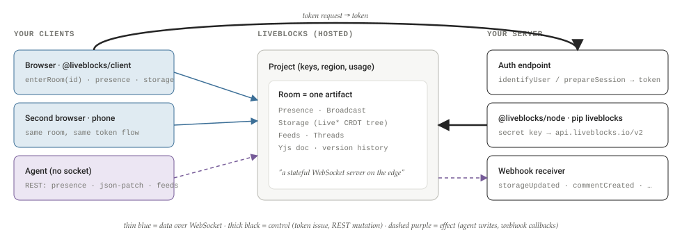
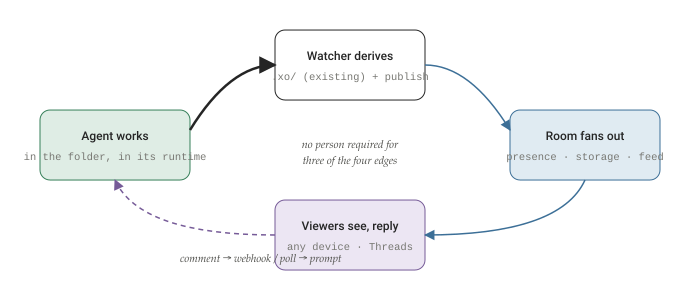

# Liveblocks, read for XO Space

A reading of the Liveblocks documentation with xo-space in hand: what the product is, where a room-per-project would sit against the watcher and the broker, whether any of it installs inside the container, and what “agents build and share a Space autonomously” would actually mean — with a bounded pilot at the end.

By **Suraj Sharma**, XO Labs · Applied Agent Research. First published 18 September 2026 as *Liveblocks, read for XO Space* in [sharmasuraj0123/writings](https://github.com/sharmasuraj0123/writings/tree/a5a356d418d45b63d34624b12ec3d7809167b309/liveblocks-for-xo-space). Subject: `liveblocks.io/docs` against `quirq-ai/xo-space`

Source: [`liveblocks-for-xo-space/index.html`](https://github.com/sharmasuraj0123/writings/blob/a5a356d418d45b63d34624b12ec3d7809167b309/liveblocks-for-xo-space/index.html) in [sharmasuraj0123/writings](https://github.com/sharmasuraj0123/writings) at `a5a356d`. Brought into this repo on 2026-10-15 with its text, tables and figures unchanged; only the format moved from HTML to Markdown.

> **How to read the badges**
>
> Two kinds of claim appear below. *\[from the docs\]* marks facts read from `liveblocks.io/docs`, the pricing page, and the public SDK references on 18 September 2026 — quoted where it matters. *\[proposal\]* marks the design I am putting forward for xo-space: nothing in that category exists in the working tree today. The docs do not describe the Space UI, the watcher, or the xo-project contract; everything that joins the two sides is mine.

## 01 · Why read Liveblocks now

xo-space has one operator and several agents, and it shows them to one browser at a time. Liveblocks is a hosted answer to the next question: what happens when two humans, a phone, and three agents need to see the same Space move.

Today the Space UI learns about change in three ways. Chat streams over server-sent events (`space_ui/js/views/chat.js` opens an `EventSource` on `/api/chat/stream/{stream_id}` and guards it with a watchdog interval). The server widget polls `/server/status` every 5 seconds through `setSlottedInterval`. Everything else — projects, sessions, todos, the dashboard — is fetched when you navigate to it, from JSON the watcher has already written into `.xo/`. That is the right design for one person at one screen: nothing is pushed that nobody is looking at.

It stops being right the moment a Space is shared. If Suraj opens a project on a laptop while a second person watches from a phone and an agent is halfway through a plan, the three views drift: each re-fetches on its own schedule, none knows the others exist, and the only shared truth is the folder on disk. Building the missing piece — a fan-out layer with presence, conflict-free shared state, and durable comments — is a known quantity, and it is a lot of work that has nothing to do with the quirq.

Liveblocks sells exactly that piece. This note reads its documentation with three questions in hand: what is it, where would it sit inside xo-space, and whether it can be installed inside the container so agents can build and share a Space without anyone standing over them. The answers are, in order: a hosted room-per-artifact sync service with agents as first-class users; as a *mirror* published by the watcher, never as a second writer; and only half — the SDKs install, the room server does not.

## 02 · What Liveblocks is

Liveblocks describes itself as "the realtime infrastructure and conflict-free sync layer for your product," built so that "people and AI agents can collaborate without breaking your app" *\[from the docs\]*. The unit of everything is the **room**: "a stateful WebSocket server on the edge" that maps one-to-one onto a collaborative artifact in your product — a document, a whiteboard, a spreadsheet. Rooms live in a **project** (API keys, usage, settings), projects can be partitioned by **organization** for multi-tenant deployments, and a project is pinned to a region — Earth, US, or EU.

Inside a room, five primitives do the work *\[from the docs\]*:

- **Presence** — ephemeral per-connection state (cursor, selection, status). Gone when the connection drops.
- **Broadcast** — fire-and-forget events to everyone in the room. Not stored.
- **Storage** — persistent, conflict-free shared state built from `LiveObject`, `LiveList`, `LiveMap`, and `LiveText`.
- **Feeds** — ordered, persistent message streams whose messages can be updated in place; the primitive the docs use for agent run status.
- **Threads** — comment threads with mentions, reactions, metadata, resolution, and attachments.

Around them sit three product layers: **Yjs** hosting (a room can hold a Yjs document, with binary update endpoints and editor bindings for Tiptap, BlockNote, Lexical, ProseMirror, CodeMirror, and Monaco), **Notifications** (an inbox per user; automatic for thread activity, custom when you trigger them), and **AI Copilots** (a hosted chat agent with tools and a knowledge base, provisioned through the same SDK). Version history snapshots Storage and Yjs state per room.

**Figure 1. The shape of every Liveblocks integration**

Nothing you own touches another client directly. Browsers hold a WebSocket to the room; your server holds the secret key and talks REST; agents can do either, and the docs steer them to REST. The room is the only shared memory.

The SDK surface is wide *\[from the docs\]*: React, Vue, Svelte, Solid, and plain JavaScript on the client; Node.js and Python on the server; a REST API under `https://api.liveblocks.io/v2` authenticated with `Authorization: Bearer <secret>`; Redux, Zustand, and Yjs adapters; a webhook signature scheme (`webhook-id.webhook-timestamp.body` under HMAC-SHA256, the Svix convention). The client packages are Apache-2.0 on GitHub, with "some components" under AGPL-3.0. The room server is not in that repository. Hold on to that fact; §07 turns on it.

## 03 · The primitives, with their limits

The distinction that matters for xo-space is not the API shape but *who is allowed to write* and *what survives*. The docs are precise about both once you collect the scattered numbers.

**Figure 2. Eight things a room can hold, sorted by durability**

| Primitive | Persists | Who writes | Server-side call | Hard limit |
|----|----|----|----|----|
| Presence | No — per connection, or REST with a TTL | Clients; agents via REST | `setPresence` / `POST /rooms/{id}/presence` | `userInfo` ≤ 1024 chars serialized |
| Broadcast | No | Clients; server | `broadcastEvent` / `POST /rooms/{id}/broadcast-event` | 32 MB per message (1 MB on older clients) |
| Storage | Yes — CRDT tree, versioned | Clients; server | `mutateStorage`, `massMutateStorage`, `PATCH …/storage/json-patch` | 2 MB per `LiveObject`; 2 MB per value in `LiveMap`/`LiveList` |
| Feeds | Yes — ordered messages, updatable | Server, agents | `createFeed`, `createFeedMessage`, `updateFeedMessage` | not stated |
| Threads / Comments | Yes — metered as net-new comments | Clients; server as any `userId` | `createThread`, `createComment`, `markdownToCommentBody` | metadata: 50 keys × 40-char key × 4000-char value |
| Yjs document | Yes — binary updates, versioned | Clients via bindings; server via binary update | `sendYjsBinaryUpdate`, `getYjsDocumentAsBinaryUpdate` | not stated |
| Files | Yes — object storage, presigned URLs | Clients; server (multipart) | `uploadFile`, `getFileUrl` | plan-dependent upload cap |
| Inbox notifications | Yes — per user, not per room | Automatic for threads; custom from server | `triggerInboxNotification` | custom ones are metered |

Collected from the Node and Python references and the limits page *\[from the docs\]*. Two rows have no published size limit; I did not find one and did not test one.

Two details deserve emphasis. First, the JSON Patch endpoint: `PATCH /rooms/{roomId}/storage/json-patch` takes an array of RFC 6902 operations (`add`, `remove`, `replace`, `test`, `copy`, `move`) and applies them to the Storage tree without a WebSocket, which is what makes a Python process a full participant. Second, presence over REST carries a TTL — an agent that stops heartbeating disappears from the avatar row on its own, which is the correct failure mode for a process that may have been killed.

**Figure 3. The numbers that bound a design**

- **128** · max characters in a roomId or userId — an xo-project id fits
- **2 MB** · per LiveObject , and per value inside a LiveMap or LiveList
- **10** · simultaneous connections per room on Free and Pro; 50 on Team; 100 on Enterprise
- **10 s** · of inactivity before a collaboration minute stops accruing

All *\[from the docs\]*. The 2 MB ceiling is per node, not per room: a Storage tree is a tree, and a large document is meant to be split across many small live values.

## 04 · Agents as first-class users

The page that changed my reading is the "agentic users" use case. Liveblocks does not treat an agent as a bot posting through a service account; it treats it as a user with a `userId`, a colour, a presence row, and the same write paths as a person *\[from the docs\]*. Four calls carry the whole pattern:

1.  **Show up.** `setPresence(roomId, { userId, userInfo, data, ttl })` from the server. The agent appears in `useOthers()` next to the humans, with a status and a focused element, and vanishes when the TTL lapses.
2.  **Edit the shared thing.** `mutateStorage` in Node, or the JSON Patch endpoint from Python. The docs explicitly name Python and "any language/workflow tool" as the audience for the REST path.
3.  **Narrate the run.** A Feed message per run, updated in place as state moves — the docs' example is "searching" → "writing" → "complete". Chat with the agent lives in the same feed.
4.  **Talk in the margins.** `createThread` under the agent's own `userId`, body from `markdownToCommentBody()`; and the reverse: a `commentCreated` webhook wakes the agent when a human mentions it.

The Python SDK covers all four. `pip install liveblocks` gives `Liveblocks` and `AsyncLiveblocks` clients with `set_presence`, `patch_storage_document`, `create_feed`, `create_feed_message`, `update_feed_message`, `create_thread`, `identify_user`, and `trigger_inbox_notification`, raising `errors.LiveblocksError` on non-2xx *\[from the docs\]*. This is the whole reason the FastAPI side of xo-space can participate without a Node sidecar.

One thing the agentic-users page does *not* say: how an agent authenticates as itself rather than as the server. Every example uses the project secret key. That is fine for a trusted process inside our container and unacceptable for an agent running on somebody else's machine; a real deployment would mint per-agent access tokens with `prepareSession` and never hand out the secret. I am flagging it because the xo-space broker already runs agents in several runtimes and the difference will matter.

## 05 · Where it fits in xo-space

An xo-project is already a room in everything but transport. It has an id, a folder that is the shared artifact, a watcher that produces a canonical view of activity in `.xo/`, and a UI that renders that view. The mapping is almost mechanical *\[proposal\]*:

**Figure 4. xo-space concept → Liveblocks primitive**

| xo-space today | Where it lives | Liveblocks primitive | Direction | Why this one |
|----|----|----|----|----|
| xo-project | `<root>/<id>/` | Room, `roomId = xo:<id>` | 1 : 1 | Rooms are meant to be one per artifact; the id fits in 128 chars. |
| Operator + agents at work | activity heartbeats in `.xo/` | Presence (REST, TTL for agents) | watcher → room | Ephemeral by design; a dead agent falls off the avatar row. |
| `.xo/todos.json` | written by the watcher | Storage: `LiveMap<todoId, LiveObject>` | watcher → room | Small, structured, changes often; JSON Patch maps to it directly. |
| Session timeline / agent turns | `.xo/sessions.json`, timeline | Feeds: one feed per session, one message per turn, updated in place | watcher → room | The docs' own primitive for agent run status. |
| Chat token stream | SSE `/api/chat/stream/{id}` | Feed message, updated as tokens land — *or keep SSE* | broker → room | Feeds persist; SSE does not. Persisting is the point of sharing. |
| Human intervention | a new prompt in chat | Threads on a todo, a file, or a turn; `commentCreated` webhook → `/api/chat/prompt` | room → broker | Threaded, attributable, and the only channel that carries a mention back to the agent. |
| "Needs a human" state | blocked todo | Custom inbox notification to the owner | watcher → user | Reaches a person who is not in the room. |
| Files in the project | the folder itself | *Not mirrored.* Storage holds pointers and diffs, not the tree | — | 2 MB per node, and the folder is already synced by the sync API. |
| Space Walk trace | Space Walk on :8765 | Feed message with a link and a summary; not the trace | watcher → room | The trace is evidence; the room is a viewport onto it. |

Every arrow that writes into the room starts at the watcher or the broker. No arrow writes into `.xo/`; that directory keeps exactly one owner.

The one rule the mapping must not break is the one the xo-projects contract states most loudly: *the agent never writes to `.xo/`*; a watcher tails runtime logs and owns that directory. Liveblocks Storage would be tempting to use as the source of truth for todos — a shared, conflict-free list that any participant can edit. That is the wrong shape. The source of truth is the runtime's own session log, the watcher derives `.xo/todos.json` from it, and Liveblocks should hold a **mirror** of that derivation. Rooms are a viewport and a conversation surface; the folder stays the ledger. If the mirror and the folder disagree, the folder wins and the watcher re-publishes.

> **Design rule**
>
> One writer per direction. The watcher and the broker write *into* the room (presence, storage mirror, feeds). Humans write into the room only through Threads. The room writes back into xo-space only through webhooks that become ordinary `/api/chat/prompt` calls. Nothing else crosses.

## 06 · A concrete integration

Three additions to the broker, one to the watcher, one to the UI *\[proposal\]*. Nothing in the core names Liveblocks; it goes behind a service module the way every other connector does, off by default, enabled by `LIVEBLOCKS_SECRET_KEY`.

### The auth endpoint

Browsers must not hold the secret. The Space UI asks the broker for an ID token; the broker asks Liveblocks. The `_is_local` gate that already protects `/server/stop` is the natural guard for the operator path; shared viewers come through whatever auth the Space already has.

    # routers/liveblocks_auth.py  — proposal
    from fastapi import APIRouter, Request
    from liveblocks import AsyncLiveblocks
    from liveblocks.models import IdentifyUserRequestBody

    router = APIRouter(prefix="/api/liveblocks", tags=["liveblocks"])
    lb = AsyncLiveblocks(secret=os.environ["LIVEBLOCKS_SECRET_KEY"])

    @router.post("/auth")
    async def liveblocks_auth(request: Request):
        who = resolve_viewer(request)          # operator, invited viewer, …
        res = await lb.identify_user(body=IdentifyUserRequestBody(
            user_id=who.id,
            group_ids=[f"xo:{pid}" for pid in who.projects],
        ))
        return res                             # {"token": "…"} for the client

### The publisher inside the watcher

The watcher already computes the delta between the last `.xo/todos.json` it wrote and the next one. Turning that delta into RFC 6902 operations is a small function, and the endpoint takes the list as-is:

    # services/liveblocks_publisher.py — proposal
    from liveblocks import Liveblocks
    from liveblocks.models import SetPresenceRequestBody

    class RoomMirror:
        def __init__(self, project_id: str, secret: str):
            self.lb = Liveblocks(secret=secret)
            self.room = f"xo:{project_id}"

        def publish_todos(self, before: dict, after: dict) -> None:
            ops = []
            for tid, todo in after.items():
                if tid not in before:
                    ops.append({"op": "add", "path": f"/todos/{tid}", "value": todo})
                elif todo != before[tid]:
                    ops.append({"op": "replace", "path": f"/todos/{tid}", "value": todo})
            for tid in before.keys() - after.keys():
                ops.append({"op": "remove", "path": f"/todos/{tid}"})
            if ops:
                self.lb.patch_storage_document(room_id=self.room, body=ops)

        def heartbeat(self, agent: str, status: str, focused: str | None) -> None:
            self.lb.set_presence(room_id=self.room, body=SetPresenceRequestBody(
                user_id=f"agent:{agent}",
                user_info={"name": agent, "color": "#83d63a"},
                data={"status": status, "focusedId": focused},
                ttl=30,
            ))

        def turn(self, feed_id: str, message_id: str | None, data: dict) -> str:
            if message_id is None:
                return self.lb.create_feed_message(
                    room_id=self.room, feed_id=feed_id, body={"data": data}).id
            self.lb.update_feed_message(
                room_id=self.room, feed_id=feed_id, message_id=message_id,
                body={"data": data})
            return message_id

The exact request-body model names (`SetPresenceRequestBody`, `CreateFeedMessageRequestBody`) are as the Python reference lists them; the field names inside `data` are ours. I have not run this code — the container has no Liveblocks key today.

### The webhook receiver

`commentCreated` is the one event we need. Verify the signature, look up the room's project, and if the comment mentions an agent, submit its text as a prompt through the existing chat route. That is the whole "human talks back" channel, and it reuses the dispatcher instead of inventing a second one.

    @router.post("/webhook")
    async def liveblocks_webhook(request: Request):
        raw = await request.body()
        event = verify_svix(request.headers, raw, WEBHOOK_SECRET)   # id.ts.body, HMAC-SHA256
        if event["type"] != "commentCreated":
            return {"ok": True}
        project_id = event["data"]["roomId"].removeprefix("xo:")
        comment = await lb.get_comment(**event["data"])
        for agent in mentioned_agents(comment.body):
            await submit_prompt(project_id, agent, comment_to_markdown(comment.body),
                                reply_to=event["data"]["threadId"])
        return {"ok": True}

### The client

The Space UI is vanilla ES modules with vendored dependencies (`space_ui/vendor/three.module.min.js`, `OrbitControls.js`). `@liveblocks/client` would be vendored the same way — no bundler, no React. The room subscription replaces the fetch-on-navigate for todos and the timeline, and adds an avatar row the UI does not have today. Everything else stays: SSE for the live token stream, the 5 s server-status poll, the atlas.

**Figure 5. One agent turn and one human reply, end to end**

Steps 1–2 exist. Steps 3–6 are the proposal. The loop closes through a route that already exists, so the agent side needs no new capability — only the watcher and the broker learn to speak Liveblocks.

## 07 · Can it be installed inside the container?

Half of it. The question splits cleanly into two once you know what is open and what is hosted.

**The SDKs install.** `pip install liveblocks` into the project venv, `@liveblocks/client` vendored into `space_ui/vendor/`. Both run inside the container without a build step and without changing the FastAPI process model. The publisher, the auth route, and the webhook receiver in §06 are ordinary Python in the trees the architecture already reserves for connectors.

**The room server does not.** The WebSocket rooms, the Storage CRDT, Feeds, Threads, version history, the async pipelines for notifications and webhooks — all of that runs on Liveblocks' edge. The public repository ships SDKs; it does not ship the server. The pricing page is explicit that self-hosting is "available as paid add-on" on the Enterprise tier and on no other *\[from the docs\]*. There is no `docker run liveblocks/server`. If the container loses outbound network, the mirror stops; the Space itself must keep working on the SSE-and-poll path it uses today, so the integration has to be strictly additive.

**Figure 6. What runs where, and what has to be reachable**

- **Inside the container**: FastAPI broker · watcher · agent runtimes · liveblocks Python SDK · publisher · auth route · webhook receiver · Space UI static files with vendored @liveblocks/client
- **Liveblocks edge (hosted)**: rooms · Storage · Feeds · Threads · presence fan-out · version history · notification and webhook pipelines · dashboard · api.liveblocks.io/v2
- **Every viewer's browser**: WebSocket to the room · token from /api/liveblocks/auth · still talks HTTP/SSE to the broker for chat and files
- **Network: outbound**: HTTPS from the container to api.liveblocks.io ; WSS from browsers to the room. Nothing else.
- **Network: inbound**: Webhooks need a public URL. The docs recommend svix-cli , localtunnel , or ngrok for local development. A container behind NAT either runs a tunnel or polls get_threads instead of receiving commentCreated .
- **Secrets**: One project secret key and one webhook secret, in the same store as the other connector credentials. The secret never reaches a browser or an agent on another host.

The orange row is the only real operational cost of "inside the container". Everything else is a pip install and an environment variable; the inbound path is the part that makes a self-contained box slightly less self-contained.

The tunnel is worth dwelling on, because it is the one place where the "autonomous" ambition meets a real constraint. The docs themselves only offer tunnelling tools for local webhooks. In a containerized xo-space with no public ingress there are two honest options: run a tunnel as a sidecar process the broker supervises, or give up on push and have the watcher poll `get_threads(room_id, query=…)` on its existing cadence. Polling costs nothing on the Liveblocks meter (REST reads are not collaboration minutes) and keeps the box self-contained. I would start there and add the tunnel only when comment latency starts to hurt.

### What it costs

The meter that matters is the collaboration minute: "cumulative time spent by two or more people or agents are actively together in the same room," paused after 10 seconds of inactivity, and free when someone is alone *\[from the docs\]*. Read that carefully against §04: an agent holding presence counts as a participant. A human watching an agent work for an hour is sixty collaboration minutes, every day, per project. The other meters — storage updates per million, net-new comments, custom notifications, file storage — are second-order for a Space.

**Figure 7. The four tiers, as published on 18 September 2026**

- **Free · \$0**: hard caps · branding required 3,000 collaboration minutes · 200 comments · 1 GB realtime storage · 512 MB files · 10 connections per room · 3 dashboard seats. Features pause when a meter is exceeded.
- **Pro · \$30/mo**: \$25/mo annual · \$30 credits Same 10 connections per room · 3 seats · 30-day version history · branding removed · pay-as-you-go beyond credits.
- **Team · \$600–\$3,750/mo**: five sub-tiers · 10 seats included 50 connections per room · 90-day history · SAML SSO, SOC 2, private Slack. Same metered rates as Pro.

Enterprise (custom): 100 connections per room, multi-region, Management API, SCIM, and the only tier where self-hosting is offered, as a paid add-on. The limits page and the pricing page disagree on the number of Free-tier projects (1 versus 10); I did not resolve which is current.

For xo-space's actual usage — one operator, occasionally a second viewer, agents working in bursts — the Free tier's 3,000 minutes is fifty hours a month of someone watching an agent. That is enough to find out whether shared Spaces are worth having and not enough to run a team on. The point at which it stops being a pilot is the point at which Pro's \$30 of credit runs out, and the watcher can compute that number from its own heartbeat log before the bill does.

## 08 · Building and sharing a Space autonomously

The third question asks whether this helps agents build and share the Space *without a person in the loop*. Split it into the two verbs.

**Sharing** is what Liveblocks is for, and it does it well. Once the publisher runs, a Space is shareable by construction: a room URL plus an ID token is a live view of the project — todos moving, agents present, turns narrating themselves in a feed — on any device, with no VPN into the container and no polling of `.xo/`. The agent does not need to do anything extra to share; the watcher shares on its behalf as a side effect of doing what it already does. "Autonomous sharing" collapses to "the watcher publishes."

**Building** is where the honest answer is narrower. Liveblocks does not run agents, host code, execute tools, or store a repository; it is not a place a Space can be built *in*. What it adds to building is coordination and interruption:

- **Multi-agent coordination through Storage.** Two agents on the same project can claim work through a `LiveMap` of leases, keyed by todo id, with `test` operations in the JSON Patch making the claim atomic. Today that coordination goes through the folder and the runtime's own todo tool, which does not see the other agent.
- **Interruption through Threads.** A human can stop, redirect, or approve from the margin of the exact todo or file, and the agent hears it as a prompt. This is the human-rescue channel the quirq's `C_total` needs to account for, and Liveblocks would timestamp and attribute every instance of it for free.
- **Presence as a liveness contract.** The TTL makes "is the agent still working?" a property of the room rather than a question for the operator.
- **Feeds as the narrative record.** A feed per session, one updatable message per turn, is a persistent, shareable, low-resolution twin of the Space Walk trace — the summary humans read, linking to the evidence agents produce.

**Figure 8. The autonomy loop, and where a person can enter it**

Autonomy is the top three edges running without anyone present. The dashed edge is the only one a human can add to, and it is the one the quirq wants counted.

So: Liveblocks does not make an agent more capable of building a Space. It makes the building *legible* to people who are not in the container, and it gives those people a typed, attributable way back in. For a research program whose central claim is that verified agent work should be measured all-in, including the human rescues, that is not a cosmetic gain. The comment stream is the intervention log; the presence minutes are the supervision cost; both arrive as data, not as anecdotes.

## 09 · Verdict and alternatives

The alternative is not "nothing"; it is one of four other ways to get a room. Compared on the axes that matter for a container that wants to stay self-contained *\[proposal\]*:

**Figure 9. Five ways to give a Space a room**

| Option | Runs in the container | Presence + CRDT + comments | Agents via REST | Effort to first shared Space | Cost shape |
|----|----|----|----|----|----|
| Liveblocks | SDKs only; server hosted (self-host = Enterprise add-on) | All three, plus Feeds, notifications, version history | Yes, documented, Python SDK | Days | Free → \$30/mo → metered minutes |
| Yjs + `y-websocket` / Hocuspocus | Yes, fully | CRDT yes; presence via awareness; comments are yours to build | Binary updates from Python are possible but awkward | Weeks | Your compute; needs a public port for sharing |
| PartyKit / Durable Objects | No — Cloudflare-hosted | Primitives you assemble; no comments product | Yes, HTTP | Weeks | Cloudflare metering |
| Electric / Zero-style sync engines | Yes, with Postgres | Sync yes; presence and comments are yours | Via the database | Weeks, plus a database the Space does not have | Your compute |
| Extend the broker: SSE fan-out + last-writer-wins JSON | Yes, trivially | Presence approximated; no CRDT; comments as another JSON file | Already do | Days, but stays single-writer | Zero |

The last row is the honest baseline: for one operator it is enough. The first row is the only one that gets agents-as-users and threaded comments without building them.

My recommendation is a bounded pilot, in this order:

1.  Create one Liveblocks project on the Free tier. Add `LIVEBLOCKS_SECRET_KEY` to the connector secrets; keep the integration off when it is absent.
2.  Ship the publisher first, and only the todos mirror plus agent presence. That already makes a Space shareable and costs nothing while nobody else is watching.
3.  Vendor `@liveblocks/client` and add the avatar row and live todos to the projects view, behind the same flag. The existing fetch path remains the fallback.
4.  Add Threads with polling, not webhooks. Measure comment latency and collaboration minutes from the watcher's own log for two weeks.
5.  Decide. If shared viewing is used, move to Pro and add the tunnel; if not, delete the module — it never touched core.

What I would not do: put the folder's files into Storage, make Storage the source of truth for todos, or hand the project secret to an agent running anywhere but this container. And I would not expect this to be self-hostable at any price we would pay this year; the docs are clear, and the design above assumes the edge stays theirs.

## 10 · Sources

- [liveblocks.io/docs](https://liveblocks.io/docs) — product overview, use-case list, SDK matrix.
- [How Liveblocks works](https://liveblocks.io/docs/concepts/how-liveblocks-works) — rooms, the five primitives, projects, organizations, regions.
- [Agentic users](https://liveblocks.io/docs/use-cases/agentic-users) — presence with TTL, `mutateStorage` / JSON Patch, Feeds for run status, Threads and the `commentCreated` webhook.
- [@liveblocks/node reference](https://liveblocks.io/docs/api-reference/liveblocks-node) and [Python SDK reference](https://liveblocks.io/docs/api-reference/liveblocks-python) — every method named above.
- [REST API](https://liveblocks.io/docs/api-reference/rest-api-endpoints) — base URL, bearer auth, `storage/json-patch`, `presence`, `broadcast-event`.
- [Webhooks](https://liveblocks.io/docs/platform/webhooks) — signature scheme, local tunnelling advice.
- [Limits](https://liveblocks.io/docs/platform/limits) and [Pricing](https://liveblocks.io/pricing) — the numbers in Figures 3 and 7; the self-hosting statement.
- [github.com/liveblocks/liveblocks](https://github.com/liveblocks/liveblocks) — licence and package inventory.
- xo-space working tree at `~/xo-projects/xo-space`, read 18 September 2026: `space_ui/js/views/chat.js`, `space_ui/js/core/store.js`, `space_ui/js/core/server-widget.js`, `routers/space.py`, `routers/cowork_agent/chat.py`, `AGENTS.md`; and the xo-projects skill contract for the watcher's ownership of `.xo/`.

**Provenance.** Everything badged *\[from the docs\]* was read from the public Liveblocks documentation, pricing, and SDK references on 18 September 2026 and is quoted where it is load-bearing. Everything badged *\[proposal\]* — the mapping in Figure 4, the code in §06, the pilot plan — is my design and exists nowhere in the xo-space working tree. Not verified: I did not create a Liveblocks project, did not run the Python SDK, and did not measure collaboration-minute accrual for a presence-only agent; the claim that a TTL-presence agent counts toward the meter follows from the pricing page's wording ("people or agents") and should be confirmed on a real project before budgeting. The Free-tier project count is inconsistent across two doc pages and left unresolved. Feeds' per-message size limit is not published.
