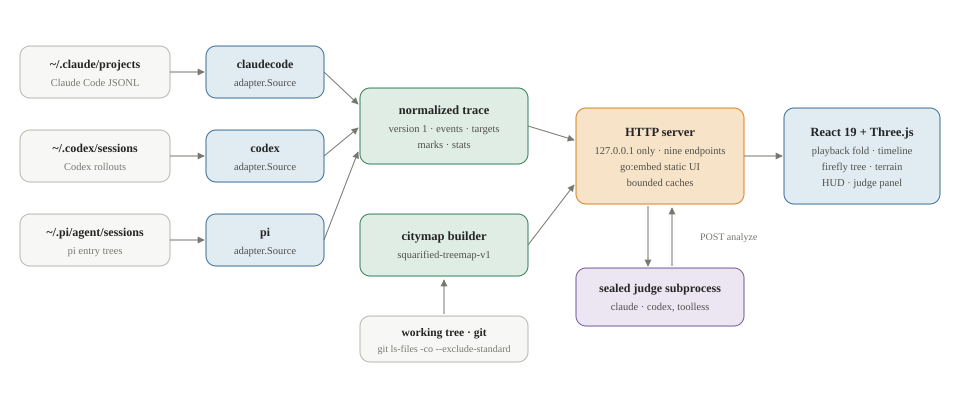
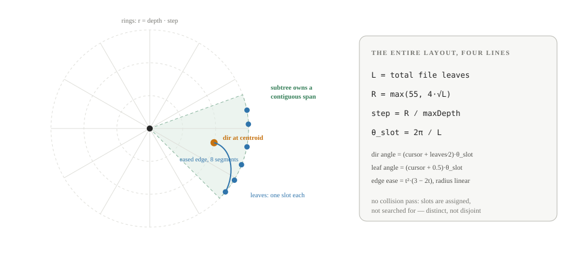
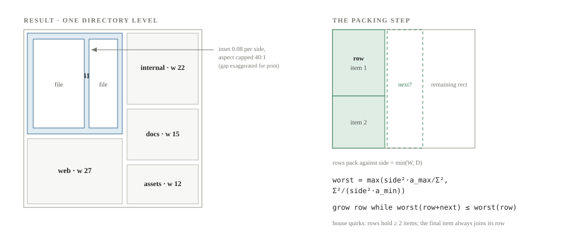
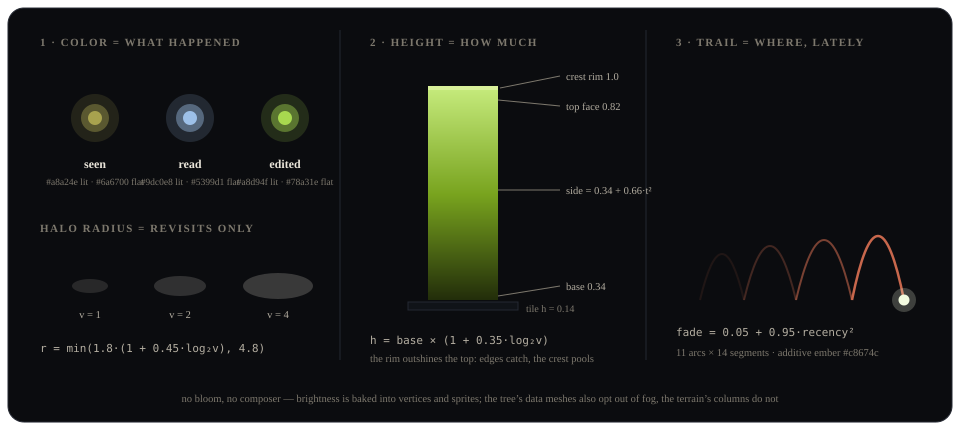
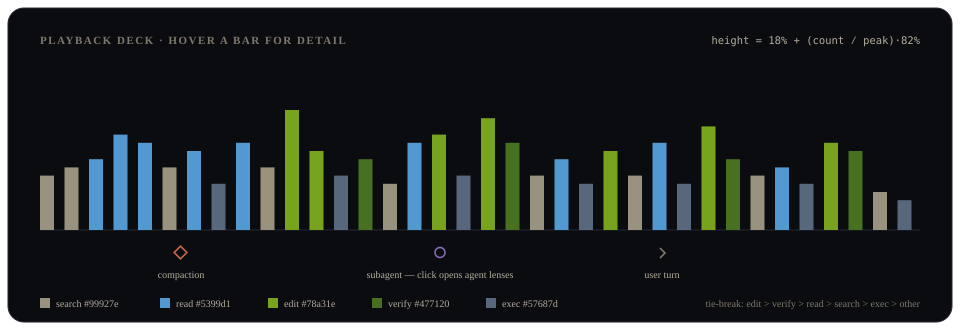
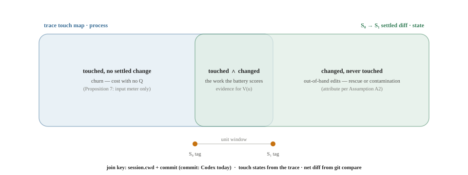
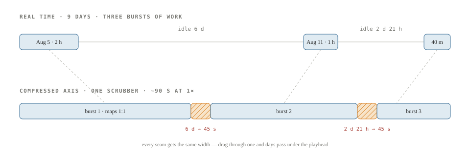

# The anatomy of Space Walk

An XO Research illustrated explainer on the architecture of Space Walk — the geometry, the rendering pipeline, and how it becomes an evidence layer for the quirq.

By **Suraj Sharma**, XO Labs · Space Walk Research Notes. First published 14 August 2026 and updated 16 August 2026 as *The anatomy of Space Walk* in [sharmasuraj0123/writings](https://github.com/sharmasuraj0123/writings/tree/a5a356d418d45b63d34624b12ec3d7809167b309/research/spacewalk-architecture).

Source: [`research/spacewalk-architecture/index.html`](https://github.com/sharmasuraj0123/writings/blob/a5a356d418d45b63d34624b12ec3d7809167b309/research/spacewalk-architecture/index.html) in [sharmasuraj0123/writings](https://github.com/sharmasuraj0123/writings) at `a5a356d`. Brought into this repo on 2026-10-15 with its text, tables and figures unchanged; only the format moved from HTML to Markdown.

XO Labs · Space Walk Research Notes

# The anatomy of Space Walk

**Space Walk replays a coding agent’s session as light moving over a 3D map of the repository — and every color the trace puts on that map is computed from arithmetic you can read.** These notes walk the full pipeline: how three harness log dialects normalize into one trace, how a repo becomes geometry twice (a radial tree and a squarified treemap), how the renderer fakes phosphorescence without a single postprocessing pass, and how the same trace becomes the evidence layer the quirq calculus has been missing.

Author  
Suraj Sharma

Published  
14 August 2026

Updated  
16 August 2026 — schema contract, event residency, the time-travel constellation (§13), and the xo-project folder as a loadable trace unit (§14)

Source  
[github.com/cosmtrek/mindwalk](https://github.com/cosmtrek/mindwalk) (upstream)

Reading  
About 70 minutes

Status  
Research note — whitepaper length, not the usual reading-notes scale

1 · Introduction

## The light and the log

A coding agent leaves behind thousands of JSONL lines that record what it did — and almost nothing about how it understood the task.

Read a raw session log and you can reconstruct every tool call: this file was opened, that command ran, this patch applied. What you cannot see is the shape of the work — whether the agent’s footprint matched the scope you had in mind, whether it wandered before it edited, whether it ever verified what it changed. The log is a ledger of actions; the question you actually have is about attention.

**Space Walk** is XO Labs’ fork of [mindwalk](https://github.com/cosmtrek/mindwalk), a Go + React/Three.js tool that answers that question visually: it parses agent session logs, projects them onto a 3D map of the repository, and replays the session as light. Files the agent merely saw glow olive; files it read glow steel; files it edited glow lime; a firefly traces the walk between them. The fork carries the rebrand end to end — module `github.com/xo-labs/spacewalk`, binary `bin/spacewalk`, and a new data-encoding palette validated for colorblind safety and contrast — while keeping upstream’s architecture intact.

These notes go deep on that architecture: the exact data structures, the layout mathematics with their real constants, the rendering tricks, the LLM-judge evaluation loop, and the customization seams. The closing section argues the larger point — that a trace replayer is not just a debugging toy but the missing *evidence layer* for the quirq, XO’s unit of verified work.

Harnesses read natively 3 Claude Code, Codex, and pi logs, detected by content sniffing rather than file names.

Map budget 10,000 Files per citymap, filled in three priority tiers: touched, ghosts, then everything else.

Timeline buckets 160 Ceiling on the histogram width — `n = min(160, events)`; edits win bucket-color ties.

Postprocessing passes 0 No bloom, no composer. Glow is faked with unlit materials, additive sprites, and baked vertex shading.

2 · Architecture

## One binary, four stages

Everything ships in a single Go binary; the seam that holds it together is a versioned trace contract that every stage upstream writes and every stage downstream reads.

The pipeline has four stages. **Ingestion** (`internal/adapter`) turns three incompatible log dialects into one normalized trace — a JSON document pinned at `version: 1` and mirrored by `schema/trace.schema.json`. **Geometry** (`internal/citymap`) scans the repository the session ran in and lays every file out as a 2D footprint. **Serving** (`internal/server`) binds to 127.0.0.1, exposes nine JSON endpoints, and embeds the compiled frontend via `//go:embed static` so `bin/spacewalk` is the whole product. **Rendering and playback** happen in the browser: a React 19 shell drives two Three.js scenes from a single zustand store.

That loopback bind is where the code is most explicitly distrustful of itself: it treats binding locally as necessary and not sufficient. Any web page you visit can fire cross-site requests straight at a loopback port, and DNS rebinding can aim an attacker-controlled name at 127.0.0.1 — so a `requireLoopback` middleware pins the `Host` header to a loopback name and gates every non-GET on a same-origin `Origin` plus a `Sec-Fetch-Site` of same-origin or none. The threat is named in the comment: `POST /api/sessions/{id}/analyze` starts a judge run that spends tokens and minutes, so a page you merely opened must not be able to start one. It is the only deliberate security mechanism in the codebase, and it has its own test file.

Two design decisions define the system’s shape. First, the *geometry split*: the server computes only 2D footprints (rectangles on a 120×120 plane), and the client computes all vertical geometry — heights, colors, glow — from the trace. Layout changes never touch the frontend; visual changes never touch Go. Second, *bounded everything*: session lists cache for 5 s, parsed traces for 10 min across at most 16 entries, repo maps for 30 s, and at most two LLM-judge subprocesses may run at once. The binary is meant to sit on a laptop, rescan cheaply, and never surprise you with cost.

The seam is the trace: everything upstream normalizes into it, everything downstream reads nothing else.

**Figure 1. From three log dialects to an embedded 3D replay**

*Data flow · logs to light · one process boundary*

The seam is deliberately narrow: adapters and the citymap builder write JSON contracts pinned by schema files; the browser never sees a raw harness log, and the Go side never computes a pixel.

3 · Ingestion

## Three dialects, one trace

Every harness gets an adapter behind one Go interface; detection is done by reading the lines, never by trusting the file name.

An adapter implements `adapter.Source` — five methods: `Harness()`, `SessionDir()`, `ListSessions()`, `Summarize(path)`, and `Parse(path)`. Callers try the adapters in a fixed order (claude-code, then codex, then pi) and keep the first parse that succeeds. Each adapter streams the JSONL and flips a `recognized` flag only when it sees its own dialect: Claude Code lines carry a `sessionId` or a type in {user, assistant, system, ai-title}; Codex lines carry types like `session_meta` or `response_item`; pi requires the *first* valid JSON line to be a header with `type == "session"`. The sniffing is deliberately fussy — Codex refuses a roleless `message` line precisely because pi also uses that type but nests its payload — so a file can never be claimed by the wrong parser.

The unit of the normalized trace is the **event**: one tool call joined with its result. Claude Code pairs `tool_use` blocks to `tool_result` blocks by `tool_use_id`; Codex pairs `function_call` items to their outputs by `call_id`; pi pairs `toolCall` blocks to `toolResult` messages by `toolCallId`. A call whose result never arrives still becomes an event, flagged `outcomeKnown: false` — the trace records its own blind spots. Each event is classified into one of six actions (search, read, edit, exec, verify, other) and carries **targets**: repo-relative paths with a touch state and optional line ranges.

Touch states form a small lattice — `RankTouch` in `internal/model/stats.go` assigns edit = 3 \> read = 2 \> hit = 1 — and folds are always monotone: a later read never downgrades an earlier edit. Shell commands get *weak* targets: path-looking tokens sniffed from the command text and output, kept only if the file actually exists under the session’s working directory. Bash classification is a conservative allowlist — a command counts as `verify` only if it contains one of ten patterns (`go test`, `go vet`, `npm test`, `npm run build`, `pnpm test`, `pnpm build`, `pytest`, `make test`, `cargo test`, `swift test`); anything unrecognized stays `exec`.

Alongside events, the trace carries **marks**: out-of-band timeline points for context compactions, user messages (note text capped at 2,000 runes, after a filter drops harness-injected envelopes — text that starts with `<` and ends with `>`, or starts with `# AGENTS.md instructions`), and subagent spawns. A final pass, `model.ComputeStats`, derives the session’s vital signs: *fovea* (files read or edited) versus *parafovea* (files merely seen), re-read regression rate, error rate, files churned three or more times, and edits after the last verify. Crucially, stats grade their own trustworthiness — and the grade is per session, not per harness. Claude Code and pi flag failures structurally, so they start at `exact`; Codex failures have to be inferred, so it starts at `estimated`. But any dangling call — the `outcomeKnown: false` case from the paragraph above — drags even an exact harness down to `estimated`, because a session that lost results cannot know its own error rate. Reads are graded on their own axis, and that axis has a third value the errors axis never uses: `unavailable` when the session read nothing at all, `estimated` as soon as one read target was sniffed out of command text rather than named by a tool call.

| Adapter | Default session dir | Recognition rule | Call→result pairing | Error grade |
|----|----|----|----|----|
| claude-code | `~/.claude/projects` | line has `sessionId`, or a type ∈ {user, assistant, system, ai-title} that also carries a timestamp or a message body | `tool_use_id` | starts exact (structural `is_error`) |
| codex | `~/.codex/sessions` | types session_meta / turn_context / response_item / event_msg | `call_id` | estimated (structural `exit_code` when the envelope carries one, else an exit-code regex on output text) |
| pi | `~/.pi/agent/sessions` | first JSON line is a `type:"session"` header with string id | `toolCallId` | starts exact (structural `isError` / exit codes) |

The three harness adapters · internal/adapter {.data-table}

#### Event

One tool call joined with its result: sequence number, timestamp, action class, targets, result size, error flag, and whether the outcome is even known.

#### Target

A repo-relative path with a touch state and optional line ranges. Weak targets — inferred from shell text — survive only if the file exists on disk.

#### Touch lattice

edit 3 \> read 2 \> hit 1. Every fold — per event, per file, per session — keeps the maximum, so state only ever escalates.

#### Mark

An out-of-band timeline point: context compaction, user message, or subagent spawn. Marks sit before the event whose sequence number they carry.

The contract on disk: trace.schema.json

The trace has a written constitution: `schema/trace.schema.json`, 175 lines of JSON Schema draft 2020-12 that mirror the Go structs in `internal/model/model.go` field for field. Five top-level keys are required — `version`, `session`, `events`, `marks`, `stats` — and every object in the document is closed with `additionalProperties: false`. Condensed to its accepted entries, the whole contract fits on one card:

    { version: 1                                  // const — and no reader ever checks it
      session:  { id* harness* eventCount*        // the three required
                  model? title? cwd? commit? startedAt? endedAt? path? }
      events[]: { seq* tool* action* targets[]* resultBytes* isError* summary*
                  ts? outside[]? outcomeKnown?
                  action ∈ { search read edit exec verify other }
                  target  = { path* touch* fileId? lines[[from,to]]? weak? }
                    touch ∈ { hit read edit }
                  outside = { scope* ∈ { home tmp other }, path* } }
      marks[]:  { seq* type* ∈ { compaction user-message subagent }, note? }
      stats:    { 17 required fields — counts, rates, and
                  observability: { reads* errors* } ∈ { exact estimated unavailable } } }

      * required   ? optional, omitted when empty   every object: additionalProperties: false

The optional set is exactly the Go `omitempty` set, and two omissions are deliberate semantics rather than thrift. `Target.FileID` is a pointer (`*int`) precisely so that “no file id” serializes as absence instead of `0`, which is a valid file index. And `outcomeKnown` must vanish when false-by-ignorance would be misleading — the one schema test in the repo, `internal/model/trace_schema_test.go`, exists mainly to assert that an unknown outcome omits the key entirely rather than writing `false`.

How much can you modify? Less than the schema’s strictness suggests, and for an unexpected reason: the schema is *producer-side documentation with one spot-check*, not a runtime gate. Nothing validates a trace on the way out of the adapters, on the way over HTTP, or ever on the way in — that single test compiles the schema against one small hand-built fixture whose marks are empty and whose targets carry no `lines`, `fileId`, or `weak`, so a new field on `Mark` or `Target` would sail past it. The real contract is triple-maintained by hand — `model.go`, the schema, and `web/src/types.ts` — with only the Go↔schema pair mechanically checked, partially, and the Go↔TypeScript pair checked not at all.

The failure modes split cleanly by what you change. **Add a field** and the schema test fails loudly (for exercised shapes) until you update the schema in the same change — the repo’s stated convention. **Add an enum value** and Go degrades silently while TypeScript breaks loudly: an unknown action falls into `countAction`’s `default:` and is counted as `other`; an unknown touch gets `RankTouch`’s default rank 0 and can never win a fold; but `touchRank` in `playback/reducer.ts` and `MARK_LABEL` in `Timeline.tsx` are exhaustive `Record` types, so extending those unions stops the web build until every consumer answers for the new value. Even CSS votes: there is no `.action-dot.other` rule, so an unrecognized action already renders in the faint fallback color. **Change `version`** and nothing happens at all — no reader in Go or TypeScript ever compares it (the judge’s *report* cache version-checks; the trace does not). It is a decorative field awaiting a version 2 that would give it work.

The deepest limit: **there is no import path**. `spacewalk trace` exports a trace as indented JSON, but every reader in the system — the three adapters tried in order — reads harness *session logs*, not traces. Feed an exported trace back and all three adapters fail recognition; you get pi’s error message, which is the wrong diagnosis. Hand-editing an exported trace is therefore a dead end by construction, and even unedited exports are not round-trippable: the server recomputes `stats` after projecting the trace onto a citymap, so an exported `filesInRepo` reflects whichever repo it was projected against — or `0` from the CLI, which never projects.

The schema is honest about shape and silent about enforcement: strict on paper, one narrow test in practice, and no door through which a modified trace could re-enter the system.

Where events live, and when they exist

An event is not a stored thing. It is computed, on request, from session logs the harnesses own — Space Walk writes almost nothing to disk. The full residency map of the machine:

| Path | What lives there | Writer |
|----|----|----|
| `~/.claude/projects/**/*.jsonl` | Claude Code session logs; subagents beside the root as `<session>/subagents/agent-*.jsonl` with `.meta.json` sidecars (agent type, spawn depth, tool-use id) | the harness |
| `~/.codex/sessions/**/*.jsonl` | Codex rollouts — subagents are ordinary rollouts linked by `parent_thread_id`; titles resolve through the sidecar index `~/.codex/session_index.jsonl` | the harness |
| `~/.pi/agent/sessions/**/*.jsonl` | pi session trees: a header line, then branching entries — only the surviving trunk is replayed | the harness |
| `~/.spacewalk/reports/<key>.json` | judge report cache, written atomically (temp + rename) | Space Walk |
| `~/.spacewalk/judge/` | the sealed, empty working directory judge subprocesses run in; Codex sessions recorded here are auto-hidden from the list | Space Walk |
| *nowhere* | traces and citymaps — never serialized to disk; they exist only in memory, on demand | — |

Everything on disk, and who writes it {.data-table}

All three roots are overridable per run (`--claude-dir`, `--codex-dir`, `--pi-dir`). Discovery is the server’s own walk, not the adapters’ `ListSessions`: `scanSessions` in `internal/server/server.go` recurses each session dir for `*.jsonl`, fans the files out to `runtime.NumCPU()` summarize workers, and memoizes each summary keyed by harness + path, validated by file size, modtime, and a digest over declared sidecars — so a Codex title edit in `session_index.jsonl` invalidates exactly the summaries that read it. The list itself caches for 5 s; the refresh button’s `?fresh=1` bumps a generation counter to force a rescan. Session identity is path-derived, not id-derived — `harness-sha256(harness\0abspath)[:12]` — because Codex resume rollouts reuse session ids across files.

So when is an event *fired*? Never, in the push sense. There is no file watcher, no SSE, no websocket anywhere in the codebase — events exist at the moment an HTTP request forces a parse, and not before. The component that makes this cheap is the `traceStore` (`internal/server/tracestore.go`): a mutex-owned, memory-only cache with two layers — *snapshots*, the trace projected onto its own citymap with file ids assigned and stats recomputed, and *raws*, the unprojected parse that subagent views re-project against the root session’s map. Entries are fingerprinted by source-file size + modtime, live for 10 minutes across at most 16 entries, and concurrent requests for the same session share a single in-flight parse (with a recover so a panicking loader can’t strand its waiters). A *live* session stays fresh by accident of this design: each new line the harness appends changes the fingerprint, so the next request re-parses the file from scratch. Freshness is entirely poll-driven — the only timers in the client poll judge-run status, never trace content.

The log on disk is the single source of truth; everything Space Walk shows you is a cache of a parse of it, at most one request old. Even “active” in the constellation view (§13) is an arithmetic fact about the playback clock, not a claim that a process is alive.

4 · Geometry

## The floor plan

Before anything can glow, the repository must become a map — a deterministic, budgeted, timeout-bounded scan that ends in 2D footprints.

The whole builder is one file, `internal/citymap/builder.go` (~1,124 lines), exposing a single call: `Build(repoRoot, trace)`. It picks a scan mode from the shape of the root. A git repo streams `git ls-files -co --exclude-standard -z` — tracked plus untracked, respecting `.gitignore`, capped at 100,000 paths. A directory with a project marker (18 recognized names: `go.mod`, `package.json`, `Cargo.toml`, and so on) but no usable git listing is walked whole. Anything else — say, your home directory — is *workspace mode*: probe four levels deep for up to 256 project roots and walk only those subtrees, never entering dot-directories, junk dirs like `node_modules`, or macOS-protected folders unless the trace touched something inside them.

Candidates then compete for a budget of **10,000** map files, seated in three tiers: files the trace touched and that still exist; *ghosts* — strongly-touched paths proven gone (a clean `ErrNotExist`, not a timeout); then everything else the scan found. A budget cut therefore drops scenery before evidence. Every blocking operation is bounded — 5 s per directory read and file inspection, 30 s per git subprocess, walk depth capped at 32 — and any non-benign failure sets a single honest `truncated` flag rather than silently lying. Line counting itself is bounded: files over 2 MiB report `lines: 0`, and binary-like files — a known extension, or a NUL byte in the first 8,192 bytes — skip counting and report `lines: 1`. Either way byte size drives the weight; the distinction only matters downstream, where `lines` is a public field the inspector and the lines-of-code height mode both read.

Each file’s area on the map comes from a weight function published verbatim in the output’s metadata, so any consumer can recompute it:

w(f)  =  √( max(lines, bytes ⁄ 4096, 16) )

- `lines` — newline count; forced to 0 for files over 2 MiB and on a read error, so bytes take over. A binary-like file simply skips the counting branch and is published as `lines: 1` — below the floor either way, so its weight is bytes-driven regardless
- `bytes ⁄ 4096` — a 4 KiB page as the byte-side “line” equivalent
- `16` — floor, so empty files and ghosts still get area: a ghost weighs exactly √16 = 4
- the square root compresses dynamic range: a 10,000-line file gets 25× the area of a 16-line file, not 625×

The builder’s output — `CityMap`, pinned by `schema/citymap.schema.json` — contains only footprints: a `Rect{x, z, w, d}` per file and directory on a fixed 120×120 world plane, plus lines, bytes, language, and the ghost flag. Heights, colors, and everything vertical are the client’s job. The build is deterministic and stateless (a repeat build is byte-identical modulo timestamp); all caching lives in the server layer, keyed by file fingerprints and short TTLs.

5 · Layout

## The firefly tree

The default view lays the repository out as a radial tree that needs no collision pass because it needs no search — every leaf is handed its own angular slot on the way past.

The layout is computed client-side in `web/src/scene/treeLayout.ts`. Files, sorted by path, are inserted into a directory trie; counting passes set each node’s `leafCount` and the tree’s `maxDepth`. Three constants then determine everything. The outer radius is `R = max(55, 4·√L)` for `L` total file leaves. Above about 189 files the √L term governs and disc area grows linearly with file count, so a 2,000-file repo and a 10,000-file monorepo have roughly the same area per file (≈ 50 units²). Below that the 55-unit floor takes over and small repos simply spread out — a 40-file toy gets about 237 units² each, which is the point: a handful of files should not huddle at the center of an empty screen. Depth rings are equally spaced at `step = R ⁄ maxDepth`. And every leaf owns an identical angular slot of `θ = 2π ⁄ L`.

A single depth-first cursor allocates the slots: each subtree owns a contiguous angular span proportional to its leaf count, a directory sits at the *centroid* of its span — angle `(cursor + leafCount⁄2)·θ` at radius `depth·step` — and each file takes `(cursor + 0.5)·θ` at radius `(depth+1)·step`, advancing the cursor by one. Because the cursor never hands the same slot out twice, the layout is a single pass with no repulsion, jitter, or retry anywhere in the file; determinism falls out of the path sort.

Edges are not straight lines. Each parent→child connection is an 8-segment polyline in which radius interpolates linearly while the angle sweeps under a smoothstep ease, `t²·(3 − 2t)`, with the angular delta wrapped to the shorter arc — two `while` loops that leave it in \[−π, π\]. The result is the organic curl that makes the layout read as a tree rather than a dartboard. Each directory also records its *reach* — the farthest descendant leaf — which later drives label level-of-detail.

**Figure 2. Radial layout: equal angular slots, equal depth rings**

*treeLayout.ts · polar coordinates · world units*

Spacing needs no collision pass because it needs no *search*: a DFS cursor hands every leaf its own 2π⁄L slot and each subtree a contiguous span, so the layout is one pass with no repulsion, jitter, or retry code at all. Distinctness is not separation, though. At 10,000 files a depth-1 directory’s leaves sit roughly 0.05 world units apart while the orbs run up to 1.05 units across, so dense directories genuinely do merge on screen — which is why the halos use normal rather than additive blending, and why the tree picks by screen-space proximity within 18 px instead of raycasting.

6 · Terrain

## Attention terrain

The second view extrudes the server’s treemap into a dark plain where mountains grow only where the agent lingered.

The footprints come from the classic Bruls–Huizing–van Wijk *squarified treemap*, implemented server-side in `builder.go` and self-declared in the output as `squarified-treemap-v1`. For each directory node, children (subdirectories plus direct files) are sorted by weight descending, their weights scaled so total area matches the parent rectangle, and packed greedily into rows against the shorter remaining side: an item joins the current row while it does not worsen the row’s worst aspect ratio, `worst = max(side²·a_max⁄Σ², Σ²⁄(side²·a_min))`. Two house quirks: rows are forced to hold at least two items, and the final item always joins the current row — both trade a little squareness for fewer degenerate slivers. Every placed rectangle is then inset by 0.08 world units per side (the visible street between plots) and aspect-capped at 40:1.

The client (`web/src/scene/CityScene.tsx`) extrudes each footprint into a flat tile 0.14 units high, then grows an *attention column* over any touched file. Height is the product of two signals — what happened and how often:

`h = base × (1 + 0.35·log₂(max(visits, 1)))`, with base 7.2 for an edit, 4.2 for a read, 1.6 for a file merely seen. The logarithm matters: the second visit adds 35% of base, the eighth adds about one base — enough that revisits read as prominence without a hot file skyscrapering over the whole map. In map-only mode (no session), untouched files rise instead on a static lines-of-code scale: heights from 0.3 to 16 units with gamma 2.2, colored by a single-hue steel ramp (`#233d53 → #336288 → #4b89bb → #6cb2ec`) so the skyline reads as a city of towers and shacks. Directories up to depth 3 render as slightly raised district plates, giving neighborhoods a silhouette.

**Figure 3. Squarified treemap: weights become footprints**

*builder.go · squarify recursion · 120×120 world plane*

The server publishes only these rectangles; whether they become flat plots, LOC towers, or attention columns is decided per frame in the browser — which is why the two sides can evolve independently.

World plane 120×120 Fixed root rectangle; every repo, from toy to monorepo, normalizes into it.

Salience spread 4.5× An edit column against a merely-seen one, before revisits enter the formula at all.

Ghost weight √16 = 4 Deleted-but-touched files keep a plot on the map; evidence outranks scenery.

7 · Rendering

## Light without bloom

There is no postprocessing anywhere in the renderer — no EffectComposer, no bloom pass. Every glow is faked with three cheap tricks, and the fakes are the point.

Both scenes run on a raw `WebGLRenderer` with antialiasing and pixel ratio capped at 2. Trick one is an opt-out, and the two scenes take it to different depths. In the tree, every data-carrying material is `MeshBasicMaterial({ toneMapped: false, fog: false })` — leaves, ghosts, halos, labels, firefly, trail, selection — so a touch color at the rim of a 10,000-file disc is the same RGB as one at the center, and in the source’s words only the ground plane keeps the depth cue. The terrain is a hybrid and worth knowing as one: its flat tiles and district plates are lit `MeshStandardMaterial` under a hemisphere-plus-directional pair, and its attention columns are unlit but *not* fog-exempt, so a column’s brightness there is touch color × baked vertex shade × distance, and the far corner of a large map reads dimmer than its middle. Scene fog runs from 2.1× to 4.2× the scene size in both. Trick two: additive-blended canvas-gradient sprites for the firefly, the selection beam, and the trail. Trick three: brightness baked into vertex colors — each terrain column’s box geometry carries a per-vertex multiplier of 0.82 on the top face and `0.34 + 0.66·t²` up the sides, so the crest rim (1.0) outshines the top and light appears to pool at the summit and fall off into the plain.

The visual encoding gives each variable its own channel, and never doubles a channel up on one mark. *Color* says what happened: the scene draws lit emissive tints of the HUD’s flat swatches — `#a8a24e` seen, `#9dc0e8` read, `#a8d94f` edited — lighter than the legend colors but locked to the same hue families and salience order. *Size* says how much, and in the tree size splits in two, which is the part to remember: the orb is the *file* (radius ∝ √lines, `min(0.24 + 0.045·√lines, 1.05)`, so a vendored 40,000-line file cannot eat its neighbors), while the halo pooled under it is the *attention* (`min(1.8·(1 + 0.45·log₂v), 4.8)`, revisits only). In the terrain the two swap roles: the footprint carries file size and column height carries attention. *Shape* marks the exceptional: deleted files render as wireframe spheres at 0.8× leaf scale — in the code’s words, shape separates them where a third grey never could — and selection in the tree is a ring plus a vertical beam, never a recolor. Halos deliberately use *normal* blending: an earlier additive version burned dense directories into one white blob.

The agent itself is a firefly sprite trailing up to 11 ballistic Bézier arcs (14 segments each) between its last 12 fixations, colored ember `#c8674c` and faded by recency squared — `0.05 + 0.95·r²` — so the path dies away quadratically behind the head. Everything heavy is instanced or pre-allocated: leaves, ghosts, halos, tiles, and columns are `InstancedMesh`; all branch edges collapse into a single `LineSegments` soup with per-vertex colors; the trail rewrites fixed Float32 buffers in place. Directory labels are canvas-texture sprites for the top 120 directories, shown only when a subtree subtends at least 60 px on screen, and culled greedily on overlap.

Motion is eased, never keyframed: each frame moves the current value toward its target by a fixed fraction — 0.12 for halos, 0.13 for columns, 0.16 for label opacity — snapping when the difference falls below 0.015, and snapping instantly under `prefers-reduced-motion`. The camera solves an exact frustum fit along a fixed canonical direction, and selecting a file pans camera and orbit target by the same vector until the pick clears the 348 px inspector panel. Picking diverges by scene: terrain raycasts its instanced meshes, while the tree projects every leaf to screen space and takes the nearest within 18 px — tiny orbs are hostile raycast targets.

Light is data: nothing may glow a *touch color* unless the trace says it was touched, and every brightness in that layer is a formula you can read. The rest of the frame is scenery and admits it — the unvisited plain carries a path-hash lightness jitter of about ±2.5% so it reads as texture rather than paint, and in map-only mode the whole terrain falls back to a lines-of-code ramp, which is exactly why that mode uses a steel hue that appears nowhere in the touch palette.

**Figure 4. The glow pipeline: what, how much, and where**

*Scene panel · app’s real night palette · world units*

The panel uses the app’s real night palette. Note the split the legend enforces: the scene glows with lit tints (#a8a24e / \#9dc0e8 / \#a8d94f) while the HUD swatches stay at the flat validated values (#6a6700 / \#5399d1 / \#78a31e) — same hue families, same salience order.

8 · Playback

## Scrubbing time

Playback is a reducer fold over the event list: forward scrubbing is incremental, backward scrubbing is an honest replay from zero.

`PlaybackEngine` (`web/src/playback/reducer.ts`) keeps a cursor and five live collections: touch state per file and per path, visit counts, per-path event history, and the last 12 primary targets for the trail. Applying an event escalates each target through the same monotone lattice as the backend — `touchRank` hit 1 \< read 2 \< edit 3, never downgrading — so seeking forward applies only the crossed events, O(delta), while seeking backward resets and replays, O(n). The store opens each session at the *end* of the walk: the finished picture first, the movie on demand.

The timeline compresses any session into at most **160** buckets: `n = min(160, total)`, so a short session gets one bar per event and only a long one is actually compressed. Bucket `b` spans event indices \[⌊b·total⁄n⌋, ⌊(b+1)·total⁄n⌋). Each bar’s height is `18 + (count⁄peak)·82` percent, and its color is the bucket’s *dominant* action — chosen by iterating a fixed priority list, edit \> verify \> read \> search \> exec \> other, keeping the first strictly greater count. The comment in the source states the policy: *edits are rare but load-bearing — let them win the bucket color on ties.* The palette follows the same logic: search and exec are deliberate neutrals (`#99927e`, `#57687d`), the background hum, while edit and verify carry the saturation.

Marks render as a strip of glyphs above the bars — a rust diamond for compaction, a violet circle for a subagent spawn, a quiet chevron for a user turn — grouped by rounding position into 220 slots so a burst collapses into one glyph with a ×N count. Clicking a subagent mark does more than seek: it opens the *agent lenses* sheet, which swaps in the subagent’s own trace while keeping the root repo’s map, caching each actor’s trace and remembering each actor’s playhead independently. The transport ticks every 340 ms at 1× (speeds 1 / 4 / 16, render interval floored at 85 ms), and the keyboard map is dense: Space plays, E / X / M jump to the next edit, error, or mark, V swaps scenes.

Export is the same machinery pointed at a file: `canvas.captureStream(30)` feeds a `MediaRecorder` (VP9, falling back to VP8, then plain WebM) while a requestAnimationFrame loop sweeps the playhead over `min(30 s, max(1 s, events × 120 ms))`; the result downloads as `spacewalk-<session>.webm`. While recording, an `exporting` flag locks every control that could move the playhead or swap the canvas mid-take.

**Figure 5. The activity histogram: dominant action wins the bar**

*Timeline.tsx · app’s real night palette · 36-column schematic, peak 12*

The encoding as a 36-column schematic; a 213-event session like this one would really fill all 160 buckets, but the arithmetic is identical at either width — 18% of the deck as a floor, plus `(count⁄peak)·82%`, peak 12 here. Search and exec are deliberate neutrals — the background hum — so the saturated lime of an edit bucket and the deep green of a verify bucket carry the story. Hover any bar for its count.

9 · Evaluation

## The sealed judge

Space Walk can grade a session with an LLM — but the trace is untrusted input, so the judge runs sealed, cites evidence, and never gets the last word.

An evaluation is at most two subprocess calls to a local agent CLI (`claude` preferred, then `codex`, detected on PATH). Call one drafts a task-specific rubric from the session’s user messages; call two is a single unified scoring pass over four fixed dimensions — exploration, scope, wandering, verification — plus the rubric’s criteria. Both calls are deliberately toolless: the claude invocation pins `-p --no-session-persistence --tools "" --strict-mcp-config --setting-sources ""`, the codex invocation runs `exec --ephemeral --sandbox read-only` with roughly a dozen `--disable` feature flags, and both execute in `~/.spacewalk/judge` — a directory the adapters recognize so the judge’s own sessions are marked auxiliary and never pollute the listings.

The output discipline is stricter than the model. Every finding must cite `evidence_seqs`; sequence numbers that do not exist in the trace are stripped, findings left without valid evidence are dropped, and an unknown severity fails the whole parse — silently downgrading a misspelled “problem” would launder a red flag. Verdicts are rolled up mechanically in Go: any problem → problem, else any warning → warning, else good — and the stats layer’s observability grades gate the whole thing, forcing *insufficient-data* on dimensions the trace cannot actually support. Evidence budgets are fixed constants: 12 user messages for scoring and 48 for rubric drafting (600 runes each), 160-rune event summaries, at most 2,000 narrated events; rubrics are capped at 6 tasks × 6 criteria, 3–12 criteria total, 12 KiB of JSON.

Reports persist to `~/.spacewalk/reports/<sessionKey>.json` via temp-file-plus-atomic-rename, and freshness is content-addressed: a SHA-256 digest of the exact evidence document, plus `PromptVersion 4` and `RubricPromptVersion 2` — bumping a prompt constant is the cache-invalidation mechanism. The server allows two concurrent judges, answers a duplicate request with 202 and a conflicting one with 409, and persists to disk *before* publishing done, so a poll can never observe a report that would vanish on restart.

The model proposes; Go disposes. Every verdict the UI shows was assembled mechanically from findings that survived evidence validation.

Sealed calls ≤ 2 Rubric draft, then one unified scoring pass; each parse gets one retry.

Rubric cap 12 KiB Hard bound on rubric JSON — an injection-surface limit, not a style preference.

Judge budget 10 min Default timeout for a whole evaluation; at most 2 judges run concurrently.

Prompt version v4 Baked into every report digest; bumping it is how cached reports go stale.

10 · Inventory

## The bill of materials

The dependency list is short on purpose: one Go library, one 3D engine, one state atom — and a font bill that outweighs all of the JavaScript except Three.js.

The Go module (`github.com/xo-labs/spacewalk`, Go 1.25) has exactly one *direct* dependency — a JSON Schema validator used only by the contract tests — plus one indirect, `golang.org/x/text`, pulled in behind it. The web app is a Vite build whose `manualChunks` config splits Three.js (534 kB minified, 134 kB gzipped, measured on the current build) and React (193 kB) into their own bundles. The largest single payload is neither: two self-hosted variable fonts ship 389 kB of woff2 into `web/dist` and therefore into the binary, twice the React chunk — the first place to look if you are trimming. `make build` compiles the frontend, copies `web/dist` into `internal/server/static`, and produces `bin/spacewalk`; end-to-end coverage is a single Playwright spec of 15 tests that assert text, ARIA, and lock behavior — never colors.

| Component | Version | Role |
|----|----|----|
| Go | 1.25 | One binary: adapters, citymap, server, judge orchestration. |
| santhosh-tekuri/jsonschema | v6.0.2 | The only direct Go dependency; validates the trace and agent-graph contracts in tests. The citymap schema ships unenforced — no Go test compiles it. |
| golang.org/x/text | v0.14.0 | Indirect, behind the validator. The whole rest of the build graph. |
| go:embed | stdlib | Ships the compiled frontend inside the binary; `--dev` overrides from the working tree. |
| React | ^19.2.1 | UI shell: rail, HUD, timeline deck, dock panels, report view. |
| Three.js | ^0.182.0 | Both scenes; raw WebGLRenderer, no postprocessing stack. |
| zustand | ^5.0.9 | Single store: sessions, active trace + city, playhead, view, filters. |
| Vite | ^7.2.7 | Build + dev server on 127.0.0.1:5173 with /api proxied to :8765. |
| TypeScript | ^5.9.3 | Frontend contracts mirror the Go structs in `web/src/types.ts`. |
| Playwright | ^1.61.1 | One e2e spec, 15 tests, mocked /api routes, single Chrome worker. |
| lucide-react | ^0.561.0 | Dock and transport iconography. |
| @fontsource-variable/fraunces | ^5.2.9 | Display serif, self-hosted: six woff2 subsets, 322 kB embedded. |
| @fontsource-variable/schibsted-grotesk | ^5.2.8 | UI sans, self-hosted: two woff2 subsets, 68 kB embedded. |

Tech inventory · go.mod + web/package.json {.data-table}

11 · Customization

## Make it yours

The fork’s own rebrand is the best map of the customization surface — including the lesson that brand colors and data colors are different jobs.

**Theme.** The UI palette is centralized in `web/src/styles.css` under `:root`; the scenes’ canonical touch colors live in `web/src/scene/sceneUtils.ts`, with per-scene ambient tuning (unvisited, ghost, edge tints) in each scene file. The naive rebrand — mapping the touch states straight onto XO’s brand tokens — failed a six-check validator run against the night floor `#0b0c0f`, which enforces a lightness band and a chroma floor, simulates the common color-vision deficiencies, and checks contrast against the surface. The instructive part is which check bound first. Under simulated deuteranopia the brand accent and the brand olive sit at ΔE 9.8, close enough to blur — but they already fail the *normal*-vision separation floor at ΔE 11.1 against a threshold of 15, which is the stronger objection: *seen* and *edited* are hard to tell apart with full color vision, and a touch state is *data*, not decoration. The shipped triad clears the same gate at ΔE 17.4 normal and 16.1 under deuteranopia. The run, its thresholds, and the two deliberate exceptions are recorded in `docs/palette-validation.md` so the claim stays falsifiable. The validated palette instead spreads the states across lightness and hue family, keeps rust reserved for errors, and pushes the high-frequency actions (search, exec) into deliberate neutrals:

| Role | Hex | Why this value |
|----|----|----|
| seen (hit) | \#6a6700 | Dark olive: present but quiet — the lowest rung of the touch lattice. |
| read | \#5399d1 | Steel blue: a different hue family from both greens, so read never collapses into seen or edited under CVD. |
| edited | \#78a31e | Lime: the brightest, most saturated touch state — salience tracks importance. |
| error / hot | \#c8674c | Rust, reserved status color: also the compaction mark and the trail ember. |
| action · search | \#99927e | Warm neutral: background hum, deliberately low chroma. |
| action · exec | \#57687d | Cool neutral: the other half of the hum, separated from search by temperature. |
| action · verify | \#477120 | Deep green: kin to edit but darker — verification answers mutation. |
| UI accent | \#a8d94f | XO lime for interactive chrome; pairs with brand green \#83d63a. Also the edit glow in-scene. |

The data-encoding palette · touch states validated as a categorical triad against night floor \#0b0c0f; status and action colors validated within their own families — the two neutrals sit below the chroma floor on purpose {.data-table}

One subtlety worth preserving in any re-theme: the scenes draw *lit emissive tints* of these flat swatches (`#a8a24e` / `#9dc0e8` / `#a8d94f` for seen / read / edited) because unlit materials on a dark floor need headroom to read as glow — but the hue families and the salience order must match the HUD legend exactly, or the legend lies.

**Adding a harness.** Implement `adapter.Source` in a new `internal/adapter/<name>` package and register it in three fallback chains: the server’s adapter list (`internal/server/server.go`), the CLI’s `parseTrace` (`cmd/spacewalk/main.go`), and the offline bench (`cmd/rubriceval/main.go`), plus a `--<name>-dir` flag. The contract is content-based detection — flip a `recognized` flag per line and return an error otherwise so the chain can fall through. New tools land in two switch statements (`actionFor`, `targetsFor`); new shell verbs extend conservative allowlist maps where anything unrecognized stays `exec`. On the UI side the two files worth knowing are `web/src/ui/shortcuts.ts`, the single source for the keymap §8 calls dense, and `web/src/state/filters.ts`, where the action and touch filters live.

**Adding a judge.** The section above spends the most words on the judge, so it is worth naming the judge’s own seam: `internal/judge/cli.go` probes `claude` then `codex` on PATH and owns each one’s sealed argv. A third CLI is one entry in `SupportedCLIs` plus its own toolless invocation — no tools, no MCP, no settings sources, no session persistence, cwd `~/.spacewalk/judge`. And if you touch the prompts, bump `PromptVersion` (or `RubricPromptVersion`) in the same commit: those constants are baked into every report’s digest, so bumping one is the only way cached reports go stale.

**Flags and build.** The CLI has six subcommands (`serve`, `open`, `map`, `build`, `trace`, `analyze`); `--port` defaults to 0, meaning a kernel-assigned port on 127.0.0.1, and `make serve` pins 8765 with `--dev` so frontend edits need only a Vite rebuild, not re-embedding. Contract changes are ceremonial by design: any change to the trace or citymap shape must update `internal/model`, the JSON schema, and the schema tests in the same commit — the repo’s AGENTS.md makes that mandatory, and the version constants (`version: 1` on both documents) are the escape hatch for breaking changes.

12 · Analysis

## Proving the quirq

The quirq calculus scores captured state; Space Walk observes process. Kept on separate meters — exactly as Proposition 7 demands — the two halves make each other testable.

A quick refresher on the calculus (all references to the section-2 spec). A **unit of work** is `u = (S₀, G, τ, B)`: a before-state, a weighted check battery, a threshold, and a budget, all committed before execution. Checks are admissible only if they are decidable (A1), *state-addressable* — they read the captured after-state S₁ and never the worker’s transcript (A2) — and replayable (A3). That A2 clause is the crux of the integration: a Space Walk trace is transcript-derived, so it can never *be* a check — and that is precisely what frees it to be the audit and evidence layer, the thing you consult to explain a score without ever letting it touch the score.

V(u)  =  Σᵢ wᵢ·gᵢ(S₁) ⁄ Σᵢ wᵢ  ∈  \[0, 1\]

Q(u)  =  B(u)·φ(V(u))

- `gᵢ, wᵢ` — weighted checks of the battery G, evaluated on captured after-state S₁ only (Assumption A2)
- `V(u)` — the score: weighted mean of check outcomes (Definition 2); `done(u) = [V(u) ≥ τ]`
- `φ` — settlement shape: divisible φ(V)=V, atomic φ(V)=\[V≥τ\], or deadband (Definition 3)
- `Q(u)` — quirqs minted, bounded by declared budget: ΣQ ≤ ΣB (Proposition 2)

Half the join key is already there. All three adapters record `session.cwd`, so the repository is never in doubt. The other half is not: `session.commit` is `omitempty` in the model and optional in the schema, and only the Codex adapter ever populates it, from `session_meta.git.commit_hash` — Claude Code and pi traces carry no commit at all. That is the one upstream change everything below needs, and it is small: resolve `git -C cwd rev-parse HEAD` at parse time in each adapter, or let the calculator pin S₀ from the unit’s own tag and use the trace only for cwd plus the time window. With that in place, the calculator’s git layer can tag S₀ and S₁ and diff between them, and the rest is buildable from data the two systems emit today.

Everything in this section attaches at one of three seams. *Offline*: `spacewalk trace <session> -o trace.json` and `spacewalk build <repo> -o city.json` emit the two contracts, both pinned by `schema/*.schema.json`, both at `version: 1` — enough for a batch QER job with no server running. *Live*: the nine loopback endpoints, of which `GET /api/sessions` and `GET /api/sessions/{id}/snapshot` (trace and citymap in one response) are all a dashboard needs, plus `/report` for the judge layer. *In-app*: a new panel is a dock entry reading the same zustand store, so a V histogram or a scope overlay ships without touching Go.

The scope overlay: process against settled state

The strongest single view joins Space Walk’s per-file touch map with the calculator’s S₀→S₁ net diff for the same unit window. Three zones fall out, and each is a quirq quantity. Files *touched but unchanged in the settled diff* are churn that never reached S₁ — by Proposition 7, pure cost with no possible effect on V or Q. Files *touched and changed* are the work the check battery actually scores. And files *changed but never touched in the trace* are out-of-band edits — human rescue or contamination — which A2’s measurement discipline requires be attributed rather than absorbed. This turns Space Walk’s founding question — did the footprint match the scope you had in mind? — into a quantitative statement about a unit.

**Figure 6. The S₀→S₁ scope overlay: three zones, three diagnoses**

*Integration · trace × git · joined on cwd + commit*

One map, two data sources: Space Walk supplies per-file touch states with line ranges; the calculator supplies the net per-file diff between the S₀ and S₁ tags. Files in the outer zones are the interesting ones — wasted motion on the left, unattributed intervention on the right.

The evidence layer for V — and the O/U gap

Space Walk’s judge already practices the spec’s audit discipline: rubric criteria are derived per task, findings must cite validated evidence, and verdicts roll up mechanically. Treat those per-criterion verdicts as a *shadow score* for the unit and compare it with the state-addressed V from the check battery: the spec’s validity gaps, `O(T) = E[max(0, V − V_gold)]` and `U(T) = E[max(0, V_gold − V)]` (eq 15), become computable per unit, and the audit-corrected `QER*(T) = QER·(1 − O)` gets a live input instead of a quarterly audit — with the spec’s own caveat attached, because eq 16 is marked OPEN there: it discounts linearly, ignores U, and applies a portfolio-level correction to what is usually a concentrated problem. A live input makes that form cheaper to falsify, which is the point of feeding it. Even the failure modes rhyme: the judge’s coverage grades force *insufficient-data* exactly where the spec says report missing, never ∞.

Human rescue, metered from marks

The costliest omission in any efficiency number is the human leg, and Space Walk records the raw signal already: every mid-session user message is a mark with a sequence position and timestamped neighbors. Meter `h` as the count and duration of user-message marks inside the unit window, price it at `r_human`, and the omitted-cost bias of Proposition 3 closes:

QER(T)  =  ΣQ ⁄ ΣC

QER_naive ⁄ QER_true  =  1 + h·r_human ⁄ C_machine

- `QER(T)` — quirq efficiency ratio over a window: strictly a ratio of sums, never a mean of per-unit ratios (Proposition 4)
- `h·r_human` — rescue time × human rate, attributed to the rescued unit (Definition 4)
- `C_machine` — the machine-only cost leg; at the spec’s worked \$0.128 unit, 30 s of rescue at \$65/h inflates naive QER **5.2×**, 120 s inflates it **17.9×** (Proposition 3)
- cheaper inference makes the bias worse — the denominator shrinks while the human leg does not

The QER dashboard, and why it must divide sums

The first build is a portfolio view. Traces carry `session.cwd` and timestamps, and (once every adapter resolves it) `session.commit`; tag-delimited windows group them into units. The only arithmetic rule that matters is that the dashboard divides sums and never averages ratios. Proposition 4 makes the gap concrete on five worked units: the per-unit multiples (31.25, 12.50, 0.00, 41.67, 13.33) average to r̄ = 19.75, while the honest ΣQ⁄ΣC is 13.60⁄1.070 = 12.71. The whole 7.04 gap is the covariance term, and it is driven by the one expensive unit that verified nothing — a 55% flattering error, in exactly the direction that rewards ignoring your failures. The dashboard should also print *n* and CV beside every figure, because a QER quoted without them is not interpretable at all (§2.6), and every unit tile should link to its session replay: the number and the movie of the number, one click apart.

Bunching detection: a number that becomes a replay

The second build is a falsification instrument. Atomic settlement predicts excess density of V just above τ (§2.2) — workers who stop the moment the gate opens. A V histogram with per-bin drill-in makes that visible, but the drill-in is what Space Walk adds: let the bin above τ open its sessions, and the friction stats are already sitting there. `editsAfterLastVerify`, `churnFiles`, `regressionRate`, and the verify counts are the behavioral signature of retry-until-green, and on the map that signature is literal — light looping over the same few files until a verify lands. The diagnostic stops being a suspicious histogram and becomes an inspectable one.

Three more ideas sit further out, and the spec is the reason: it marks all three open. The *meter-separation view* would plot the input meter (cumulative `resultBytes` and action counts) against the output meter (the running settled diff) on one timeline; long stretches where inputs climb and settled output stays flat are the reading key’s “inputs without output” signature, and `eventsBeforeFirstEdit` already summarizes the opening stretch of exactly that shape. *Tenure-cost decay* (H1, eq 23) needs a time-ordered cost panel within owner × task class at a fixed model version; the trace supplies `session.model`, harness, timestamps, and `resultBytes` as a cost proxy, and compaction and subagent marks identify the memory-ablation arms — but H1 is a randomized falsification design, not a chart, and no panel will substitute for one. *Cluster structure for DEFF* is the cheapest of the three and the most immediately worth doing: `DEFF = 1 + (m̄ − 1)·ρ_ICC`, and at the spec’s illustrative m̄ = 8, ρ = 0.15, detecting a 10% QER change takes 4,048 clustered units instead of 1,975 (eq 14). `stats.subagents` and the subagent marks give the measured m̄ distribution, so the planner can use n_eff = n⁄DEFF with observed cluster sizes rather than an illustrative constant.

Space Walk meters the inputs; the quirq settles the outputs. Kept on separate meters and joined only through the world — cwd plus commit — each half makes the other auditable.

13 · Time travel

## Time travel: every session on one clock

The newest surface merges every session onto a single wall-clock axis you can scrub, compress, and jump through — nine days of work played in ninety seconds, on one map.

The codebase never says “time travel” — internally this is the *constellation*, and its heart is a shared clock — but time travel is what it does: pick any instant across every session you have ever run, and see the whole workspace exactly as the walkers had touched it by that moment. Everything in this section shipped after the sections above were written, in three commits (`77f8a30`, `97d8f57`, `e46c1bb`), and — worth stating plainly — with **zero server changes**. The constellation is built entirely on the existing per-session snapshot endpoint, fetched once per lane with `Promise.allSettled` so one failed session becomes an error row instead of a blank screen.

The foundation is a pure module, `web/src/time/globalTimeline.ts`, that imports nothing but types. `laneTimes` gives each session a monotone per-event clock — unparseable timestamps inherit their predecessor, a running max keeps binary search honest, and a session with no clock at all stays `NaN` and reads “never started.” `buildAxis` then flattens every lane’s times into one sorted array and splits it into *bursts* and *gaps*: five minutes of dead air ends a burst, and if a metronomic workspace would shatter into too many pieces, the threshold doubles until at most 48 segments remain. The trick is what happens to the gaps:

seamW  =  min( 45 s,  0.25 · Σactive ⁄ gapCount )

- every gap — an hour of lunch or six days of silence — compresses to the *same* axis width, capped at 45 s of compressed time, with all seams together holding ≈20% of the axis
- `compress(axis, t)` and `expand(axis, c)` are exact piecewise-linear bijections — active bursts map 1:1, so inside a seam a few pixels of drag fast-forwards days
- constants: gap threshold 300,000 ms (adaptive ×2 up to 48 segments) · seam cap 45,000 ms · seam share 0.25 · single-event bursts padded to 1 s so they stay scrubbable

**Figure 7. Nine days become one scrubber: every seam the same width**

*globalTimeline.ts · buildAxis · bursts kept, gaps compressed*

One transport, N clocks

A single deck (`ConstellationDeck.tsx`) drives everything, and it ticks *compressed milliseconds*, not event indices: every 85 ms it advances the cursor by `cMax ⁄ (90,000 ⁄ 85) × speed`, so the whole span — whether it holds one afternoon or two weeks — plays in about ninety seconds at 1× (speeds 1 ⁄ 4 ⁄ 16). Every cursor move is one derivation, fanned out: `expand` turns the compressed cursor back into a wall-clock instant, a binary search (`seqAt`) finds each lane’s last event at or before that instant, and each lane’s own `PlaybackEngine` — the same incremental reducer from §8, one per session, held in refs outside React state — folds to exactly that sequence number. The readouts are real datetimes, and each lane’s status is pure arithmetic on the same numbers: before your first event you are *not started*, past your last you are *ended*, more than five minutes behind the cursor you are *idle*, otherwise *active*. The deck’s “2 of 5 active” is that arithmetic — a fact about the playback clock, never about a live process (§3).

Three layouts, one union

The constellation renders in three shapes, and the third is the world feature. **Lanes**: one row per session (at most 8, with WebGL budgeted to 6 live scenes), each holding metadata, an untouched `TreeScene`, and a 160-bucket action strip re-bucketed in compressed space — every row keeps the same three-column grid, so the playhead reads as one vertical line crossing all of them. **One world**: sessions sharing a working directory collapse onto a single radial tree. **World** (`/?constellation=world`): the same union rendered on the terrain of §6 — the workspace as one continuous map, attention mountains rising wherever any session lingered.

The union itself is `mergePlaybacks` (`web/src/playback/merge.ts`), and it reuses the trace’s own algebra. Touch states merge by the same lattice as everywhere else — deepest touch wins, so one session’s edit outranks another’s read of the same file. Visit counts sum. And the trail *braids*: each walker contributes its last dozen primary targets tagged with wall time, all are sorted on the shared clock, and the freshest twelve survive — so the moving light on the world map genuinely interleaves everyone’s footsteps in true order. Sessions from a different repository are grouped out, not dropped: the largest same-cwd group gets the map, and the rest become a labeled chip (“2 in other repos”).

| Layout | Scene | What you see | Entry |
|----|----|----|----|
| lanes | one `TreeScene` per session | aligned rows on one playhead; per-lane strips, focus mode, dimmed inactivity | `/?constellation=1` |
| one world | single `TreeScene` | union of same-repo sessions on the radial tree; status chip per walker | `/?constellation=one` |
| world | single `CityScene` | the union on the terrain — districts, attention mountains, braided trail | `/?constellation=world` |

The three constellation layouts · web/src/ui/ConstellationView.tsx {.data-table}

Jumping: the axis is clickable everywhere

Time travel needs destinations, and nearly everything is one. A trail arc in a lane jumps the shared cursor to that event’s instant — nudged forward half a millisecond so the float roundtrip can’t land just before it — and opens its detail card. A strip bar jumps to its bucket’s compressed center and lists the bucket’s events as further jumps. Hovering the strip column raises a ruler labeled with the real datetime under the pointer; clicking pins the playhead there. `[` and `]` hop between burst edges, skipping the seams entirely. And every lane’s header — like every walker chip on the world map — hands off into the full single-session walk of §8 *at the exact shared moment*, clamped and applied only after the session finishes loading so a mid-flight switch can’t misfire. One gap is deliberate: on the merged one-world and world maps, the braided arcs are *not* clickable — a union trail has lost walker identity, and a bare sequence number would jump some other lane’s clock to the wrong moment. The restraint is the correctness.

This is the section §12 was waiting for. The quirq needs many sessions on one auditable clock — cost legs visible as seams, rescue marks in true order, one workspace’s whole history scrubbable end to end. The constellation is that instrument: the portfolio view of the evidence layer, built without touching the evidence.

14 · The folder

## A folder that carries its own evidence

XO’s unit of work is becoming a folder — the xo-project. This section maps what that folder holds today, what Space Walk needs from it, and the one missing piece that would make every project a self-contained, loadable trace bundle.

An **xo-project** is a directory under `~/xo-projects/` shared between a human and any number of agents. Its contract (each folder’s `AGENTS.md`) splits the contents by writer: agents co-edit the narrative docs and `memory/`; a background **watcher** owns everything under `.xo/`; and one file is written by neither — the session registry, which belongs to the runtime adapters. The layout, annotated by who writes what:

    ~/xo-projects/<name>/
    ├── AGENTS.md · PROJECT.md · OBJECTIVES.md      agents + human — scope, definition of done
    ├── PLAN.md · PROGRESS.md                       agents — current plan, append-only narrative
    ├── memory/{semantic,episodic,procedural,working}/   agents — distilled cognition, committed
    └── .xo/                                        the machine layer
        ├── project.json                            watcher — identity (pid, name, owner)
        ├── sessions/sessionslist.json              runtime adapters — one row per session:
        │                                             composite key, nativeSessionId, backend,
        │                                             directory, updatedAt, token usage
        ├── sessions/sessions-augment.json          watcher — counters, latency, models seen
        ├── todos.json · stats.json                 watcher — mirrored todos, rolling stats
        ├── timeline.jsonl                          watcher — append-only event log, 8 MB rotation
        └── sessions/raw/                           ← the missing piece (proposed below)

The watcher is real, running code, not a design doc: a 1-second asyncio loop in xo-space (`services/cowork_agent/visualizer/watcher.py`) that tails each harness’s native logs through per-adapter `visualizer_source` modules — offset-persisting, inode-aware, PII-filtered — groups events by project, and fans them into six per-project sinks plus a workspace-tier rollup, every write atomic. The association between a session and a folder runs in one direction twice: at session start the adapter *registers* a row in the project’s `sessionslist.json` (composite key, the runtime’s own session id, the directory); the watcher then *reverses* each row into the native log path — for Claude Code, `~/.claude/projects/<path-with-slashes-as-dashes>/<nativeSessionId>.jsonl` — and falls back to matching a session’s `cwd` into the workspace when no row exists. Everything downstream is derived; the flow is strictly one-way, native logs → events → sinks.

Honest status, verified on this machine: the pipeline runs but the data plane reads zeros. Every project’s `sessionslist.json` here is empty — sessions in this workspace predate the adapters that write rows, and the fallback glob checks only the project root’s encoded directory, so sessions run in a nested repo (`mindwalk/mindwalk`) are invisible to it. The layout docstring also promises a `sessions/compressed/` archive and an `index.md` that *no code writes or reads* — a one-line aspiration. And one invariant is stated four separate times in the xo-space source: *messages are never written to the project folder; they stay in the provider’s own storage*. The folder indexes its sessions. It does not contain them.

What the tracing tool actually needs

Section 3 established that Space Walk’s entire input is two things: the native session log, and a working directory to build the map from. Everything else — trace, citymap, stats, the judge’s evidence document — is derived on demand and cached in memory only. Three properties of the ingestion layer, all already shipped, make the folder a viable loading unit. **Recognition is content-based**: every adapter sniffs its own dialect line by line and refuses files it doesn’t own, so *where* a log sits is irrelevant — three harnesses’ files can share one directory and each parser claims only its own. **The roots are parameters**: `--claude-dir`, `--codex-dir`, `--pi-dir` point the recursive `*.jsonl` walk anywhere. And **the map comes from `session.cwd`** — which, for an xo-project session, *is the project folder*: every session in the folder shares one world, which is precisely the shape §13’s world layout wants.

Proposal: the raw mirror

The missing piece is one more watcher sink. The watcher already reads every new line of every associated session log within a second of it landing; mirroring those same bytes into the folder — `.xo/sessions/raw/<composite-key>.jsonl`, append-only, same rotation discipline as the timeline — costs no new tailing machinery and finally implements the `compressed/` slot the layout has promised since v1. Ownership stays clean: the watcher writes it, agents never do, and Space Walk only reads. Claude Code’s subagent sidecars (`subagents/agent-*.jsonl` plus `.meta.json`) and Codex’s parent-thread rollouts ride along under the same key, or the agent-lens views degrade. With the mirror in place, loading a project is zero new code on the Space Walk side:

    spacewalk serve --claude-dir ~/xo-projects/foo/.xo/sessions/raw \
                    --codex-dir  ~/xo-projects/foo/.xo/sessions/raw \
                    --pi-dir     ~/xo-projects/foo/.xo/sessions/raw

One folder in, the project’s whole history out: the session rail lists every run, the constellation puts them on one clock, and the world layout replays the entire project as one map — because every `cwd` agrees.

Three costs, stated plainly. *Sensitivity*: the watcher’s event pipeline strips tool inputs before anything reaches `.xo/`; a raw mirror reverses that — the folder becomes exactly as sensitive as `~/.claude/projects` itself, which is acceptable only because the sync layer that ships folders off-machine encrypts them end to end. *Identity*: Space Walk keys sessions by a hash of the log’s absolute path, so a mirrored copy is a *new* session key — cached judge reports keyed to the original location will not transfer, and re-analysis re-spends tokens. *Portability*: the logs record absolute paths; restore the folder at a different path or on another machine and `session.cwd` points at a world that no longer exists, so the citymap degrades to touched-files-only until paths are rewritten or resolved relative to the folder. None of these is fatal; all three belong in the design before the first byte is mirrored.

The folder already holds the definition of done (OBJECTIVES), the narrative (PROGRESS), the settlement anchors (git), and the index of every session. Mirror the raw logs and it holds the evidence too — one directory that any auditor, or any Space Walk, can open and replay end to end. The quirq’s unit of account becomes a thing you can copy.

15 · Sources

## References

1.  cosmtrek. “mindwalk.” Upstream repository Space Walk is forked from. [github.com/cosmtrek/mindwalk](https://github.com/cosmtrek/mindwalk)
2.  XO Labs. “Space Walk.” Fork source, module `github.com/xo-labs/spacewalk` — all file paths and constants in this note were verified against the working tree at `xo-projects/mindwalk/mindwalk`, August 2026.
3.  XO Labs. “xo-cowork-api.” The xo-space broker — source of the watcher, visualizer sources, project layout, and scope map cited in §14; verified against the working tree at `xo-projects/xo-space`, August 2026.
4.  Sharma, S. “What is quirq?” XO Labs whitepaper, 2026. [what-is-quirq](2026-10-15-what-is-quirq.md)
5.  Sharma, S. “Section 2 — the measurement layer.” Quirq formula specification (source of truth for V, Q, C_total, QER, O/U, DEFF), 2026. [what-is-quirq/section-2-spec.md](https://github.com/sharmasuraj0123/writings/blob/a5a356d418d45b63d34624b12ec3d7809167b309/what-is-quirq/section-2-spec.md)
6.  Bruls, M., Huizing, K., and van Wijk, J. “Squarified Treemaps.” Proceedings of the Joint Eurographics and IEEE TCVG Symposium on Visualization, 2000. [win.tue.nl/~vanwijk/stm.pdf](https://www.win.tue.nl/~vanwijk/stm.pdf)
7.  Three.js documentation — InstancedMesh, MeshBasicMaterial, and canvas textures. [threejs.org/docs](https://threejs.org/docs/)
