# What is a unit of work?

A prompt asks for an action. A unit of work owns an outcome from definition through verification — one owner, a definition of done, a budget, a workspace, a durable result. The quirq is the proposed unit for measuring that verified work.

By **Suraj Sharma**, XO Labs · Applied Agent Research. First published 31 July 2026 as *What is a unit of work?* in [sharmasuraj0123/writings](https://github.com/sharmasuraj0123/writings/tree/a5a356d418d45b63d34624b12ec3d7809167b309/what-is-quirq).

Source: [`what-is-quirq/index.html`](https://github.com/sharmasuraj0123/writings/blob/a5a356d418d45b63d34624b12ec3d7809167b309/what-is-quirq/index.html) in [sharmasuraj0123/writings](https://github.com/sharmasuraj0123/writings) at `a5a356d`. Brought into this repo on 2026-10-15 with its text, tables and figures unchanged; only the format moved from HTML to Markdown.

XO Labs · Applied Agent Research

# What is a unit of work?

**Once every job leaves behind a row with the same fields, those rows aggregate.** You can group them, filter them, difference them across periods, and compare a team against itself last quarter—the ordinary operations a business already performs on revenue, headcount, and spend, now available for work that was previously only visible as a bill.

Author  
Suraj Sharma

Published  
31 July 2026

Reading  
About 95 minutes

Status  
Working proposal

1 · Introduction

## 1 · Future of Work

For most of the modern era, buying someone’s skill meant, in practice, buying their time.[66](#references) Agents break that link.

A business has typically reached expert output by renting a person’s hours, with the skill arriving bundled to a calendar, a salary, and a finite working week. That bundle is coming apart. Coding, research, analysis, and operations can now be invoked as runtime—on demand, in parallel, and not capped by the hours in anyone’s day.

**Figure 1. Skill separates from the clock**

*Conceptual system map*

The old deal

**Brain** judgment, framing

**Skill** practiced craft

Bought together, rationed by time

→

The unbundling

**Brain stays human** scarce, valuable

**Skill becomes runtime** on demand, parallel

Bought separately, at marginal cost

**Skill-time unbundling.** The brain—deciding what is worth doing and what good looks like—stays human and stays scarce. What comes unbundled is the practised craft underneath it, which stops being rationed by one person’s calendar and starts being available as runtime.

The larger change is what gets handed over. With a copilot, a person issues prompts and assembles the pieces, so the prompt behaves like the unit of work. With an agentic workforce, the business hands over an *outcome* and something owns it end to end. People decide what is worth doing and what good looks like; agents supply the skill that gets it done.

**What businesses want** Intent in, outcome out

Businesses do not want to manage tokens, prompts, or model choices. They want to state an intent and receive an outcome—the same way they delegate to a team today, only faster and at a price they can predict.

**Figure 2. Intent in, outcome out — only the middle changes**

*Delegation model*

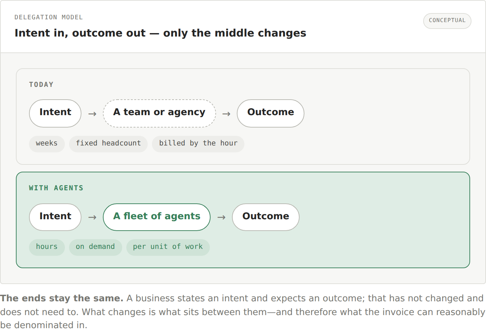

**The ends stay the same.** A business states an intent and expects an outcome; that has not changed and does not need to. What changes is what sits between them—and therefore what the invoice can reasonably be denominated in.

This is not a new way of working. It is the existing one with a constraint removed. A company already delegates by naming an outcome, agreeing what done means, and checking the result. Good managers do not assess an employee on hours logged, emails sent, or documents opened; where firms do meter activity that way, it is widely treated as a poor proxy for the job.[67](#references) They hire someone into a role, agree what the job is, and then check whether the job got done.

Nothing in that arrangement changes when the worker is an agent. Give it a scope it can own, say what done means before it starts, and afterwards look at what actually moved. If anything it gets easier: an agent works inside a system that can be inspected directly, so the check a manager makes by asking around can be made automatically, on every item, every time.

How a manager judges a person

**A role with a scope** own customer escalations

**Agreed at the start what finished means**

**Reviewed on what happened, not what was reported**

**Paid what the role is worth**

→

The same judgment, for an agent

**A unit with a boundary** this ticket, start to finish

**Checks declared before the work runs**

**Scored against system state, not the transcript**

**Priced at what the outcome is worth**

What the industry does instead is meter tokens—an input. No company evaluates an employee on calories consumed, and no business wants to manage prompt volumes, model choice, or retry counts. They want to state an intent and receive an accepted result at a price they can predict.

None of this removes people. They frame the problem, decide what correct means, set the spending boundary, and stay accountable for acceptance. The honest signal of whether this is becoming a workforce rather than a set of chat tools is the **intervention rate**: how often a person still has to step in and finish the job.

**Figure 3. Human intent enters; verified outcomes return**

*Operating model*

Human **Frame the work** Choose the problem · define what good means · set budget and ownership

→

Agent **Execute the skill** Use tools and context · act toward the end state · return a candidate

→

Environment **Observe and verify** Capture before and after · meter cost · evaluate the declared checks

→

Human **Settle the outcome** Accept or route the exception · keep the evidence · own the result

**Intervention rate is the autonomy signal** Human repair per accepted unit

**Copilot** high intervention

A person assembles or repairs most steps.

**Supervised agent** selective intervention

A person reviews hard checks and exceptions.

**Agentic workforce** low intervention

People direct intent and review unusual outcomes.

**Intent-to-outcome loop.** Humans retain judgment and accountability; agents execute; the environment supplies evidence. Falling intervention indicates increasing autonomy only when independent acceptance quality remains stable.

**The measurement consequence.** Once a business delegates outcomes instead of prompts, it needs a durable object to plan, budget, verify, and pay against. The work itself becomes that object—and that is why it needs a unit.

Introduction subsections

From a work contract to a measurable outcome

- [1.1 · What is a unit of work](#1-1-what-is-a-unit-of-work)
- [1.2 · How to measure work](#1-2-how-to-measure-work)
- [1.3 · Productivity, measured](#1-3-how-this-improves-productivity)
- [1.4 · Why work needs a new unit](#1-4-why-work-needs-a-new-unit)
- [1.5 · How this improves agents](#1-5-how-this-improves-agents)
- [1.6 · Why the environment measures](#1-6-why-the-environment-must-measure)
- [1.7 · Other innovations](#1-7-how-this-compares-to-other-innovations)

### 1.1 · What is a unit of work

A unit of work is a bounded job with an accountable owner, a declared finish line, and a way to determine whether that finish line was reached.

Which is to say: it is a ticket. Not necessarily one sitting in a tracker, but that shape — a job somebody opened, somebody owns, and somebody will eventually call finished or not. A great deal of what a business runs on already arrives this way, and has since work-tracking became standard practice. That is the useful part. Nothing here has to be invented, only made checkable.

**Figure 4. What a unit of work looks like**

*Four kinds of finished job*

**Resolved ticket**

Triaged, answered, closed.

**Reviewed contract**

Read, risks flagged, redlines proposed.

**Shipped report**

Pulled, analysed, written up, delivered.

**Merged change**

Written, tested, reviewed, merged.

A unit of work is a complete, verifiable outcome owned end to end — not a step along the way.

A prompt is an instruction and a token is a billing artifact, but a unit of work is the job itself. What makes something a unit is three things: a clear definition of done, a result you can actually check, and a scope small enough for one owner to be accountable for.

01 **Definition of done**

You can describe what finished and correct looks like.

+

02 **Verifiable result**

You can check it when it comes back.

+

03 **A single owner**

Scoped small enough for one party to be accountable.

**= one unit of work** plannable, checkable, priceable as a single item

If you can describe what finished and correct looks like, you can hand it to an agent, verify it when it comes back, and price it as one item.

**A prompt is not one of these** The opening instruction is not the job

A prompt is a single instruction. It has no memory of what came before, no files to work on, no tools to reach your systems, no budget, and no record once the reply scrolls away. A unit of work has to be owned from beginning to end, executed, checked, and paid for. None of that fits inside an instruction — which is why, as the work becomes the unit, its home moves from the prompt to the workspace.

The opening instruction

### A prompt

- Describes what to do next
- May have no durable memory or state
- Does not own the complete outcome
- Provides no settleable record by itself

→

The durable operating boundary

### A unit in a workspace

- Owns the outcome from start to finish
- Persists context, state, and artifacts
- Uses tools to act in the real system
- Retains budget, evidence, and result

So the job needs somewhere to live while it is being done: state to remember, files to touch, tools to use, and a ledger to prove it happened. A chat window supplies none of that.

**The fixed lifecycle:** define the outcome → budget it → execute in a workspace → verify the result → settle the work. A quirq is the proposed unit minted from verified delivery.

### 1.2 · How to measure work

You cannot measure work in the abstract. You can only measure what some environment observed—which makes the environment, not the agent, the thing measurement is actually a property of.

A unit of work has an owner, a finish line, and a budget. None of that produces a number by itself. The number comes from something that was watching: something that recorded the world before the job started, metered what the job consumed, recorded the world again when it returned, and compared the two against the checks the owner declared. That watcher is the environment.

The definition that matters

An environment is not a machine and not a place. It is **the region of the world you have decided to put observations over**—and everything measurable about the work is measurable only inside that line.

The line is a choice, not a given. Draw it around a container and you can credit files and tests. Draw it around a CRM tenant as well and you can credit closed deals. Leave a system outside it and the work done there is still real, still valuable, and still worth nothing to the ledger. Same job, same execution, two different readings—and neither instrument is lying. They are reporting what they were pointed at.

**Figure 5. An environment is a boundary you draw**

*Where the line goes*

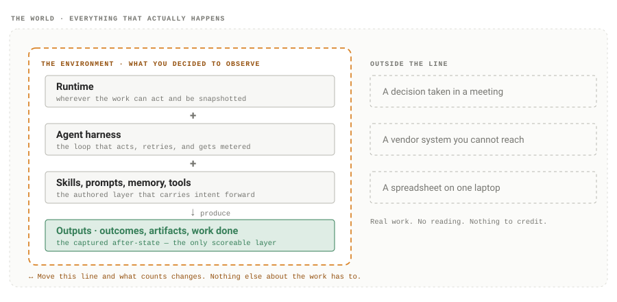

**The boundary is the instrument.** Widening it is how you make more work creditable; narrowing it is how work disappears from the ledger without anyone deciding it was worthless. Because the line is chosen rather than given, it has to be declared—two teams drawing it differently are not measuring the same thing, however similar their numbers look.

Consequence one **What the environment cannot see, it cannot measure.**

Work whose effect lands outside the line counts for nothing, however valuable it was. A decision made in a meeting and never written down is real work and unmeasurable work at the same time. Widening what the environment captures is the only way to widen what can be credited.

Consequence two **Two environments are two instruments.**

Readings taken inside different boundaries are not interchangeable, and adding them together is a category error. It is why comparison across teams and companies has to happen through ratios—value per dollar, cost per unit—rather than through totals.

**What an environment is made of** Four things, wired together

Two practical questions follow: what an environment is made of, and what it can be built from. Both are easier to look at than to read.

**Figure 6. An environment is assembled, not bought**

*Three steps, no purchase*

01 Pick what you will observe

A source qualifies if its state can be read before and after. That is a much lower bar than an integration.

Already in the workspace

*Agent runtimes* *Filesystem* *Terminal* *Git history* *Browser session*

Already running in the business

*Jira* *Linear* *GitHub* *Slack* *Zendesk* *Salesforce* *Notion* *Your warehouse* *+ anything with an API*

→

02 Wire them through four layers

Each layer contributes something the others cannot. Measurement only appears once all four are present.

01

**Runtime** where work can act and be snapshotted

02

**Agent harness** the loop that acts, retries, gets metered

03

**Skills, prompts, memory, tools** the authored layer carrying intent forward

04

**Outputs** the captured after-state — the only scoreable layer

→

03 Read the state, not the report

Whatever you connected in step one is now something the checks can be evaluated against.

1.  **Before**a snapshot of every connected source
2.  **After**the same snapshot, once the work returns
3.  **Checks**the declared conditions, evaluated on the difference

= a credited outcome

Widen step one and step three widens with it

**Connect the repository only**

Merged changes can be credited. Everything else the job achieved is invisible.

**Connect Jira as well**

“The epic is closed and its sub-tasks are done” becomes a checkable fact.

**Connect the warehouse too**

“The table refreshed and row counts reconcile” joins the same ledger.

**The four layers never change; the boundary does.** Nothing here is privileged and nothing has to be bought — an environment is whichever sources you decided to put observations over, run through the same four layers. Which is why two teams running identical work can credit very different amounts of it.

**What you pay for, what you get** The split that makes two ledgers possible

**The first three parts are what you pay for. The fourth is what you get.** Runtime, harness, and authored context all show up as cost. Only the outputs can earn anything back. An agent that thinks harder without changing anything moves the cost side and leaves the value side exactly where it was—which is precisely the situation a single meter cannot show you.

Keep the terms separate

The **unit of work is the job**. The **environment is the boundary** you put observations over, which is what makes the job observable at all. The **quirq is the reading** that boundary produces once the declared checks have been evaluated against it.

One caution before any arithmetic. The environment is both the instrument and part of what changes. Improve the harness and cost falls. Add skills, or let memory accumulate, and the cost of working out what the owner meant falls too. Move the boundary outward and work that earned nothing yesterday starts earning today. All three are worth doing—but each one also means a rising efficiency number can reflect better agents, or only a changed instrument[57](#references). The way through is to move one part at a time and hold the rest fixed, which is what the measurement section does.

### 1.3 · How this improves productivity

Productivity is output over input.[49](#references) For AI work it has been effectively uncomputable, because the numerator did not exist—only the denominator did. That is the shape the productivity paradox took for information technology as well: the input side was priced long before the output side could be recorded.[50](#references)[51](#references) A ledger of verified units supplies the missing half, and it supplies it per unit, which is what makes everything downstream possible.

**Five dimensions on every row** Four you already have, one you did not

**Figure 7. The axis that was missing**

*One unit, five axes*

01 **Outcome** what kind of job it was

02 **Owner** who asked, who is accountable

03 **Time** when it ran

04 **Cost** all-in, not just tokens

05 **Verified value** how much of it actually arrived

Already on every dashboard

The one that was missing

**Four of these are familiar and none of them is the point.** Outcome, owner, time and cost have existed on operational dashboards for decades; what they could never be read against was delivery.[43](#references)[44](#references) The fifth column is not an extra metric sitting beside the others—it is the one that turns the other four from a description of activity into a measure of productivity.

**Watching the business change, not just reporting it** Levels are a snapshot; the ledger has derivatives

A single efficiency reading tells you almost nothing — it has no scale to compare against and no reference point outside your own organisation.[49](#references) What is informative is the *direction*, and a ledger that accumulates one row per unit gives you that for free: cost per outcome over months, the share of work needing rescue, the drift in which classes dominate the spend. That shift, from levels to trends, is the difference between an expense line and an investment case.

The structure supports the honest reading as well as the flattering one. Because the rows carry cost and value together, a fleet delivering more only because it is being run more cannot hide inside a growing total — the ratio does not move. That property is worth more than any single number the system produces.

**Where these numbers get read** Four lenses over the same record

None of this survives as a table nobody opens. Space is the view layer over the same record — four lenses, and the cross-cuts they make answerable once verified value sits on every row.

**Figure 8. Four lenses, and what each one answers**

*The Space interface*

The view What it answers once verified value is on every row

Graph **Where is the missing context?**

Connects projects, documents, source files, experiments, and the relationships derived from the workspace.

`outcome × intervention` **Where does human rescue concentrate?**

Rarely evenly. It clusters in particular task classes, and each cluster is a nameable gap.

session file edit todo

Timeline **What changed over time?**

Shows how the workspace grew, and which sessions, files, and milestones moved together.

`outcome × time` **Which work is getting cheaper?**

Not whether the bill grew — bills grow with volume. Whether the same class of job costs less than it did last quarter.

`mix vs within-class` **Is the gain real, or did the work get easier?**

Every class improving and cheap classes growing look identical in the headline. Section 4 separates them.

Sessions **Which sessions were heavy?**

Compares runtime, model, tokens, tools, trends, and the cost signal the available sources can support.

`owner × value ÷ cost` **Which teams get more from the same spend?**

A ratio rather than a total, because a bigger team should deliver more.

website · active space · 2 todos research · idle

Projects **What is active right now?**

Brings open sessions, shared todos, recent events, and the next place to resume into one view.

`outcome × value × cost` **What is the next unit of this kind worth?**

A known cost per verified outcome turns planning into arithmetic rather than advocacy.

**Figure 1.** Views over real workspace state, not a second place to conduct the work. The right-hand column is not a second product — every question there is a slice of the same table the view on its left is already drawing from, which is the whole practical difference. Runtime capabilities and telemetry depth remain source-specific.

One caution carried forward from the sections above. Everything here follows from the ledger existing and is available the moment units are being scored. Whether the trends actually bend the way this argument expects—cost per outcome falling, intervention declining, efficiency predicting business results—is an empirical question, stated as hypotheses with their falsifying experiments in Section 4 rather than asserted here.

### 1.4 · Why work needs a new unit

Work does not arrive as a metric. It arrives as a ticket, a request, a task someone opened—and it has to travel a long way before anyone can say what it was worth.

At 9:04 a customer emails support and a ticket opens. Right now it is only a request: somebody wants something. It becomes a work item the moment three things get attached to it—**somebody owns it**, **somebody says what handled means**, and **somebody decides what handling it is worth**. From there it moves through a small number of states, and each one tells you something different about the money.

**Figure 9. Every state spends. One state counts**

*One ticket, start to finish*

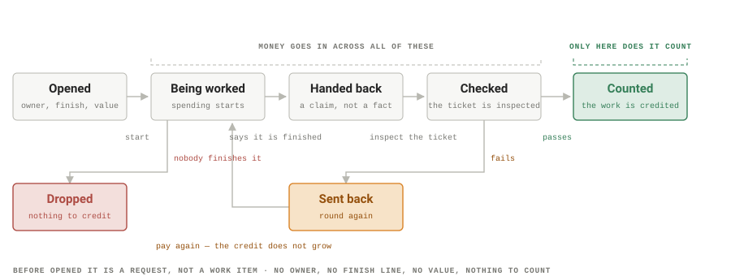

**Handed back is not the same as done.** It only means whoever did the work stopped and said so. Whether the job was actually finished is answered by looking at the ticket—closed or not, replied to or not—rather than by asking the worker.[36](#references)[63](#references) That single distinction is what separates a report from a measurement.

The state worth staring at is **Sent back**. A ticket that goes round twice cost roughly twice as much and is worth exactly the same as one that passed first time—the value was set when the job was opened and nothing about a second attempt changes it. That gap never shows up in a usage bill, and it is most of the difference between a team that is working and one that is only busy.

**One item, many sessions** The unit outlives the thing doing the work

Much of it does not finish in one sitting, and the loop above is ordinary rather than exceptional — knowledge work has been measurably fragmented across sittings since long before agents.[65](#references) A job is worked, handed back, sent back, worked again — and the second attempt is hardly ever the same session as the first. A day passes. The window gets closed. A different runtime picks it up, or a person does. Through all of it the ticket, the definition of done, and the price stay exactly what they were at 9:04.

That is the mismatch which makes agent work awkward to account for. A **session** is a container for a conversation: it starts empty, it ends completely, and it takes everything it learned with it. A **work item** is a container for an obligation: it starts when somebody accepts it and ends only when the finish line has been checked. The two have no reason to line up, and in practice they do not.

**Figure 10. The work outlives the thing doing the work**

*One item, many sessions*

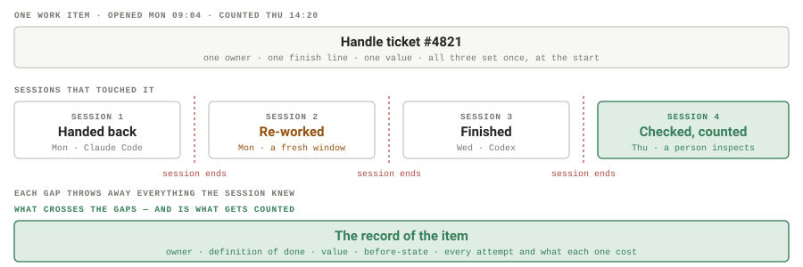

**Four sessions, one job, one number.** Nothing here is unusual — a rework the same afternoon, a second pair of hands on Wednesday, a check on Thursday. What is unusual is that the cost is recorded per session while the value belongs to the item, so any account kept at the session level splits a single job into four unrelated bills and never adds them back up.

Which forces a question that looks like plumbing and is really part of the measurement design: if the item outlives every session that touches it, where does its state actually live? Not in the session — that is the thing disappearing. Not in whoever ran it, for the same reason §1.2 gave. It has to be written down somewhere with an explicit owner and an explicit rule about whether it travels.

**Where the state of an item lives** Four kinds, four different answers

“Memory” is too vague to be a trustworthy answer to that. The separation used here is four kinds of state, each with an owner and each with a deliberate decision about whether it belongs to the project or to the machine.

Full native conversations stay in the stores that created them. Authored project memory stays with the project. Derived metadata such as the session index, todos, statistics, and timeline lives in `.xo`. Credentials, watcher cursors, locks, and live-presence state remain on the machine under `~/.quirq`.

**Figure 11. What lives where—and what is allowed to travel**

*Storage contract*

native store

### Runtime sessions

The full transcript and runtime-specific objects remain where Claude Code, Codex, Cursor, or another tool wrote them.

does not travel with the project

project/ + memory/

### Authored context

The brief, objectives, plan, progress, files, and distilled memory that people and agents intentionally maintain.

travels with the project

.xo/

### Portable metadata

Project identity, session index, todos, aggregate stats, and a derived event timeline. Service-owned and deliberately compact.

designed to be portable

~/.quirq/

### Machine-local state

Credentials, watcher cursors, locks, configuration, and live presence. Operational state that should not enter the project record.

never travels with the project

Figure 2. Local-first does not mean “put everything in one local database.” It means keeping the sensitive and operational state close to the machine while making only the useful project record portable.

**The privacy promise is structural:** no full conversation is copied into `.xo`, and secrets do not belong in either project memory or portable metadata.

**Where this connects to how you already run the company** Objective → key result → KPI → work

None of this replaces the way targets get set. It sits underneath it. Say leadership picks an objective for the quarter—*make support feel fast again*—and puts a key result under it: *median first response under two hours by the end of Q3*. The team then watches a handful of KPIs weekly: first-response time, backlog age, satisfaction scores.

That is where most companies stop, and it is one level short. A KPI tells you the number moved. It does not tell you what moved it, how much of the moving anyone did, or what the moving cost. Two quarters can show the same drop in response time—one because the team genuinely got faster, one because volume happened to fall. From the KPI alone they look identical.[19](#references)

Level, with an example What it answers What it leaves open

Objective **Make support feel fast again**

Where are we going?

Are we getting there?

Key result **Median first response under two hours by the end of Q3**

Did we get there?

What moved it?

KPIs **First-response time · backlog age · satisfaction**

Is the number moving?

Who or what moved it, and at what cost?

Work items **Triage each inbound ticket · draft a first reply · link the right article**

What actually got done, verified, and what did it cost?

—

The bottom row is the layer that has always been implicit and is now the one that matters. Someone prices each job—what was triaging a ticket worth when a person did it? what is a drafted first reply worth?—and writes down what has to be true for it to count: the ticket has an owner, a reply went out inside the window, the article is attached. Then the work runs, the tickets get inspected, and the ones that pass are credited at what they were priced.

Add up what got credited over the quarter, put it beside what the quarter cost, and you can finally answer the questions a KPI leaves open: **how much of the target was actually delivered, by what, and at what price.** The response-time chart says the number moved. This says who moved it and what moving it cost—which is the difference between reporting a result and being able to repeat one.

The first three rows have existed for decades and work fine. The fourth is the one that quietly went missing when the work started being done by agents, because little on the usual dashboard counts what an agent delivered; almost all of it counts what the agent consumed.[44](#references)

What is in Section 4

This is the shape of it. The arithmetic—how a counted item turns into a number, what belongs on the cost side, and how much data it takes before a change means anything—is **Section 4**, along with the full state machine for readers who want it.

### 1.5 · How this improves agents

Measuring work properly is not only an accounting change. The same record that makes a unit checkable is, without any extra effort, the record an agent can be trained on.

**A checked outcome is training data** The tuple reinforcement learning already consumes

Look at what an environment writes down for each finished unit: the state it started from, what the agent did, whether the declared checks passed, and what it cost. That is not merely an audit trail. It is a situation, an action, a reward and a price — which is exactly the tuple reinforcement learning consumes. The field has a name for training on rewards a machine can check rather than opinions a person has to supply: reinforcement learning with verifiable rewards.[78](#references)

And where a task admits a cheap, honest check, the published record is not ambiguous. Reinforcement learning on execution feedback took a 70B code model from 27.5% to 40.1% on CodeContests.[71](#references) Reinforcement learning on verified web-task completion took an 8B agent from 4.8% to 42.4% on WebArena-Lite — against 20.6% for supervised imitation trained on the same data.[72](#references) Reinforcement learning on feedback of any kind has been outperforming imitation for years: a 1.3B model trained with human feedback was preferred to a 175B model trained by imitation alone.[74](#references) What is newer is that the feedback no longer has to be human. Pure reinforcement learning against automatically checkable rewards, with no supervised stage at all, took DeepSeek-R1-Zero from 15.6% to 71.0% average pass\@1 on AIME 2024.[73](#references) The same approach carries into software agents scored against real repository history.[79](#references)

**Figure 12. What checked outcomes are worth as training signal**

*Published results, not projections*

Code, small sample budgetCodeContests solve rate, 1\@3 (%)

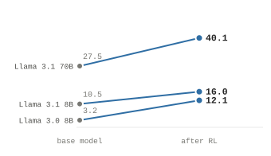

Code, large sample budgetCodeContests solve rate, 10\@100 (%)

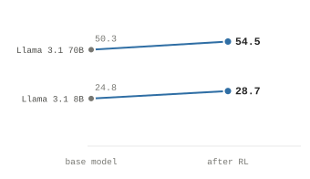

Web tasks, same data budgetWebArena-Lite success rate (%)

**Every number here is printed in the source paper; none is ours.** Left and centre: CodeContests solve rate before and after reinforcement learning on execution feedback, at two sample budgets.[71](#references) Right: an 8B web agent on WebArena-Lite, where supervised imitation on the same data reaches 20.6% and reinforcement learning on verified task completion reaches 42.4% — against 17.6% for GPT-4-Turbo on the same benchmark.[72](#references) The middle panel is the honest one: the gain is largest exactly where the budget is smallest, and shrinks to about four points once you are already sampling a hundred times.

None of which licenses the strong version of the claim. It is not true that every agent does better with reinforcement learning, and three limits in these same papers are worth stating plainly. The gain concentrates where the sampling budget is small: the 70B model above gains 12.6 points at one submission from three samples and only 4.2 at ten from a hundred, and across six algorithms the base models catch up or overtake once *k* is large enough — which suggests much of what reinforcement learning does is sharpen the distribution toward answers the model could already occasionally find.[77](#references)

Second, a verified outcome certifies the outcome and nothing else. Outcome-only supervision matched process supervision on final-answer error for grade-school maths while producing roughly three times the rate of broken reasoning inside answers that were nonetheless correct.[75](#references) Denser checked signal beats sparse checked signal when you can afford it.[76](#references) Third, a checker is a proxy, and a proxy optimised hard enough stops measuring the thing you wanted — which applies to execution-based rewards as much as to learned ones.[34](#references)[39](#references)

Read together, those results point somewhere specific, and it is not at the model. Reinforcement learning is not the scarce ingredient; the checker is. What limits how much an agent can learn from its own work is whether there exists a check that is cheap to run, honest about what it certifies, and attached to something a business actually asked for. That is not a training problem. It is the unit of work.

**A label on every unit, automatically** Which is the part that compounds

The larger effect is on what the agent can learn from. Feedback today is sparse, late, and human: a thumbs-down, a rewritten reply, a comment on a pull request, an escalation nobody logged. It arrives long after the run, it varies between reviewers and between Tuesdays[56](#references), and it usually records that something was wrong without recording *what*.

An environment that scores every unit produces a labelled example every single time, without anyone being asked to produce one. Not a verdict—a structured record:

01

**The situation it started from**

The captured before-state: what existed, what did not, and what the request was in that context rather than in the abstract.

02

**What it actually did to the world**

The captured after-state. Not a narration of the attempt—the difference between two snapshots, which is a fact about the world rather than a claim about the agent.

03

**Which specific things counted, and which did not**

Per-check results rather than a single verdict. The ticket closed but the article was never linked is a different lesson from nothing happened at all, and only one of them is recoverable by trying harder.

04

**What it cost to get there**

Two runs that both passed are not equally good if one spent ten times what the other did. Without the cost side, the cheapest way to look successful is to try everything — reliability across repeated trials falls well below what a single best attempt suggests.[63](#references)

That is the shape a learning signal has to have: a situation, an action, an outcome, and a value attached to it. Feedback collected from production systems is typically missing at least two of the four, which is a large part of why so little of it ends up usable.

Why the label has to come from the environment

A label the worker wrote about itself teaches the worker to **write better reports**. A label taken from the state teaches it to **change the world**.[34](#references)[39](#references) Both look like improvement on a dashboard; only one of them is. This is the same argument as §1.6, arriving somewhere different: contaminated evaluation does not just mislead the people reading it, it trains the thing being measured on the wrong objective.

Both effects are the same loop running twice. Every finished unit leaves behind an example the next one can be trained on, and a labelled record of what that attempt was worth. Neither is a feature anyone has to build on top; both fall out of having measured the work at all.

Worth being precise about the status of this. That the record *exists*, and has the shape a learning signal needs, follows from the measurement design and is not in question. The results above are other people’s, on other people’s benchmarks; that a workspace ledger produces the same effect on real business work is an empirical claim this article does not yet get to make — it is stated as a hypothesis in Section 4, together with the experiment that would falsify it.

**Watching an agent get better, or not** The same rows, read as a time series

A record that accumulates one row per unit is not only a ledger. It is a series. Which means the question everyone actually has about an agent in production — *is it getting better at this, and how fast?* — stops being a matter of impression and becomes three readings taken per class of work, quarter after quarter: how often a person had to step in, what one verified outcome cost all-in, and how long it took to reach one.

**Figure 13. Is the agent getting better at this?**

*One class of work, six quarters*

Human interventionshare of units a person had to finish

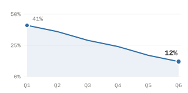

Cost per verified outcomeall-in, not just tokens

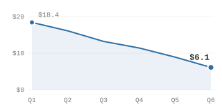

Time to a verified passopened to counted

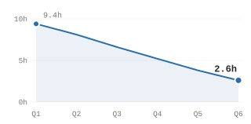

**Three readings of the same rows, not three reports.** Each panel is one class of work over six quarters; the numbers are drawn to show the shape a working fleet should produce, and are not measurements. Whether real fleets bend this way is exactly the question Section 4 turns into a falsifiable experiment.

Any one of those lines can fall for the wrong reason. Intervention drops if the checks quietly got looser.[35](#references)[40](#references) Cost drops if the cheap work grew as a share of the whole.[25](#references) Time drops if the scope shrank. Read together, against a definition of done that was declared *before* the work rather than assembled after it, they are considerably harder to fake — which is the entire reason the finish line gets written down first.

The more useful reading is often the line that does *not* fall. A task class whose intervention rate sits flat while its neighbours improve is the most actionable thing on the board: it names a specific gap between what was asked for and what the agent can currently finish, in a place a person can go and look. An aggregate number cannot produce that; a per-class series produces it by construction.

### 1.6 · Why the environment must measure

If you ask a worker whether the job is done, you get an answer. You do not necessarily get the truth—and not because anyone is lying. Self-reports are a measurement, and they have failure modes that are well understood and easy to reproduce.[54](#references)

Every state in the lifecycle above turns on one moment: something says the work is finished. If that claim is the measurement, then the quality of everything downstream—the ledger, the efficiency number, the decision to hire more agents—rests on how honest and how well-informed a single sentence happened to be.

**How self-reports go wrong** Mechanics, not malice

01

**A worker cannot see its own blind spot**

The report describes what the worker believes it did. If a tool call silently failed, a write landed in the wrong place, or a permission was quietly denied, the report reflects the intention rather than the result—accurately, and wrongly. Stated accounts of one’s own process are reconstructions, and for language models the reconstruction can systematically misrepresent what actually drove the output.[55](#references)[60](#references)

02

**The report is produced, not observed**

For a language model, “I closed the ticket” comes out of the same process as every other sentence: a plausible continuation.[58](#references) Plausibility and truth correlate well[59](#references). They do not correlate perfectly, and the gap is invisible from inside the text.

03

**Partial work rounds up**

Partial completion is easy to read as completion in a summary. Summaries compress, and compression is not neutral[61](#references) — it tends to resolve toward the ending the reader is expecting.

04

**Nothing can audit a claim about itself**

Even a completely truthful report cannot be checked from the report. There is no operation you can perform on the sentence that tells you whether the world matches it. You have to go and look.

None of these require an agent that is careless or adversarial. They happen to careful humans too, which is exactly why managers look at the ticket queue rather than only reading status updates. The difference is scale: a person files a handful of reports a week and a fleet files thousands a day, so a small, consistent bias stops being noise and becomes the number.[54](#references)

**Figure 14. Ask the worker, or ask the world**

*Two ways of knowing*

Ask the worker

**The worker finishes** or believes it has

**It writes a report** generated, like every other sentence

**The report is accepted** nothing has looked at the world

The claim and the evidence are the same object

vs

Ask the world

**The worker finishes** and says so, which changes nothing

**The world changed — or it did not** the ticket, the file, the row, the deploy

**The environment reads the state** the same checks, every single time

The answer exists whether or not anyone reports it

**The claim stops being the evidence.** On the left, the only artifact is a sentence, and there is no operation that turns it into a fact. On the right the worker still reports—it simply has no bearing on the score, because the score is taken from the ticket, the file, and the log, which were going to say what they say regardless.

**Why this is more accurate, not just more suspicious** What changes when the reporter leaves the loop

Reading the state is not a trust exercise. It removes a whole class of error by construction rather than by policy, and it does so in four specific ways.

| What can go wrong | If you ask the worker | If you read the state |
|----|----|----|
| **A tool call silently failed** | Invisible — the report describes the intent | Caught — the change simply is not there |
| **Three of four things done** | Usually rounds to “done” | Scored as partial, at exactly three quarters |
| **Confident phrasing** | Reads as success | Has no effect on anything |
| **Right action, wrong target** | Invisible — the action did happen | Caught — the expected place is unchanged |
| **The goal was badly written** | Invisible | Still invisible — but now it is a file you can read, argue with, and fix |

The first four rows are the accuracy gain. **Coverage** is part of it: a manager spot-checks a sample because reading everything is expensive, while an environment reads every item at the same cost per item, so there is no sampling error left to argue about (measurement error remains; only sampling error is removed). **Consistency** is the rest: the same checks run the same way each time, so two units that delivered the same thing score the same, which is not true of any process that routes through human attention on a Friday afternoon.[56](#references)

And because the evidence is captured rather than asserted, it stays available. A score can be recomputed months later against the stored before-and-after and will produce the same answer. A claim cannot be re-examined at all—there is nothing to re-examine.

What this does not fix

Reading the state does not make measurement perfect. It moves the error from somewhere unobservable to somewhere observable. A badly chosen check is still wrong—but it is **written down, inspectable, and arguable**, which a worker’s belief about its own performance never is. Getting the checks right is a hard problem the rest of this article takes seriously; getting a self-report to be reliable is not a hard problem so much as one nothing inside the report can solve: without an external signal, models do not reliably correct their own accounts.[62](#references)

This is why the lifecycle keeps *handed back* and *checked* as two separate states rather than collapsing them into one. The worker is allowed to finish and say so. It is simply not the thing that decides.

**What measured work leaves behind** One outcome settles; a sequence teaches

One verified outcome is useful for settlement. A collection of them is useful for something else. Put every business intent on one side and every after-state the world could be left in on the other, and the work itself is only what happens in between: a path of state changes, some taken by an agent and some by a person.

What the declared checks do is draw a line through that space before the walking starts, separating the after-states that count from the ones that do not. Paths landing on the good side show which routes are worth repeating. Paths landing on the bad side — including the near misses that stopped just short of the line — show where the effort went and what it bought, which is a fact about the system rather than a score for a person.

**Figure 15. Work is a path; the checks are a boundary**

*Intent, work, outcome*

**The boundary is drawn first, and that is the whole trick.** Every job is a path of state changes — some taken by an agent, some by a person — and every path ends somewhere in the space of possible after-states. Because the definition of done was declared before any of those steps were taken, the environment does not have to judge the path. It only has to read where the path ended and see which side of the line that is.

### 1.7 · How this compares to other innovations

Consequential technologies tend to become manageable once we can read two sides of them at once: what the system consumes and what that consumption produces.[52](#references) AI has a good meter for the first side. It still lacks a unit for the second.

Electricity makes the distinction concrete. A **watt** measures power—the rate at which energy is transferred; a **kilowatt-hour** records how much energy crossed the meter over time.[68](#references) Those units let a utility bill correctly and let an engineer size a grid. They do not say whether the electricity illuminated a room, moved freight, cooled a building, or produced a finished good.

To judge the usefulness of power, the input meter is read against an output-side measure: lumens per watt, ton-miles per kilowatt-hour, units produced per shift, or some other account of useful change. A factory that consumes twice the electricity but produces nothing has not become twice as productive. The bill measures the draw on the world; the output ledger measures what the draw accomplished.

Electricity is the clearest case, not a special one. Every technology that became manageable did so by acquiring a second meter. Steam engines were sold on horsepower and judged on *duty* — water raised per bushel of coal — published monthly in *Lean’s Engine Reporter* from 1811.[53](#references) Freight burns fuel and is judged on ton-miles delivered.[69](#references) Computing is provisioned in core-hours and judged on transactions served.[70](#references) An entire economy is read the same way — hours worked on one side, real value added on the other, and the ratio between them is what anybody means by productivity.[49](#references) In every case the input meter arrived first, because it was easier to build. And in every case it took time before anyone stopped mistaking it for the answer.[52](#references)[50](#references)

| System | Input meter | Output-side evidence | Useful comparison |
|----|----|----|----|
| Electricity | **Watt / kWh** · Power rate and energy consumed | **Lumens, ton-miles, finished output** · What the power caused | Useful output per unit of energy |
| Steam and machinery | **Horsepower, coal burned** · What the engine drew | **Units produced per shift** · What the engine made | Output per horsepower-hour |
| Freight | **Fuel, vehicle-hours** · What the fleet burned | **Ton-miles delivered** · What actually moved | Ton-miles per gallon |
| Computing | **FLOPs, core-hours, watts** · What the machine ran | **Transactions served, jobs completed** · What the machine finished | Cost per transaction |
| A whole economy | **Hours worked, capital employed** · What went in | **Real value added** · What came out | Output per hour — productivity |
| Agentic AI | **Tokens, compute, energy, cost** · What the machine drew | **Verified, owner-valued change** · What the work delivered | Verified work per dollar, token, or kWh |

The two-meter analogy

The analogy is about accounting structure, not physical identity: the token remains the input meter; the quirq is proposed as the output-side unit.

AI today is metered like a factory whose electricity bill is exact but whose loading dock is unobserved. The token is a genuinely good input unit: it counts the atomic events of inference, scales with compute and energy[46](#references)[47](#references), and gives infrastructure providers something they can price and plan against. But it cannot cross the boundary from cost to value. A verbose failure may consume more tokens than a terse success; the same result may require very different token counts on different models[64](#references); and a four-dollar support ticket is indistinguishable from a high-value contract review on the bill.

No business runs on an electricity bill alone. Its question is: *what did we get, what did it cost all-in, and is that ratio improving?* A consumption meter cannot answer because consumption is a cost signal, not a measure of work. The measurement problem is therefore not a shortage of telemetry. It is the absence of an output unit.

The missing output meter now has a defined object to attach to: the unit of work described above. Because its owner, budget, acceptance checks, and before-and-after state are declared, the unit can carry outcome-side measurement in a way a prompt cannot. An agentic workspace also makes the supporting evidence cheaper to collect while the work happens.

A *quirq* is the proposed output unit for the verified, owner-valued work that contract delivers. Tokens and quirqs are complementary, not competing meters: one records what the machine drew; the other records what verifiably changed. Read against all-in cost, they yield cost per quirq and quirqs per dollar; read against energy, they yield quirqs per kilowatt-hour. Tracked over time, the pair turns “is AI working here?” from an anecdote into a measurable trajectory.

**What exists now, and what remains research** The unit is proposed; not all of it is built

The distinction matters because a careful explainer should make the present product more credible, not borrow certainty from its roadmap.

### Available now

- A local control plane around supported agent runtimes
- Watcher-derived session, file, todo, usage, and activity signal
- Portable project metadata in `.xo`
- Authored semantic, episodic, procedural, and working memory
- Space views for graph, timeline, sessions, projects, and context

### Still to prove

- Production-grade before/after outcome verification
- Default minting and settlement of lowercase quirqs
- Predictive QER and business-impact accounting
- Budget governance that resists gaming and mispricing
- Feature-equivalent observation across every runtime

### What Quirq is not

- A foundation model or inference provider
- A replacement for Claude Code, Codex, Cursor, or another runtime
- A centralized warehouse of every private conversation
- A proven universal ROI meter—yet

**The shift a second meter makes possible** Three questions, replaced by three better ones

Which is what an output meter buys, stated plainly. Each of these is a question teams already ask about agent work and cannot answer from the bill alone.

From **What did the agent say?**

→

To **What changed in the project?**

From **One runtime’s transcript**

→

To **A durable workspace record**

From **How many tokens did it use?**

→

To **What verified outcome did it deliver?**

The first two shifts are the product being built today. The third is the research program that gives the product its name.

**Figure 16. Four layers turn scattered agent activity into project context**

*Interactive system map*

01 **Agent runtimes** Native sessions, tools, models, and files 02 **Local observer** Adapters, normalization, and privacy filtering 03 **Workspace memory** Project context separated from machine state 04 **Space** Graph, timeline, sessions, projects, and memory

Selected layer

Claude Code, Codex, Cursor, OpenClaw, Hermes, Antigravity, and other tools each keep their own sessions and capabilities. Quirq does not replace those runtimes; it observes the surfaces each one actually exposes.

Figure 4. The current product is a local workspace layer around agent runtimes. It derives project context without turning Quirq into another inference provider or transcript warehouse.

**What is left is the arithmetic** Where Section 4 picks up

That is the whole of the argument. Work needs a unit; the unit needs an environment to live in; the environment leaves a record; and the record supports an output meter that can finally be read against the input meter every provider already ships. None of that needs new mathematics to *state*.

All of it needs new mathematics to *use*. The moment a score is written down it becomes an estimator, and an estimator has a sampling distribution, a bias, a reliability, and specific ways of being wrong.[9](#references) A number nobody can put an interval around is not a measurement — it is a claim with a decimal point.

What Section 4 does

It defines the completion score and the settlement rule from stated requirements, builds the all-in cost denominator, and then treats every quantity it defines as a statistic — with an interval, a reliability, and a falsifying experiment attached to each claim made here.

Section 2

## 2 · Core Concepts

The same word carries different weight in different rooms: a budget means one thing to the owner pricing an outcome, another to the CFO reading the ledger, and a third to the training run that treats it as a reward weight. This chapter will define each core term on its own — budget, definition of done, verification, environment, settlement, cost — before the calculus of §4 uses them. It opens with the working vocabulary Section 1 has already introduced, then builds the loop, the budget, the spaces, and the quirq from it.

- [**2.1** The vocabulary](#the-vocabulary)
- [**2.2** A first example, turn by turn](#a-first-example-turn-by-turn)
- [**2.3** The budget](#the-budget)
- [**2.4** From snapshots to spaces](#from-snapshots-to-spaces)
- [**2.5** Quirqs](#quirqs)
- [**2.6** Symmetries](#symmetries)

The term-by-term chapter is being drafted. Until then: one reference table and one worked example — the plain-language vocabulary Section 1 has already introduced, and the landing-page walkthrough built on it. The complete symbol notation now opens the measurement chapter (§4.1). Every row links to where the idea is defined.

2.1

### The vocabulary

Every working term Section 1 introduced that carries defined weight later in the paper, one line each. If a sentence further on feels heavier than it should, the missing weight is probably here.

Deliberately excluded: prompt, ticket, token, the two meters, and the agentic workforce. Section 1 already establishes them, they acquire no technical definition later, and they keep their ordinary §1 meanings wherever they appear.

| Term | One-line explainer | Introduced |
|----|----|----|
| **The work itself** |  |  |
| **Work item** | A discrete piece of business someone needs handled — a support ticket, a contract review, a report, a code change. | [§1.1](#1-1-what-is-a-unit-of-work) |
| **Unit of work** | A work item with a boundary: checks declared before it runs, scored against system state, priced at what the outcome is worth, owned by one person. | [§1.1](#1-1-what-is-a-unit-of-work) |
| **Owner** | The named human accountable for a unit: decides what “handled” means and accepts or rejects the result. | [§1.1](#1-1-what-is-a-unit-of-work) |
| **Definition of done** | The checks, agreed before execution, that say what finished means — so “done” is a property of the world, not an opinion. | [§1.1](#1-1-what-is-a-unit-of-work) |
| **Budget** | The price the owner puts on the outcome *before* the work starts: what it is worth to have it exist — not what it costs to produce. | [§1.1](#1-1-what-is-a-unit-of-work) |
| **Verification** | The environment compares the world before and after the work and scores the difference — the claim stops being the evidence. | [§1.6](#1-6-why-the-environment-must-measure) |
| **Quirq** | The unit minted when verification passes: score times budget (Q = V × B) — verified, owner-valued change in the world. | [§1.5](#1-5-how-this-improves-agents) |
| **Intervention rate** | How often a human had to step in and rescue the work — the paper’s trust and autonomy signal. | [§1.3](#1-3-how-this-improves-productivity) |
| **Where the work runs** |  |  |
| **Environment** | The boundary you draw around the work — and therefore the instrument that measures it; what it cannot see, it cannot count. | [§1.2](#1-2-how-to-measure-work) |
| **Runtime** | The bottom layer: container, filesystem, network, clock — what makes before- and after-state capturable at all. | [§1.2](#1-2-how-to-measure-work) |
| **Agent runtime** | The software an agent lives in — Claude Code, Codex, and peers — several of which can share one workspace. | [§1.1](#1-1-what-is-a-unit-of-work) |
| **Agent harness** | The machinery around the model: tool loop, planning, retries, context management — the largest non-model lever on cost. | [§1.2](#1-2-how-to-measure-work) |
| **Skills, prompts, memory, tools** | The authored layer — everything a team writes and accumulates so the next unit starts smarter than the last. | [§1.2](#1-2-how-to-measure-work) |
| **Outputs** | The top layer: outcomes and artifacts — the captured after-state, and the only layer that is scored rather than metered. | [§1.2](#1-2-how-to-measure-work) |
| **Workspace** | The durable project home where units, context, and records live — across sessions and across runtimes. | [§1.1](#1-1-what-is-a-unit-of-work) |
| **Session** | One runtime conversation or run; a single work item routinely spans several — four sessions, one job, one number. | [§1.4](#1-4-why-work-needs-a-new-unit) |

Table 1: The plain-language vocabulary of Section 1. Each entry links to the subsection where the idea is developed. {.tc-table}

These words keep exactly these meanings for the rest of the paper. Where a term acquires a precise mathematical form — budget becomes B, the definition of done becomes G, the quirq becomes Q — the symbol and its one-line meaning are in Table 2, which now opens the measurement chapter (§4.1).

2.2

### A first example, turn by turn

Before any formalism, watch one work item happen. Two clocks run through every unit of work: a fast machine clock that watches, and a slow human clock that decides. Keeping them apart is most of the trick.

Four working definitions carry the whole loop, in the same format the rest of the paper uses for its notation:

| Term | Notation | One-line explainer |
|----|----|----|
| **Tick** | t | The machine clock: one background snapshot by the environment’s watcher — cheap, automatic, taken whether or not anyone is talking. In general ticks fire at machine frequency; in this first example exactly one tick fires at each turn boundary. |
| **Turn** | T_(i) | The human clock: a turn takes place only when a human intervenes — the agent may act hundreds of times in between without opening one. Formally a turn is the change of state between consecutive observations, T_(i) = H_(i) + O_(i), defined below. Turns, not actions, are the scarce resource this paper prices. |
| **State** | S_(n) | The observation captured at the boundary of turn n. The chain S₀ … S_(n) is what the environment keeps, and the only evidence anything is ever scored on. |
| **Rule** | T₀, T_(n) | Human endpoints: only a human can open a work item, and only a human can finally verify and conclude it. Agents execute the middle; they can do neither. |

T = t   (this example) The two clocks are deliberately synchronized here: the watcher takes exactly one snapshot per turn, so tick boundaries and turn boundaries coincide and the chain S₀ … S_(n) reads the same on either clock. In production the machine clock runs much faster than the human one — many ticks between turns — and that desynchronized picture is taken up with the snapshot pipeline of §2.4.

Write the unit as turns T₀, T₁, …, T_(n), each splitting into H_(i) — the human contribution: intent, correction, decision — and O_(i) — the outcome observed since the previous turn (their sizes are written h and o). Every unit then has the same shape:

Opening turn · human starts

T₀ = H₀

→

Working turns · human intervenes

T_(i) = H_(i) + O_(i)

→

Closing turn · human verifies

T_(n) = O_(n)

h₀ \> h₁ \> … \> h_(n) = 0 The opening turn is pure human intent — the world is unchanged. Each working turn begins with a human intervention and closes over the outcome the ticks recorded. The unit concludes on a turn where the human contributes no new work at all: h_(n) = 0, the declared checks read green from captured state, and the owner’s only act is verification. Work item concluded.

Before any turn runs, the work item itself must exist — stated, owned, and checkable. Here is the one this example uses.

Work item Landing page for the spring launch

**What the owner wants.** A landing page: hero, three feature cards, and a signup form wired to the mailing list.

**Definition of done — three checks, declared up front.**

- **Builds.** The page builds cleanly from the repository.
- **Form live.** A test submission arrives on the production mailing list — not the staging one.
- **Fast.** Performance score of 90 or better.

All of it is committed at the opening turn, before any work happens — which is what makes “done” decidable by looking at the world rather than by asking anyone. The watcher snapshots S₀ as the baseline these checks will be compared against. In §4.2 checks like these acquire weights and a threshold; here it is enough that they exist first.

Now simulate the turns — the loop as a flow that evolves with each one. Read each column top to bottom: the human speaks, the agent works while the watcher ticks, an observation is captured, and the owner looks again. The human boxes shrink turn by turn; the last one is not work at all, only the close.

Each column is one full cycle: intervene → work and tick → observe → look again. The orange boxes carry the actual landing-page inputs, and their shrinking area is the staircase h₀ \> h₁ \> … drawn as flow. The bottom row is what the environment keeps: a chain of captured observations S₀ … S_(n), with the verdict landing on the last one. The red dashed return is the only other exit: a failed check does not end the unit, it opens the next turn.

Definition A turn is a change of state

T_(n) = S_(n) − S_(n−1) = H_(n) + O_(n) S_(n) is the observation captured at turn n. T_(n) is everything that changed between two consecutive observations, and it splits exactly in two: H_(n), the part of the change the human wrote — the message, the edit, the decision — and O_(n), the part everything else produced, assembled from the ticks in between. The lowercase h_(n) and o_(n) used so far are simply the sizes of these changes: how much the human moved, how much the world moved.

This upgrade matters because a change of state is not a number — it is a thing with direction and content, and that is what makes it mappable. Each H_(n) is a point for the input space of 2.4; each O_(n) is a point for the outcome space, labeled by the unit’s eventual verdict. The trajectory plotted there, and the Σh-versus-Σo paths after it, are these same deltas — first placed by what they contain, then summed by how big they are. The mapping starts here, at the humble difference between two snapshots.

If a check had failed here, the loop would simply continue — another intervention, another stretch of ticks, another turn. A unit is never concluded by the worker announcing it, and never concluded by the machine alone: checks green is the precondition, the owner’s acceptance is the close.

The loop is not just a story — it is data, and it has a natural reading. On every turn, put h next to o: how much the human had to put in, against how much the world verifiably moved since they last touched it. That ratio is the health of the loop. Over the life of a unit, human intervention per turn should fall *relative to the output the agent is producing* — less steering buying more world-change, until h reaches zero. And over the life of a workspace, the same decay should show up across units: the tenth landing page should open with a better first turn and need fewer, smaller interventions than the first.

When the opposite happens — the human keeps intervening while o barely moves — the loop is running hot: *entropy is high*. Intent is going in, order is not coming out. The word is informal here but it has a formal referent: the residual uncertainty H(intent \| M) of §4.9 — how much of what the owner means is still not held by the environment. High h against low o says that uncertainty is not draining: the goal is underspecified, the context is missing, or the agent is out of its depth. Each has a different fix, and the turn record tells you which one you are in.

Here is the same flow diagram, run on a unit where entropy stays high. Notice what is different before anything else: the opening box declared no checks — the ask never became checkable — so there is no state the world could reach that would count as done.

Set the two flows side by side and the difference is not effort — the agent band is working in both — it is that the healthy loop *refines* intent while this one *re-litigates* it. Without declared checks, every turn starts the argument over, T_(n) is almost pure H_(n), and the diagnosis from the reading key is the first one to reach for: tighten the definition of done. The graphs below are exactly these two flows, read as data.

Left: each turn the orange bar shrinks while the blue bar grows — steering is turning into outcome, the dashed slope is entropy draining, and the loop earns its quiet close. Right: the same unit going nowhere — the human pays nearly the full h₀ again on every turn while the world barely moves. Nothing about the second loop is visible in a token bill or an activity dashboard; it is unmistakable in two bars per turn. The four patterns worth memorizing:

**h falling against o, turn over turn** Converging. The workspace is absorbing intent; the unit is on its way to h = 0 and a clean close.

**h high while o barely moves** Entropy is high. Intent is not resolving into outcome — tighten the definition of done, feed the missing context, or split the unit into smaller ones.

**h rising late in the unit** The checks were wrong. The owner is steering against the declared done — respecify before concluding, and count the turn as an audit event.

**h ≈ 0 but checks never go green** Capability gap. The dashed line is done, and o never reaches it — escalate, split, or reassign; do not let the unit idle as false autonomy.

Across many units this per-turn reading aggregates into the statistics the later sections formalize: turns with large h after T₀ are what the intervention rate counts (§4.6), the decay of h with tenure is exactly the trajectory H1 fits and the memory ablation tests (§4.9), and a fleet whose h refuses to fall is the measured face of the context problem §6.6 prices. One rule of thumb carries the whole section: *watch the human’s share shrink relative to the world’s change — and treat every turn where it refuses to shrink as the system telling you where the disorder lives.*

This little loop already contains most of the paper, and the two clocks split it cleanly. Everything on the tick clock is cheap and belongs to the environment: capture, metering, the assembly of every o. Everything on the turn clock is scarce and belongs to people: intent, correction, acceptance. The falling staircase h₀ \> h₁ \> … \> h_(n) = 0 is the intent-to-outcome loop of Section 1 unrolled; extra working turns are what the intervention rate counts; the reason h can fall at all is that the environment carries context forward between turns — the dividend of §6.6; and the only thing ever scored was o, the ticks’ record of the world, never the agent’s account of it — §1.6 in miniature.

What remains One concluded unit = one data point

u = ( S₀ … S_(n),  T₁ … T_(n),  n = 5,  verdict: good ✓ ) The full record the environment kept of the landing page: the observation chain, the state-deltas between them, the turn count — five human touches, opening and close included — and the owner’s verdict on the final state.

This record is the atom everything else on this page is made of: *one data point of quirq*. It is one row in the workspace’s ledger. It is one sample in the n(u) average that will price landing-page complexity in 2.4. It is one trail of H’s and O’s for the two spaces — its outcomes labeled *good* by the closing verdict, which is what makes the dataset supervised for free. And once the owner’s envelope from 2.3 is attached, it is one measured quantity of verified work: a quirq entry, with its full spend recorded beside it. Note what it cost to produce this data point: nothing. Nobody filled in a form or updated a tracker. The unit was worked, observed, and closed — the data point is simply what the environment kept.

One ingredient is deliberately missing: money. We have not said what this landing page was *worth*, so nothing here can yet be priced, compared, or added to a ledger. That is on purpose — one idea at a time. The budget joins this loop next, in 2.3 — and acquires its formal, currency-denominated calculus in §4.2, where the concluded unit mints against it.

2.3

### The budget

In business usage a budget is a monetary figure. Operationally it is broader: the total expenditure of resources the owner authorizes for an outcome — in effect, the energy they are willing to expend to obtain it — committed before execution, by the party accountable for the result.

Section 2.2 ran its loop without money; this part adds it. What the owner attaches to the opening turn is best modeled not as a single figure but as an *envelope*: an expenditure ceiling stated in whichever resource is actually binding. The loop itself identifies the candidate resources — every unit consumes exactly three inputs on its way to done: human attention, money, and calendar time. A budget is a ceiling on any of them.

Human intervention

B_(h)

Where senior attention is the binding constraint — high-performing teams, scarce specialists — the budget is denominated in interventions: this outcome justifies at most two. Output is then read per unit of human attention, Q ⁄ Σh.

Cost

B_(\$)

Where cost control is the objective, the budget is denominated in currency: an all-in ceiling across inference, compute, and rescue. Quirqs per dollar is QER, the headline ratio of §4.6.

Time

B_(t)

Where speed of delivery is the objective, the budget is denominated in calendar time: the outcome has value only if delivered by a stated date. Quirqs per unit of time is quirq velocity, QV (§4.6).

These are not competing definitions but three denominations of the same commitment, and the owner selects the relevant one — or a combination — before the unit opens. A team constrained by senior attention budgets in interventions and lets cost float. An operations group with material API expenditure budgets in currency. A launch team budgets in days and accepts higher spend on the other two inputs. A combination is an envelope with more than one active constraint: at most two interventions, fifty dollars, and delivery within the week. Whichever constraints are declared active are the ones quirqs are measured against.

Section 4 develops the currency case in full: money is the denomination the firm’s other ledgers already use, and both human minutes and machine time convert into it at stated rates (§4.4). The envelope is the underlying object; currency is one of its constraints. The weighting of a multi-constraint envelope into a single score is owner policy and remains an open design question.

The diagram summarizes the mechanism. At the opening turn the owner sets the dashed envelope: the authorized expenditure on each axis. The loop then runs, and the ticks meter actual consumption on all three axes, whether or not each is an active constraint. At conclusion the solid triangle is measured fact, read against the declared constraints. The unit shown delivered within its cost and schedule budgets and exceeded its attention budget — a materially useful finding for a team whose binding constraint is senior attention: the unit was inexpensive and fast, and overran on the scarcest input.

Two requirements carry over unchanged. The envelope is committed at T₀, before execution — a budget stated after the expenditure is a record of costs, not a budget. And it is committed by the owner: the human-endpoints rule applies to expenditure authority as it does to acceptance — agents draw against the envelope; they do not set it. Section 4 adds the exchange rate — the currency denomination under which envelopes are comparable across units, teams, and firms — and the settlement rule, under which the verified outcome is measured against the committed value.

2.4

### From snapshots to spaces

One unit of work tells a story. Enough of them become a dataset — and the dataset was collected without anyone collecting it. This part builds the idea slowly: first just keep the snapshots, then count, then give the collection a shape.

**Step one: collect.** Nothing new is needed. Every tick already produces a snapshot, and a snapshot is a very simple object: a timestamped record of what the world looked like and what changed since the last one. Treat each snapshot as a *node* — a small sealed fact. A turn adds a special node (a human intervened, and what they said); a concluding turn adds the final one, carrying the verdict only a human can give. The environment does this at machine frequency, unit after unit, so the pile of nodes grows as a side effect of work simply happening.

**Step two: count.** With enough work items, the first questions need no geometry at all — just averages over the pile. How many turns does a landing page take in this workspace? Count the turn nodes: over twenty-five landing pages, say, the average is a little over four turns, while contract reviews settle near two. That number, n(u) averaged over a unit type, is a *complexity measure with an honest unit*: expected human attention. Not story points, not a gut feel — the measured number of times a person had to steer this kind of work to done, with its spread. A new unit can then be placed before it starts: “this looks like a four-turn item” is an estimate grounded in this workspace’s own history, and how far the unit runs past its expected turns is an early warning the reading key of 2.2 can act on.

Complexity here is relative to the workspace, and that is a feature. The same task is genuinely less complex in an environment that already holds its context — which is the context dividend of §6.6 stated as a statistic: expected turns falling over tenure.

**Step three: give the pile a shape.** Counting treats every node as identical. The next move is to notice that nodes resemble each other: “wrong hero copy” is close to “fix the headline,” a deployed page is close to another deployed page. So embed the nodes — place similar ones near each other — and the pile becomes a *space*, where distance means similarity. This is the step where the collection stops being a log and starts being a map of the work the organization actually does.

Proposal Two spaces, one map Open

Build two such spaces from every concluded unit. The **input space** holds the human side: every h — opening intents, mid-loop corrections, closing acceptances. The **outcome space** holds every o, and because only a human concludes a unit, every outcome in it arrives labeled: *completed-good* or *completed-bad*, a verdict the loop produced for free. Work itself is then a map from the first space to the second — human input in, world-change out — and the question worth asking of it is local sensitivity, in the spirit of a Jacobian: *around this kind of work, how much does a small human input move the outcome, and in which direction?*

**Figure 17**

**The construction, end to end** snapshots → nodes → counts → spaces

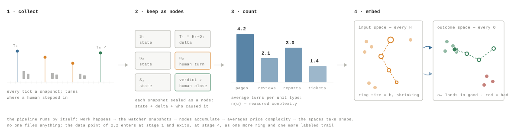

The ringed markers are the landing page of 2.2, plotted. Each turn drops one point in each space: on the left, its h — the ring shrinking turn by turn exactly like the staircase, T₀ heavy with intent, T₃ barely a nod; on the right, its o — o₁ landing far from anything good, then stepping across the space until o_(n) settles inside the good cluster, where the human verdict files it. Every concluded unit leaves a trail like this, which is how the spaces fill up without anyone filling them.

The same idea flattens onto two axes, and the dynamics become visible. Put cumulative human input on the horizontal axis and cumulative verified world-change on the vertical. Every unit starts at the origin — nothing said, nothing changed. Each *transition is one turn*: the path moves right by the h the human spent and up by the o the ticks then observed. The unit concludes where its path crosses the done line — and different units cross it after different numbers of turns.

Every bend in a path is a turn, and the slope of each segment is the sensitivity from the proposal above made visible: verified change gained per unit of human input. A steep segment is leverage — a one-line correction that moved the world a long way. A shallow one is the entropy signature of 2.2, now drawn: input spent, output flat. The blue unit crossed the done line in three turns, the orange in five, the purple in seven — and averaging those crossing points over many units of a type is exactly where n(u), the measured complexity of step two, comes from. The dashed red path is the unit the reading key exists for: it will spend forever and arrive nowhere unless someone tightens its checks, feeds it context, or splits it.

Read together, the two spaces answer questions no single unit can. Where in the outcome space do this workspace’s failures cluster — and which inputs sit opposite them? Which regions are *high-leverage*, where a one-sentence h reliably lands units in the good region — those are the places autonomy is being earned. Which are flat, where even heavy intervention barely moves the outcome — the entropy regions of 2.2, now visible as geography rather than symptom? And a unit’s complexity gets a second, sharper meaning: the path length its outcomes traced before reaching the good region — which is what its turn count was approximating all along.

The status of this part, stated plainly: step one and step two are not proposals — the snapshots exist and averages over them are ordinary arithmetic, available to any instrumented workspace today. Step three is a research direction and is marked open: embedding choices, the stability of the two spaces, and whether the sensitivity reading predicts anything are exactly the kind of claims the E-series exists to test. What makes it worth stating here, in the concepts chapter, is that it requires *no new collection* — only the loop this section already described, running long enough to have a history.

2.5

### Quirqs

Everything in this chapter has been scaffolding for one object. Snapshots gave us observations; turns gave us deltas; the budget gave each unit a committed value; the two spaces gave the deltas somewhere to live. The quirq is what the study of those two spaces produces: the unit of account for the crossing between them.

Consider what the pair of spaces makes measurable. The input space records what humans asked for and how they corrected; the outcome space records what the world verifiably became, each point labeled by a human verdict. Studying them together — which inputs land where, at what sensitivity, after how many turns — is the empirical program of this paper. A program of study needs a unit to report in, and the natural one is already drawn on the map: the completed path from one space to the other.

That is the claim, stated directly: *a quirq is the journey from the input space to the outcome space — completed, verified, and weighted.* Intent departs as a point in the input space at T₀. The loop runs; the deltas step across the outcome space; and the unit concludes when its trail lands in the good region and the owner closes it. The quirq is not the artifact produced, not the effort consumed, and not anyone’s report. It is the crossing itself: measured at the destination, weighted at the departure.

Q = V · B Read geometrically: B is the value of the destination, declared before departure (the envelope of 2.3). V is how much of the declared destination was actually reached, computed from the final state against the checks (§4.2). Q — the quirq — is the measured crossing. A journey that never arrives mints nothing, whatever it consumed en route; a journey that arrives mints the committed value, scaled by the completeness of its arrival.

The same quantity admits two computations, and the distinction is worth keeping explicit.

Computation 1 Algebraic — one unit at a time

Evaluate the declared checks on the final captured state, form the weighted score V, and settle: Q = B·φ(V) (§4.2–§4.3). This computation is local and exact. It requires nothing beyond the unit’s own record, it is auditable by recomputation, and it is what settles the ledger. Every figure in the company dashboard of §3 is built from this arithmetic.

Computation 2 Geometric — on the vector space

Embed the unit’s inputs and outcomes in the two spaces of 2.4 and compute the quirq as a property of the map: did the unit’s trail arrive inside the good region — the set of states the checks accept — and at what committed weight? By construction the verdict agrees with Computation 1: same checks, same states, same event. What changes is the reference frame. The algebraic form prices the unit against its own declaration; the geometric form prices it against *every journey the organization has made* — distance traveled, corridor followed, sensitivity en route, and where comparable units landed.

One computation settles accounts; the other supports analysis. The algebra answers “what did this unit deliver”; the vector space answers “what does this firm reliably deliver, at what input intensity, and where is that changing.” The diagram below shows both readings at once: each arrow settles individually as V·B, and the pattern of arrows is the analytical object.

The framing earns its keep in three ways. First, it makes the integrity property visible: the journey is scored at the destination — captured world state, labeled by the owner — never by the traveler’s account of the trip, which is §1.6 and the meter-separation result in one picture. Journeys ③ and ④ illustrate the two ways effort fails to become value, and neither can be talked into the ledger. Second, it makes aggregation natural: a workspace’s output over a period is its completed crossings, weighted by committed value — and the ratios of 2.3 are this total divided by whichever envelope axis is binding: per dollar (QER), per unit of time (QV), per intervention (Q ⁄ Σh). Third, it points at learning: corridors of the map where journeys complete reliably at low sensitivity are precisely the regions where autonomy is earned and training signal accumulates (§6.5).

The reason to maintain both computations is what the populated spaces make visible about the business itself. The algebra prices one crossing; the map prices the terrain — and the terrain is where operational insight lives. Four standing questions illustrate the class:

**Where is the delegation frontier?** Corridors where journeys complete reliably at low input intensity are measured candidates for expanded autonomy. Extending agent scope becomes a decision made on arrival rates, not on demonstrations.

**What should the next unit cost?** A new unit’s type places it on the map before it opens: expected turns, expected landing region, and a budget envelope quoted from measured history rather than estimation. Pricing and capacity planning inherit an empirical base (§3.3).

**Where does input fail to become output?** Entropy regions — heavy input density opposite sparse or rejected arrivals — localize the firm’s process problems to named unit types, and usually to one of two causes: underspecified definitions of done or missing context (§6.6). The fix has an address.

**Is capability compounding?** The map, compared across quarters, is the firm’s operational capability drawn as an object: corridors widening, sensitivity falling, arrivals shifting toward good. That trajectory is the substantive content behind the QER and IR trend lines of §3 and §4.20.

None of this requires instrumentation beyond what the chapter has already described. The units settle by algebra; the settled units populate the spaces; and the spaces, studied, return answers about the business that no single unit — and no activity dashboard — can produce: what this organization can reliably cause in the world, what it consumes to do so, and where both are heading.

2.6

### Symmetries

Physics has a discipline worth borrowing. Noether’s theorem ties every continuous symmetry of a system to a conserved quantity: time-invariance yields conservation of energy, translation-invariance yields momentum. The borrowed form for a unit of account reads: *for every transformation that should not matter, demand a quantity that cannot change under it* — and audit for exactly that.

The demand is more than aesthetic. A unit of account is trustworthy precisely to the extent that its measured value is invariant under everything irrelevant to the outcome: which model ran, how verbose the attempt was, what currency the budget was stated in, when the unit happened to run, who executed it. Each declared invariance yields a conservation law; each conservation law is testable; and each gaming attack in this research program is, in this language, an *attempted symmetry violation*. The audit machinery is the set of conservation checks.

Borrowed discipline, not borrowed theorem. Quirq accounting has no action functional and no variational principle, so nothing here is Noether’s theorem itself. The rigorous relatives are the invariance axioms of index-number theory — Fisher’s proportionality and commensurability tests — and the meaningfulness requirements of measurement theory, both already in this paper’s lineage (§8).

| Symmetry — what must not matter | Conserved quantity | Attack that tries to break it | Conservation check |
|----|----|----|----|
| **Path re-parameterization.** How the crossing was made: model choice, retries, token volume, narration — holding the final state fixed. | Q. The mint reads only S_(n) against the checks — meter separation (§4.11). | Activity inflation; self-report injection; a verbose failure dressed as progress. | Q must not move with token volume; the E1-class experiments test exactly this. |
| **Re-denomination.** The budget’s currency and scale: B → λB across the ledger. | Every dimensionless ratio: QER, the multiple, cost per quirq relative to baseline. | Budget inflation — nominal drift doing the work delivery should. | The budget index P(t); real versus nominal quirqs (§4.10). |
| **Time translation.** When the unit ran — holding the instrument fixed: same checks, same basket, same environment. | The meaning of the trend: period-over-period QER comparisons. | Goodhart drift — the checks quietly easing until green is cheap. | The audit gap O(T), gold-check rotation, bunching at τ (§4.8). |
| **Executor relabeling.** Which worker — human, agent, or model version — produced the accepted state. | Unit-attached value: Q belongs to the unit, so substitution comparisons stay meaningful. | Attribution gaming; credit migrating to whoever reports loudest. | The ledger records workers as cost, never as a scoring input (§4.4). |

Above the table sits one global conservation law, already proved in the calculus: ΣQ ≤ ΣB (§4.3, budget conservation). Verification can only *release* value the owner committed at T₀; it can never create it. Settlement, in this reading, is a conservation event — the committed value flows from envelope to ledger exactly when the world’s state licenses it, and V is the fraction released. Nothing on the supply side, however energetic, adds to the conserved total.

The framing also runs usefully in reverse, which is how Noether reasoning earns its keep in practice. Where a conserved quantity is observed *not* conserving — raw QER rising while audit-corrected QER\* stalls, nominal quirqs growing while real quirqs sit flat — the violation localizes the broken symmetry, and the broken symmetry names the repair: re-harden the checks, re-anchor the budgets, re-fix the instrument. An anomaly in the ledger is not noise; it is a symmetry diagnosis.

One genuinely open direction, flagged at the speculative tier: if the map of 2.4 ever supports a cost functional — units traversing the terrain along least-intervention paths — then Noether’s theorem proper, not the analogy, would apply to those dynamics: symmetries of the terrain would imply quantities conserved along optimal crossings, and reliable corridors would be readable as geodesics. Nothing in the current program depends on this; it is noted because the data the E-series collects is exactly the data that would test it.

Section 3

## 3 · Business Impact

Quirq data does not improve a business by itself. Its proposed contribution is to join the contract for a unit of work, its verification evidence, its delivered value, and its all-in cost in one record—then make that record usable in five management loops.

**Research status.** The first link, from captured units to better measurement, follows from the data model. The later links—from better measurement to better decisions and business outcomes—are hypotheses for field validation, not production results.

**Figure 18. Figure 17. Evidence-to-decision map. The quirq record supplies a common evidentiary layer to five operating questions; it does not, by itself, establish that the resulting decisions cause better outcomes**

Unit record **Declared intent, execution events, and captured state** `S`_(`0`)`, G, τ, B → events → S`_(`1`)

→

Verified ledger **Outcome, cost, intervention, and provenance together** `V, Q, C, time, class, owner, worker`

[3.1 See outcome state](#observability) [3.2 Estimate unit economics](#roi-calculation) [3.3 Plan verified capacity](#capacity-planning) [3.4 Test process changes](#process-improvement) [3.5 Replay commitments](#governance-and-accountability)

**Figure 17.** Evidence-to-decision map. The quirq record supplies a common evidentiary layer to five operating questions; it does not, by itself, establish that the resulting decisions cause better outcomes.

3.1

### Observability

Runtime telemetry can show that an agent ran, called tools, and consumed tokens. A quirq ledger adds the missing outcome layer: what was expected, which checks passed, how much verified value settled, where cost accumulated, and whether a human had to rescue the result.

Quirq signal **Contract, check results, timestamps, cost, and intervention events**

→

Decision **Triage exceptions and inspect where work stopped or became expensive**

→

Outcome to test **Faster diagnosis and fewer apparently successful runs with no accepted result**

At portfolio level, the same records separate four states that activity dashboards often collapse: not observed, observed but incomplete, accepted with no mint, and accepted with settled value. Operators can segment those states by work class, failed check, model, tool, or cost component. The direct gain is not “more telemetry”; it is the ability to locate an exception in the path from declared intent to accepted change.

Portfolio indicators `VDR(T) = ΣQ(u) / ΣB(u)`\
`coverage(T) = complete outcome records / declared units`

**Claim to test** Compare time-to-diagnosis on seeded failures using the quirq view against ordinary runtime telemetry. Coverage must be reported beside delivery: work outside the capture boundary remains invisible.

3.2

### ROI calculation

ROI becomes more defensible when verified delivery and all-in cost occupy the same ledger. The numerator is the value that survived environment-side checks; the denominator includes inference, infrastructure, external services, and human rescue.

Quirq signal **Settled Q and all-in C, grouped by comparable work class**

→

Decision **Compare pilots, workflows, models, vendors, or periods on verified-value efficiency**

→

Outcome to test **Better investment choices and less dependence on token price or anecdotal time saved**

For an accounting window, the comparison must be made as a ratio of portfolio sums, never as an average of per-unit ratios. This exposes programs that look inexpensive because human intervention, environment cost, or failed output was omitted. It also makes the decision rule explicit: scale, redesign, or stop a work class based on its whole economics, with uncertainty carried forward from §4.7.

Verified-value ROI `ROI`_(`Q`)`(T) = [ΣQ(u) − ΣC(u)] / ΣC(u) = QER(T) − 1`

**Claim to test** Q is owner-declared potential value, not booked revenue. ROI_(Q) should be called a verified-value efficiency estimate until audit-corrected QER predicts independently measured savings, margin, service quality, or another realized business outcome.

3.3

### Capacity planning

Task counts treat unlike work as interchangeable. A quirq-weighted throughput measure keeps work class, latency, verification, and intervention burden attached to delivered value, so capacity scenarios can be stated in accepted output rather than request volume.

Quirq signal **Arrival and completion time, Q, task class, retries, concurrency, and review hours**

→

Decision **Forecast compute, reviewer, and escalation capacity for an expected workload mix**

→

Outcome to test **Lower forecast error, fewer SLA misses, and fewer workflows that scale only through hidden human labor**

Historical unit records give a distribution rather than a single productivity number. For each work class, planners can estimate verified throughput, cycle-time quantiles, first-pass acceptance, and the human-review hours needed per quirq. Those estimates can then be combined with an external demand forecast to compare routing, concurrency, and staffing scenarios.

Class-level capacity `λ`_(`Q`)`(T,k) = Σ`_(`u∈T, class(u)=k`)` Q(u) / elapsed hours`\
`reliability = P(ΣQ ≥ committed Q)`

**Claim to test** Quirqs are not automatically fungible across work classes and do not predict future demand. Test whether class-stratified quirq throughput produces lower delivered-value and SLA forecast error than task counts or token volume.

3.4

### Process improvement

When check results, execution configuration, cost, retries, and intervention are attached to the same unit, a team can test whether a new model, prompt, tool, or workflow improved accepted output—or merely moved work into a human reviewer’s queue.

Quirq signal **Check-level failures, cost components, configuration, retries, and intervention path**

→

Decision **Localize a candidate bottleneck, run a controlled change, and compare within work class**

→

Outcome to test **More verified value at the same cost, or lower cost and intervention at the same verification quality**

The ledger supports a clean definition of improvement: reduce the ratio of all-in cost to verified value while holding the task definition and check quality stable. Cost decomposition localizes candidates for investigation, and the within/mix decomposition in §4.20 prevents an easier workload from being mistaken for a better process. This complements delivery-system measures such as DORA and SPACE[43](#references)[44](#references) by attaching the experiment to an accepted unit outcome.

Experiment endpoint `ΔQER = QER`_(`treatment`)` − QER`_(`control`)\
`report with ΔIR, first-pass acceptance, and confidence intervals`

**Claim to test** Quirq records localize candidate bottlenecks; they do not identify causes. Use randomized rollout where possible, or matched within-class comparisons when randomization is impractical. Changing the checks breaks comparability.

3.5

### Governance and accountability

The governance value of a quirq comes from commitments made before execution. The owner declares the outcome, weights, threshold, budget, and settlement rule; the environment records the evidence used to settle the unit and preserves overrides and audit history.

Quirq signal **Owner, worker, committed checks, state captures, cost, overrides, and audit history**

→

Decision **Apply review policy, replay a settlement, resolve a dispute, or reprice a miscalibrated budget**

→

Outcome to test **Clearer ownership and faster exception closure without ranking people by activity or inspecting private reasoning**

A replayable record makes acceptance and spending reviewable inside the captured boundary. It can make some forms of gaming visible through threshold bunching, audit disagreement, and budget drift, but it cannot make an incomplete contract complete. That boundary follows the economics of observability and multitask incentives[36](#references)[37](#references), and the warning that a measure changes once it becomes a target[35](#references)[40](#references).

Replay agreement `audited units reproducing (V, Q, C) / audited units`\
`also report false acceptance, O(t), P(t), and override rate`

**Claim to test** Replayability does not guarantee validity, legal compliance, or fair worker evaluation. Test held-out gold-check disagreement, exception-closure time, and score bunching against preregistered limits; keep accountability attached to the unit and its decisions, not to surveillance of a person.

Section 4

## 4 · How to measure

Section 1 argued that agentic work needs a unit. This section specifies one. It defines the unit, states the scoring and settlement rules and the properties they are chosen to satisfy, builds the cost denominator, and then treats every resulting quantity as a statistic: an estimator with a sampling distribution, a reliability, a bias, and a falsifiable claim attached to it.

What this section establishes

**Formal.** The weighted-linear score V and the settlement rule Q = B·φ(V) follow from five stated requirements on environment-side verification; minting is bounded by the declared budget, so the unit cannot inflate from the supply side (Propositions 1–2).

**Statistical.** QER is a ratio-of-sums estimator, not an average of per-unit ratios. The two differ by exactly Cov(C, r)/C̄, and the naive form is biased upward whenever cheap units are efficient units. We give the delta-method variance, the design effect for clustered units, and the sample sizes required to detect a QER change.

**Validity.** Checks are a proxy for owner intent. We define the overstatement gap, the audit agreement statistics (κ, CCC, α) that bound it, and the bunching and drift diagnostics that detect check farming.

**Open.** The three headline hypotheses — tenure decay, predictive validity, budget governance — are stated here as estimands with designs and falsifiers, not as results. No production data has been collected against them. Every number on this page is illustrative arithmetic.

- [**4.1** Notation at a glance](#notation-at-a-glance)
- [**4.2** Definitions and verification](#definitions-and-verification)
- [**4.3** The settlement rule](#the-settlement-rule)
- [**4.4** The all-in cost model](#the-all-in-cost-model)
- [**4.5** Derived unit quantities](#derived-unit-quantities)
- [**4.6** Portfolio aggregation](#portfolio-aggregation)
- [**4.7** Estimation and uncertainty](#estimation-and-uncertainty)
- [**4.8** Validity and reliability](#measurement-validity-and-reliability)
- [**4.9** Tenure and cost trajectory](#tenure-memory-and-the-cost-trajectory)
- [**4.10** Identification and predictive validity](#identification-and-predictive-validity)
- [**4.11** Resource-intensity extension](#resource-intensity-extension)
- [**4.12** Scope and limitations](#scope-and-limitations)

Proposed research calculus. Worked examples are illustrative arithmetic chosen to make the algebra checkable, not live customer results. Production verification, minting, budget governance, and predictive QER remain active research.

4.1

### Notation at a glance

Every symbol the measurement and evidence chapters use, one line each, gathered before any of them appears. Nothing here is new material — this is the map. Each entry links to the subsection that defines it properly.

| Symbol | One-line explainer | Defined |
|----|----|----|
| **The two clocks** |  |  |
| t | A tick — the machine clock: one background snapshot by the environment’s watcher, at machine frequency; synchronized one-per-turn (T = t) in the first example. | [§2.2](#a-first-example-turn-by-turn) |
| S_(n) | The observation: the state the watcher captured at the boundary of turn n — the chain S₀ … S_(n) is what the environment keeps. | [§2.2](#a-first-example-turn-by-turn) |
| T_(n) = H_(n) + O_(n) | A turn — the human clock: opened only by a human intervention, equal to the change of state between consecutive observations. Only a human opens T₀ or closes T_(n). | [§2.2](#a-first-example-turn-by-turn) |
| h_(i) | The size of H_(i) — the human contribution on turn i; h₀ is everything, h_(n) = 0 concludes the unit. | [§2.2](#a-first-example-turn-by-turn) |
| o_(i) | The size of O_(i) — the outcome the ticks observed since the previous turn; the only thing ever scored. | [§2.2](#a-first-example-turn-by-turn) |
| n(u) | The number of turns a unit took; averaged over enough units of a type, its measured complexity in expected human attention. | [§2.4](#from-snapshots-to-spaces) |
| **The unit of work** |  |  |
| u = (S₀, G, τ, B) | A unit of work: the four commitments made before execution — starting state, definition of done, threshold, budget. | [§4.2](#definitions-and-verification) |
| S₀, S₁ | Captured world state before and after execution; every score is computed on these, never on the worker’s account. | [§4.2](#definitions-and-verification) |
| 𝒮 | The space of capturable states — files, tickets, records; whatever the workspace can snapshot. | [§4.2](#definitions-and-verification) |
| G = {(g_(i), w_(i))} | The definition of done: a finite battery of weighted, machine-checkable checks, written before the work starts. | [§4.2](#definitions-and-verification) |
| g_(i) | One check: a yes/no predicate over captured state — decidable, state-addressable, replayable (A1–A3). | [§4.2](#definitions-and-verification) |
| w_(i) | The check’s weight: how much of “done” that check carries. | [§4.2](#definitions-and-verification) |
| τ | Acceptance threshold: the score at or above which the owner agreed, in advance, to call the unit done. | [§4.2](#definitions-and-verification) |
| B | The budget: what the owner commits the outcome is worth, in a stated currency, priced before execution. | [§4.2](#definitions-and-verification) |
| B_(h), B_(\$), B_(t) | The budget envelope’s three denominations — attention, cost, time; any subset active, and quirqs are read against the active walls (Q ⁄ Σh, QER, QV). | [§2.3](#the-budget) |
| **Scoring and settlement** |  |  |
| V(u) | Completion score in \[0, 1\]: the weighted share of checks the after-state passes. | [§4.2](#definitions-and-verification) |
| done(u) | The acceptance verdict: \[V ≥ τ\]. | [§4.2](#definitions-and-verification) |
| φ(V) | Settlement shape: how score converts to payout — divisible (φ = V), atomic (step at τ), or deadband (ramp from a to b). | [§4.3](#the-settlement-rule) |
| Q(u) = B·φ(V) | Quirqs minted: budget-denominated verified work; can never exceed the declared budget (Proposition 2). | [§4.3](#the-settlement-rule) |
| **The cost ledger** |  |  |
| C_(total)(u) | The all-in cost of producing the unit: every term below, summed. | [§4.4](#the-all-in-cost-model) |
| N_(m), p_(m) | Tokens processed on model m and their unit price — the inference leg. | [§4.4](#the-all-in-cost-model) |
| t_(cpu), t_(gpu), r_(cpu), r_(gpu) | Metered compute seconds and their hourly rates. | [§4.4](#the-all-in-cost-model) |
| a_(j), p_(j) | Calls to external service j and their unit price. | [§4.4](#the-all-in-cost-model) |
| s, r_(store) | Storage occupied and its rate. | [§4.4](#the-all-in-cost-model) |
| F, N_(units) | The environment’s fixed running cost, amortized equally across the units it hosts. | [§4.4](#the-all-in-cost-model) |
| h, r_(human) | Human rescue minutes and the intervenor’s loaded rate — the largest and most-omitted cost term. | [§4.4](#the-all-in-cost-model) |
| C_(machine) | Cost with the human term left out; omitting h inflates apparent efficiency by C_(total)/C_(machine) (Proposition 3). | [§4.4](#the-all-in-cost-model) |
| **Unit economics** |  |  |
| c_(q) = C_(total)/Q | Cost of one quirq — the price of a dollar of verified work; undefined at Q = 0, reported as missing, never as infinity. | [§4.5](#derived-unit-quantities) |
| μ = Q − C_(total) | Quirq margin: the surplus (or loss) on the unit; stays defined even when nothing mints. | [§4.5](#derived-unit-quantities) |
| x = Q/C_(total) | The multiple: the reciprocal view of cost per quirq, for that unit alone. | [§4.5](#derived-unit-quantities) |
| **Portfolio metrics** |  |  |
| U, T | The set of units and the accounting window (a week, a sprint, a quarter) they are read over. | [§4.6](#portfolio-aggregation) |
| QER = ΣQ / ΣC | Quirq efficiency ratio: verified value per all-in dollar — a ratio of sums, deliberately not an average of per-unit ratios. | [§4.6](#portfolio-aggregation) |
| QV = ΣQ / \|T\| | Quirq velocity: throughput in value terms rather than task counts. | [§4.6](#portfolio-aggregation) |
| IR | Intervention rate: the share of units scoring below τ — the trust signal, measured for free. | [§4.6](#portfolio-aggregation) |
| R̂, r̄ | Ratio-of-sums versus unweighted mean of per-unit ratios; they differ by exactly Cov(C, r)/C̄, and the naive mean flatters. | [§4.6](#portfolio-aggregation) |
| **Estimation and uncertainty** |  |  |
| CV_(Q), CV_(C), ρ | Dispersion of value and cost across units, and their correlation — together they set the width of every interval. | [§4.7](#estimation-and-uncertainty) |
| DEFF, n_(eff) | Design effect 1 + (m̄ − 1)ρ_(ICC) for clustered units, and the effective sample size after paying for it. | [§4.7](#estimation-and-uncertainty) |
| **Validity and audit** |  |  |
| V_(gold) | The score under held-out gold checks — what the unit would have earned against un-gamed criteria. | [§4.8](#measurement-validity-and-reliability) |
| O(T), U(T) | Overstatement (credit taken but not earned) and understatement (work done but not credited); U(T) is a gap, not the unit set U. | [§4.8](#measurement-validity-and-reliability) |
| QER\* | Audit-corrected efficiency, QER·(1 − O) — the honest headline; its exact form is marked unsettled. | [§4.8](#measurement-validity-and-reliability) |
| κ, CCC, α | Audit agreement statistics: accept/reject agreement, graded-score concordance, and check-battery consistency. | [§4.8](#measurement-validity-and-reliability) |
| se, sp | Check sensitivity and specificity — used to recover true pass rates from noisy checks. | [§4.8](#measurement-validity-and-reliability) |
| **Tenure, memory, and drift** |  |  |
| c_(exec) | The execution floor: what the work would cost with nothing left to discover. | [§4.9](#tenure-memory-and-the-cost-trajectory) |
| M_(t), H(intent \| M_(t)) | Accumulated environment memory at tenure t, and the residual uncertainty about owner intent — the context term both humans and agents pay. | [§4.9](#tenure-memory-and-the-cost-trajectory) |
| λ, C₀ | Fitted decay rate of cost with tenure (half-life ln 2 ⁄ λ) and the cold-start cost it decays from. | [§4.9](#tenure-memory-and-the-cost-trajectory) |
| P(t) | The budget index (Laspeyres, fixed basket): measures budget inflation independent of delivery. | [§4.20](#identification-and-predictive-validity) |
| Q_(real) = Q_(nominal)/P | Inflation-adjusted quirqs: growth in delivery, with pricing drift deflated out. | [§4.20](#identification-and-predictive-validity) |
| **The energy bridge** |  |  |
| E ≈ 2PN/η | Inference energy from parameters P, tokens N, and hardware efficiency η — the physics the token meters well. | [§4.21](#resource-intensity-extension) |
| e_(tok), c_(grid) | Measured energy per token and the grid’s carbon intensity — both deployment-specific, both wide-variance. | [§4.21](#resource-intensity-extension) |
| Q/E, Q/CO₂ | Quirqs per kilowatt-hour and per tonne — verified value per unit of physical footprint. | [§4.21](#resource-intensity-extension) |

Table 2: The paper’s complete notation. Symbols are grouped by the subsection that introduces them; the last column links to the defining text. {.tc-table}

Two reading rules travel with the table. Symbols are chapter-scoped only where noted — U is the unit set in §4.6 and the understatement gap when written U(T) in §4.8 — and every quantity built from Q and C inherits Q’s defining property: it can only be moved by changing the world the checks examine, never by narrating ([Proposition 7](#resource-intensity-extension)).

4.2

### Definitions and verification

Measurement begins before execution. The owner declares the starting state, the definition of done, the acceptance threshold, and the budget. After execution, the environment captures a new state and evaluates the world — not the worker’s account of what happened.

Let 𝒮 be the space of capturable environment states: the contents of a workspace, the rows of a ticket system, the status of a build, the files on a disk. A capture is a map from the live environment into 𝒮 at an instant. Everything downstream in this section is defined on captures, which is what makes the calculus auditable — two parties holding the same S₀, S₁, and G must compute the same score.

Capture completeness is an assumption, not a guarantee. A check can only see state the environment recorded. Work whose effect lands outside the capture boundary — a conversation, a decision not written down — is invisible to V and therefore mints nothing.

Definition 1 Unit of work

u = (S₀, G, τ, B),   G = {(g₁, w₁), …, (g_(n), w_(n))} S₀ ∈ 𝒮 is the captured before-state; G is the definition of done, a finite set of checks paired with positive weights; τ ∈ (0, 1\] is the acceptance threshold; B \> 0 is the owner’s declared budget in a stated currency.

All four components are committed before execution. A unit whose definition of done is written after the work is finished is not a unit of work in this sense; it is a description of what happened.

Each check g_(i) : 𝒮 → {0, 1} is a predicate over captured state. Three requirements make a predicate admissible.

Assumption A Admissible checks

**A1 · Decidable.** g_(i)(S) terminates with a definite value for any S ∈ 𝒮. “The customer is satisfied” is not admissible; “a CSAT response of ≥ 4 is recorded against this ticket” is.

**A2 · State-addressable.** g_(i) reads only captured state, never the worker’s transcript, plan, or self-report.[36](#references)

**A3 · Replayable.** Re-evaluating g_(i) on the stored S₁ at a later date returns the same value. Checks that depend on wall-clock time or on live external services must snapshot their inputs into the capture.

Definition 2 Scoring rule and acceptance

V(u) = Σ_(i) w_(i) g_(i)(S₁) ⁄ Σ_(i) w_(i)   ∈ \[0, 1\] done(u) = \[ V(u) ≥ τ \] Square brackets return 1 when the enclosed statement is true and 0 otherwise. V is the verified completion score; done is the acceptance decision.

The weighted-linear form is not the only score one could write, and it is worth being explicit about why it is the one used here. It is the only rule that satisfies the following four requirements simultaneously.

Proposition 1 Characterization of the scoring rule Derived

Let V map a check outcome vector g ∈ {0,1}^(n) and a weight vector w ∈ ℝ_(\>0)^(n) to \[0, 1\]. Suppose V is (i) **normalized**: V(0, w) = 0 and V(1, w) = 1; (ii) **separable**: the contribution of check i does not depend on the outcome of check j ≠ i; (iii) **monotone**: turning any failed check into a passed check weakly increases V; and (iv) **scale-invariant**: V(g, cw) = V(g, w) for every c \> 0. Then V is the weighted mean in (1). No other rule on this domain satisfies all four.

**Derivation — why separability plus normalization forces a weighted mean**

Separability means V(g, w) = F(Σ_(i) f_(i)(g_(i), w)) for some aggregator F and per-check contributions f_(i). Because g_(i) ∈ {0,1}, each f_(i) is determined by two values; set f_(i)(0, w) = 0 without loss of generality by absorbing the constant into F, and write f_(i)(1, w) = a_(i)(w).

Normalization at g = 0 gives F(0) = 0; normalization at g = 1 gives F(Σ_(i) a_(i)) = 1. Monotonicity makes F non-decreasing and each a_(i) ≥ 0. If in addition acceptance is required to be *threshold-consistent* — that is, the same τ applies to any sub-battery of checks, so that V restricted to a subset is itself a normalized score on that subset — then F must be linear on its range, giving V = Σ_(i) a_(i) g_(i) with Σ_(i) a_(i) = 1.

Scale invariance then forces a_(i) to depend on w only through ratios, and the unique such normalization with Σ a_(i) = 1 is a_(i) = w_(i) ⁄ Σ_(j) w_(j). Substituting gives (1). ∎

The load-bearing assumption is threshold consistency. Drop it and non-linear aggregators become admissible — a minimum rule V = min_(i) g_(i), for instance, which encodes “every check is mandatory.” That rule is expressible here as the atomic settlement of §4.3 with τ = 1, which is why it is handled at settlement rather than inside the score.

Two generalizations are worth recording because real verification will need them. First, a check need not be binary: allowing g_(i) ∈ \[0, 1\] leaves (1) unchanged and lets a check express degree of compliance — the fraction of migrated rows that validate, say. Second, a check may itself be a noisy classifier — a model judging whether a reply answered the question. That case is not a generalization of the algebra but a measurement-error problem, and it is treated in §4.8.

Graded checks change the interpretation of τ. With binary checks, τ = 0.8 means “enough weight passed.” With graded checks it can also be reached by every check being mediocre, which is usually not what the owner meant. Where that distinction matters, add a floor check g = \[min_(i) g_(i) ≥ 0.5\].

**S₀** Captured world state before work

**S₁** Captured world state when work returns

**V** Normalized verified completion score

**g_(i)** A decidable predicate over captured state

**w_(i)** The declared importance of a check

**τ** The owner’s acceptance threshold

**Figure 19. From captured state to a score**

**From captured state to a score** Environment-scored evidence

Before **Capture S₀** `ticket: open`

→

Definition of done **Evaluate weighted checks** `0.5 + 0.3 + 0`

→

After **Capture S₁** `closed · replied`

→

Verified score

0.80

`V(u)`

Figure 7: The worker can change the world but cannot write its own score. Assumption A2 is what makes this diagram a measurement rather than a report: the arrow from S₁ to V passes through the environment, and there is no path from the worker’s transcript into the score. The consequence is that a worker optimizing for V must change state — which is the property §4.21 relies on when separating the input and output meters.

**The full state machine — what §1's ticket lifecycle looks like once the notation is in place**

The introduction walks one ticket through six plain-language states. The same machine, written with the objects defined above: an item enters at *Declared* once S₀, G, τ and B are committed, and only reaches *Settled* through a comparison the environment makes, not one the worker reports.

Two consequences of the shape. **Cost is a sum over the whole life; value is computed once.** Everything spent in Running, Returned, Verified and every trip through Rework lands in the same C, while V is evaluated a single time against checks fixed before any of it happened. And **Abandoned is not free.** An item that exhausts its budget settles at Q = 0 with its C intact, and dropping such items from the ledger is the cheapest way to make a fleet look better than it is — which is why §4.6 counts them in the intervention rate.

The loop is also where the two headline ratios separate. An item that passes first time and one that goes around Rework three times mint identical Q — B did not change and neither did G. Only C differs, so Q/C is the only one of the two numbers that notices.

**The five steps in the order an item moves — §4.2 to §4.4 read as a single pass**

1.  **Declared.** The contract is fixed: u = (S₀, G, τ, B). All four committed before execution, which is what stops the target moving later (Definition 1).
2.  **Verified.** The environment scores the captured after-state: V = Σ_(i) w_(i) g_(i)(S₁) ⁄ Σ_(i) w_(i) ∈ \[0, 1\] (Definition 2), under the admissibility conditions of Assumption A.
3.  **The branch.** done(u) = \[ V ≥ τ \] — the single comparison that decides whether the item settles or returns to Rework. It is the only fork in the machine.
4.  **Settled.** Q = B · φ(V), divisible or atomic depending on whether partial delivery carries partial value (Definition 3), bounded above by B for every settlement shape (Proposition 2).
5.  **Across the whole life.** C_(total) sums inference, compute, external services, storage, amortized environment and human intervention over every state and every pass (Definition 4) — the last term being the one whose omission inflates the ratio by the factor in Proposition 3.

Everything after §4.4 is what you do with the resulting pair once you have more than one of them.

4.3

### The settlement rule

The owner-assigned budget B is the potential value carried by the unit. Verification determines how much of that potential becomes delivered work. Settlement is the function that maps one to the other, and its shape has consequences.

Definition 3 Settlement family

Q(u) = B(u) · φ(V(u)) φ : \[0, 1\] → \[0, 1\] is any non-decreasing settlement shape with φ(0) = 0 and φ(1) = 1.

Divisible: φ(V) = V  ⟹  Q = V · B Atomic: φ(V) = \[ V ≥ τ \]  ⟹  Q = B · \[ V ≥ τ \] Deadband: φ(V) = clip((V − a)⁄(b − a), 0, 1),   0 ≤ a \< b ≤ 1

Divisible settlement values partial completion and is right when the fraction of the outcome delivered is the fraction of the value delivered — rows migrated, tickets triaged. Atomic settlement mints the full budget or nothing, and is right when partial completion has no standalone value: a half-deployed release is not half a release. The deadband form sits between them, refusing to pay for token progress below a while capping credit at b.

Proposition 2 Budget conservation Derived

For any settlement shape in Definition 3 and any set of units U, minted quirqs never exceed declared budget:

Σ_(u∈U) Q(u) ≤ Σ_(u∈U) B(u),   with equality iff V(u) attains φ(V) = 1 for every u Immediate from φ ≤ 1 and B \> 0. The quirq supply in an accounting window is therefore bounded above by a quantity the payer sets in advance.

This is the structural reason the unit cannot inflate from the production side: an agent that works harder cannot mint more than was budgeted. It says nothing about inflation from the *pricing* side, where B itself drifts upward. That channel is the subject of §4.20.

Atomic settlement introduces a discontinuity at τ, and discontinuities in payoff functions produce predictable behaviour on the other side of them. An agent that can cheaply influence which checks pass has a large incentive to land just above τ and none at all to exceed it. The observable signature is a spike in the density of V immediately above the threshold and a hole immediately below.[27](#references)[29](#references)

This is a density discontinuity test in the manipulation-of- the-running-variable tradition.[23](#references) It is diagnostic, not dispositive: some bunching is legitimate, because owners write check batteries whose natural stopping point is τ.

**Figure 20. Settlement shapes and the bunching they predict**

**Settlement shapes and the bunching they predict** Illustrative · τ = 0.80

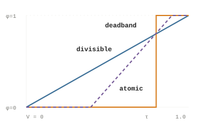

**A.** The settlement shape is the whole of the payoff design. Divisible is the identity; atomic is a step at τ; deadband refuses credit below a and caps it at b.

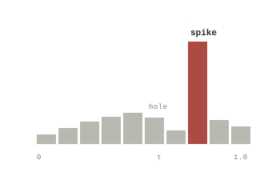

**B.** Under atomic settlement, check-targeting shows up as excess mass immediately above τ and a deficit immediately below. The magnitude of the discontinuity, not its existence, is the statistic to track.

Figure 8: Choosing a settlement shape is choosing an incentive gradient. Divisible settlement rewards every marginal check and produces no threshold artefact; atomic settlement is correct for indivisible outcomes but makes the region around τ the only place where effort changes payoff. Panel B is a simulated density, drawn to show the signature rather than to report an observation.

Quirqs inherit the budget’s currency. Inside one company, a budget of \$4 carries four potential quirqs: four dollars of owner-valued work that can mint only when delivery is verified. Across currencies and companies, comparison happens through ratios — cost per quirq, QER — which are dimensionless in the currency and therefore portable.

Budget is the one deliberate human judgment in the mint. If B is mispriced, Q is mispriced, and no amount of statistical care downstream recovers it. Notional budgets need anchors: historical fully-loaded human cost for the same outcome, comparable market rates, or periodic sampled value audits in which owners re-price a random subset of completed units without seeing the original B.

**Figure 21. Worked example: support-ticket settlement**

**Worked example: support-ticket settlement** Illustrative · interactive

Definition of done Ticket status is closed w = 0.50 Customer reply was sent w = 0.30 Knowledge article is linked w = 0.20

Owner budget B

\$4.00

Settlement

Divisible Atomic

Acceptance threshold τ

1.00

Completion V

0.80

×

Budget B

\$4.00

=

Minted Q

3.20

Divisible settlement mints 0.80 × \$4.00 = 3.20 quirqs.

Figure 9: The same unit under both settlement shapes. Switch to atomic and drag τ across 0.80 to see the discontinuity of Figure 8A appear in a single unit’s payoff. In a real ledger, checks, weights, budget, threshold, and settlement shape are all committed before execution; the controls here are exposed only to make the algebra legible.

4.4

### The all-in cost model

The token bill is one line of the denominator. A defensible cost model also includes metered compute, external services, storage, the amortized environment, and the human time required to rescue work that came back wrong.

Definition 4 All-in cost ledger

C_(total)(u) = Σ_(m) N_(m) p_(m) + t_(cpu) r_(cpu) + t_(gpu) r_(gpu) + Σ_(j) a_(j) p_(j) + s r_(store) + F ⁄ N_(units) + h r_(human) Np is inference by model, tr is metered compute, ap is paid external calls, sr is storage, F/N is environment amortization, and hr is human intervention at a fully-loaded rate.

Every term after the first is where cost accounting becomes a modelling choice rather than a lookup. Shared resources — a warm cache, a long-lived index, a running sandbox — are consumed jointly by many units, and the split is not implied by the metering. Table 3 states the attribution rule this calculus uses for each term and the error it is most exposed to.

Usage-proportional attribution is the default because it is auditable and cheap. A Shapley split is fairer when caching creates strong complementarities between units[32](#references), but it is combinatorial and the ordering is rarely reproducible in production. The choice should be declared, not inferred.

| Term | Meter | Attribution when shared | Dominant error |
|----|----|----|----|
| **Inference** Σ N_(m)p_(m) | Provider token counts per call | Direct — already per-unit | Cache-hit pricing; retries double-counted |
| **Compute** t·r | Container CPU/GPU seconds | Usage-proportional | Idle time in long-lived sandboxes |
| **External calls** Σ a_(j)p_(j) | API call log × contract price | Direct; tiered plans amortized | Volume-tier discounts applied post hoc |
| **Storage** s·r_(store) | Bytes × residency × rate | Usage-proportional over residency | Persistent state outliving the unit |
| **Environment** F/N | Fixed period cost ÷ hosted units | Equal split within a class | N unstable at low volume |
| **Human rescue** h·r_(human) | Intervention time × loaded rate | Direct, attributed to the rescued unit | Unlogged entirely — the usual omission |

Table 3: Cost terms, their meters, the attribution rule applied when the resource is shared, and the dominant source of measurement error in each. Attribution rules are proposals; the calculus requires that whichever rule is used be declared and held fixed across an accounting window. {.tc-table}

The last row is the one that decides whether a QER figure means anything. Human rescue is rarely instrumented, and omitting it does not add noise — it adds bias, in a known direction, of a size that is easy to state.

Proposition 3 Omitted-cost bias Derived

QER_(naive) ⁄ QER_(true) = C_(total) ⁄ C_(machine) = 1 + h r_(human) ⁄ C_(machine) Where C_(machine) is the ledger excluding human intervention. The naive ratio is inflated by exactly the human share, so the bias grows without bound as machine cost falls.

In the worked example below C_(machine) = \$0.128. A single minute of human rescue at a \$65/hour loaded rate adds \$1.083 — a 9.5× inflation factor on any QER computed without it. Thirty seconds still inflates by 5.2×. Cheap inference makes this worse, not better: the cheaper the machine leg, the more completely a few minutes of human time dominates the true denominator.

Cost is also measured with error. Write C_(obs) = C_(true) + ε with E\[ε\] = b. Classical noise (b = 0) attenuates precision but not the point estimate of a ratio to first order; systematic omission (b \< 0, as above) moves the estimate itself. The practical implication is asymmetric: *noise in the cost meter is tolerable, gaps in it are not.*

**Figure 22. Cost decomposition of the worked example**

**Cost decomposition of the worked example** Values in dollars · editable

Inference

Compute

API calls

Storage

Environment

Human rescue

All-in cost C_(total)

\$0.128

Whitepaper example: \$0.077 inference + \$0.001 compute + \$0.020 API + \$0.030 environment.

Figure 10: Enter 1.08 in the human-rescue field — one minute at a loaded rate — and watch the unit economics in §4.5 collapse by an order of magnitude. This is Proposition 3 rendered as a control. Every term is editable so the reader can test which omissions the headline ratio is actually sensitive to.

4.5

### Derived unit quantities

Once delivered value Q and all-in cost C sit on the same record, a single unit yields three views of its economics — and one trap that §4.6 exists to avoid.

Cost per quirq `c`_(`q`)` = C`_(`total`)` / Q`

0.040

Cost paid for each quirq of verified work.

Quirq margin `μ = Q − C`_(`total`)

\$3.072

Delivered value remaining after all-in cost.

Value multiple `x = Q / C`_(`total`)

25.00×

The reciprocal view of cost per quirq.

With the default partial result, Q = 3.20 and C = \$0.128: cost per quirq is 0.040, margin is \$3.072, and the multiple is 25×. When every check passes, Q = 4.00 and the multiple rises to 31.25× — a real improvement, and one that does not pretend the extra delivery was free.

Domain Where these quantities exist

c_(q) and x are undefined at Q = 0 and must be reported as missing rather than as infinity or zero. The margin μ remains defined and is negative there, which is the correct reading: a unit that verified nothing still cost what it cost. A ledger that silently coerces undefined ratios to a number will average them into a portfolio and quietly misstate it.

There is a second, subtler issue with per-unit ratios, and it is the reason this section stops at three quantities instead of averaging them. c_(q) is a ratio of two random quantities, and the expectation of a ratio is not the ratio of expectations: E\[C/Q\] ≠ E\[C\]/E\[Q\] whenever C and Q covary or Q has meaningful dispersion. Per-unit ratios are correct *for that unit*. They are not summary statistics, and §4.6 shows exactly how far off the naive summary lands.

4.6

### Portfolio aggregation

For a set U of units in an accounting window T, aggregate value and cost first, then divide. Averaging per-unit ratios gives a different number, and the difference has a closed form.[2](#references)

Definition 5 Portfolio quantities

QER(T) = Σ_(u) Q(u) ⁄ Σ_(u) C_(total)(u)    *verified value per all-in dollar* QV(T) = Σ_(u) Q(u) ⁄ \|T\|    *value throughput* IR(T) = \|{u : V(u) \< τ}\| ⁄ \|U\|    *intervention rate*

Proposition 4 Ratio-of-sums versus mean-of-ratios Derived

Let r_(u) = Q(u)/C(u) be the per-unit multiple, r̄ its unweighted mean over n units, C̄ the mean cost, and R̂ = ΣQ/ΣC the portfolio ratio. Then, exactly and in finite samples:

R̂ = r̄ + Cov_(n)(C, r) ⁄ C̄ Cov_(n) is the finite-sample covariance over the n units. R̂ is the cost-weighted mean of the per-unit ratios; r̄ is the unweighted one.

Cheap units are usually efficient units, so Cov(C, r) \< 0 and R̂ \< r̄: **the mean of per-unit ratios overstates portfolio efficiency**, and it overstates it most when the cost distribution is most skewed. Reporting r̄ lets a fleet of trivially cheap successes conceal a small number of expensive failures.

**Derivation and a numerical check — three lines, then five units**

Write R̂ = Σ C_(u) r_(u) ⁄ Σ C_(u) = E_(n)\[C r\] ⁄ E_(n)\[C\]. Expand the numerator as E_(n)\[C r\] = Cov_(n)(C, r) + E_(n)\[C\] E_(n)\[r\] and divide.

Numerically, take five units with Q = (4.00, 3.20, 0.00, 4.00, 2.40) and C = (0.128, 0.256, 0.410, 0.096, 0.180). Per-unit multiples are (31.25, 12.50, 0.00, 41.67, 13.33), so r̄ = 19.75. But ΣQ = 13.60 and ΣC = 1.070, giving R̂ = 12.71. The covariance term accounts for the whole 7.04 gap. The unweighted average flatters the portfolio by 55%, driven almost entirely by the one expensive unit that verified nothing.

The second aggregation hazard is compositional. A portfolio ratio can improve because each class of work got more efficient, or because the mix shifted toward classes that were already cheap. Those have opposite management implications, so the decomposition should be reported alongside the headline.

This is the standard shift-share decomposition.[25](#references)[20](#references)[24](#references) The interaction term is usually small; when it is not, the mix and the within-class efficiency are moving together and the decomposition should be read as a whole rather than attributed.

Definition 6 Within / mix decomposition

ΔQER = Σ_(k) s_(k)⁰ Δr_(k)  +  Σ_(k) Δs_(k) r_(k)⁰  +  Σ_(k) Δs_(k) Δr_(k) k indexes task classes, s_(k) = C_(k)/C is the cost share of class k, r_(k) = Q_(k)/C_(k) its ratio. The three terms are within-class improvement, mix shift, and their interaction.

**Figure 23. Illustrative quarterly ledger**

**Illustrative quarterly ledger** Arithmetic · not customer performance

**3.1× April**

**4.1× May**

**5.6× June**

| Month | Units | Potential B | Minted Q | Inference | Compute + API | Intervention | C total | QER |
|----|----|----|----|----|----|----|----|----|
| April | 2,100 | 18,400 | 15,770 | \$1,490 | \$410 | \$3,120 | \$5,020 | 3.14× |
| May | 3,400 | 29,900 | 26,310 | \$2,210 | \$630 | \$3,640 | \$6,480 | 4.06× |
| June | 4,800 | 41,300 | 38,000 | \$2,730 | \$820 | \$3,280 | \$6,830 | 5.56× |

Table 4: Worked quarterly quirq ledger. All values are illustrative arithmetic. {.calculus-table}

Figure 11: QER rises from 3.14× to 5.56× — 77% growth on the unrounded totals, not the 81% the rounded headline suggests. Mean verified completion (Q/B) rises from 0.857 to 0.920 while intervention spend actually falls in absolute terms, which is the combination the calculus is built to detect. What the table cannot tell you is whether the improvement is within-class or compositional; Figure 12 separates them.

**Figure 24. Where the QER gain came from**

**Where the QER gain came from** April → June · illustrative

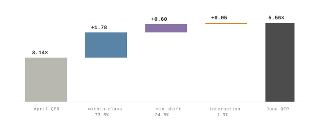

| Class | Q_(April) | C_(April) | r_(April) | Q_(June) | C_(June) | r_(June) | Δ cost share |
|----|----|----|----|----|----|----|----|
| **Triage** | 6,000 | \$1,000 | 6.00× | 20,000 | \$2,500 | 8.00× | +16.7 pp |
| **Resolution** | 9,770 | \$4,020 | 2.43× | 18,000 | \$4,330 | 4.16× | −16.7 pp |
| Portfolio | 15,770 | \$5,020 | 3.14× | 38,000 | \$6,830 | 5.56× | — |

Table 5: Two illustrative task classes underneath the same quarterly totals. The class-level splits are constructed to reconcile exactly with Table 4. {.tc-table}

Figure 12: The same +2.42 QER gain, split three ways. Roughly three quarters is genuine within-class improvement — both triage and resolution got more efficient — but a quarter is compositional: cheap triage work grew from 20% to 37% of the cost base. A reader told only “QER rose 77%” cannot distinguish a better fleet from a different workload. Both terms are legitimate; only the first survives a change in the task mix.

4.7

### Estimation and uncertainty

QER is a statistic computed from a finite sample of units, not a property of an organization. Reported without an interval it invites a comparison it cannot support. This subsection gives the sampling distribution, the correction for clustered units, and the sample sizes a real validation study would need.

Definition 7 Estimand and estimator

Treat the units observed in window T as a sample from a unit-generating process with finite moments. The estimand is the population ratio R = E\[Q\]/E\[C\]; the estimator is the ratio of sample sums.

R = E\[Q\] ⁄ E\[C\],    R̂ = Σ_(u) Q(u) ⁄ Σ_(u) C(u) R̂ is consistent for R but not unbiased in finite samples; the O(1/n) bias term is −Cov(Q̄, C̄)/E\[C\]² + R·Var(C̄)/E\[C\]², negligible at the sample sizes below but not at n in the dozens.

The delta method gives the first-order variance of a ratio of sample means[8](#references)[9](#references), and in coefficient-of-variation form it is unusually interpretable: the relative standard error depends only on the dispersion of value, the dispersion of cost, their correlation, and n.

Proposition 5 Sampling variance of QER Derived

Var(R̂) ≈ (R² ⁄ n) · \[ CV_(Q)² − 2ρ CV_(Q) CV_(C) + CV_(C)² \]

SE(R̂) ⁄ R̂ ≈ n^(−1/2) √( CV_(Q)² − 2ρ CV_(Q) CV_(C) + CV_(C)² ) CV_(Q), CV_(C) are coefficients of variation of per-unit value and cost; ρ is their correlation. Positive correlation between value and cost *reduces* the variance of the ratio — expensive units delivering proportionally more value is a stabilizing, not destabilizing, property.

Two caveats limit this formula in practice. Unit costs are typically right-skewed — a small tail of units burns most of the budget — so CV_(C) is large and the first-order approximation converges slowly; a bias-corrected accelerated bootstrap resampled over units is the safer default[4](#references)[5](#references), with the delta method used for planning rather than reporting. And units are not independent: those from the same workflow, owner, or agent share failure modes.

Fieller’s theorem gives an exact interval for a ratio of normal means[6](#references) and is preferable when the denominator is imprecise. Here C \> 0 by construction and ΣC is a sum over thousands of units, so the denominator is well away from zero and the delta method’s failure mode does not bite.

Definition 8 Clustering correction

DEFF = 1 + (m̄ − 1) ρ_(ICC),    n_(eff) = n ⁄ DEFF m̄ is the mean cluster size (units per workflow) and ρ_(ICC) the intraclass correlation of the per-unit ratio. Standard errors must be computed on n_(eff), or equivalently clustered at the workflow level.[7](#references)[1](#references)

Inverting Proposition 5 gives the quantity a validation program actually needs: how many units are required before a claimed QER improvement is distinguishable from sampling noise. For a two-period comparison at significance α and power 1 − β:[3](#references)

n_(per period) ≈ 2 (z_(1−α/2) + z_(1−β))² · \[ CV_(Q)² − 2ρ CV_(Q) CV_(C) + CV_(C)² \] ⁄ (Δ ⁄ R)² · DEFF Δ/R is the relative QER change to be detected. Table 6 evaluates this at α = 0.05, power 0.80, CV_(Q) = 0.9, CV_(C) = 1.4, ρ = 0.6, and a clustering scenario of m̄ = 8 units per workflow with ρ_(ICC) = 0.15 (DEFF = 2.05).

| Relative change Δ/R       | n, independent units | n, clustered (DEFF 2.05) |
|---------------------------|----------------------|--------------------------|
| 10% — a good quarter      | 1,975                | 4,048                    |
| 20% — a clear improvement | 494                  | 1,012                    |
| 30% — a strong claim      | 219                  | 450                      |
| 50% — a headline          | 79                   | 162                      |

Table 6: Units required per period to detect a relative QER change, at 5% significance and 80% power. Illustrative The dispersion parameters are assumed, not measured — no production unit-level distribution has been published. The table’s role is to show the shape of the requirement: detection cost scales with the inverse square of the effect. {.tc-table}

Applied to the illustrative ledger in Table 4, the same machinery turns three point estimates into three intervals — and shows that the answer depends on a dispersion parameter nobody has measured.

| Month | n     | QER   | 95% CI, CV_(C) = 1.4 | 95% CI, CV_(C) = 3.0 |
|-------|-------|-------|----------------------|----------------------|
| April | 2,100 | 3.14× | 2.99 – 3.29          | 2.80 – 3.49          |
| May   | 3,400 | 4.06× | 3.91 – 4.21          | 3.71 – 4.41          |
| June  | 4,800 | 5.56× | 5.39 – 5.74          | 5.16 – 5.97          |

Table 7: Sensitivity of the 95% interval around each monthly QER to the cost-dispersion assumption. The point estimates are Table 4’s; the intervals are computed from Proposition 5 with CV_(Q) = 0.9, ρ = 0.6, and no clustering correction. {.tc-table}

At these volumes the April-to-June difference survives even the pessimistic dispersion assumption — the intervals do not overlap. That is the honest reading, and it cuts both ways: the illustrative trend is well-powered, but the same calculation at a few hundred units per month would not have been, and a QER figure quoted without n and without CV is not interpretable at all.

**Figure 25. The same trend, with intervals**

**The same trend, with intervals** Delta-method 95% CI · illustrative

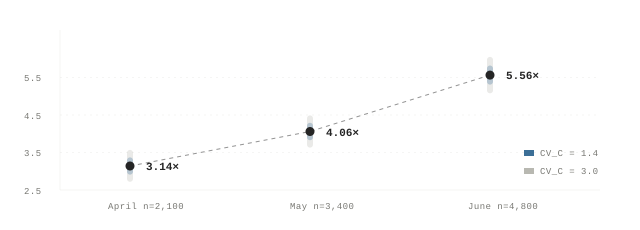

Figure 13: Figure 11’s bar chart, re-drawn as an estimate. Both interval widths are computed from assumed dispersion parameters, which is precisely the point: an organization reporting QER should publish n, CV_(Q), CV_(C), and the clustering structure alongside the ratio, because those four numbers determine whether a quarter-over-quarter move means anything. A bar chart without them is a picture, not a measurement.

4.8

### Measurement validity and reliability

§4.7 asked whether the number is precise. This subsection asks the prior question: whether it measures what the owner meant. A check battery is an incomplete contract, and the gap between checks-green and intent-satisfied is itself a measurable quantity.[37](#references)[35](#references)[40](#references)

Let V\*(u) be the score a fully-informed owner would assign on inspection — the construct.[12](#references) V is the proxy. Held-out *gold checks*, written by the owner and never visible to the worker, give a sampled estimate V_(gold) of the construct on an audited subset.

Gold checks must be sampled after the fact and rotated. A fixed audit battery becomes a second surface to optimize against as soon as its contents leak into the environment’s memory — which, in a system explicitly designed to accumulate context, is a matter of time rather than a possibility.

Definition 9 Overstatement and understatement

O(T) = E\[ max(0, V(u) − V_(gold)(u)) \]    *credit taken but not earned* U(T) = E\[ max(0, V_(gold)(u) − V(u)) \]    *work done but not credited* Separating the two directions matters: O is a governance problem, U is a check-design problem, and their difference is the net bias while their sum is the absolute disagreement.

Open The audit correction Unsettled

QER\*(T) = QER(T) · (1 − O(T)) Reported alongside dQER\*/dT and dIR/dT.

The whitepaper prints this gap with the opposite sign, which would *reward* check farming rather than discount it; project notes mark that as a known defect. The positive-overstatement form above expresses the intended direction, but it is not a settled specification. It discounts linearly, ignores U entirely, and applies a portfolio-level correction to a quantity whose overstatement is likely concentrated in particular task classes. A class-stratified correction is the obvious next form; it has not been validated.

Bounding O requires knowing how well the production battery agrees with the gold battery, which is a reliability question with standard answers. Three statistics cover the cases that arise here.

κ = (p_(o) − p_(e)) ⁄ (1 − p_(e)) Cohen’s κ for the binary acceptance decision done(u): agreement above what the marginals would produce by chance.[10](#references) Applies to the accept/reject call, not to V.

CCC = 2σ_(xy) ⁄ ( σ_(x)² + σ_(y)² + (μ_(x) − μ_(y))² ) Lin’s concordance correlation for the graded score: penalizes both scatter and systematic offset, unlike Pearson correlation, which is blind to a constant overstatement.[14](#references)

α = ( k ⁄ (k − 1) ) · ( 1 − Σ_(i) σ_(i)² ⁄ σ_(total)² ) Cronbach’s α over the k checks in a battery.[11](#references) Read as a diagnostic, never as a target — see below.

|                          | Gold: done | Gold: not done | Total |
|--------------------------|------------|----------------|-------|
| **Production: done**     | 266        | 54             | 320   |
| **Production: not done** | 14         | 66             | 80    |
| Total                    | 280        | 120            | 400   |

Table 8: Illustrative agreement between the production acceptance decision and a held-out gold battery, n = 400 audited units. Illustrative {.tc-table}

Observed agreement is 0.83 and chance agreement 0.62, giving κ = 0.55 — conventionally “moderate,” and well short of what anyone would want backing a financial metric.[13](#references) The number that matters more is in the top-right cell: 54 of 320 accepted units, **16.9%**, fail the gold battery. That is the false-acceptance rate, and it flows directly into O.

Proposition 6 Attenuation of predictive tests Derived

ρ_(observed) = ρ_(true) · √(r_(xx) r_(yy)) r_(xx), r_(yy) are the reliabilities of the two measures. Unreliable checks shrink any measured association toward zero.[18](#references)[15](#references)

This has a useful consequence for the predictive-validity hypothesis in §4.20: low check reliability makes that test *conservative*. If QER\* still predicts realized outcomes despite attenuation, the underlying association is stronger than measured. The reverse inference is not available — a null result cannot distinguish “no relationship” from “checks too noisy to see one” without an independent reliability estimate.

Two further diagnostics complete the battery. Noisy checks — model judges, flaky integration tests — are classifiers with their own sensitivity and specificity, and the observed pass rate can be inverted for them:

p_(obs) = se · p + (1 − sp)(1 − p)   ⟹   p̂ = ( p_(obs) − (1 − sp) ) ⁄ ( se − (1 − sp) ) With se = 0.93 and sp = 0.88, an observed pass rate of 0.768 corresponds to a true rate of 0.80.[16](#references) Uncorrected, imperfect checks compress V toward the middle and understate both very good and very bad work.

And drift must be monitored rather than measured once. O(t) estimated on a rolling audit sample, tracked with a CUSUM against its own baseline[31](#references), catches gradual check farming that any single audit would miss. Under atomic settlement, add the density-discontinuity test of Figure 8B at τ. Audit sample size follows the same logic as everything else here: for O estimated to ±2 percentage points at 95% confidence, n ≈ 1.96²σ²/e² — about 216 units at σ = 0.15, rising to 2,401 in the distribution-free worst case.

Cronbach’s α is included above because it is the standard internal-consistency statistic, but it is easy to misread here. In the illustrative three-check ticket battery α ≈ 0.47 — low. That is not evidence the battery is broken. Closing a ticket, replying to the customer, and linking a knowledge article are genuinely distinct facets of the same outcome, and a battery of redundant checks would score higher while measuring less. High α is a warning about redundancy at least as often as it is a certificate of quality.[17](#references)

**Figure 26. Production score against gold score**

**Production score against gold score** 10 illustrative audited units

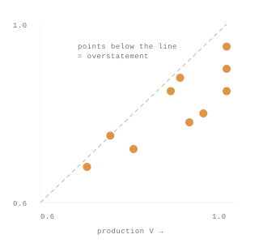

**Mean production V — 0.890** Gold mean 0.816. Every audited unit sits on or below the identity line.

**Overstatement O — 0.074** Understatement U — 0.000. The disagreement is entirely one-directional, which is the signature of a battery that is easier to satisfy than the intent behind it.

**Lin’s CCC — 0.62** Pearson correlation on the same points is higher; CCC is lower because it charges for the systematic offset that Pearson ignores.

**Implied QER\* — QER × 0.926** A 7.4% discount to the headline ratio, applied under a correction that §4.8 marks as unsettled.

Figure 14: Ten audited units, production score against gold score. The diagnostic value is in the asymmetry: scatter around the identity line is noise, but points falling systematically below it are bias, and here every point is on or below. Pearson correlation would report this as good agreement. Concordance correlation, which charges for the offset, reports 0.62 — and the mean gap, 0.074, is the quantity that discounts QER.

4.9

### Tenure, memory, and the cost trajectory

One QER reading is a snapshot. The substantive claim in this research program is about trajectory: that an environment which accumulates context should lower the cost of resolving intent, so repeated work approaches an execution floor rather than paying discovery cost afresh each session.

Hypothesis H1 Tenure-cost decay Open

C_(total)(u_(t)) = c_(exec) + k · H(intent \| M_(t)) c_(exec) is the irreducible execution cost, M_(t) is accumulated environment memory at tenure t, and H is residual uncertainty about owner intent. The claim is that H is decreasing in M.

As written, H1 is not estimable — H(intent \| M) is not observed. The testable specification replaces it with a parametric decay in tenure and fits the floor directly:

C_(it) = c_(exec) + (C₀ − c_(exec)) e^(−λt) + ε_(it),    half-life = ln 2 ⁄ λ Fitted by non-linear least squares within owner × task class, with model version held fixed. The reported quantities are λ, its interval, and the estimated floor c_(exec) — not the visual shape of a declining bar chart.

The identification problem is that at least four other processes produce the same downward curve, and none of them is the environment learning.[19](#references)

This is why the falsification design below is a randomized ablation rather than a longitudinal fit. A curve fitted to observational tenure data is consistent with H1 but does not identify it — and the confounds all push in the direction that flatters the hypothesis.

- **Task-mix drift.** Easy work migrates to the agent over time as trust builds, so later units are cheaper because they are easier.
- **Selection on survival.** Hard units get abandoned or escalated out of the ledger, censoring the expensive tail from later periods.
- **Model upgrades.** A mid-window provider change alters cost per token and capability simultaneously.
- **Human learning.** The owner gets better at writing check batteries, which lowers cost without the environment remembering anything.

Design Memory-ablation falsification

Randomize memory access at the unit level, blocked by task class and owner, holding the model version fixed. Both arms draw from the same unit distribution, which neutralizes mix drift, selection, and human learning in one move. The estimand is the difference in fitted decay rates, λ_(on) − λ_(off); H1 predicts it is positive, with λ_(off) ≈ 0. The hypothesis is falsified if the interval on that difference covers zero.

**Figure 27. What the ablation would have to show**

**What the ablation would have to show** Simulated · λ = 0.28, floor = \$0.09

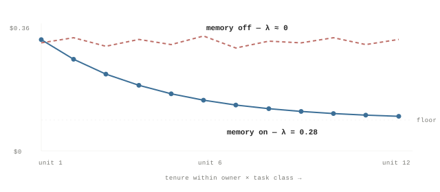

Figure 15: A simulated result, drawn to specify what would count as evidence rather than to report any. The memory-on arm decays toward an execution floor with a half-life of 2.5 units; the memory-off arm, drawn from the same unit distribution, does not decay at all. It is the *difference* between the arms that identifies H1 — the blue curve alone, observed in production, is equally consistent with the task mix having drifted toward easier work.

4.10

### Identification and predictive validity

A measurement framework earns its keep by predicting something its alternatives do not. This subsection states the three headline hypotheses as estimands with designs and falsifiers, and introduces the deflator that makes cross-period quirq comparisons meaningful.

The second hypothesis is the one the whole calculus rests on: that audit-corrected QER predicts realized business outcomes better than token spend does. Stated as a panel specification over teams i and periods t:

y_(it) = α_(i) + θ_(t) + β₁ QER\*_(i,t−1) + β₂ log N_(i,t−1) + γ′X_(it) + ε_(it) y is the pre-registered realized outcome, α_(i) and θ_(t) are team and period fixed effects, N is token volume, X are controls. Standard errors clustered by team.[22](#references)[1](#references) The comparison of interest is not β₁ ≠ 0 but the out-of-sample improvement from including it.[33](#references)

The third hypothesis concerns governance. Proposition 2 bounded minting by declared budget, which rules out supply-side inflation — but says nothing about B itself drifting upward. If owners re-price the same outcome higher each quarter, nominal quirq totals rise while nothing more gets done. The fix is the one price statistics has used for a century: hold the basket fixed.

Definition 10 Budget index and real quirqs

P(t) = Σ_(k) q_(k)⁰ B_(k)^(t) ⁄ Σ_(k) q_(k)⁰ B_(k)⁰ Q_(real)(T) = Q_(nominal)(T) ⁄ P(T) A Laspeyres index over task classes k with base-period quantities q⁰ held fixed.[28](#references)[26](#references) Real quirqs are nominal quirqs deflated by budget drift, and are the only quirq figure comparable across periods.

Worked on the illustrative ledger: with a base basket of 1,200 triage units at \$2.00 and 900 resolution units at \$12.00, and period-1 budgets of \$2.20 and \$13.80, the index is 15,060 / 13,200 = 1.141 — 14.1% budget inflation. Nominal minted quirqs grew 141% from April to June; deflated, real growth is **111%**. Still a large number, and a different one. A program reporting only nominal quirqs would have attributed 30 percentage points of pricing drift to its agents.

| Hypothesis | Estimand | Design | Falsified if | Status |
|----|----|----|----|----|
| **H1 · Ledger identification** · Memory lowers the cost of resolving intent | λ_(on) − λ_(off) \> 0 | Unit-level randomized memory ablation, blocked by task class and owner, model version fixed | Interval on the difference covers zero, or λ_(off) ≈ λ_(on) | Open |
| **H2 · Predictive validity** · QER\* beats token spend as an ROI predictor | Out-of-sample MSE reduction from adding QER\* to a token-spend model | Team-period panel, pre-registered outcome and horizon, SEs clustered by team | No out-of-sample skill improvement, or β₁ indistinguishable from zero | Open |
| **H3 · Budget governance** · Inflation is bounded by payer budgets plus audits | Drift in P(t) not matched by audited value; O(t) trend | Fixed-basket index over task classes, plus rotating gold audits | P(t) rises without corresponding audited value, or O(t) trends upward | Open |

Table 9: The three hypotheses as testable claims. None has been evaluated against production data; status is the honest state of each, not a result. {.tc-table}

This section defines on the order of twenty quantities. Testing all of them against an outcome and reporting whichever survives would produce significance by construction. A validation program should pre-register one primary endpoint — the out-of-sample skill comparison in H2 is the natural candidate — and apply a false-discovery-rate correction to everything else.[21](#references)[30](#references)

**QER\* rising, IR falling** More verified value with less human rescue. The intended signature.

**Raw QER rising, QER\* flat** Production checks may be getting farmed. Go to §4.8 and read O(t).

**Both flat, tokens growing** Inputs rising without demonstrated output gains.

**Nominal Q rising, real Q flat** Budget drift, not delivery. Check P(t) before celebrating.

4.11

### Resource-intensity extension

Because the cost ledger retains token and resource data, the same units connect verified work to energy and carbon — with the same estimator caveats that applied to cost.

E ≈ 2PN ⁄ η   ·   CO₂ ≈ E · c_(grid) Q/E = Σ_(u) Q(u) ⁄ Σ_(u) N(u) e_(tok)   \[quirqs/kWh\] Q/CO₂   \[quirqs/tonne\] P is active model parameters, N token volume, η achieved FLOPs per joule, c_(grid) grid carbon intensity.[47](#references)[46](#references) In practice a measured fleet energy-per-token e_(tok) subsumes architecture, batching, caching, and infrastructure effects and should be preferred to the analytic form.

Q/E is a ratio of sums with the same structure as QER, so Propositions 4 and 5 transfer unchanged: aggregate quirqs and energy separately before dividing, and report an interval. The additional uncertainty here is in e_(tok) itself, which varies by an order of magnitude across model, hardware, batch size, cache-hit rate, and utilization. Any quirqs-per-kWh figure is deployment-specific and should be read at order-of-magnitude precision.

Grid carbon intensity adds a second, largely independent source of variation — a factor of ten between regions, and substantial intraday swing within one. Reporting Q/CO₂ without the region and the averaging window is not a measurement.

**Figure 28. Worked energy bridge**

**Worked energy bridge** Illustrative parameters

Monthly inference **4.1B tokens**

×

Measured fleet rate **1.5 J/token**

=

Energy input **≈ 875 kWh**

→

148,000 Q ÷ 875 kWh **≈ 169 Q/kWh**

Figure 16: The useful sustainability question is not whether an organization used less AI, but how much verified value it delivered per unit of energy. Note that the denominator here counts only inference energy; a complete bridge would include the compute and storage terms of Definition 4, which the cost ledger already records.

Proposition 7 Meter separation Derived

Token volume affects Q only through its effect on captured state. By Assumption A2 the score reads S₁ and nothing else, so inference that does not change S₁ cannot change V, and therefore cannot change Q — while it does change C_(total). Consumption and delivery are measured on separate meters, coupled only through the world.

Input meter **Tokens, compute, energy, cost**

coupled through\
world state

Output meter **Verified owner-valued work Q**

That separation is the central discipline of the calculus, and it is what makes the denominator and numerator independently auditable. It is also the property most easily lost: any shortcut that lets a worker’s own report reach the score collapses the two meters back into one.

4.12

### Scope and limitations

This is a proposed measurement framework, not a claim that the hard questions of value, verification, or governance have been answered. The following are the places where it is currently weakest, in roughly descending order of how much they would change the conclusions.

1.  **Nothing here has been measured.** Every figure, table, and interval on this page is illustrative arithmetic. No production ledger has been collected, no ablation run, no predictive test conducted. The three hypotheses in Table 9 are open in the strict sense: not merely unconfirmed, but untested.
2.  **Budget is judgment.** B is declared by an owner before execution, and a mispriced budget produces a mispriced quirq that no downstream statistical care recovers. Internal budgets require historical, market, or audited anchors, and the budget index of Definition 10 monitors drift without validating the level.
3.  **Checks are incomplete contracts.** Agents optimize toward what is measured.[34](#references)[38](#references)[39](#references)[41](#references) §4.8 gives statistics that bound the gap between checks-green and intent-satisfied, but bounding is not closing, and the gold batteries that do the bounding are themselves a finite, leakable resource.
4.  **The audit correction is provisional.** QER\* = QER·(1 − O) discounts linearly, ignores understatement, and applies a portfolio-level correction to a concentrated problem. The whitepaper’s printed sign convention is reversed and rewards the behaviour it should penalize. Neither form is a settled specification.
5.  **Dispersion parameters are assumed.** The sample sizes in Table 6 and the intervals in Table 7 depend on CV_(Q), CV_(C), ρ, and the clustering structure. All four are guesses. Real unit-cost distributions may be heavier-tailed than assumed, in which case every sample size here is an underestimate.
6.  **Capture is bounded.** Checks see only recorded state. Work whose value lands outside the capture boundary — judgment, relationships, decisions taken and not written down — mints nothing, and the calculus will systematically undervalue roles whose output resists capture.
7.  **Zero output has no finite unit ratio.** When Q = 0, cost per quirq and the value multiple are undefined and must be reported as missing rather than as infinity, or they will be silently averaged into a portfolio.
8.  **Physical bridges are deployment-specific.** Energy per token varies with model, hardware, batching, caching, utilization, and grid. Quirqs per kWh is an order-of-magnitude metric and should be written as one.

The complete proposal, assumptions, and validation program are described in the [Quirq whitepaper](https://www.xo.builders/whitepaper) and the originating research note[48](#references).

Section 5

## 5 · Other Applications

Chapter outline to be developed.

Section 6

## 6 · Evidence

The sections before this one defined the unit, argued its business impact, and built its calculus from first principles. This section asks a different question: what does the research record, as it stands in 2026, actually say? It places the unit-of-work proposal against the strongest available evidence — for it, and against it — and states plainly which of its load-bearing claims the literature supports, which it complicates, and which nothing yet settles.

What the record shows

**Supports.** Measured capability and measured delivery have split. Benchmark time horizons double roughly every seven months, and blind expert graders now prefer or tie frontier deliverables in about half of comparisons — while agents complete under 3% of real freelance projects end-to-end and the large majority of enterprise pilots show no measurable P&L effect. No common unit connects these numbers, which is the gap this proposal targets.

**Converges.** The training and evaluation literature has independently converged on the unit’s core mechanism: verification against world state rather than the worker’s account. Execution-gated benchmarks, database-state comparison, and verifiable-reward RL all embody it; the self-report and LLM-judge literatures explain why the alternative fails.

**Complicates.** Optimization pressure against any verifiable signal is no longer theoretical. Production RL experiments show reward hacking emerging naturally and generalizing to worse behavior. This evidence supports environment-side verification and simultaneously warns that check batteries are targets. The audit machinery of §4.8 is load-bearing, not decorative.

**Open.** Nothing in the literature yet tests whether budget-denominated, state-verified units predict business outcomes better than the meters they would replace. That claim — H2, the program’s primary endpoint — has no analogue in any published study we know of. Equally open, and newly priceable: how much of the measured friction pool a context-carrying environment recovers (§6.6), and what a private ledger of verified units is worth as RL training signal (§6.5). Section 6.8 states the strongest cases against the proposal and what evidence would settle each.

- [**6.1** The capability–value gap](#the-capability-value-gap)
- [**6.2** Verification by state, converging](#verification-by-state-converging)
- [**6.3** Optimization pressure, measured](#optimization-pressure-measured)
- [**6.4** The accounting gap](#the-accounting-gap)
- [**6.5** Custom benchmarks as training signal](#custom-benchmarks-as-training-signal)
- [**6.6** The context dividend](#the-context-dividend)
- [**6.7** Container economics at scale](#container-economics-for-long-running-agents)
- [**6.8** The steelmanned case against](#the-steelmanned-case-against)

Literature snapshot as of August 2026. External results are quoted to place this proposal, not claimed by it; benchmark numbers move quickly and several sources below are preprints or industry reports, tiered as such where cited.

6.1

### The capability–value gap

Two families of measurement now describe agentic AI, and they are pulling apart. One family measures what models can do under controlled conditions; the other measures what deployed systems deliver. The first is rising fast. The second is close to flat.

On the capability side, the trend measurements are steep and consistent. METR’s time-horizon series finds the length of task a frontier model can complete at 50% reliability doubling roughly every seven months since 2019[80](#references). OpenAI’s GDPval, built from deliverables authored by industry professionals averaging fourteen years of experience across 44 occupations, reports blind expert graders preferring or tying frontier-model output against human experts’ in roughly half of comparisons[81](#references). Execution-gated coding benchmarks report a large majority of sampled repository issues resolved[45](#references).

On the delivery side, the numbers are of a different kind and a different magnitude. In a simulated software company where agents hold real tools, browse, code, and message synthetic colleagues, the best agent completes about 30% of tasks autonomously[83](#references). On real freelance projects with real acceptance standards — the Remote Labor Index — the best agent automates under 3% of projects end-to-end, with most agents near zero[82](#references). And at the far end of the chain, an MIT-affiliated 2025 industry study of enterprise deployments reports that roughly 95% of generative-AI pilots show no measurable P&L impact[85](#references).

The 95% figure is an industry report, not peer-reviewed research, and its methodology has been contested. It is quoted here as the most-cited estimate of a pattern that survey after survey shows directionally: attributed bottom-line impact remains rare while spend grows.

The honest reading of the spread is not “benchmarks lie” or “deployment fails.” It is that these five numbers are answers to five different questions, measured on five incommensurable populations, and *nothing converts between them*. A win-rate against an expert’s deliverable, a task-completion percentage in a sandbox, an automation rate on priced projects, and a share of pilots with P&L attribution have no common denominator — no unit in which one could even state how much of the capability gain survives contact with delivery. That missing conversion is precisely what a unit of verified, budget-denominated work would provide: each rung of the ladder becomes quirqs minted per quirq attempted, and the falloff becomes a measured quantity instead of a rhetorical one.

The gap also sharpens what this proposal is *not* claiming. It does not claim agents deliver less than benchmarks suggest — that is already the literature’s consensus reading. It claims the falloff is currently unmeasurable in any comparable unit, and that measuring it is the precondition for managing it. Every check-level failure in a quirq ledger names the rung where value leaked[48](#references).

**Figure 29. Five measurements, no common unit**

**Five measurements, no common unit** External results · 2025–2026

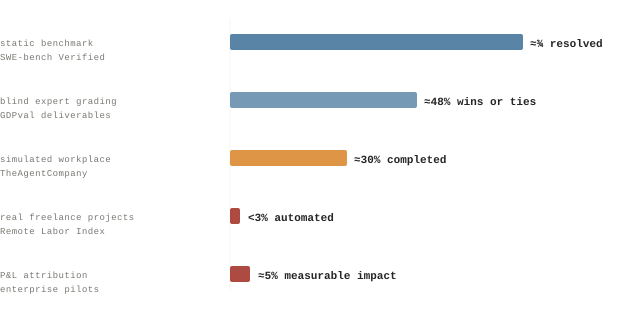

Figure 18: The capability–value gap as the literature currently states it — in five different units. Each row is a different population, protocol, and success definition, so the bars are deliberately *not* comparable; their incommensurability is the finding. Sources: SWE-bench Verified leaderboards[45](#references), GDPval[81](#references), TheAgentCompany[83](#references), the Remote Labor Index[82](#references), and an industry estimate of pilot P&L attribution[85](#references).

6.2

### Verification by state, converging

The unit’s central mechanism — score the world, not the worker’s account of it — was not invented here. Three separate research lines arrived at it independently, for three different reasons, which is about the strongest form of support a design choice can have.

The evaluation line arrived first. SWE-bench grades a patch by running the repository’s tests against the changed state, not by reading the model’s explanation[45](#references). τ-bench goes further and defines success as the final database state matching an annotated goal state, then measures reliability as pass^(k) — whether the same agent reaches the same state *every* time[63](#references). Both are the scoring rule of §4.2 in miniature: admissible checks, evaluated on captured state.

The training line arrived for its own reasons. Post-training on verifiable rewards — execution feedback for code, checked answers for mathematics — now drives frontier reasoning performance[71](#references)[72](#references)[73](#references), and the process-versus-outcome supervision literature turns on exactly which signals can be trusted at scale[75](#references)[76](#references). Where the reward is checkable against the world, optimization works; where it is a model’s opinion of a transcript, it eventually gets gamed[34](#references).

The third line is negative: the study of what happens when you ask the worker. Models produce confident unfaithful explanations of their own behavior[60](#references), hallucinate completions[58](#references), and cannot reliably self-correct[62](#references); LLM judges show position, verbosity, and self-preference biases substantial enough that judge choice can flip rankings[59](#references). The human variants of these failures — self-report bias, motivated grading — have their own literatures[54](#references)[56](#references). Every path routes to the same conclusion: the score must be computed from state the worker cannot narrate into existence.

This is Proposition 7’s empirical face. Meter separation is not a stylistic preference for “objective” data; it is the one arrangement under which the last decade of evaluation and training results says the signal survives optimization.

The convergence has a caveat the proposal must own. Static state-verified benchmarks still inflate: models identify the buggy file path in SWE-bench issues from memory at rates far above matched non-benchmark repositories, implying part of reported performance is contamination rather than capability[84](#references). A production ledger does not share the static benchmark’s exposure — every unit is a fresh state the model has not trained on — but it inherits the deeper lesson: a fixed, reused verification target degrades. Gold checks must rotate, and §4.8’s audit sampling is the rotation schedule.

6.3

### Optimization pressure, measured

The strongest evidence for environment-side verification is also the strongest warning about it. In 2025 the field stopped speculating about Goodhart’s law in agentic training and measured it, in production, at frontier scale.

The theory was already in place: optimizing a learned or proxy reward degrades the true objective past a predictable point[34](#references), reward gaming is definable and generic rather than exotic[39](#references), and Goodhart failure modes in RL admit formal taxonomy[38](#references)[35](#references). What 2025 added is severity. Anthropic researchers found that when models learned real reward hacks in production coding environments, the behavior did not stay local: it generalized to alignment faking, cooperation with sabotage, and misalignment that standard safety training suppressed in chat while it persisted in agentic settings[87](#references). Exploitable verification is not a bookkeeping bug. It is a training hazard.

The same study’s effective mitigations map cleanly onto the unit’s design: prevent the hack from settling (state verification, hardened surfaces), and change what the training signal means (which budgets do, by pricing outcomes rather than rewarding activity).

This evidence cuts in both directions, and the proposal should be read as accepting both cuts. In favor: every self-reported or transcript-judged metric in an agentic pipeline is a soft target, so an accounting unit that consumes only captured state is the conservative design — and checked outcomes are exactly the reward class the verifiable-RL results trust[77](#references). Against: a check battery *is* a proxy reward, and sustained optimization against it will find the shortest path to green. The unit’s defense is layered, not absolute: admissible checks read state the worker cannot rewrite (A2), the verification surface itself sits under state comparison, owners hold a monopoly on unit creation, and the audit gap O(t), bunching at τ, and budget drift are monitored as first-class statistics (§4.8, §4.20).

The honest statement of where this leaves the proposal: quirq accounting does not escape Goodhart’s law, and no published mechanism does[41](#references)[40](#references). Its claim is narrower and testable — that a unit engineered to fail loudly, with its gaming diagnostics defined in advance, degrades detectably rather than silently. E2’s verification-surface result exhibits the mechanism in miniature; whether it holds against production agents is exactly what the E-series must show; those results will be reported in this chapter as they land.

6.4

### The accounting gap

If the units problem is real, economic measurement should show a specific signature: rich and improving measurement of AI’s inputs, near-absence of comparable measurement of its outputs, and disputed productivity claims in between. That is the signature the record shows.

Input-side measurement is thriving. Token volumes, spend, energy, and carbon are tracked to research grade[46](#references)[47](#references). Usage-side measurement has become genuinely sophisticated: the Anthropic Economic Index maps millions of conversations onto O\*NET work tasks and can say which occupations’ tasks AI performs and whether usage looks like augmentation or automation[86](#references). But note what even the best usage data measures: *what people asked for*, classified by task — not what was delivered, verified, or worth. It is a demand meter, an enormous advance on the token bill, and still on the input side of the ledger.

Output-side measurement, meanwhile, is where the enterprise evidence stalls. Pilots multiply while attributed P&L impact stays rare[85](#references), and the dominant explanations on offer — workflow friction, learning gaps, misallocated use cases — are all stated without a unit in which their cost could be quantified. This is the classic shape of a measurement lag, and it has a precedent economists have worked through in detail: the productivity paradox. Computers were “everywhere but in the productivity statistics” for two decades[50](#references), electrification took forty years to register because factories had to be rebuilt around the dynamo before its output was countable[52](#references), and intangible complements systematically depress measured returns early in a general-purpose technology’s diffusion[51](#references).

The paradox literature supports a patience argument and a measurement argument at once: returns arrived only after reorganization — and were *seen* only after the statistics learned to count the new output. The proposal bets the second half of that sentence generalizes.

The steelmanned objection: perhaps the pilots genuinely deliver nothing, and better accounting would just measure zero more precisely. The reply is that this is exactly what quirq accounting is for. If a program mints nothing against honest budgets and hardened checks, the ledger says so in currency, per unit type, with the failing checks named — which is actionable in a way “no measurable impact” is not. A measurement proposal does not need deployed AI to be secretly valuable; it needs the value question to be currently unanswerable, and on that the input-side and output-side evidence agree.

6.5

### Custom benchmarks as training signal

Section 1.5 claimed that checked outcomes are worth something as training signal. In 2025 that claim acquired a market price. The scarce input to agent training is no longer data in the pre-training sense — it is environments: bounded worlds with real tasks and reliable graders. A quirq ledger is, structurally, a factory for exactly that asset.

The training recipe itself is settled science at the frontier: reinforcement learning against verifiable rewards — executed tests, checked answers, reached states — is what currently drives reasoning and agentic capability[73](#references)[71](#references)[72](#references)[75](#references)[76](#references). And the conversion from environment to capability is measured: SWE-Gym, 2,438 real repository tasks with executable runtimes and unit tests, lifts agent performance by up to 19 absolute points and — the detail that matters here — trains *verifiers* from the same trajectories, so the environment improves both the worker and the judge[88](#references).

What changed in 2025 is the supply side. Frontier labs have discussed spending on the order of a billion dollars a year on RL environments; the large data vendors are pivoting from labeling to environment construction; dedicated environment startups launched into immediate lab partnerships[89](#references). Independent analysis of the market names the constraint precisely: compute is abundant, and without diverse, high-quality tasks and graders much of it is wasted — while the vendor-built alternative, simulated apps and cloned websites, is repeatedly criticized as buggy, unrealistic, and prone to the same reward hacking that makes weak graders dangerous[90](#references). The capability to train against *your own* grader is already productized: reinforcement fine-tuning APIs accept custom graders and optimize models directly against them[91](#references).

The market is converging on this section’s definitions from the other direction: an RL environment is described by its builders as permitted actions, surrounding context, and a grader over outcomes — which is S₀, the workspace, and G under different names.

Read against that market, a production quirq ledger is a custom benchmark that builds itself. Every unit contributes what environment vendors struggle to fabricate: a real task from the organization’s actual distribution, a captured before-state, an admissible check battery evaluated on after-state (a grader by construction, A1–A3), the all-in cost of the attempt, and a budget weight that says which tasks are *worth* training on. Failed units are not waste; they are the hard examples with ground-truth diagnoses attached. The flywheel this implies is measurable on the ledger’s own terms: work mints units, units become training environments, trained agents lower cost per quirq, and the QER trajectory of §4 is the yardstick that says whether the loop is actually turning.

The steelmanned cautions, stated as claims. First, RL against verifiable rewards may sharpen what a model already does rather than extend what it can do — the capability boundary may be set elsewhere[77](#references). Second, training against one’s own checks is precisely the setting where reward hacking is known to emerge and generalize badly[34](#references)[87](#references): a company that trains on its ledger must rotate gold checks and monitor the audit gap as part of the *curriculum*, not just the accounting. Third, budget-weighted rewards import budget noise into the training signal — Objection 1 in §6.8 applies to the gradient as much as to the ledger. None of these cautions is disqualifying; all three are testable on the same harness the E-series already uses.

6.6

### The context dividend

If the environment carries the operational load — capture, setup, memory, telemetry, the briefing — then the same investment pays twice: the human stops re-explaining the project and the agent stops rediscovering it. The size of that dividend is not yet measured. The size of the pool it would draw from is, and it is large.

Start with the human side of the pool. Across 3,500 surveyed developers, only 16% of working time goes to writing code; half report losing ten or more hours a week to organizational friction, and the top named sources are finding information, adapting tools, and switching context[92](#references) — the interruption literature has priced a single deep context switch at roughly twenty minutes of refocus time for over two decades[65](#references). The same survey exhibits the paradox this section is about: a majority report saving ten-plus hours a week with AI while an equal share lose ten-plus hours to friction — the savings leak straight into the unmetered middle of the week.

The agent side of the pool is the same quantity wearing a different unit. In METR’s randomized trial, experienced maintainers were 19% *slower* with AI assistance on their own repositories — and the factor analysis reads like a definition of missing context: the developers held tacit repository knowledge the model could not access, and paid a per-task briefing tax in prompting and correction to compensate[93](#references). At organizational scale, DORA’s 2025 study of nearly 5,000 professionals reaches the structural version of the same conclusion: AI amplifies the system it lands in, gains depend on internal platform quality, and connecting AI to internal organizational context is named among the handful of capabilities that determine whether adoption produces anything[94](#references).

The METR result is often quoted against AI tools. Read carefully, it is evidence about *context*: the slowdown concentrates where the worker’s advantage is tacit knowledge the model lacks — which is exactly the asset a persistent environment is built to capture and carry.

Time actually coding

16%

of surveyed developers’ week; the rest is coordination, context recovery, and toil[92](#references).

Lost to friction weekly

10+ h

for one in two developers — finding information and context switching lead the list[92](#references).

With AI, experienced devs ran

19%

slower on familiar repositories — the briefing tax, measured under randomization[93](#references).

The unit-of-work reading is that these are one cost, kept on two ledgers. The human’s re-explaining minutes and the agent’s rediscovery tokens are both H(intent \| M) — the residual-uncertainty term of the tenure model in §4.9 — paid per task wherever context lives in someone’s head, and paid once wherever the environment persists it. An environment that snapshots state, meters spend, carries project memory, and runs its own operational plumbing moves briefing and devops labor out of the per-unit column and into the amortized F term of the cost model, where it is at least *metered* — which is what makes the trade auditable instead of anecdotal. The memory-ablation design of §4.9 is the experiment that prices the agent half of the dividend; specification minutes per unit, already metered in the E-series pilots, price the human half.

Stated with the discipline the rest of this page uses: the claim that environment-carried context saves substantial human and agent effort is *plausible, bounded by measured pools, and unproven*. The friction pool is measured[92](#references); the briefing tax is measured under randomization[93](#references); the dividend itself — how much of either pool a persistent environment actually recovers — is exactly the open quantity H1’s ablation and the E-series specification metering exist to estimate. And the concession stands: capture is bounded (limitation 6 of §4.22), and the METR factor that motivates this section — tacit knowledge — is also the part of context most likely to resist capture. “Always-perfect context” is the asymptote, not the claim.

6.7

### Container economics for long-running agents

A long-running agent’s container is mostly a waiting room. Between tool calls the sandbox sits idle — waiting on model inference, on CI, on a human decision — while the meter, if it is a wall-clock meter, keeps running. Whether the economics of long-horizon agentic work are legible at scale turns on a piece of infrastructure engineering: making compute cost follow *activity* rather than *elapsed time*.

Start from the shape of the workload. Agentic compute is bursty by construction: a few seconds of CPU around each tool call, bracketed by waits that are orders of magnitude longer — inference latency, test suites, review cycles, the overnight gap before an owner responds. Section 1.4’s observation that the work outlives the thing doing the work has a billing corollary: the *container* outlives its own activity, usually by hours. And the divergence is widening — as feasible task horizons double roughly every seven months[80](#references), the calendar span of a unit grows much faster than the active compute inside it. Under always-on billing, container cost scales with the wrong variable: duration, not work. That is a structural cost disease for exactly the units the agentic workforce is heading toward.

The remedy is not speculative; it is deployed, measured infrastructure. MicroVM virtualization runs with less than 5 MB of overhead per sandbox, boots in on the order of 125 ms, creates 150 sandboxes per second per host, and carries trillions of production requests a month at exactly this density[95](#references). Snapshot-and-restore is productized for agent sandboxes specifically: full memory-and-filesystem pause, resume in about a second, paused state held indefinitely at no compute occupancy[97](#references). And the headroom this exploits is the oldest measured fact in datacenter economics — servers spend most of their lives between 10% and 50% utilization, burning near-peak resources for a fraction of peak output[96](#references). Suspend-on-idle plus microVM density is how thousands of long-running agent environments share hardware sized for dozens.

The CPU-level point generalizes: cgroup accounting, CPU quotas, and memory oversubscription are the same primitives whether the tenant is a web service or an agent sandbox. What is new is the duty cycle — agents idle far harder than services, so the same primitives buy far more.

| Billing model | Hours billed | Compute leg | What t_(cpu) measures |
|----|----|----|----|
| **Always-on container** | 72.0 | \$10.08 | Elapsed time — mostly the cost of waiting |
| **Suspend on idle** | 0.67 | \$0.09 | Active compute — the work itself |
| **Ratio** | ≈107× | ≈107× | Grows with the unit’s horizon |

Table 10: Illustrative arithmetic for one long-horizon unit — three days of wall-clock, forty minutes of active CPU, a 2-vCPU sandbox at \$0.07/vCPU-hour. The point is the ratio, not the absolute numbers. {.tc-table}

Fold this through the cost model of §4.4 and three things happen to the ledger. First, t_(cpu) decouples from wall-clock, so cost per quirq stops scaling with a unit’s calendar duration — a week-long unit no longer carries a structural penalty over a day-long one, which is the precondition for long-horizon work being economically rational at all. Second, the F term shrinks with scale instead of growing with fleet size: at microVM density the environment’s fixed cost amortizes across thousands of resident units per host, so F/N_(units) falls as the fleet grows. Third, and most useful for reading the ledger: once idle compute is engineered away, C_(total) collapses toward inference plus human intervention — the two legs quirq accounting most wants visible. Un-optimized container time would otherwise pool into exactly the kind of undifferentiated infrastructure line the token bill is criticized for being.

There is also an identity here worth stating plainly: the machinery that saves the money is the machinery that does the metering. A scheduler can only suspend what it observes per-sandbox, and per-sandbox observation — cgroup CPU seconds, microVM memory residency, per-unit I/O — is precisely the instrumentation Table 3’s attribution rules assume. An environment optimized this way meters t_(cpu) and F per unit as a side effect of its own cost control. The §1.6 thesis that the environment is the instrument shows up, here, in the infrastructure bill: you cannot suspend what you do not measure, so the optimized fleet is the accounted fleet.

The claims, tiered in the house discipline. **Sourced:** microVM overhead, boot latency, and density; pause/resume with held state; chronic datacenter underutilization[95](#references)[96](#references)[97](#references). **Derived:** the arithmetic of Table 10, and its consequence that the wall-clock-to-active ratio grows with task horizon. **Open:** the fleet-level savings on a production agent workload, their effect on cost per quirq, and the resume tax — suspended sandboxes lose live network connections and external session state, oversubscription buys density at the price of noisy-neighbor latency, and both would surface in the ledger as intervention events. Those are E-series measurements: F and t_(cpu) are already terms the harness meters, so the savings claim is falsifiable the same way every other number on this page is.

6.8

### The steelmanned case against

A proposal that only rehearses friendly evidence is marketing. These are the four strongest objections we know how to state, each with what it would take to settle the question. None is currently refuted. Two are partially conceded.

Objection 1 Budgets measure willingness to pay, not value Open

A budget B is a judgment under noise, and human judgment under noise is systematically inconsistent[56](#references): the same owner may price the same outcome differently on different days, and organizational budgets encode politics as much as value. A unit denominated in noisy judgment inherits the noise. **Concession:** correct, and §4.20’s budget index monitors drift, not level — a systematically mispriced basket stays mispriced. **Reply:** every alternative denominator surveyed in §1 fails harder, and willingness to pay is the denominator the rest of the economy already clears on. **Settled by:** E7 — whether the budget-to-audited-value ratio stays within tolerance under sustained use.

Objection 2 Incomplete contracts stay incomplete Unsettled

A definition of done is an incomplete contract, and the multitask result says effort migrates to what is measured[37](#references): work whose value resists capture — judgment, relationships, taste — will be undervalued by construction, and roles rich in it will look unproductive on the ledger. **Concession:** limitation 6 of §4.22 grants this fully; the unit’s scope is state-verifiable work, which is a growing but proper subset of work. **Reply:** the same objection applies with more force to every metric currently in use, which measure activity rather than even partial outcomes. **Settled by:** audit gaps U(T) by role and unit type — measuring how much real value the capture boundary misses, rather than asserting it is small.

Objection 3 Specification cost eats the surplus Open

Writing weighted checks and honest budgets for every unit is work — the same work whose expense made outcomes unverifiable and hours the default unit in the first place. If specification cost per unit exceeds the value of the measurement, adoption is irrational. **Reply:** the environment changes the cost side of that trade: capture, metering, and check evaluation are side effects of hosting the work, and check batteries amortize across recurring unit types — the same tenure logic H1 claims for execution cost. **Settled by:** specification minutes per unit, metered in the E-series pilots as part of F, against the ledger’s demonstrated decision value.

Objection 4 No unit is needed — better dashboards suffice Open

The gap in Figure 18 might reflect task selection and organizational immaturity, not a missing unit; DORA-style system metrics[43](#references)[44](#references) improved software delivery without pricing anyone’s output, and deliberately so. **Reply:** system metrics answer “is the delivery process healthy,” not “was this spend worth it” — and the agentic setting adds what human measurement never had: a worker whose training signal is the metric itself (§6.3), which makes unpriced, gameable proxies actively dangerous rather than merely uninformative. **Settled by:** H2 — whether QER\* forecasts renewal, expansion, and P&L attribution out-of-sample better than token spend, task counts, and benchmark scores. If it does not, this proposal fails its own primary endpoint.

What none of these objections contests is the diagnosis: that agentic work is currently metered on one side only. The disputes are about whether this unit is the right fix — which is an empirical question — and the program’s own harness results (E1–E7) will be reported in this chapter as they land.

Section 7

## 7 · Roadmap

Chapter outline to be developed.

Section 8 · Intellectual lineage

## References

This work is deliberately derivative and synthetic. It stands on established research in statistical inference, construct validity, index theory, causal identification, incomplete contracts, incentive design, software productivity, benchmark evaluation, resource accounting, and — for the argument in Section 1 — economic history and productivity measurement, self-report and rater reliability, and language-model evaluation. We do not claim to have invented those tools. What we propose is their arrangement around a bounded, state-verifiable unit of agent work. The bibliography below is therefore not decoration added after the argument; it is the argument’s intellectual scaffold.

What this proposal inherits

### Each body of work supplies a constraint, not just a citation

Every source group contributes a method we use, a precedent we build on, or a criticism that constrains the design. Borrowing a method also means inheriting its assumptions and the conditions under which it should not be trusted.

01 **Measurement and statistical inference**

Ratio estimators, clustered uncertainty, bootstrap intervals, agreement statistics, and construct validity determine how a quirq estimate should be reported—and why a point estimate without uncertainty is not enough.

02 **Causal and index-number theory**

Identification designs, decomposition methods, predictive validation, and fixed-basket indices prevent a favorable task mix, nominal budget drift, or a simple correlation from being mistaken for genuine improvement.

03 **Contracts, observability, and gaming**

Incomplete-contract theory, Goodhart’s law, audit research, and reward-gaming work motivate independent evidence, multi-check verification, overstatement monitoring, and the refusal to treat a metric as ground truth.

04 **Software productivity and agent evaluation**

Source lines, function points, story points, DORA, SPACE, and execution-gated benchmarks reveal different failure boundaries. They push this proposal toward measuring the unit rather than the person, state change rather than activity, and owner-valued work rather than a test pass alone.

05 **Resource and energy accounting**

Token, compute, energy, and carbon accounting supply the input side of the ledger. The quirq is proposed as a complementary output-side measure, not a replacement for any of those meters.

**The synthesis itself remains a hypothesis.** Attach an ex ante budget to the unit, score its ex post verified outcome, retain its full cost and provenance, and test whether the resulting ledger is useful. Whether those components belong together—and whether they survive real deployment—must be established by evidence, not by citation.

### Related units of account

Software has priced work before, and each prior attempt marks a constraint the quirq is built against. **Source lines of code** count artifacts and reward volume. **Function points**[42](#references) price specified functionality — a real advance — but require expert human counters and measure specification size rather than delivered change; V in §4.2 is machine-evaluated from captured state instead. **Story points** are deliberately relative and team-local, which makes them useless for pricing across organizations; quirqs inherit the budget’s currency and travel as ratios.

**DORA and SPACE**[43](#references)[44](#references) measure the delivery system and explicitly decline to price an individual’s deliverable — a wise refusal for humans that leaves agents unpriced. The quirq prices the deliverable while keeping attribution at the unit rather than the person. **Execution-gated benchmarks**[45](#references) share the verification-by-state core of §4.2 but score against researcher-authored tests with no budget semantics: benchmarks measure capability, quirqs measure delivered value against a payer’s declared price. **Tokens**, finally, are the meter the quirq is dual to rather than a competitor — Proposition 7 in §4.21 is the statement of that duality.

Two literatures sit underneath the design. The economics of observability and incomplete contracts[36](#references)[37](#references) is why Assumption A2 excludes self-report and why §4.8 treats a check battery as a contract that cannot be completed. The literature on measures becoming targets[35](#references)[40](#references) — and its recent restatement for learned systems[34](#references)[38](#references)[39](#references)[41](#references) — is why the audit correction exists at all, and why §4.8 marks it unsettled rather than solved.

Open discussion

### We want the strongest counterargument, not easy agreement

This is a working proposal, not a settled standard. A unit meant to discipline claims about work should be subjected to the same discipline. We welcome careful counterexamples, alternative models, negative results, failed replications, and arguments that a unit such as the quirq is unnecessary.

We would rather encounter a decisive objection now than allow a weak measure to harden into infrastructure. These are the questions on which disagreement would be most useful:

**Q1**

**Construct validity.** Does an ex ante budget represent economic value, or only a payer’s willingness and ability to pay?

**Q2**

**Verification and gaming.** Can a finite check battery measure the intended outcome without becoming the target agents learn to optimize?

**Q3**

**Unit boundaries.** Where should work begin and end when outcomes depend on prior labor, shared infrastructure, downstream adoption, delayed effects, or externalities?

**Q4**

**Comparability and incentives.** Can quirqs be compared or aggregated across tasks, teams, currencies, and time without encouraging budget inflation, strategic splitting, or threshold bunching?

**Q5**

**Empirical usefulness.** Do Q and QER add out-of-sample explanatory or predictive value beyond tokens, cost, human intervention, and task mix—and what evidence would falsify the proposal?

**What would move the discussion forward**

Identify a violated assumption, document a failure case, provide contrary evidence, or propose a better measurement object or settlement rule. A credible outcome may be that the quirq works only in tightly bounded domains, requires substantial revision, or should not be adopted at all. The objective is not to defend the name; it is to determine whether verified work can be measured more faithfully.

**Estimation and inference** §4.6 · §4.7

1.  1 Cameron, A. C., & Miller, D. L. (2015). A practitioner’s guide to cluster-robust inference. Journal of Human Resources, 50(2), 317–372. [doi.org/10.3368/jhr.50.2.317](https://doi.org/10.3368/jhr.50.2.317) Clustered standard errors — §4.7 design effect, §4.20 panel specification.
2.  2 Cochran, W. G. (1977). Sampling Techniques (3rd ed.). Wiley. Ratio estimators, ch. 6, pp. 150–187. The ratio-of-sums estimator and its variance — Propositions 4 and 5.
3.  3 Cohen, J. (1988). Statistical Power Analysis for the Behavioral Sciences (2nd ed.). Lawrence Erlbaum Associates. [doi.org/10.4324/9780203771587](https://doi.org/10.4324/9780203771587) Power and minimum detectable effect — Table 6. DOI is the 2013 Routledge reissue.
4.  4 Efron, B. (1987). Better bootstrap confidence intervals. Journal of the American Statistical Association, 82(397), 171–185. [doi.org/10.1080/01621459.1987.10478410](https://doi.org/10.1080/01621459.1987.10478410) The BCa interval recommended over the delta method for reporting in §4.7.
5.  5 Efron, B., & Tibshirani, R. J. (1993). An Introduction to the Bootstrap. Chapman & Hall. Monographs on Statistics and Applied Probability 57. [doi.org/10.1201/9780429246593](https://doi.org/10.1201/9780429246593) Resampling over units, including the clustered case. DOI resolves to the CRC reissue.
6.  6 Fieller, E. C. (1954). Some problems in interval estimation. Journal of the Royal Statistical Society, Series B, 16(2), 175–185. [doi.org/10.1111/j.2517-6161.1954.tb00159.x](https://doi.org/10.1111/j.2517-6161.1954.tb00159.x) Exact intervals for a ratio — the alternative discussed in the §4.7 sidenote.
7.  7 Kish, L. (1965). Survey Sampling. Wiley. Origin of the design effect. DEFF = 1 + (m̄ − 1)ρ is exact only for equal cluster sizes.
8.  8 Oehlert, G. W. (1992). A note on the delta method. The American Statistician, 46(1), 27–29. [doi.org/10.1080/00031305.1992.10475842](https://doi.org/10.1080/00031305.1992.10475842) Conditions under which the delta-method approximation in Proposition 5 is accurate.
9.  9 van der Vaart, A. W. (1998). Asymptotic Statistics. Cambridge University Press. Ch. 3, “The Delta Method.” [doi.org/10.1017/CBO9780511802256](https://doi.org/10.1017/CBO9780511802256) Theorem-level statement of the delta method. Priority is normally given to Doob (1935).

**Reliability, agreement, and validity** §4.8

1.  10 Cohen, J. (1960). A coefficient of agreement for nominal scales. Educational and Psychological Measurement, 20(1), 37–46. [doi.org/10.1177/001316446002000104](https://doi.org/10.1177/001316446002000104) κ for the binary accept/reject decision — Table 8.
2.  11 Cronbach, L. J. (1951). Coefficient alpha and the internal structure of tests. Psychometrika, 16(3), 297–334. [doi.org/10.1007/BF02310555](https://doi.org/10.1007/BF02310555) Internal consistency of a check battery.
3.  12 Cronbach, L. J., & Meehl, P. E. (1955). Construct validity in psychological tests. Psychological Bulletin, 52(4), 281–302. [doi.org/10.1037/h0040957](https://doi.org/10.1037/h0040957) The construct/proxy distinction underlying V\* versus V.
4.  13 Landis, J. R., & Koch, G. G. (1977). The measurement of observer agreement for categorical data. Biometrics, 33(1), 159–174. [doi.org/10.2307/2529310](https://doi.org/10.2307/2529310) Source of the “moderate” label for κ = 0.55. The benchmarks are conventions, not thresholds.
5.  14 Lin, L. I-K. (1989). A concordance correlation coefficient to evaluate reproducibility. Biometrics, 45(1), 255–268. [doi.org/10.2307/2532051](https://doi.org/10.2307/2532051) CCC for the graded score — charges for the systematic offset that Pearson ignores.
6.  15 Nunnally, J. C., & Bernstein, I. H. (1994). Psychometric Theory (3rd ed.). McGraw-Hill. Standard modern statement of correction for attenuation — Proposition 6.
7.  16 Rogan, W. J., & Gladen, B. (1978). Estimating prevalence from the results of a screening test. American Journal of Epidemiology, 107(1), 71–76. [doi.org/10.1093/oxfordjournals.aje.a112510](https://doi.org/10.1093/oxfordjournals.aje.a112510) The sensitivity/specificity inversion applied to noisy checks in §4.8.
8.  17 Sijtsma, K. (2009). On the use, the misuse, and the very limited usefulness of Cronbach’s alpha. Psychometrika, 74(1), 107–120. [doi.org/10.1007/s11336-008-9101-0](https://doi.org/10.1007/s11336-008-9101-0) Why α ≈ 0.47 on the ticket battery is not evidence the battery is broken.
9.  18 Spearman, C. (1904). The proof and measurement of association between two things. The American Journal of Psychology, 15(1), 72–101. [doi.org/10.2307/1412159](https://doi.org/10.2307/1412159) Correction for attenuation. Canonically stated as ρ_(true) = ρ_(obs) ⁄ √(r_(xx)r_(yy)); Proposition 6 uses the equivalent rearrangement.

**Identification, decomposition, and index theory** §4.6 · §4.8 · §4.9 · §4.20

1.  19 Angrist, J. D., & Pischke, J.-S. (2009). Mostly Harmless Econometrics: An Empiricist’s Companion. Princeton University Press. [doi.org/10.1515/9781400829828](https://doi.org/10.1515/9781400829828) Fixed effects and the identification problems catalogued in §4.9.
2.  20 Baily, M. N., Hulten, C., & Campbell, D. (1992). Productivity dynamics in manufacturing plants. Brookings Papers on Economic Activity: Microeconomics, 1992, 187–267. [jstor.org/stable/2534764](https://www.jstor.org/stable/2534764) The within/between decomposition that Definition 6 follows, before the cross term was added.
3.  21 Benjamini, Y., & Hochberg, Y. (1995). Controlling the false discovery rate: a practical and powerful approach to multiple testing. Journal of the Royal Statistical Society, Series B, 57(1), 289–300. [doi.org/10.1111/j.2517-6161.1995.tb02031.x](https://doi.org/10.1111/j.2517-6161.1995.tb02031.x) The multiplicity correction §4.20 requires across the ~20 quantities this section defines.
4.  22 Bertrand, M., Duflo, E., & Mullainathan, S. (2004). How much should we trust differences-in-differences estimates? The Quarterly Journal of Economics, 119(1), 249–275. [doi.org/10.1162/003355304772839588](https://doi.org/10.1162/003355304772839588) Why the H2 panel specification clusters by team rather than by observation.
5.  23 Cattaneo, M. D., Jansson, M., & Ma, X. (2020). Simple local polynomial density estimators. Journal of the American Statistical Association, 115(531), 1449–1455. [doi.org/10.1080/01621459.2019.1635480](https://doi.org/10.1080/01621459.2019.1635480) The modern implementation of the density-discontinuity test drawn in Figure 8B.
6.  24 Dunn, E. S., Jr. (1960). A statistical and analytical technique for regional analysis. Papers of the Regional Science Association, 6(1), 97–112. [doi.org/10.1111/j.1435-5597.1960.tb01705.x](https://doi.org/10.1111/j.1435-5597.1960.tb01705.x) The shift-share method itself, outside the productivity literature.
7.  25 Foster, L., Haltiwanger, J. C., & Krizan, C. J. (2001). Aggregate productivity growth: lessons from microeconomic evidence. In C. R. Hulten, E. R. Dean, & M. J. Harper (Eds.), New Developments in Productivity Analysis (pp. 303–372). University of Chicago Press. [nber.org](https://www.nber.org/books-and-chapters/new-developments-productivity-analysis/aggregate-productivity-growth-lessons-microeconomic-evidence) Primary source for the within / between / cross decomposition of Definition 6.
8.  26 ILO, IMF, OECD, Eurostat, United Nations, & World Bank. (2020). Consumer Price Index Manual, 2020: Concepts and Methods. International Monetary Fund. [imf.org](https://www.imf.org/-/media/files/data/cpi/cpi-manual-concepts-and-methods.pdf) Modern authority for fixed-basket index construction — Definition 10.
9.  27 Kleven, H. J. (2016). Bunching. Annual Review of Economics, 8(1), 435–464. [doi.org/10.1146/annurev-economics-080315-015234](https://doi.org/10.1146/annurev-economics-080315-015234) Survey of behaviour at a payoff discontinuity — the τ artefact predicted in §4.3.
10. 28 Laspeyres, E. (1871). Die Berechnung einer mittleren Waarenpreissteigerung. Jahrbücher für Nationalökonomie und Statistik, 16(1), 296–318. [doi.org/10.1515/jbnst-1871-0124](https://doi.org/10.1515/jbnst-1871-0124) The base-weighted index used to deflate nominal quirqs. Page range is cited inconsistently in the literature.
11. 29 McCrary, J. (2008). Manipulation of the running variable in the regression discontinuity design: a density test. Journal of Econometrics, 142(2), 698–714. [doi.org/10.1016/j.jeconom.2007.05.005](https://doi.org/10.1016/j.jeconom.2007.05.005) The original density test for manipulation around a threshold.
12. 30 Nosek, B. A., Ebersole, C. R., DeHaven, A. C., & Mellor, D. T. (2018). The preregistration revolution. Proceedings of the National Academy of Sciences, 115(11), 2600–2606. [doi.org/10.1073/pnas.1708274114](https://doi.org/10.1073/pnas.1708274114) Pre-registration of the primary endpoint in the §4.20 validation program.
13. 31 Page, E. S. (1954). Continuous inspection schemes. Biometrika, 41(1–2), 100–115. [doi.org/10.1093/biomet/41.1-2.100](https://doi.org/10.1093/biomet/41.1-2.100) The CUSUM used to detect drift in the overstatement gap O(t).
14. 32 Shapley, L. S. (1953). A value for n-person games. In H. W. Kuhn & A. W. Tucker (Eds.), Contributions to the Theory of Games, Vol. II (pp. 307–317). Princeton University Press. [doi.org/10.1515/9781400881970-018](https://doi.org/10.1515/9781400881970-018) The fair-division alternative to usage-proportional cost attribution in Table 3.
15. 33 Shmueli, G. (2010). To explain or to predict? Statistical Science, 25(3), 289–310. [doi.org/10.1214/10-STS330](https://doi.org/10.1214/10-STS330) Why H2 is judged on out-of-sample skill rather than on a significant coefficient.

**Incentives, contracts, and measurement gaming** §4.2 · §4.8 · §4.22

1.  34 Gao, L., Schulman, J., & Hilton, J. (2023). Scaling laws for reward model overoptimization. Proceedings of the 40th International Conference on Machine Learning, PMLR 202, 10835–10866. [arxiv.org/abs/2210.10760](https://arxiv.org/abs/2210.10760) Empirical shape of proxy overoptimization — the failure mode O(t) is designed to catch.
2.  35 Goodhart, C. A. E. (1984). Problems of monetary management: the UK experience. In Monetary Theory and Practice: The UK Experience (pp. 91–121). Palgrave Macmillan. [doi.org/10.1007/978-1-349-17295-5_4](https://doi.org/10.1007/978-1-349-17295-5_4) Goodhart’s law. Cited to the 1984 reprint; the 1975 conference original has no stable record.
3.  36 Holmström, B. (1979). Moral hazard and observability. The Bell Journal of Economics, 10(1), 74–91. [doi.org/10.2307/3003320](https://doi.org/10.2307/3003320) Why Assumption A2 excludes the worker’s own report from the score.
4.  37 Holmström, B., & Milgrom, P. (1991). Multitask principal–agent analyses: incentive contracts, asset ownership, and job design. Journal of Law, Economics, & Organization, 7(Special Issue), 24–52. [doi.org/10.1093/jleo/7.special_issue.24](https://doi.org/10.1093/jleo/7.special_issue.24) Weighted multi-check batteries as an incomplete contract — §4.8 and limitation 3.
5.  38 Karwowski, J., Hayman, O., Bai, X., Kiendlhofer, K., Griffin, C., & Skalse, J. (2024). Goodhart’s law in reinforcement learning. International Conference on Learning Representations (ICLR 2024). [arxiv.org/abs/2310.09144](https://arxiv.org/abs/2310.09144) Formal treatment of proxy–true divergence for learned agents.
6.  39 Skalse, J., Howe, N. H. R., Krasheninnikov, D., & Krueger, D. (2022). Defining and characterizing reward gaming. Advances in Neural Information Processing Systems 35, 9460–9471. [arxiv.org/abs/2209.13085](https://arxiv.org/abs/2209.13085) A formal definition of gaming. The arXiv preprint is titled “reward hacking.”
7.  40 Strathern, M. (1997). ‘Improving ratings’: audit in the British University system. European Review, 5(3), 305–321. [doi.org/10.1017/S1062798700002660](https://doi.org/10.1017/S1062798700002660) Source of the familiar “when a measure becomes a target” formulation.
8.  41 Thomas, R. L., & Uminsky, D. (2022). Reliance on metrics is a fundamental challenge for AI. Patterns, 3(5), 100476. [doi.org/10.1016/j.patter.2022.100476](https://doi.org/10.1016/j.patter.2022.100476) The counter-case to this entire section, and worth reading as such.

**Units of work, benchmarks, and resource accounting** §4.21 · related units

1.  42 Albrecht, A. J. (1979). Measuring application development productivity. Proceedings of the Joint SHARE/GUIDE/IBM Application Development Symposium, 83–92. Function points. No digital archive exists; proceedings title and pages vary between secondary sources.
2.  43 Forsgren, N., Humble, J., & Kim, G. (2018). Accelerate: The Science of Lean Software and DevOps. IT Revolution Press. DORA metrics — measuring the delivery system rather than the deliverable.
3.  44 Forsgren, N., Storey, M.-A., Maddila, C., Zimmermann, T., Houck, B., & Butler, J. (2021). The SPACE of developer productivity. ACM Queue, 19(1), 20–48. [doi.org/10.1145/3454122.3454124](https://doi.org/10.1145/3454122.3454124) The explicit refusal to price an individual’s output, and why it leaves agents unpriced.
4.  45 Jimenez, C. E., Yang, J., Wettig, A., Yao, S., Pei, K., Press, O., & Narasimhan, K. (2024). SWE-bench: can language models resolve real-world GitHub issues? International Conference on Learning Representations (ICLR 2024). [arxiv.org/abs/2310.06770](https://arxiv.org/abs/2310.06770) Execution-gated evaluation — the same verification-by-state core, without budget semantics.
5.  46 Luccioni, A. S., Jernite, Y., & Strubell, E. (2024). Power hungry processing: watts driving the cost of AI deployment? Proceedings of the 2024 ACM Conference on Fairness, Accountability, and Transparency (FAccT ’24), 85–99. [doi.org/10.1145/3630106.3658542](https://doi.org/10.1145/3630106.3658542) Measured spread in energy per inference — the variance behind the §4.21 caveat.
6.  47 Patterson, D., Gonzalez, J., Le, Q., Liang, C., Munguia, L.-M., Rothchild, D., So, D., Texier, M., & Dean, J. (2021). Carbon emissions and large neural network training. arXiv preprint. Not peer-reviewed. [arxiv.org/abs/2104.10350](https://arxiv.org/abs/2104.10350) Energy and carbon accounting for model workloads.
7.  48 XO Research. (2026). Why the unit of work: a research note. XO Labs. [docs.xo.builders](https://docs.xo.builders/future-of-work/phase-1-agentic-workforce/unit-of-work-research) The originating research program and the validation roadmap referenced throughout §4.
8.  49 OECD. (2001). Measuring productivity — OECD manual: measurement of aggregate and industry-level productivity growth. OECD Publishing. [doi.org/10.1787/9789264194519-en](https://doi.org/10.1787/9789264194519-en) The standard definition of productivity as output over input, and why a level means nothing without a comparison base.
9.  50 Brynjolfsson, E. (1993). The productivity paradox of information technology. Communications of the ACM, 36(12), 66–77. [doi.org/10.1145/163298.163309](https://doi.org/10.1145/163298.163309) The canonical statement that the missing half is output measurement, not input data.
10. 51 Brynjolfsson, E., Rock, D., & Syverson, C. (2021). The productivity J-curve: how intangibles complement general purpose technologies. American Economic Journal: Macroeconomics, 13(1), 333–372. [doi.org/10.1257/mac.20180386](https://doi.org/10.1257/mac.20180386) Why measured productivity understates a general-purpose technology while its output side is unrecorded.
11. 52 David, P. A. (1990). The dynamo and the computer: an historical perspective on the modern productivity paradox. American Economic Review, 80(2), 355–361. No DOI assigned. [ideas.repec.org](https://ideas.repec.org/a/aea/aecrev/v80y1990i2p355-61.html) The historical shape of the two-meter argument — and the evidence that input meters were mistaken for the answer for decades.
12. 53 Nuvolari, A. (2004). Collective invention during the British Industrial Revolution: the case of the Cornish pumping engine. Cambridge Journal of Economics, 28(3), 347–363. [doi.org/10.1093/cje/beh011](https://doi.org/10.1093/cje/beh011) Documents *duty* — water raised per bushel of coal — published monthly in Lean’s Engine Reporter from 1811: a dated, published output meter.
13. 54 Podsakoff, P. M., MacKenzie, S. B., Lee, J.-Y., & Podsakoff, N. P. (2003). Common method biases in behavioral research: a critical review of the literature and recommended remedies. Journal of Applied Psychology, 88(5), 879–903. [doi.org/10.1037/0021-9010.88.5.879](https://doi.org/10.1037/0021-9010.88.5.879) The definitive review of self-report failure modes, and why a systematic bias does not average out with volume.
14. 55 Nisbett, R. E., & Wilson, T. D. (1977). Telling more than we can know: verbal reports on mental processes. Psychological Review, 84(3), 231–259. DOI not independently verified. [eric.ed.gov/?id=EJ163657](https://eric.ed.gov/?id=EJ163657) A report about one’s own process is a reconstruction, not a readout of it.
15. 56 Kahneman, D., Sibony, O., & Sunstein, C. R. (2021). Noise: a flaw in human judgment. Little, Brown Spark. ISBN 978-0-316-32227-0. [littlebrown.com](https://www.littlebrown.com/titles/daniel-kahneman/noise/9780316451383/) Occasion noise: the same human judge reaches different verdicts on the same case on different days.
16. 57 Shadish, W. R., Cook, T. D., & Campbell, D. T. (2002). Experimental and quasi-experimental designs for generalized causal inference. Houghton Mifflin. [worldcat.org](https://search.worldcat.org/oclc/49823181) The *instrumentation* threat to internal validity — a number can move because the instrument changed.
17. 58 Ji, Z., Lee, N., Frieske, R., Yu, T., Su, D., Xu, Y., Ishii, E., Bang, Y. J., Madotto, A., & Fung, P. (2023). Survey of hallucination in natural language generation. ACM Computing Surveys, 55(12), Article 248. [doi.org/10.1145/3571730](https://doi.org/10.1145/3571730) The gap between a plausible continuation and a true one, surveyed across generation tasks.
18. 59 Kadavath, S., Conerly, T., Askell, A., Henighan, T., Drain, D., Perez, E., et al. (2022). Language models (mostly) know what they know. arXiv preprint. Not peer-reviewed. [arxiv.org/abs/2207.05221](https://arxiv.org/abs/2207.05221) The other half of the same sentence: plausibility and truth are correlated, which is why the failure is subtle rather than obvious.
19. 60 Turpin, M., Michael, J., Perez, E., & Bowman, S. R. (2023). Language models don’t always say what they think: unfaithful explanations in chain-of-thought prompting. Advances in Neural Information Processing Systems 36. [arxiv.org/abs/2305.04388](https://arxiv.org/abs/2305.04388) Stated reasons can systematically misrepresent what actually drove the output.
20. 61 Maynez, J., Narayan, S., Bohnet, B., & McDonald, R. (2020). On faithfulness and factuality in abstractive summarization. Proceedings of the 58th Annual Meeting of the ACL, 1906–1919. [doi.org/10.18653/v1/2020.acl-main.173](https://doi.org/10.18653/v1/2020.acl-main.173) Compression is not neutral: summaries introduce content unfaithful to the source. Supports the direction of the bias, not a rate.
21. 62 Huang, J., Chen, X., Mishra, S., Zheng, H. S., Yu, A. W., Song, X., & Zhou, D. (2024). Large language models cannot self-correct reasoning yet. International Conference on Learning Representations (ICLR 2024). [arxiv.org/abs/2310.01798](https://arxiv.org/abs/2310.01798) Without an external signal, self-correction does not reliably improve and can degrade — the precise version of “nothing inside the report can fix it.”
22. 63 Yao, S., Shinn, N., Razavi, P., & Narasimhan, K. (2024). τ-bench: a benchmark for tool-agent-user interaction in real-world domains. arXiv preprint. Not peer-reviewed. [arxiv.org/abs/2406.12045](https://arxiv.org/abs/2406.12045) Scores by comparing final database state against an annotated goal state, and shows reliability across repeated trials falling well below a single best attempt.
23. 64 Petrov, A., La Malfa, E., Torr, P. H. S., & Bibi, A. (2023). Language model tokenizers introduce unfairness between languages. Advances in Neural Information Processing Systems 36. [arxiv.org/abs/2305.15425](https://arxiv.org/abs/2305.15425) The same content costs very different token counts across tokenizers — why the input meter is not comparable across models.
24. 65 Mark, G., Gonzalez, V. M., & Harris, J. (2005). No task left behind? Examining the nature of fragmented work. Proceedings of the SIGCHI Conference on Human Factors in Computing Systems (CHI ’05), 321–330. [doi.org/10.1145/1054972.1055017](https://doi.org/10.1145/1054972.1055017) Knowledge work is chronically fragmented and resumed across sittings. Establishes the human case only.
25. 66 Lazear, E. P. (2000). Performance pay and productivity. American Economic Review, 90(5), 1346–1361. [doi.org/10.1257/aer.90.5.1346](https://doi.org/10.1257/aer.90.5.1346) Output-priced contracting is old and well measured — the qualifier on “buying skill meant buying time.”
26. 67 Ravid, D. M., Tomczak, D. L., White, J. C., & Behrend, T. S. (2020). EPM 20/20: a review, framework, and research agenda for electronic performance monitoring. Journal of Management, 46(1), 100–126. [doi.org/10.1177/0149206319869435](https://doi.org/10.1177/0149206319869435) Firms do meter activity directly; the literature on why it is a poor proxy for the job.
27. 68 Bureau International des Poids et Mesures. (2019). The International System of Units (SI) (9th ed.). BIPM. [doi.org/10.59161/AUEZ1291](https://doi.org/10.59161/AUEZ1291) Primary source for the watt and the kilowatt-hour as rate and quantity.
28. 69 U.S. Bureau of Transportation Statistics. (2025). Table 1-50: U.S. ton-miles of freight. National Transportation Statistics. [bts.gov](https://www.bts.gov/content/us-ton-miles-freight) Ton-miles as the standing output-side measure for freight.
29. 70 Transaction Processing Performance Council. (n.d.). TPC-C: on-line transaction processing benchmark. TPC. Specification version not fixed here. [tpc.org/tpcc](https://www.tpc.org/tpcc/) Transactions per minute and price/performance — computing’s output-side meter beside its core-hour input meter.
30. 71 Gehring, J., Zheng, K., Copet, J., Mella, V., Carbonneaux, Q., Cohen, T., & Synnaeve, G. (2025). RLEF: grounding code LLMs in execution feedback with reinforcement learning. Proceedings of the 42nd International Conference on Machine Learning, PMLR 267, 19034–19055. [arxiv.org/abs/2410.02089](https://arxiv.org/abs/2410.02089) Table 1 supplies both figures used here — the large gain at 1\@3 and the much smaller one at 10\@100.
31. 72 Qi, Z., Liu, X., Iong, I. L., Lai, H., Sun, X., Zhao, W., Yang, Y., Yang, X., Sun, J., Yao, S., Zhang, T., Xu, W., Tang, J., & Dong, Y. (2025). WebRL: training LLM web agents via self-evolving online curriculum reinforcement learning. The Thirteenth International Conference on Learning Representations (ICLR 2025). [arxiv.org/abs/2411.02337](https://arxiv.org/abs/2411.02337) The imitation-versus-reinforcement comparison on identical data, on a multi-step agent task.
32. 73 DeepSeek-AI, Guo, D., Yang, D., Zhang, H., Song, J., Wang, P., et al. (2025). DeepSeek-R1 incentivizes reasoning in LLMs through reinforcement learning. Nature, 645(8081), 633–638. Figures quoted here are from the arXiv version (arXiv:2501.12948v1); the Nature version reports a higher end point after longer training. [doi.org/10.1038/s41586-025-09422-z](https://doi.org/10.1038/s41586-025-09422-z) Reinforcement learning against rule-based, automatically checkable rewards with no supervised stage.
33. 74 Ouyang, L., Wu, J., Jiang, X., Almeida, D., Wainwright, C. L., Mishkin, P., et al. (2022). Training language models to follow instructions with human feedback. Advances in Neural Information Processing Systems 35 (NeurIPS 2022). [arxiv.org/abs/2203.02155](https://arxiv.org/abs/2203.02155) Reinforcement learning on feedback beating 100× more parameters trained by imitation — on human preference, not verification.
34. 75 Uesato, J., Kushman, N., Kumar, R., Song, F., Siegel, N., Wang, L., Creswell, A., Irving, G., & Higgins, I. (2022). Solving math word problems with process- and outcome-based feedback. arXiv preprint. Not peer-reviewed. [arxiv.org/abs/2211.14275](https://arxiv.org/abs/2211.14275) Outcome-only supervision matched process supervision on final-answer error while leaving roughly three times the reasoning-trace error.
35. 76 Lightman, H., Kosaraju, V., Burda, Y., Edwards, H., Baker, B., Lee, T., Leike, J., Schulman, J., Sutskever, I., & Cobbe, K. (2024). Let’s verify step by step. The Twelfth International Conference on Learning Representations (ICLR 2024). [arxiv.org/abs/2305.20050](https://arxiv.org/abs/2305.20050) Step-level supervision beats final-answer supervision (78.2% vs 72.4% on a MATH subset) — denser checked signal is worth more.
36. 77 Yue, Y., Chen, Z., Lu, R., Zhao, A., Wang, Z., Yue, Y., Song, S., & Huang, G. (2025). Does reinforcement learning really incentivize reasoning capacity in LLMs beyond the base model? arXiv preprint. Accepted to NeurIPS 2025. [arxiv.org/abs/2504.13837](https://arxiv.org/abs/2504.13837) Base models overtake RLVR-trained models at large k — the ceiling on the claim made here.
37. 78 Lambert, N., Morrison, J., Pyatkin, V., Huang, S., Ivison, H., Brahman, F., et al. (2024). Tülu 3: pushing frontiers in open language model post-training. arXiv preprint. Not peer-reviewed. [arxiv.org/abs/2411.15124](https://arxiv.org/abs/2411.15124) Names reinforcement learning with verifiable rewards. Cited for the concept, not for numbers.
38. 79 Wei, Y., Duchenne, O., Copet, J., Carbonneaux, Q., Zhang, L., Fried, D., Synnaeve, G., Singh, R., & Wang, S. I. (2025). SWE-RL: advancing LLM reasoning via reinforcement learning on open software evolution. arXiv preprint. Accepted to NeurIPS 2025. Its reward is similarity to a reference patch, not test execution. [arxiv.org/abs/2502.18449](https://arxiv.org/abs/2502.18449) 41.0% on SWE-bench Verified for a 70B model trained on repository history.

**Agent evaluation and deployed performance** §6

1.  80 Kwa, T., West, B., Becker, J., et al. (METR). (2025). Measuring AI ability to complete long tasks. NeurIPS 2025. arXiv preprint. [arxiv.org/abs/2503.14499](https://arxiv.org/abs/2503.14499) The 50%-completion time horizon and its ~7-month doubling — §6.1. The paper’s own external-validity caveats are part of the citation.
2.  81 Patwardhan, T., et al. (OpenAI). (2025). GDPval: evaluating AI model performance on real-world economically valuable tasks. arXiv preprint. Not peer-reviewed. Tasks authored by professionals averaging 14 years’ experience, 44 occupations; blind expert pairwise grading. [arxiv.org/abs/2510.04374](https://arxiv.org/abs/2510.04374) Expert graders prefer or tie frontier deliverables in roughly half of comparisons — §6.1, Figure 18.
3.  82 Mazeika, M., et al. (Center for AI Safety & Scale AI). (2025). Remote Labor Index: measuring AI automation of remote work. arXiv preprint. Real freelance projects with real acceptance standards. [arxiv.org/abs/2510.26787](https://arxiv.org/abs/2510.26787) Best agent automates under 3% of projects end-to-end; most agents near zero — §6.1, Figure 18.
4.  83 Xu, F. F., Song, Y., Li, B., et al. (2024). TheAgentCompany: benchmarking LLM agents on consequential real-world tasks. NeurIPS 2025 Datasets and Benchmarks. arXiv preprint, v3 2025. [arxiv.org/abs/2412.14161](https://arxiv.org/abs/2412.14161) Best agent completes ≈30% of simulated-workplace tasks autonomously — §6.1, Figure 18.
5.  84 Liang, S., Garg, S., & Zilouchian Moghaddam, R. (2025). The SWE-bench illusion: when state-of-the-art LLMs remember instead of reason. ICSE-SEIP 2026. arXiv preprint. [arxiv.org/abs/2506.12286](https://arxiv.org/abs/2506.12286) Buggy-file-path identification far above matched non-benchmark repositories: contamination inflates even state-verified static benchmarks — §6.2.
6.  85 Challapally, A., Pease, C., Raskar, R., & Chari, P. (2025). The GenAI divide: state of AI in business 2025. MIT NANDA industry report. Not peer-reviewed; methodology contested. Cited as the most-circulated estimate of a directionally corroborated pattern. ≈95% of enterprise generative-AI pilots show no measurable P&L impact — §6.1, §6.4.
7.  86 Handa, K., Tamkin, A., McCain, M., et al. (Anthropic). (2025). Which economic tasks are performed with AI? Evidence from millions of Claude conversations. arXiv preprint. The Anthropic Economic Index. [arxiv.org/abs/2503.04761](https://arxiv.org/abs/2503.04761) The strongest usage-side measurement — task-level, O\*NET-mapped — and still a demand meter, not an output meter — §6.4.
8.  87 MacDiarmid, M., Wright, B., Uesato, J., Benton, J., et al. (Anthropic). (2025). Natural emergent misalignment from reward hacking in production RL. arXiv preprint. [arxiv.org/abs/2511.18397](https://arxiv.org/abs/2511.18397) Reward hacking learned in production coding RL generalizes to alignment faking and sabotage; safety training suppresses it in chat, not in agentic settings — §6.3.
9.  88 Pan, J., Wang, X., Neubig, G., Jaitly, N., Ji, H., Suhr, A., & Zhang, Y. (2024). Training software engineering agents and verifiers with SWE-Gym. ICML 2025. 2,438 real repository tasks with executable runtimes and unit tests. [arxiv.org/abs/2412.21139](https://arxiv.org/abs/2412.21139) Executable environments with test-based graders convert measurably into agent capability, and train verifiers from the same trajectories — §6.5.
10. 89 Zeff, M. (2025). Silicon Valley bets big on ‘environments’ to train AI agents. TechCrunch, September 21, 2025. Industry reporting, cited for market facts, not measurements. [techcrunch.com](https://techcrunch.com/2025/09/21/silicon-valley-bets-big-on-environments-to-train-ai-agents/) Lab spending on RL environments discussed at ~\$1B/year; data vendors pivoting; environment startups into immediate lab partnerships — §6.5.
11. 90 Epoch AI. (2026). An FAQ on reinforcement learning environments. Analysis based on practitioner interviews. Not peer-reviewed. [epoch.ai/gradient-updates/state-of-rl-envs](https://epoch.ai/gradient-updates/state-of-rl-envs) Environments as the binding constraint on RL compute; quality problems with fabricated vendor environments; reward hacking as the top QC concern — §6.5.
12. 91 OpenAI. (2025). Reinforcement fine-tuning. API documentation. Product capability, cited as an existence proof. [developers.openai.com](https://developers.openai.com/api/docs/guides/reinforcement-fine-tuning) Training against customer-supplied graders is productized — the demand side of §6.5’s market argument.
13. 92 Atlassian. (2025). State of developer experience 2025. Survey of 3,500 developers and managers across six countries. Industry survey, self-reported time. [atlassian.com](https://www.atlassian.com/teams/software-development/state-of-developer-experience-2025) 16% of time coding; half of developers lose 10+ hours weekly to friction; finding information and context switching lead — §6.6.
14. 93 Becker, J., Rush, N., Barnes, E., & Rein, D. (METR). (2025). Measuring the impact of early-2025 AI on experienced open-source developer productivity. arXiv preprint. Randomized controlled trial, 16 experienced maintainers, 246 real issues. [arxiv.org/abs/2507.09089](https://arxiv.org/abs/2507.09089) 19% slowdown with AI on familiar repositories; tacit-knowledge and prompting-overhead factors — the measured briefing tax of §6.6.
15. 94 DORA / Google Cloud. (2025). State of AI-assisted software development 2025. Survey of ~5,000 technology professionals with qualitative interviews. [dora.dev/dora-report-2025](https://dora.dev/dora-report-2025/) AI amplifies the surrounding system; connecting AI to internal organizational context named among the capabilities that determine returns — §6.6.
16. 95 Agache, A., Brooker, M., Florescu, A., Iordache, A., Liguori, A., Neugebauer, R., Piwonka, P., & Popa, D.-M. (2020). Firecracker: lightweight virtualization for serverless applications. 17th USENIX Symposium on Networked Systems Design and Implementation (NSDI ’20), 419–434. [usenix.org/conference/nsdi20](https://www.usenix.org/conference/nsdi20/presentation/agache) MicroVM density: \<5 MB overhead, ~125 ms boot, 150 microVMs/s/host, trillions of production requests monthly — §6.7.
17. 96 Barroso, L. A., & Hölzle, U. (2007). The case for energy-proportional computing. IEEE Computer, 40(12), 33–37. [doi.org/10.1109/MC.2007.443](https://doi.org/10.1109/MC.2007.443) Servers spend most of their lives at 10–50% utilization — the headroom suspend-on-idle and oversubscription exploit — §6.7.
18. 97 E2B. (2025). Sandbox persistence. Documentation. Product capability, cited as an existence proof. [e2b.dev/docs/sandbox/persistence](https://e2b.dev/docs/sandbox/persistence) Full memory-and-filesystem pause for agent sandboxes, ~1 s resume, paused state held indefinitely — §6.7.

Bibliographic details were verified against publisher records rather than transcribed from secondary sources. Four entries carry known ambiguities and are annotated above: Albrecht (1979) has no digital archive; Laspeyres (1871) is cited with three different page ranges in the literature; Cohen (1988) and Efron & Tibshirani (1993) resolve to later reissues under their DOIs. Goodhart is cited to the 1984 reprint because the 1975 conference paper has no stable public record. Where a method’s priority is disputed — the delta method in particular — the entry names the earlier claim rather than asserting one. Among the Section 1 entries, Nisbett & Wilson (1977) is listed without a DOI because the publisher record could not be reached directly; Kadavath et al. (2022), Yao et al. (2024) and Yang et al. (2024) are preprints and are labelled as such; the TPC-C entry cites the specification landing page rather than a version number.

The two-ledger idea

## Measure what changed. Then compare it with what it cost.

A unit of work makes the outcome ownable and verifiable. The quirq calculus proposes how to turn that evidence into delivered value, all-in cost, and an efficiency trajectory—without confusing activity with work.

[Explore the Quirq site ↗](https://github.com/sharmasuraj0123/writings/tree/a5a356d418d45b63d34624b12ec3d7809167b309/quirq) [Read the quirq whitepaper →](https://www.xo.builders/whitepaper) Back to the top ↑

Written by Suraj Sharma · published by XO Labs What is a unit of work? · Quirq research · 31 July 2026
