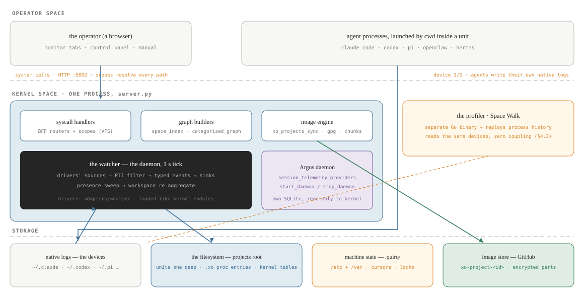
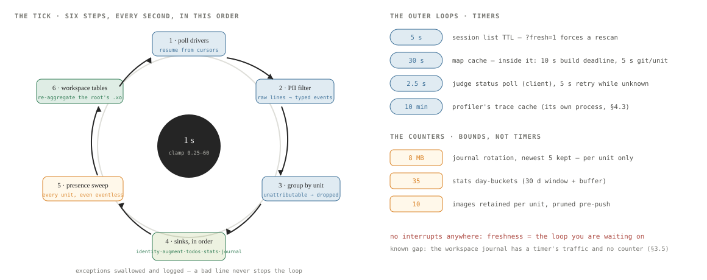
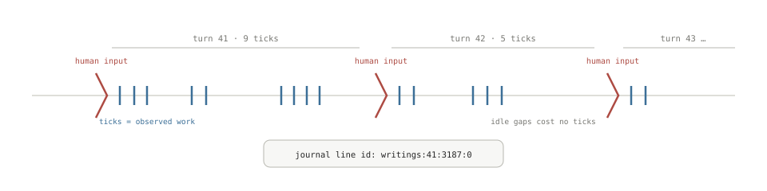
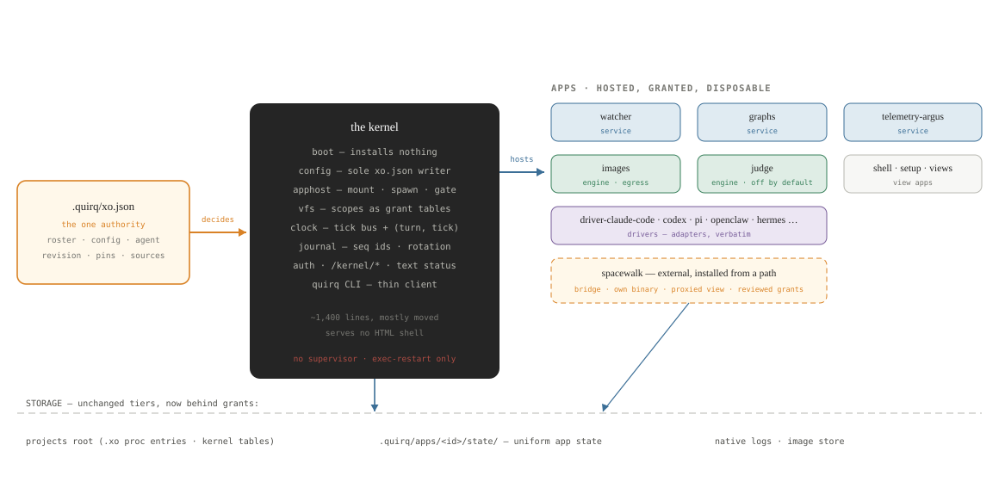
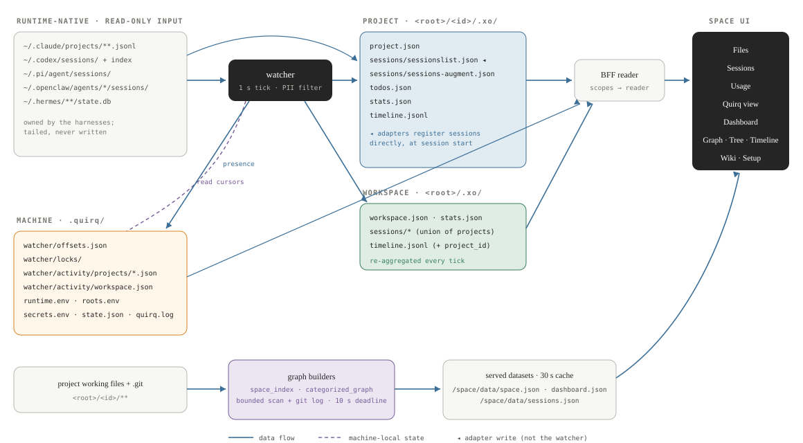
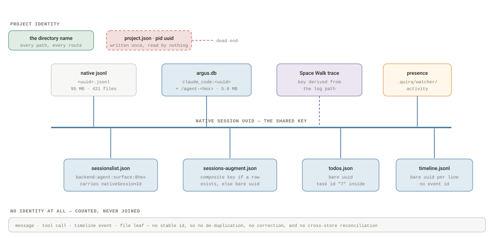
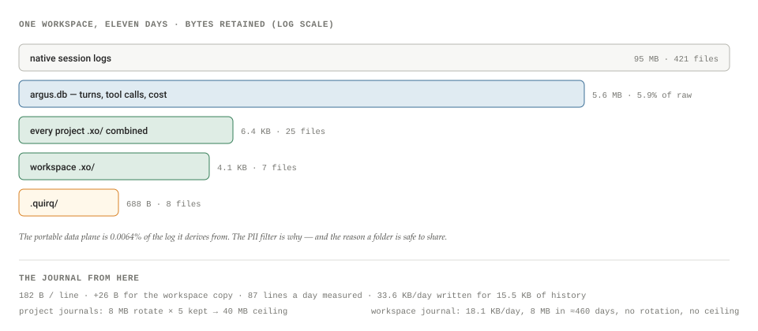
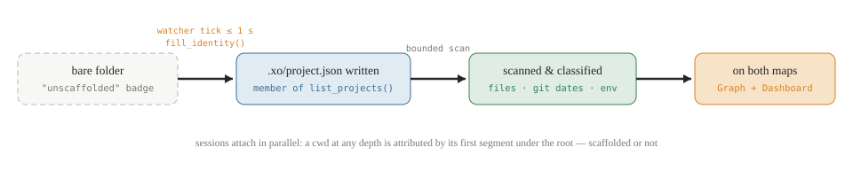
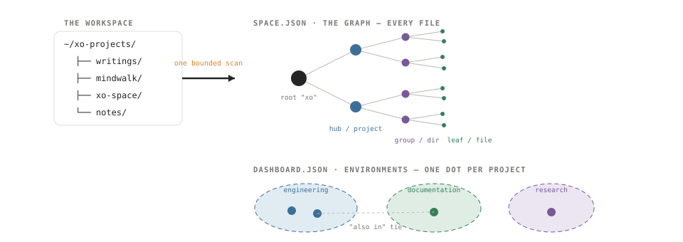

# XO Space: the architecture

The implementation reference for xo-space, the app for understanding and mapping xo-projects. Everything verified against the working tree, stated once, and kept short. This revision adds the full data model: the twelve entities collected across five stores, the field-level session record, what bounds each file as the timeline grows, and a marked proposal for consolidating the plane.

By **Suraj Sharma**, XO Labs · Engineering. First published 16 August 2026 as *XO Space: the architecture* in [sharmasuraj0123/writings](https://github.com/sharmasuraj0123/writings/tree/a5a356d418d45b63d34624b12ec3d7809167b309/xo-space-architecture). Subject: `quirq-ai/xo-space`

Source: [`xo-space-architecture/index.html`](https://github.com/sharmasuraj0123/writings/blob/a5a356d418d45b63d34624b12ec3d7809167b309/xo-space-architecture/index.html) in [sharmasuraj0123/writings](https://github.com/sharmasuraj0123/writings) at `a5a356d`. Brought into this repo on 2026-10-15 with its text, tables and figures unchanged; only the format moved from HTML to Markdown.

## 01 · Foundations

The vocabulary, the shape of the system, and getting it running.

### 1.1 · Terminology

Twelve words carry this whole document. Each is defined once, here, and used consistently everywhere below.

| Term | Meaning |
|----|----|
| **workspace** / **projects root** | the one directory everything hangs off — `XO_PROJECTS_ROOT`, default `~/xo-projects`. Every non-hidden folder directly under it is a project. |
| **xo-project** | a folder under the root. Its *id* is the directory name, always. Membership is one file: `.xo/project.json`. |
| **scaffolded / unscaffolded** | whether the folder has been given the template docs. Distinct from membership: the watcher *promotes* a bare folder to project status (writes `.xo/project.json`) on its next tick, but template docs come only from the scaffold API. |
| **`.xo/`** | the project's *data plane*: portable, schema'd, derived state inside the folder. Travels with the folder when shared. |
| **`.quirq/`** / **state root** | machine-local installation state (`QUIRQ_STATE_ROOT`; the server's code default is `~/.quirq`, and the installer anchors it to `./.quirq` beside your projects via `roots.env`): config, credentials, cursors, locks, presence, logs. Never travels. |
| **watcher** | the 1-second background loop inside the server that tails native session logs and writes every derived `.xo/` file — the system's daemon, in §2's OS terms. |
| **adapter** (backend, harness) | the per-agent module (`adapters/<name>/`) that knows one runtime's native storage. Core code never names one — save the single sanctioned `openclaw` safe-boot literal — and `AGENT_NAME` selects. |
| **session** | one agent run — a process, in §2's OS terms. Registered as a row keyed by a *composite key* (`<backend>:<agent>:<surface>:<8hex>`) carrying the runtime's own *native session id*. |
| **todo** (work item) | the one lifecycle-bearing entity: `{id, content, status, description, active_form}`, status ∈ pending · in_progress · completed · cancelled · blocked. Lives in `.xo/todos.json`. |
| **timeline** | the append-only event log `.xo/timeline.jsonl` — what happened, one JSON object per line. |
| **workspace tier** | the root's own `<root>/.xo/`: the same file shapes, aggregated across every project, rebuilt each tick. |
| **environment** | one of the five classification clusters on the Dashboard: engineering, ops, documentation, research, marketing. |
| **snapshot** | one encrypted backup of one project: chunked, manifested, pushed to a private per-project GitHub repo (`xo-project-<id>`). |

### 1.2 · One process, one folder tree

xo-space exists to understand and map xo-projects. Everything the app does — the watcher, the APIs, the Space UI — is in service of one model: every folder under the projects root is an xo-project, and the app's job is to observe it, describe it, and draw it. Think of it as a small operating system for that tree — it boots at the root, and §2 walks the hierarchy from there.

The implementation is one Python process and one directory tree. The process is a FastAPI server (`server.py`) that serves the JSON APIs, the Space UI at `/space/`, and — inside its own lifespan — a watcher that tails agent session logs on a 1-second tick. The tree is your projects root: one folder per project, no registry anywhere else.

The codebase has one structural rule: **core code never names an agent** — with a single sanctioned exception, the `openclaw` safe-boot default in the agent registry, kept so the server boots with no env configured. The active backend resolves from `AGENT_NAME` through a single capability loader (`services/cowork_agent/adapters/loader.py`); an agent's code lives only in `adapters/<name>/` and its two config trees. A capability module that is missing means the route returns its empty shape — never a crash. Adding an agent is dropping folders in place; no core edits, no registry to update.

Default port `5002` — the installer binds loopback, while a bare `python server.py` defaults to `0.0.0.0` — and no external services are required. Everything below is reproducible from a shell.

### 1.3 · Install and run

One command. Pick the directory you want as your projects root, run the installer from it, and the server starts in the foreground.

    curl -fsSL https://raw.githubusercontent.com/quirq-ai/xo-space/main/install.sh | bash

It must be piped to `bash`, not `sh`. The script: installs `uv` if missing; clones the repo into `./xo-space`; creates `./xo-space/venv` on Python 3.12 (downloading an interpreter if the host has none) and installs `requirements.txt`; creates `./.quirq` for machine-local state; prints a readiness table; and starts `server.py`. Open `http://localhost:5002/space/`. Ctrl-C stops it; **re-running the same command is the update path** — it fast-forwards the checkout and restarts.

From a clone the same script runs in place and never touches your working tree with git:

    git clone https://github.com/quirq-ai/xo-space
    cd xo-space && ./install.sh

**Prerequisites.** Only `git` is required. Four tools are optional, and a missing one disables exactly its feature: `node`/`npm` (installing the agent CLI), `gh` (sync backup repositories), `rclone` (Drive/OneDrive connectors), `gpg` (encrypted backup). The installer will not install software behind your back — the agent CLI is yours to install once:

    npm install -g @anthropic-ai/claude-code

(Set `QUIRQ_SKIP_BOOT_INSTALL=0` to opt back into the automatic bootstrap.)

**What lands on disk.** The launch directory becomes the workspace, and an install is self-contained — move or delete it as one folder:

    .            your projects root — each project is a subdirectory with its own .xo/
    ./xo-space   the source checkout
    ./xo-space/venv   the Python environment
    ./.quirq     machine-local state: config, credentials, watcher activity,
                 read cursors, locks — never shipped by sync

**Process model.** Foreground only. Output appends to `<state root>/quirq.log`; there is no daemon, no PID file, no stop subcommand — lifecycle belongs to whoever launched it. Every setting is an environment override (`PORT=8080 ./install.sh`), and the two roots resolve in precedence order: exported `XO_PROJECTS_ROOT` / `QUIRQ_STATE_ROOT` → `roots.env` saved by the Setup tab → the checkout's `.env` → the launch directory. The Setup tab shows the paths in use, CLI readiness, and the watcher's source mode and tick interval — but it cannot restart the server; when it says a restart is required, Ctrl-C and re-run.

## 02 · The operating system

Space is a small operating system, and the claim is meant literally: it has a kernel, a filesystem, device drivers, daemons, a process model, clocks, system images, a monitor, and an operator. This section names every component, shows how the loops that drive them work, and describes how a human actually uses the thing. Each component's deep dive lives in its own section; this is the map.

### 2.1 · Boot and the hierarchy

**Boot.** The sequence is short and entirely file-driven. The server starts and resolves its two roots by the fixed precedence — exported env → `roots.env` saved by the Setup tab → the checkout's `.env` — and the projects root is created on read, so first boot never errors. Inside the server's own lifespan the watcher starts: the system's daemon, one tick per second. Its first tick sweeps the root's children and *adopts* every non-hidden folder as a project (§4.1's promotion — membership written within a second). From then on, sessions attach like processes: any agent whose cwd sits one level under the root is attributed to that unit, no registration call anywhere.

**The hierarchy, from the top.** Everything Space manages hangs off the root:

    <XO_PROJECTS_ROOT>/                 where Space starts — the platform's root
    ├── .xo/                            the system's own ledger (workspace tier)
    │   ├── workspace.json              the mounted-unit table: {projects_root, projects[]}
    │   ├── stats.json · sessions/*     aggregates across every project
    │   └── timeline.jsonl              the global journal — every line tagged project_id
    ├── <project-a>/                    every non-hidden child = one xo-project,
    ├── <project-b>/                    …adopted by the daemon within a second
    └── <project-n>/                    (hidden dirs are system space, never units)

The root's own `.xo/` is the OS's table of mounted units — `workspace.json` literally is the project list as a document, rebuilt every tick — plus the same aggregate shapes each unit keeps for itself, unioned across all of them. The one directory that is *not* under the root is the machine tier (§3.2's `.quirq/`): the installation's `/var`, deliberately outside the filesystem it manages.

### 2.2 · The components

Start the classification simply: everything *active* in this OS is one of three things — an **observer**, an **installer**, or an **executor**. The kernel and the filesystem are not classified; they are the stage the three act on.

| Class | Its one rule | Members |
|----|----|----|
| **observers** | watch the work; never touch it (rule M4) | the watcher · the drivers · telemetry · the graph builders · the monitor · the profiler |
| **installers** | change what exists on the machine, only on explicit operator request | the installer + system update · the scaffold call · the app installer *(proposed)* · image restore |
| **executors** | do bounded work, then stop | agent sessions (the primary executors) · the judge · image backup · the kernel's exec-restart |

The full component map, each row tagged with its class:

**Figure 1. The complete OS: component → implementation → deep dive**

| Class | OS component | Implementation | Detail |
|----|----|----|----|
| *stage* | **kernel** | one process, `server.py`: boots the roots, mounts the routers, owns every lifespan | §1.2, §1.3 |
| *stage* | **system calls** | the HTTP surface; `scopes.py` resolves every path — BFF routes never construct one themselves | §3.3 |
| *stage* | **filesystem** | the projects root; units exactly one deep; each unit's `.xo/` as its proc entry; `<root>/.xo/` as the kernel's tables | this section |
| *observer* | **device drivers** | `adapters/<name>/` behind the capability loader — auto-discovered like kernel modules, a missing capability degrades to an empty shape, `AGENT_NAME` selects the active one | §1.2 |
| *observer* | **daemons** | the watcher (1 s tick); the Argus telemetry daemon, started and stopped per provider through `start_daemon`/`stop_daemon`; judge subprocesses as sealed one-shot workers | this section, §3.4 |
| *executor* | **processes** | agent sessions — each unit keeps its process table (`sessionslist`), work queue (`todos`), accounting (`stats`), and journal (`timeline`) | this section |
| *observer* | **the monitor** | the Space UI, tabs as system apps: Files = file manager, Sessions = task manager, Usage = resource monitor, Graph/Dashboard = system monitor, Quirq view = system information | §4.1 |
| *observer* | **the manual** | the Wiki tab — the OS ships its own man pages, including its FAQ entries for surprising behavior | — |
| *installer* | **control panel** | the Setup tab: writes `runtime.env`/`roots.env`, reports restart-required (runtime, secrets, roots), and runs the git-backed **system update** (`/space/update/status` → `apply`, localhost-only) | §1.3 |
| *executor* | **system images** | encrypted per-unit snapshots, ten retained, restore verified before decryption | §4.2 |
| *observer* | **the profiler** | Space Walk — replays one process's history over a map of its working set, from the same logs | §4.3 |

The one deliberate absence: there is no service supervisor. The kernel runs in the foreground, Ctrl-C is shutdown, and re-running the installer is both update and restart.

**Figure 2. The OS architecture: operator space, kernel space, storage**

Two things cross the syscall line: the operator's HTTP calls down, and the monitor's data up. Agents never cross it — they write their own device logs, and the kernel's daemon reads those from below.

### 2.3 · The clocks: how the loops work

**The clocks: how the loops work.** Nothing in this OS is event-pushed — there is no file watcher API, no SSE, no websocket anywhere. Every component is a loop with a cadence, reading state and rewriting it, and freshness is always a function of which loop you are waiting on. The daemon's tick is the heartbeat: every second it drains the drivers' sources (resuming each log from a saved cursor), filters and types the events, applies the sinks per unit in fixed order, writes presence for every unit — even eventless ones, so exited processes get evicted — and re-aggregates the kernel tables. Around that heartbeat sit the slower loops: the session list caches for 5 seconds (a refresh forces a rescan); the two maps rebuild on request behind a 30-second cache with a 10-second build deadline and a 5-second git timeout per unit; the client polls a running judge every 2.5 seconds. And two loops are counters rather than timers: the journal rotates at 8 MB keeping five files, and each unit's image history keeps ten snapshots. The design consequence is worth stating once: the OS has no interrupts. A change becomes visible when the next loop passes over it — within a second for anything the daemon owns, within half a minute for the maps.

**Figure 3. The heartbeat and the outer loops: every clock in the OS**

The tick is the only writer-loop; everything on the right is a reader-loop or a bound. When two views disagree, the one behind the slower clock is the stale one.

### 2.4 · Ticks and turns

**Ticks and turns: the OS's own time.** *Status: proposal — no code in the tree implements this yet.* Wall-clock time is the wrong clock for this OS: idle days mean nothing, and "when" matters less than "how much happened" and "who caused it." The design gives every scope two monotonic counters. The **tick** is machine time: it advances when a daemon pass observes at least one new event for that scope — an idle second costs nothing, so ticks measure observed work, not elapsed time. The **turn** is human time: it advances when the daemon observes human input — in v1, a user message in any of the unit's sessions (operator writes like todos and configuration are candidate turn sources, deferred deliberately). Together they define the OS's logical timestamp:

    <unit>/.xo/clock.json · and one for the workspace          status · proposal
    { "schema": 1, "turn": 41, "tick": 3187, "updated_at": "…" }

    tick   + 1 when a daemon pass observes ≥1 new event for this scope
    turn   + 1 when that pass contains human input; the tick that carries it
           belongs to the new turn
    stamp  every journal line and every snapshot gains "as_of": [turn, tick];
           a journal line's id becomes unit:turn:tick:n — which closes rule J3
           (referenceable, deduplicable, resumable) as a side effect

The semantics that fall out are the point. A turn is an *epoch of autonomy*: it opens at a human touch and holds every tick of machine work until the next one — so ticks-per-turn is the system's autonomy ratio, readable per unit straight off two integers. State comparison gets a language ("what changed since turn 40" is a filter on stamps, not a wall-clock guess), the monitor's timeline can scrub by turn instead of by date, and because both counters are kernel-owned and observation-driven, they survive machine moves, clock skew, and restores — none of which is true of timestamps. The seeds already exist in the tree: the event stream already types user messages, and both stores already count user turns per session; the design promotes that count from a statistic to the clock.

**Figure 4. Two clocks: turns open on human input, ticks advance on observation**

The human's inputs cut history into turns; the daemon's observations count the machine work inside each. Nine ticks in turn 41, five in turn 42 — the autonomy ratio, read off two integers.

### 2.5 · The operator

**The operator: how a human uses this OS.** The human never talks to the kernel directly; the operator's whole interface is folders, agents, and the monitor. *Mount work*: drop or clone a folder under the root — or create one through the scaffold call — and it is a managed unit within a second. *Launch processes*: run any supported agent with the unit as its working directory; the cwd *is* the launch context, so there is nothing to register. *Share the work queue*: todos are the one surface human and agent write together — agents through their native task tools, the operator through the todo API and UI — with the flock the kernel holds making the sharing safe. *Watch the monitor*: the tabs are the OS's applications, and selecting a unit's node even orbits its live work queue around it. *Configure*: tags in the unit's `project.json` (name, description, environment) and the control panel for the installation — knowing that root, runtime, and secret changes all require the one restart gesture this OS has, Ctrl-C and re-run. *Image and restore*: one call per unit, encrypted, off-machine. *Read the manual*: the Wiki tab documents the OS from inside it. Setup and install are §1.3; everything the operator touches beyond that is a folder or a browser tab.

### 2.6 · Scaffolding and the one-deep rule

**Scaffolding the system, from zero.** The whole platform scaffolds from one decision — where the root is — and then proceeds strictly downward:

    1  pick the root        install from the directory you want as root (§1.3);
                            or export XO_PROJECTS_ROOT — created on read either way
    2  bring work in        one unit per direct child: move a folder in, clone a
                            repo, or create via the scaffold API — never deeper
    3  let the daemon adopt within one tick each child carries its identity tag,
                            .xo/project.json, and is on the mounted-unit table
    4  tag the units        what the system cannot infer: display_name and
                            description via the scaffold call, an environment via
                            "category" in project.json (§4.1 — mind the clobber bug)
    5  open Space           the maps exist with no further ceremony: List/Tree for
                            contents, Graph and Dashboard for the territory

**The one-deep rule.** The system maps units at exactly one level below the root, and every mechanism agrees on that depth: membership walks the root's direct children; session attribution takes the *first path segment* under the root; the mounted-unit table lists children; the scan treats each child as one map. Everything deeper belongs to the unit, not the system. The rule has two sharp edges, both observed on this machine. A session run in a *nested* repo (`mindwalk/mindwalk`) still attributes correctly — first segment wins — but the log auto-discovery fallback checks only the root-level encoded directory, so a nested-cwd session is found only if its adapter wrote a registry row. And git history is gated on `.git` sitting at the unit's top level: a repo one level deeper counts as having no history at all, which the Timeline's own FAQ states. The rule of thumb that follows: *keep the unit's `.git` at depth one; run agents from anywhere inside it.*

### 2.7 · Inside each unit

**Inside each unit.** Every project under the root has the same internal shape — a three-writer contract: agents, the watcher, and the runtime adapters each own distinct files, with the project's `.xo/` as its proc entry — the place the system exposes everything it knows about the unit.

**Creation.** Two calls. Resolve the root, then scaffold:

    GET  /api/config/workspace
    → {"roots": {"openclaw": "/home/coder/xo-projects"}, "default": "openclaw"}

    POST /api/files/mkdir
    { "path": "<root>/my-app", "scaffold": true,
      "display_name": "My App", "description": "…" }
    → 200  created (template copied)
    → 400  path.parent is not the projects root
    → 409  folder already exists

Scaffolding copies a bundled template and is idempotent: re-running fills in missing files and never overwrites existing ones. The template docs arrive with `[TEMPLATE]` markers that the first agent session replaces with real scope.

**The unit's tree, annotated by writer:**

    <root>/my-app/
    ├── AGENTS.md                      the operating contract; CLAUDE.md points here
    ├── PROJECT.md · OBJECTIVES.md     agents + human — scope and outcomes
    ├── PLAN.md · PROGRESS.md          agents — current plan, append-only log
    ├── memory/
    │   ├── semantic/                  agents — distilled facts, one claim per line
    │   ├── episodic/                  agents — append-only, one file per episode
    │   ├── procedural/                agents — workflows validated ≥2 times
    │   └── working/                   agents — session scratch, wiped at close
    └── .xo/
        ├── project.json               watcher — identity: pid, name, owner, created_at
        ├── sessions/sessionslist.json runtime adapters — one row per session
        ├── sessions/sessions-augment.json   watcher — per-session counters, activity times
        ├── todos.json                 watcher + todo API — flock-guarded
        ├── stats.json                 watcher — rolling aggregates
        └── timeline.jsonl             watcher — append-only events, 8 MB rotation

**Ownership rules, as enforced conventions.** Agents never write `.xo/`. The watcher owns five files — `project.json`, `sessions-augment.json`, `todos.json`, `stats.json`, `timeline.jsonl` — and the runtime adapters own two: `sessions/sessionslist.json` (one row per session: composite key, the runtime's native session id, backend, directory, token usage) and an optional `agent.json` index. The template also ships `peers.json` and `sync.json` stubs that nothing writes yet. The watcher's augmenting data goes in the sibling `sessions-augment.json` so the two writers never collide; all its writes are atomic (temp + `os.replace`), and `todos.json` — the one file with a second legitimate writer, the todo CRUD API — is additionally `flock`-guarded.

**What deliberately stays out of the folder.** Session messages remain in each harness's own storage (`~/.claude/projects/…` and friends) — the folder holds metadata and derived state only. Presence, read cursors, and other ephemera live under `./.quirq/`, outside every project, precisely so a synced or copied folder never carries machine-local or unfiltered data. A workspace-level `<root>/.xo/` aggregates the same shapes across all projects.

**Todos.** Claude Code agents use the native task tools; the watcher mirrors them into `todos.json`. Other runtimes write through the todo HTTP API. One `in_progress` item per agent; finished work moves to `PROGRESS.md` at session close, not into a growing completed list.

### 2.8 · The data plane

**The data plane, file by file.** In OS terms the mapping is exact: `sessionslist.json` is the unit's process table, `todos.json` its work queue, `stats.json` its accounting, and `timeline.jsonl` its journal. Everything the watcher writes into `.xo/` has a JSON Schema (`visualizer/schema/`, ten files) and keys sessions consistently; the JSON documents are written atomically (temp + `os.replace`), while the timeline is fsync'd appends. The shapes, as actually written today:

**Figure 5. What the watcher writes into .xo/ — shapes as implemented**

| File | Shape | Semantics |
|----|----|----|
| `sessions/sessions-augment.json` | `{schema:2, updated_at, sessions:{key → row}}`; row = `messageCount`, `messageCountByRole`, `toolCallCount`, `taskCount{total,…,blocked}`, `firstActivity`/`lastActivity` (epoch ms), `ended_at`, `episode_refs[]` | the watcher's counters beside the adapters' registry; keyed by composite key when a `sessionslist` row exists, else native id. `ended_at` is always null today — session-close detection isn't built |
| `todos.json` | `{schema:1, updated_at, sessions:{native_sid → {runtime, source_file, session_started_at, todos[]}}}`; todo = `{id, content, status, description, active_form}` | the work items. Status enum: pending · in_progress · completed · cancelled · blocked. The one file with two writers (watcher sink + todo API), so it alone is flock-guarded; `source_file` is schema'd but always null |
| `stats.json` | `{schema:2, updated_at, rolling{7d,30d}, by_session, by_runtime, by_day}`; windows = tokens, by_model, by_tool, files_edited, sessions, active_minutes; day buckets add message splits and a reservoir-sampled latency block | rolling aggregates; `by_day` capped at 35 entries; private `_session_totals` makes restarts lossless without a sidecar |
| `timeline.jsonl` | one object per line: `{ts, session_id, runtime, type, …}` | five types are emitted today — `session.started`, `todo.added`, `todo.completed`, `file.created`, `file.edited` — of twelve the schema defines; rotates at 8 MB, newest five kept |
| `sessions/sessionslist.json` | `{composite_key → {sessionId, nativeSessionId, directory, backend, updatedAt, usage}}` | the adapters' registry (§2 above) — adapter-owned, never watcher-written (as is the optional `agent.json`); augment rows without a matching registry row are dropped on read |

Schema'd, atomic, and honest about gaps: fields the schemas define but no code writes yet (`ended_at`, `source_file`, seven timeline types, the `peers`/`sync` schemas) are stated here rather than implied to work.

**Snapshots vs. the journal.** The watcher has exactly two write disciplines, and every `.xo/` file uses one of them. Every JSON file is a *snapshot*: the sink rebuilds the complete document in memory and replaces the file atomically (write to a temp file, `os.replace`) — never a partial edit, never a diff. A reader therefore always sees a whole, schema-valid document; a crash mid-write leaves the old version intact. The one exception is `timeline.jsonl`, the *journal*: append-only (append, flush, fsync — no temp file), one JSON object per line, with atomicity only at rotation, which is an atomic rename.

**One tick, start to finish.** Every second the watcher: (1) polls each adapter's source, which resumes every tailed log from a persisted byte offset (`.quirq/watcher/offsets.json`; an inode change or a shrunken file means rotation or truncation → re-read from zero; an incomplete trailing line is deferred to the next tick); (2) runs raw lines through the PII filter, which normalizes them into typed events and strips tool inputs; (3) groups events by `project_id`, dropping any it cannot attribute; (4) applies the sinks per project in a fixed order — identity, sessions-augment, todos, stats, and timeline *last*, so the timeline's freshly rendered lines can be fanned out to the workspace tier in the same tick; (5) writes presence for *every* project, even ones with no events, so exited sessions get evicted; and (6) re-aggregates the workspace tier. Per-tick exceptions are swallowed and logged — a bad line never stops the loop.

**The timeline format, concretely.** The journal's base object is `{ts, session_id, runtime, type}` (the schema requires only `ts` and `type`); each event type adds its own payload:

    {"ts":"2026-08-16T16:31:04Z","session_id":"<native-sid>","runtime":"claude_code","type":"session.started"}
    {"ts":"…","session_id":"…","runtime":"claude_code","type":"todo.added",
     "todo":{"id":"7","content":"Wire the export path","status":"pending"}}
    {"ts":"…","session_id":"…","runtime":"claude_code","type":"todo.completed","todo_id":"7"}
    {"ts":"…","session_id":"…","runtime":"claude_code","type":"file.created","path":"src/export.py"}
    {"ts":"…","session_id":"…","runtime":"claude_code","type":"file.edited","path":"src/export.py"}

Five types are emitted today. `todo.added` embeds the new todo (always born `pending`); `todo.completed` carries only the `todo_id` — status changes other than completion emit nothing; the two file events carry project-relative paths (`file.created` when the tool was a Write, else `file.edited`). Messages, token usage, and bare tool calls are deliberately not journaled — they land in the snapshot files as counters instead. At 8 MB the journal rotates to `timeline.<UTC-stamp>.jsonl` and the newest five rotations are kept; the workspace-tier copy appends the same rendered lines tagged with `project_id`, unrotated.

### 2.9 · The spec and the plan

**The systems and their rules.** An OS is its invariants. The table below states them as a spec the tree can be held against — each rule marked **✓** implemented, **◐** partial, or **→** roadmap. Nothing here is aspiration disguised as description: every ✓ was verified against source, and every → is a gap one of the verification passes or §5.1's ledger surfaced.

**Figure 6. The nine systems of the OS, and the rules each must keep**

| System | Rules |
|----|----|
| **filesystem** | F1 one root, resolved by fixed precedence ✓ · F2 a unit is a non-hidden direct child ✓ · F3 unit id = directory name, always ✓ · F4 every `.xo` file has a schema ✓ · F5 hidden dirs are system space ✓ · F6 the three storage tiers never mix ✓ |
| **processes** | P1 a process is launched by cwd; the first path segment owns it ✓ · P2 drivers register, the daemon accounts ✓ · P3 process end is detectable → (`ended_at` has no writer) · P4 an orphan process is still adopted → (unclaimed sessions need a watcher-written minimal row, §5.1) |
| **clock** | C1 no interrupts — every view has a declared staleness bound ✓ · C2 all `.xo` writes go through the daemon, a registering driver, or a locked API ✓ · C3 every growing file carries a bound ◐ (the workspace journal has none, §3.5) |
| **drivers** | D1 the kernel never names a driver, one sanctioned boot literal aside ✓ · D2 capabilities auto-discover; absence degrades, never crashes ✓ · D3 each driver owns its cursors ✓ · D4 one PII stance across all readers ◐ (the Argus store keeps richer telemetry under its own rules, §3.4) |
| **journal** | J1 append-only, typed, attributable ✓ · J2 a schema'd type is an emitted type ◐ (seven of twelve are silent) · J3 a line is referenceable → (no per-line sequence id, §5.1) |
| **state** | S1 snapshot files are whole-document atomic replacements ✓ · S2 two writers means a lock ✓ · S3 identity writes merge, never clobber → (`fill_identity` replaces the document — the known bug) |
| **security** | X1 secrets never enter a unit ✓ · X2 tool inputs are stripped before anything persists ✓ · X3 no plaintext secret leaves via any endpoint ◐ (legacy `GET /api/secrets/env`) · X4 mutating system calls are loopback-only ✓ · X5 nothing leaves the machine unencrypted ✓ |
| **images** | I1 the unit is the image boundary ✓ · I2 verify before decrypt ✓ · I3 machine state is never imaged ✓ · I4 every unit is imageable ◐ (a not-yet-promoted folder is invisible to `backup all`) |
| **interface** | M1 every path resolves through scopes ✓ · M2 the monitor writes nothing but todos and configuration ✓ · M3 absolute paths never leave the machine ✓ · M4 observation asks nothing of the operator — no annotation, no wrapper, no workflow change (§4.4) ✓ |
| **time** | T1 two counters per scope — tick and turn — monotonic and kernel-owned → · T2 ticks advance only on observation → · T3 turns advance only on human input → · T4 every persisted write carries its (turn, tick) stamp → · T5 wall clock is display metadata, never ordering → |

Ten systems, thirty-five rules; twenty-three hold today. The twelve that don't — seven gaps and the five-rule time system — are the tech plan.

**The tech plan.** Every ◐ and → above, as a change with a size. Ordered so that dependencies come first — session-close detection unlocks two other rows:

**Figure 7. The plan: change → rule it closes → size**

| Change | Closes | Size | Notes |
|----|----|----|----|
| Session-close detection (PID gone, or idle timeout) | P3 | M | unlocks `ended_at`, the `session.closed` journal type, and honest "active" states |
| Watcher-written minimal registry row for unclaimed sessions | P4 | S | §5.1's ledger; ends augment-data written to be discarded |
| Rotate the workspace journal | C3 | S | the one growing file with no ceiling (§3.5's measurement) |
| `fill_identity` merges instead of replacing | S3 | S | stops the clobber of `display_name`/`category` |
| Retire legacy `GET /api/secrets/env` | X3 | S | the newer BFF routes already never return plaintext |
| The clock: `clock.json` + (turn, tick) stamps on every write | T1–T5, J3 | M | ticks and turns derive from the event stream the daemon already types; subsumes bare sequence numbers |
| Emit the silent journal types | J2 | M | `session.closed` (needs row 1), `project.created`, `plan.written`, `episode.written` |
| Promote before imaging in `backup all` | I4 | S | iterate the union the daemon already tracks, not `list_projects()` |
| One session record: fold telemetry into `.xo/sessions/` | D4 | L | §5.1's convergence — registry + counters + Argus fields, one PII decision |
| Classification producer + the category filter's missing assignment | — | M | closes §4.1's two dormant halves; the filter is one assignment away |
| Level-1 trace generation into `.xo/sessions/traces/` | — | M | the profiler converges (§4.3): the registry supplies *which*, Space Walk supplies *how* |

Five smalls, five mediums, one large. The smalls are all single-file changes; the large is the §5.1 convergence and deserves its own design pass.

### 2.10 · The lean redesign

**The lean redesign: everything is an app.** *Status: target architecture — designed, not implemented; a three-architect panel with an adversarial judge produced it, and the open questions at the end are unresolved by intention.* The direction: shrink the kernel to what only a kernel can do, and make every other component — the watcher, Argus, the graph builders, the image engine, the judge, every UI surface — an *app*. Internal apps ship with the tree as `builtin` rows; external apps install from a path, a git ref, or pip; both are managed identically, and one file decides the whole system: `.quirq/xo.json`. Rule M4 binds the app model too — no installed app may demand the operator change how they work.

**The kernel** keeps nine things: boot (which installs *nothing* — every setup block in today's lifespan becomes an app's `on_install` hook); `config`, the sole writer of xo.json (atomic, last-good `.bak`, a monotone revision counter); the `apphost`, a generalization of the capability loader that mounts routes, spawns daemons, and gates a disabled app's routes to 503; the `vfs` — today's scopes module, now enforcing per-app grant tables; the `clock` — the tick bus apps subscribe to, *and* the (turn, tick) counters of the time system, kernel-advanced, app-readable; the `journal` with its sequence ids and rotation (the kernel must journal app lifecycle with zero apps enabled); the auth core; the `/kernel/*` syscalls plus a plain-text status page that works when the shell app is broken; and a `quirq` CLI that is a thin client of those syscalls, nothing more. Everything else — explicitly — is not kernel.

    .quirq/xo.json — the one authority                        status · proposal
    { "version": 1, "revision": 7,
      "kernel": { "host": "127.0.0.1", "port": 5002, "projects_root": "…", "ui_shell": "shell" },
      "agent":  { "active": "claude_code", "safe_boot_fallback": "openclaw" },   // data, not code
      "apps": {
        "watcher":            { "enabled": true,  "source": "builtin",
                                "config": { "interval_s": 1, "source_mode": "all", "pii_filter": true } },
        "driver-claude-code": { "enabled": true,  "source": "builtin" },
        "graphs":             { "enabled": true,  "source": "builtin", "config": { "cache_s": 30 } },
        "images":             { "enabled": true,  "source": "builtin", "config": { "chunk_mb": 45 } },
        "judge":              { "enabled": false, "source": "builtin" },
        "spacewalk":          { "enabled": true,  "pin": true,
                                "source": "path:/home/coder/xo-projects/mindwalk",
                                "config": { "port": 8765 } } } }

    precedence  bootstrap env (roots · host · port) > xo.json > manifest defaults —
                nothing else reads env; runtime.env is deleted; secrets never enter
                this file; shadowing env vars become a doctor error after cutover

**An app declares everything.** One directory, one `app.json`: what it contributes (routes, views, ticks, daemons, capabilities), what it requires, which scopes it may touch and in which mode, its config schema (keys not listed in `hot_keys` require restart — nothing is claimed hot until proven), its journal vocabulary, and a data policy per path so deletion is safe by construction. Five kinds: *service* (watcher, graphs), *driver* (today's adapters, verbatim), *view* (UI-only), *engine* (on-demand subprocess: judge, images), *bridge* (a foreign binary with its own port — Space Walk). The watcher's manifest, condensed:

    apps/watcher/app.json                                      status · proposal
    { "id": "watcher", "kind": "service", "runtime": "python", "entry": "app:App",
      "requires":    { "kernel": ">=2.0", "capabilities": ["visualizer_source", "session_telemetry"] },
      "contributes": { "routes": [{ "prefix": "/api/visualizer" }],
                       "ticks":  [{ "fn": "app:tick", "interval_s": 1 }] },
      "permissions": { "scopes": [
                         { "name": "xo-projects-visualizer", "mode": "rw",
                           "files": ["sessions/*", "todos.json", "stats.json", "timeline.jsonl"] },
                         { "name": "native-logs", "mode": "ro" } ],
                       "subprocess": false, "network": "none" },
      "config_schema": { "interval_s": { "default": 1 }, "hot_keys": ["interval_s"] },
      "data": [ { "path": "$STATE/apps/watcher", "policy": "purge-ok" },
                { "path": "$PROJECT/.xo",        "policy": "never-delete" } ] }

**Lifecycle, honestly bounded.** `on_install` (the only hook with network — where `pip install argus-code` and the setup scripts go) → *enable*, where the operator reviews the requested grants in Setup → `on_start` → running, with every daemon in one health registry the monitor reads uniformly — crash means one bounded restart attempt, then fail-visible → *disable* (daemons stop and views drop immediately; routes gate to 503 until next boot) → delete, which walks the manifest's data policies: `never-delete` paths (all of `.xo/`) untouched, the rest archived to a 30-day trash. Hot operations are exactly what the kernel can do truthfully — daemon start/stop, view add/remove, declared `hot_keys`; everything else sets `restart_required`, and the one restart syscall exec-replaces the same process in the same terminal. Still no supervisor, by rule.

**Space Walk as the first external app.** `quirq install ~/xo-projects/mindwalk`: its `app.json` declares a *bridge* daemon (the Go binary, its port, an HTTP health probe), one `native-logs: ro` grant — making its pre-PII read an explicit, reviewed contract instead of an unmanaged fact — and a view that mounts through the kernel's reverse proxy at `/apps/spacewalk/http/`, so the monitor gains a Walk tab on a single origin and the port stops being a second thing to know. A dead binary shows one bulkheaded tab, never a broken shell.

**What an app can never do** — kernel-refused and lint-enforced before any code moves: construct a path (every path resolves through a granted scope); read a secret back; write another app's state or xo.json; enable, disable, or install anything, itself included; bind beyond loopback without an `egress` grant; name another app or driver; run a private timer loop instead of subscribing to the kernel clock; emit undeclared journal types. The trust model is stated, not pretended: in-process apps are contract plus lint; subprocesses get only granted paths; foreign binaries are audit contracts — reviewed at enable, checksummed, journaled.

**Figure 8. The lean architecture: one file decides, one kernel hosts, everything else is an app**

Compare Figure 2: same storage, same boundaries — but the kernel's middle band empties into the app grid, and the roster on the left decides what exists at all.

**Figure 9. Thirteen shippable steps from today's tree to the lean OS**

| Step | What ships |
|----|----|
| M1 | kernel journal (seq ids, rotation) + loader promotion — pure addition |
| M2 | xo.json authority: first boot synthesizes it from env + roots.env + runtime.env; dual-read for one release |
| M3 | apphost with *shim* apps wrapping existing modules in place; the scope-lint lands here, before anything moves |
| M4 | vfs + clock carve; the watcher becomes the first real app — live enable/disable proven |
| M5 | telemetry-argus moves; its SQLite into uniform app state; registers the `argus-db` scope |
| M6 | dynamic UI shell: views load from `GET /kernel/ui/manifest` — mechanism proven before any view moves |
| M7 | views and graphs move, one PR per view; three copy-pasted caches become one |
| M8 | images and judge as engine apps; promote-before-image closes I4 |
| M9 | drivers: manifests generated in place, then one mechanical move; parity gate before and after |
| M10 | installer + grant review + data-policy delete + the thin CLI |
| M11 | Space Walk installs as the first external app; trace generation lands as cooperation |
| M12 | the derived `xo.json` naming collision resolved (→ `status.json`); Plane-A quarantined behind a row |
| M13 | burn the boats: runtime.env, env fallbacks, dead lifespan blocks, the legacy secrets endpoint — pure deletion |

Every step leaves the system green behind the existing route-count parity gate. The remaining tech-plan gaps land *inside* apps — session-close detection, minimal rows, the merge fix all belong to the watcher app once it exists.

**The lean dividend.** What deletion buys: `server.py` falls from 1,140 lines to a shim (every install block, daemon stanza, and warmup becomes an app hook); `runtime.env` and its parser go entirely; the manifest-publishing module, the hand-edited cache-busters, the duplicate TTL caches, the legacy secrets endpoint, and the env-knob sprawl all disappear — their jobs absorbed by manifests the Setup tab can render automatically. Adopting the design amends five rules (D1 loses its sanctioned literal — the fallback becomes data; D4 splits portable-vs-machine telemetry honestly; C2, M2, F1 tighten to the kernel paths) and adds an *apps* system: A1 everything outside the kernel is an app · A2 an app declares everything it contributes, requires, and touches · A3 the kernel names no app and no app names another · A4 storage only through granted scopes · A5 hooks are non-fatal and journaled · A6 an app declares the kernel ABI it needs — plus P5 (only the kernel restarts, by exec-replace), P6 (only declared children, one bounded restart), and X6 (a foreign binary's grants are a reviewed, checksummed audit contract).

**Open questions — the operator's to decide.** (1) Plane-A go/no-go: is `/ask_question*` confirmed dead, or quarantined? (2) The privacy stance: is two-tier PII permanent policy — portable `.xo` always filtered, bridges like Space Walk granted pre-filter reads forever? (3) The default-enabled set on a fresh install — judge on or off; all six drivers or just active + fallback? (4) Uninstall policy: 30-day trash or immediate delete with confirmation? (5) Supply chain: pinned refs + recorded checksums required, or floating refs with a warning? (6) After cutover, does any emergency env override survive for containers, or is bootstrap-env + xo.json the whole story? (7) Names, which are forever: the CLI verb (`quirq` here) and the renamed derived file (`status.json` here).

## 03 · The data plane

Everything the system stores and counts: machine state, the full inventory, the entity model, growth, and the tracking catalog.

### 3.1 · The xo-project, end to end

One project, one data plane. This is how an xo-project's `.xo/` actually works — the order things happen in, which writer moves first, and what each read merges.

    t0    the folder appears     the daemon writes project.json — membership, within a tick
    t1    a session starts       the driver registers the row in sessions/sessionslist.json:
                                 composite key · native sid · backend · directory
    t+1s  every tick after       beside that row, never inside it:
                                 sessions-augment.json   counters, activity times
                                 todos.json              the work queue, mirrored
                                 stats.json              tokens · tools · day buckets
                                 timeline.jsonl          the journal, append-only
    read  any time               the BFF merges registry + augment on every read;
                                 an augment row with no registry row is dropped
    share on request             the image carries the whole .xo/ — the project
                                 remembers everything it derived, anywhere it lands

Three properties make this work. **Writers never collide**: the driver writes exactly one file, the daemon writes the other four, and the single genuinely shared file — the work queue — is the one behind a lock. **The registry anchors everything**: the adapter's row is the project's process table, and every other file keys off it — which is why an orphaned augment row is dropped on read rather than trusted (and why §5.1 proposes the daemon write minimal rows for unclaimed sessions). **Reads never block writes**: snapshot files are replaced atomically, so a reader always holds a complete document; the journal is append-only, so a reader is at worst one line behind. The result is the property §4.4 sells to the user: the whole record assembles itself, in one folder, with nobody asked to maintain it.

### 3.2 · Machine state: .quirq

Three tiers of storage, one rule each: native session logs belong to the runtimes, portable derived state belongs to the project's `.xo/`, and everything about *this machine* belongs to the state root — `.quirq/`, the installation's `/etc` and `/var` in one place.

The state root (`QUIRQ_STATE_ROOT`; the code default is `~/.quirq`, and the installer anchors it to `./.quirq` beside your projects) is the installation's memory. Nesting is policed with one exception: the state root may sit as a hidden directory *directly* inside the projects root — exactly the default layout — but anything deeper or non-hidden is rejected, and the reverse (projects root inside the state root) is always forbidden. Its full inventory:

    .quirq/
    ├── state.json              onboarding state — survives browser/localStorage clears
    ├── runtime.env             allowlisted controls: AGENT_NAME + the 3 watcher knobs (0600)
    ├── roots.env               the two roots, saved by the Setup tab — read back at boot
    ├── secrets.env             write-only credentials (0600); masked to •••••• everywhere
    ├── quirq.log               server stdout/stderr, appended by the installer's exec
    └── watcher/                ← one directory to delete for a full watcher reset
        ├── offsets.json        JSONL read cursors {path → {offset, inode}} — rotation-aware
        ├── hermes-offsets.json the Hermes adapter's SQLite row cursors
        ├── locks/              0-byte flock sentinels (today: only todos.json needs one)
        └── activity/
            ├── projects/<id>.json   live presence: open sessions, runtime, last activity
            └── workspace.json       the same, unioned across projects

Every entry answers "why not in the folder?" the same way: because it would poison sharing. Read cursors are per-machine (the same project on two machines has different offsets); presence is a heartbeat about *this* host's processes; lock files are transient sentinels that would tag along in a copy; credentials must never enter a syncable directory at all. The locks design note states the principle: keeping sentinels out of `.xo/` preserves "everything in `.xo/` has a schema." A read-only, path-masked inventory of this whole tree — presence counts, byte totals, which contract files exist per project, watcher health — is served at `GET /api/quirq` and rendered in the Quirq view (deep-linked at `#/quirq` from the Setup tab's header — it deliberately has no tab of its own). `secrets.env` is flagged sensitive and masked to `••••••` in the catalog, the BFF secrets routes, and the UI — though one legacy endpoint, `GET /api/secrets/env`, still returns plaintext values and is worth knowing about before exposing the port.

One correction worth writing down: todos — the "work items" — do *not* live here. They are project data, in `.xo/todos.json`, and they travel with the folder. What `.quirq/` holds is the machinery that keeps them fresh: the cursors that tail the logs they're derived from, and the lock that serializes their two writers.

### 3.3 · Data collection: the full inventory

Every file the platform reads, writes, or serves for visualization, in one place — with its repo-relative path, its writer, and the surface that consumes it.

Five tiers hold everything. *Runtime-native storage* is read-only input: the harnesses own it, the watcher tails it, nothing of ours writes there. The *project* and *workspace* `.xo/` tiers are the portable data plane of §2. The *machine* tier is §3.2's `.quirq/`. A fifth — *telemetry* — is a second derived store the folder contract doesn't mention: the `argus` daemon tails the same Claude Code logs into `~/.argus/argus.db`, which the server only ever opens `mode=ro`. And one tier is *served, not stored*: four `/space/data/*.json` endpoints are built live from the filesystem, git, and that database on request (30-second cache), with only `space.json` having a static fallback file in the repo. §3.4 walks the whole set entity by entity.

**Figure 10. Every data file, by tier · writer → reader**

| Tier | Path | Writer | Visualization use |
|----|----|----|----|
| native (input) | `~/.claude/projects/**/*.jsonl` · `~/.codex/sessions/` · `~/.pi/agent/sessions/` · `~/.openclaw/agents/*/sessions/` · `~/.hermes/**/state.db` | the harnesses | tailed by the watcher's per-adapter sources; never displayed raw |
|  | `~/.codex/session_index.jsonl` | Codex | session titles |
| project · `<root>/<id>/.xo/` | `sessions/sessionslist.json` (+ optional `agent.json`) | runtime adapters | session registry — merged with augment on every read; rows anchor the whole per-project surface |
|  | `project.json` · `sessions/sessions-augment.json` · `todos.json` · `stats.json` · `timeline.jsonl` | watcher (todo API co-writes todos) | Files tab card, todos, usage analytics, per-project timeline via the BFF (`/api/xo-projects/{id}/…`) |
|  | `peers.json` · `sync.json` | nothing yet (template stubs) | — |
|  | `activity.json` | legacy — an older install still writing the pre-`.quirq` path | none; `GET /api/quirq` counts the strays and names the file legacy |
| workspace · `<root>/.xo/` | `workspace.json` · `stats.json` · `sessions/sessionslist.json` · `sessions/sessions-augment.json` · `timeline.jsonl` | watcher (per tick) | workspace-wide usage, sessions, and timeline endpoints (`workspace.json` itself currently has no reader) |
|  | `xo.json` | the server at boot (`services/xo_manifest.py`) | capability manifest — which models, connectors, channels, and secrets are enabled; drives section visibility. In no schema and in no other tier |
| telemetry · `~/.argus/` | `argus.db` (SQLite: `sessions`, `turns`, `tool_calls`, `file_offsets`; `prompts`/`transcript` tables exist but are off by default) | the `argus` daemon — never the server, which opens it `mode=ro` | the Sessions tab, via `/space/data/sessions.json`; the only store carrying per-turn cost, tool errors, and subagent rows |
| machine · `.quirq/` | `watcher/activity/projects/<id>.json` · `watcher/activity/workspace.json` | watcher | live presence chips and activity endpoints |
|  | `watcher/offsets.json` · `watcher/hermes-offsets.json` · `watcher/locks/` · `state.json` · `runtime.env` · `roots.env` · `secrets.env` · `quirq.log` | watcher · server · installer | not visualized directly; inventoried read-only by `GET /api/quirq` |
| served · (built live) | `/space/data/space.json` · `/space/data/dashboard.json` · `/space/data/sessions.json` | graph builders on request (30 s cache) | the atlas: Graph lens, Dashboard, Timeline; session telemetry |
|  | `/space/data/session_prompts.json` | the runtime adapter's optional `session_prompts` capability, per request | one session's user prompts, fetched lazily for the detail view — the aggregate payload never carries prompt text; 32-entry LRU |
|  | `space_ui/data/space.json` | checked into the repo | static fallback when the live build fails |
| schemas | `services/cowork_agent/visualizer/schema/*.schema.json` (10 files) | checked into the repo | the written contract for every `.xo` shape above |

One asymmetry worth seeing: everything on the left half of the flow is per-session and event-driven; the served tier at the bottom ignores sessions entirely and rebuilds from files and git.

**Figure 11. The data flow: writers, stores, and the surfaces that draw them**

Two of the three pipelines that feed this UI: the event pipeline (native logs → watcher → `.xo/` tiers → BFF) and the structural pipeline (working files + git → graph builders → served datasets). They meet only on screen. The third — the `argus` daemon tailing the same logs into its own database for the Sessions tab — is drawn out of this figure and taken up in §3.4.

### 3.4 · The data model, entity by entity

§1.1 defined twelve words. This section is the twelve things they name — every entity the platform collects, with its identity, its writer, and its home. Consolidation is a question about identities, so the identities come first.

One correction to §3.3 before the table. There are **five** stores, not four: alongside the native logs, the two `.xo/` tiers, and `.quirq/`, a separate daemon tails the same Claude Code logs into its own SQLite database at `~/.argus/argus.db`. It arrives through the same seam as everything else: `argus-code==0.4.3` is pinned in `requirements.txt`, and at boot `server.py` walks every provider of the `session_telemetry` capability and calls its optional `start_daemon` (and `stop_daemon` on shutdown). The server never writes the database: `argus_index.py` opens it `mode=ro` and turns it into `/space/data/sessions.json` for the Sessions tab. On this machine that file is 5.6 MB against 6.4 KB for every project's `.xo/` tier combined — the largest derived store in the system is the one the folder contract doesn't mention.

**Figure 12. Twelve entities · identity, writer, home, reader**

| Entity | Identity today | Written by | Home |
|----|----|----|----|
| **workspace** | the projects-root path | watcher | `<root>/.xo/workspace.json` — no reader |
| **project** | the directory name (the `pid` UUID beside it joins nothing — it appears in no route, no builder, and nowhere in the UI) | watcher + scaffold | `.xo/project.json` |
| **session** (registry) | `<backend>:<agent>:<surface>:<8hex>`, carrying `nativeSessionId` | runtime adapters | `.xo/sessions/sessionslist.json` |
| **session** (telemetry) | `<agent>:<native-uuid>`, subagents suffixed `/agent-<hex>` | argus daemon | `argus.db:sessions` |
| **turn** | `(session_id, sequence)` | argus daemon | `argus.db:turns` — 4,309 rows here |
| **message** | none — counted, never stored | watcher | `sessions-augment.json` → `messageCountByRole` |
| **tool call** | none in `.xo/`; `argus.db` keeps a row per call | watcher (tally) · argus (row) | `stats.json` · `argus.db:tool_calls` — 6,015 rows |
| **work item** | the runtime's own task number (`"7"`), unique per session only | watcher sink + todo API | `.xo/todos.json` |
| **timeline event** | none — `(ts, session_id, type)` is the only handle | watcher | `.xo/timeline.jsonl` + workspace copy |
| **file leaf** | `<project>:<relative-path>` | graph builder, in memory | nowhere — rebuilt per request |
| **presence row** | native session uuid | watcher | `.quirq/watcher/activity/…` |
| **snapshot** | `YYYYMMDD-HHMMSS`, scoped to one project | sync service | GitHub `xo-project-<id>` |

Four of the twelve have no identity at all. That is the reason a message, a tool call, or a timeline line can be counted but never joined, corrected, or de-duplicated — and why replay after an offset reset appends rather than reconciles.

**The one key that already joins.** Every store that knows about sessions keys off the runtime's own session uuid, or off something that carries it. The adapters' registry carries it as `nativeSessionId` beside their composite key; the watcher's augment file uses the composite key when a registry row exists and the bare uuid when it does not; `todos.json` and `timeline.jsonl` always use the bare uuid; presence uses the bare uuid; the argus row is that uuid with an agent prefix; and Space Walk derives its key from the log path, whose basename is the same uuid. No new identifier is needed to join them — only the decision to do it.

**Figure 13. The key map: what joins, what dead-ends**

The blue spine is a join that already exists in the data and is used by exactly one consumer — the BFF's merge of the registry with the augment file. Everything else hanging off it is a join nobody has written yet.

**One session, three descriptions.** The same run is described three times, by three writers, with almost no overlap in fields. Figure 10 is the union — which is also the schema of the consolidated session record proposed in §5.1.

**Figure 14. The session record, field by field — who holds what today**

| Field | Registry · `sessionslist` | Watcher · `augment`·`stats` | Telemetry · `argus.db` |
|----|----|----|----|
| composite key · backend · surface | ✓ | key only | — |
| native session uuid | ✓ | ✓ | ✓ (prefixed) |
| project attribution | `directory` (stripped before the wire) | by folder | `project_path`, any location |
| started / ended | `updatedAt` only | `firstActivity`/`lastActivity`; `ended_at` always null | `started_at`, `ended_at`, `duration_sec` |
| token usage | `usage` 4-way, adapter-written | input/output per session and day; cache split per day only | 4-way per *turn*, 4,309 rows |
| cost | — | — | `total_cost_usd` + `pricing_table_version` |
| model | — | per session and per day | `primary_model` + per-turn `model_raw` |
| messages | — | counts by role | turn rows |
| tool calls | — | tally by name, 9-tool allowlist | one row per call: name, `is_error`, `input_size`, `turn_index` |
| errors | — | — | 89 of 6,015 calls |
| subagents | — | — | first-class rows — 171 of the 178 here |
| latency | — | per-day reservoir, p95 approximated | derivable from turn timestamps |
| files touched | — | `by_session.files`, Edit/Write/NotebookEdit only | — |
| work items | — | `todos.json` + `taskCount` | TaskCreate/TaskUpdate as tool rows |
| prompts / transcript | — | stripped by the PII filter | tables exist, empty by default (`enable_transcript_search=0`) |

Three writers, one subject, one shared key — and only three fields any two of them both hold. The overlap is small enough that consolidation is mostly a union, not a merge conflict.

### 3.5 · How the timeline grows

The journal is the only file in the data plane that grows without being rewritten, so it is the only one whose size is a function of history rather than of state. This section is that function — measured, not estimated — and the same question asked of every other file.

**What one event costs.** A rendered line is the four base fields plus the type's payload. Measured from real output: `session.started` 142 bytes, `todo.completed` 157, `file.edited` 197, `file.created` 198, `todo.added` 214 — a 182-byte average across the five types that are emitted. Every line is written twice: the workspace copy is the same line plus `"project_id"`, a flat +26 bytes. So the true cost of an event is **~390 bytes across both tiers**, and the workspace journal is the larger of the two.

**What the rate is.** Timeline lines are emitted for five things only, and four of them are countable from this machine's telemetry over eleven days: 7 session starts, 67 `TaskCreate` calls, 125 `TaskUpdate` calls (an upper bound on `todo.completed` — only completion is journaled), and 759 `Edit`/ `Write`/`NotebookEdit` calls. That is at most 958 lines in eleven days: **87 lines a day** — 15.5 KB a day spread across every project journal, and 18.1 KB a day into the single workspace journal that receives all of them — 33.6 KB a day of writing for 15.5 KB of distinct history. The workspace file is therefore both the largest journal and the fastest-growing one: it would pass 8 MB in about **460 days**, except that it is also the one tier with no rotation at all.

**Figure 15. What survives each stage — and what the journal does after that**

Bar length is `(log₁₀ bytes − 2) ÷ 6` of the full width — the raw logs are four orders of magnitude larger than the plane that travels with the folder, so a linear axis would draw every derived store as a hairline. The rotation ceiling that exists protects the smaller journal; the one without a ceiling is the bigger one.

**The snapshot files don't rotate either — they accumulate.** Every JSON file in `.xo/` is a snapshot, rewritten whole each tick, which is often read as "bounded". It isn't: a snapshot is bounded only if the state it snapshots is. Four of them are keyed by session, and no code path anywhere removes a session.

**Figure 16. What bounds each file — and what doesn't**

| File | Grows with | Bound | Eviction |
|----|----|----|----|
| `timeline.jsonl` (project) | events | 8 MB × 5 rotations = 40 MB | rotate + prune ✓ |
| `timeline.jsonl` (workspace) | events × every project | **none** | none — stated in the module's own docstring |
| `stats.json` → `by_day` | days | 35 buckets; latency reservoir 100 samples/day | oldest days trimmed ✓ |
| `stats.json` → `_session_totals` | sessions × distinct files touched | **none** — and it is the durable state the public `by_session` is projected from | none |
| `sessions-augment.json` | sessions (plus a private `_task_states` map per row) | **none** | none — the sink's docstring says orphan rows are pruned on the next tick; no pruning code exists |
| `todos.json` | sessions × work items | **none** | none — completed items stay listed |
| `sessionslist.json` | sessions | **none** | none (adapter-owned) |
| `activity.json` | concurrent sessions | self-limiting — snapshot of what's open | rewritten every tick ✓ |
| `.quirq/watcher/offsets.json` | files ever tailed | **none** — `OffsetStore.drop()` exists and has zero callers | none |
| `argus.db` | sessions, turns, tool calls | none in the DB; the *payload* is capped at 500 sessions | none |

Seven of ten have no eviction path — six of them inside the two roots that travel or persist. None of it matters yet at 10 KB — which is exactly when a retention policy is cheap to add and honest to state.

**What that means in practice.** A folder synced after a year of daily use carries every session it has ever hosted, in four files, with no way to drop one — because dropping one requires an identity for the thing being dropped, and §3.4 is the list of what has none. Growth and identity are the same problem seen twice.

### 3.6 · The tracking elements

Everything the platform knows, it knows by tracking. This section is the complete catalog of the primitives that follow work through the system — identities, lifecycles, counters, events, cursors, presence, and time — each with where it lives and what reads it.

**Identity.** Five identifiers follow a piece of work. The *project id* is the directory name (F3 — never the stored one). A session carries two: the *composite key* (`<backend>:<agent>:<surface>:<8hex>`), the row's true identity, and the runtime's own *native session id*, back-filled mid-stream and never clobbered once set. Space Walk adds a third, path-derived session key (a hash of the log's absolute location — why moved logs re-key, §4.3). Below the session: Claude's `message.id` deduplicates multi-record turns, and `tool_use_id` pairs a TaskCreate with its result to recover the user-visible *task id*.

**Lifecycle.** Three state machines. The todo: pending → in_progress → completed \| cancelled \| blocked — the one lifecycle humans and agents co-drive. The session's status is *derived, never stored*: active, idle, ended, or not-started, computed from timestamps against a clock (the presence heartbeat live; the playback cursor in the profiler). And the judge's report state (running/fresh/stale) rides a content digest, not a flag.

**Counters and events.** The augment row counts what a session did (messages by role, tool calls, tasks by status, first/last activity); stats aggregate it (tokens in/out/cache by model and tool, files edited, active minutes, day buckets with a reservoir-sampled latency block); the journal records the five things worth remembering as events; and the trace (§4.3) keeps the full sequence — every tool call, action-classified, target-touched, error-flagged. The proposed clock (§2) sits on top: ticks counting observed work, turns counting human touches, stamps making any of the above referenceable.

**Figure 17. The tracking catalog: every element, where it lives, who reads it**

| Element | Tracks | Lives in | Read by |
|----|----|----|----|
| composite session key · native sid | one agent run's identity, across registries | `sessionslist.json` | everything per-session |
| todo `{id, content, status, active_form}` | the work queue, five states | `todos.json` (flock-guarded) | Files card, atlas satellites, agents |
| augment counters | messages by role · tool calls · tasks by status · first/last activity | `sessions-augment.json` | session cards, usage |
| token usage `{input, output, cache_read, cache_write}` | spend, per session and per model | registry rows + `stats.json` | Usage tab, analytics |
| latency reservoir `{count, sum, min, max, p95[≤100]}` | user-message → response gaps, clamped 600 s | `stats.json` day buckets | analytics |
| journal events (5 types) | session start · todo added/completed · file created/edited | `timeline.jsonl` ×2 tiers | timeline endpoints |
| trace events `{seq, action, targets, touch}` | the full sequence, replayable | derived on demand (§4.3) | the profiler |
| marks (compaction · user-message · subagent) | out-of-band moments in a session | inside the trace | profiler timeline glyphs |
| presence heartbeat `{open_sessions, last_activity_at}` | what is running on *this* machine now | `.quirq/watcher/activity/` | activity endpoints, chips |
| read cursors `{offset, inode}` | how far each log has been consumed | `.quirq/watcher/offsets.json` | the daemon only |
| cache fingerprints (size + mtime · sha256 digests) | staleness of summaries, graphs, judge reports | in memory · report cache | their own loops |
| git first-appearance dates · history days | when files entered the world | derived from `.git` per unit | maps, timeline by-project |
| telemetry rows (cost, errors, subagent edges) | the richer per-session record | Argus SQLite (§3.4) | Sessions tab |
| tick · turn *(proposal)* | observed machine work · human touches | `clock.json` per scope | stamps on everything above |

One reading rule ties the catalog together: identities are written once, lifecycles are derived where possible, counters are snapshots, events are journals — and nothing here asks the user to do anything (§4.4).

## 04 · Using Space

What the operator sees and does: the maps, sharing, the profiler, and the contract that none of it changes how you work.

### 4.1 · Mapping the workspace

"Every folder is a project" is not a convention — it is enforced code. This section is how a directory becomes a node on a map: discovery, promotion, classification, and the two graph datasets the Space UI draws — the system monitor for the OS of §2.

**Discovery.** Membership is one file: `.xo/project.json`. `list_projects()` (`project_layout.py`) walks the root and keeps every non-hidden directory that has it; malformed JSON is tolerated, and **the directory name is always the project id** — a stale `name` inside the file never wins, so two renamed folders can never collide into one id. Folders *without* the file are not ignored: `list_unscaffolded_dirs()` returns them, `GET /api/xo-projects` merges both lists (each entry flagged `unscaffolded`), and the Files tab counts and badges them. Session attribution is even looser — `project_id_for_cwd()` is purely positional and takes the *first path segment* under the root at any depth: a session run in `<root>/mindwalk/web/src` is `mindwalk`'s, scaffolded or not. A cwd outside the root is dropped — on this machine that was 123 of the 178 session rows the telemetry store recorded in eleven days (§3.4).

**Promotion.** The unscaffolded state is transient by design. Every watcher tick runs `fill_identity(xo_dir(pid))` over the *union* of scaffolded and bare folders, writing `.xo/project.json` (creating `.xo/` if needed). Drop any directory under the root and within a second it is a project — listed, mapped, and eligible to receive session events. One flagged risk in the current tree: `fill_identity` replaces the whole document and its no-op guard requires a `pid` key that API-scaffolded projects don't have, so a freshly scaffolded project's `display_name`, `description`, and any manual `category` are clobbered on the first tick (the real folders on this machine show exactly the 5-key overwritten shape).

**Figure 18. The promotion lifecycle: any folder becomes a mapped project within a second**

No registration step exists anywhere: the watcher turns presence under the root into membership within a second. The dashed state is transient in a running system.

**Two maps from one scan.** The Space UI draws two graph datasets, both built from the same bounded filesystem scan (per project: 2,000 files walked, 400 leaves kept, 40 per group before subdividing; 1,500 leaves and a 10-second deadline for the whole build; `node_modules`-class directories pruned during the walk, never entered). Dates come from git only — one `git log --reverse --name-only` per project with a 5-second timeout, gated on the folder having its own `.git` — because an mtime would stamp every artifact as "today". Undated leaves are the first dropped at the cap.

**Figure 19. One scan, two projections: the same folders drawn two ways**

The Graph keeps every mapped file under its project hub; the Dashboard collapses each project to one dot inside its primary environment, with secondary memberships as dashed ties.

**Figure 20. The two graph datasets · services/cowork_agent/visualizer/**

| Dataset | Endpoint | Nodes | View |
|----|----|----|----|
| `space.json` (`space_index.py`) | `GET /space/data/space.json` · 30 s cache, static-file fallback | root → one hub per project → one group per level-1 dir → one leaf per file; ties from git co-change (≥3 shared commits), doc references, and `test_x ↔ x` pairs | Graph lens + Timeline |
| `dashboard.json` (`categorized_graph.py`) | `GET /space/data/dashboard.json` · 30 s cache, no fallback | 5 fixed environments (engineering, ops, documentation, research, marketing) → **one leaf per project**; secondary memberships drawn as "also in" ties | Dashboard tab |

One bounded scan, two projections: the graph keeps every mapped file; the dashboard collapses each project to a single node and asks only which environment it belongs to.

**Classification.** Two keys in `.xo/project.json` participate, sitting at the top of a three-level precedence chain:

    { "category": "research",              // manual override — always position 0
      "classification": {                  // reserved for the watcher
        "categories": ["engineering", "documentation"] } }

`classification.categories` (or a single `.category`) is read first — normalized through an alias table (`app`/`eng` → engineering, `docs`/`wiki` → documentation, `customer` → marketing) and deduped — then the manual `category` is hoisted to position 0, and position 0 decides the node's environment cluster. Heuristics run *unconditionally* and append after: saved values outrank inference but never suppress it. The tests are concrete: ops = Terraform/Helm/Ansible/Pulumi markers; marketing = slide decks, sales-token names, or an image-majority tree; research = `.tex/.ipynb/.bib` or paper tokens; documentation = a docs-site config, writing files ≥ max(2, code files), or a docs token; engineering = a build manifest, ≥2 code files — or the catch-all when nothing else fires. The project *id itself* is in the token search space, so a folder named `research-notes` classifies from its name alone; a fully empty result falls back to documentation. Everything past the primary renders as an "also in" tie. Two honest caveats: the `classification` block has *no producer yet* (read path only), and the promotion clobber flagged above can erase a manual `category` — so today, in practice, classification is heuristics unless you set a category and the `pid` guard holds.

**The root.** The projects root — `XO_PROJECTS_ROOT`, default `~/xo-projects`, created on read — is the single load-bearing boundary in the system. Five mechanisms key off it. *Membership*: a project is precisely a non-hidden direct child of the root (which is also what keeps the root's own `.xo/` from becoming a project). *Attribution*: `project_id_for_cwd()` maps a session's cwd to the first folder under the root that contains it; a cwd outside returns `None` and its events are dropped — the root is the line between observed and invisible. *Promotion*: the watcher's per-tick sweep covers exactly the root's children. *Aggregation*: the root is treated as a meta-project with its own `.xo/` tier. *The map*: in `space.json` the root is a literal node (`id: "xo"`, blurb "N projects under \<root\>") that every hub connects to; the Dashboard swaps it for `environments-root`, since there the five environments are the organizing frame. In containers, `QUIRQ_HOST_PROJECTS_ROOT` maps container paths back to host paths so cwd attribution still resolves.

**Rendering.** The atlas is dependency-free: a hand-written Canvas-2D force layout (explicit-Euler, damping 0.7, a per-tick speed clamp so big groups can't diverge, alpha decay to a full stop) with drag, pan, zoom, search, re-root, and a node panel whose "Show on timeline" traces the file onto an SVG timeline with two modes — by file (git first-appearance dates) and by project (one lane per repo, dot size = commits that day). Selecting a project node also fetches its todos from the BFF and draws them as *satellites* orbiting the node — the one place the event pipeline's data appears inside the structural graph. The Files tab has three lenses — List, Graph, and a Tree that reads the same `space.json` as a hierarchy, with per-row sizes, item counts, and modified times — and its "Map" button jumps a project into either graph and pulses its node. Switching datasets deliberately reloads the page so the two simulations never share stale physics.

**The workspace tier.** The root itself gets the same treatment as any project: `<root>/.xo/` mirrors the per-project shape, rebuilt atomically every tick — and `workspace.json` is nothing more than the folder list as a document (`{schema, updated_at, projects_root, projects[]}`). The aggregation endpoints (`/api/xo-projects/usage…`, `/activity`, `/timeline`) currently re-derive the list live rather than reading that file.

**Dormant, stated plainly:** the category filter in the atlas is fully built but never assigned (no UI control); the "complete this folder's setup" prompt has data but no button; the `materialize()` seam that would let the watcher write `space.json` to disk has zero callers; and the `xotype` legend advertises four node types while every leaf is hardcoded `"output"`.

**Figure 21. Roots and environment variables in use today**

| Variable | Default | Controls |
|----|----|----|
| `XO_PROJECTS_ROOT` | `~/xo-projects` | the projects root — membership, attribution, promotion, aggregation, the map's anchor |
| `QUIRQ_STATE_ROOT` | `~/.quirq` (code); installer anchors `./.quirq` | machine-local state: config, credentials, watcher presence and read cursors, locks, `quirq.log` |
| `QUIRQ_HOST_PROJECTS_ROOT` · `QUIRQ_HOST_STATE_ROOT` | unset | container→host path mapping so cwd attribution and state paths resolve when the server runs in Docker |
| `CLAUDE_PROJECTS_DIR` · `CODEX_HOME` · `CURSOR_HOME` | each harness's own home | where the adapters look for native session logs |
| `XO_PROJECT_TEMPLATE` | bundled `project_template/` | the scaffold copied by `POST /api/files/mkdir` |
| `AGENT_NAME` | `openclaw` (safe-boot) | the active adapter behind `/api/*` — resolved through the one capability seam |
| `PORT` · `HOST` | `5002` · `0.0.0.0` (installer: `127.0.0.1`) | where `server.py` binds |
| `QUIRQ_WATCHER_ENABLED` · `_INTERVAL_SECONDS` · `_SOURCE_MODE` | `true` · `1` (clamped 0.25–60) · `active` | the watcher: on/off, tick cadence, and whether it tails only `AGENT_NAME`'s logs or every adapter's (`all`) |
| `SPACE_DIR` · `SPACE_CACHE_TTL` | bundled `space_ui/` · `30` s | the Space UI static root and the cache window on the three `/space/data/*.json` builds |
| `QUIRQ_SOURCE_REPO` · `_SOURCE_REF` · `_PYTHON_VERSION` · `_SKIP_BOOT_INSTALL` | `quirq-ai/xo-space` · `main` · `3.12` · skip | installer knobs: what to clone, which branch to track, which interpreter, and whether to auto-bootstrap the agent CLI |

Two roots do the real work: everything portable lives under the projects root, everything machine-local under the state root. The "default" column is what a bare `python server.py` uses; a fresh install via `install.sh` sets and persists several of these (the two roots, `AGENT_NAME`, source mode) through `roots.env` and `runtime.env`.

### 4.2 · Using and sharing a project

The folder is the unit of everything: you create it through the API, work in it with any agent, observe it in Space, and share it as an encrypted snapshot. The three-tier storage split is what makes the last step safe.

**The working loop.** Create (`POST /api/files/mkdir`, §2) → run any supported agent with the folder as cwd — attribution is positional, so that is the whole integration — → watch the `.xo/` data plane fill (todos, stats, timeline, session registry) and the maps redraw (§3.3) → read it all back through the BFF endpoints or the Space tabs. Nothing in the loop requires registering anything anywhere: membership is `.xo/project.json`, and the watcher writes it for any folder under the root within a second (§3.3) — with one edge worth knowing: backup iterates only member projects, so a folder the watcher hasn't yet promoted is invisible to `backup all`.

**Sharing = snapshots, not copies.** In OS terms a snapshot is a system image of one unit. Backup and restore run through `/api/xo-projects-sync/*` (`setup`, `status`, `projects`, per-project and `all` backup and restore). One call per project: tar the folder — gitignore-respected via `git ls-files` when the project is a git repo; a non-git folder gets only the fixed exclude list (`.env*`, `.git`, `node_modules`, `.venv`, `__pycache__`, `*.sock`) → encrypt with symmetric gpg (passphrase via fd, never argv; plaintext staged outside the clone so it cannot land in a commit) → split into ≤95 MB parts under GitHub's file cap → write a manifest (`sha256` over the concatenated parts, verified on restore *before* decryption) → push to a private per-project repo named `xo-project-<id>`, created on demand; ten snapshots retained, per-project locking, at most four parallel pipelines. The user never opens GitHub.

**What travels, what doesn't.** A snapshot carries the folder: the docs, `memory/`, and the whole `.xo/` data plane. It deliberately does not carry `.quirq/` (cursors, presence, locks, credentials — §3.2) or the native session logs, which stay in each runtime's own storage. So a restored project knows everything it ever derived — todos, stats, timeline, session registry — but its raw logs remain on the machine that ran them: the same boundary drawn in §3.2, now doing security work.

### 4.3 · Converging with Space Walk

Space Walk replays a session as light over a 3D map of the repository — in OS terms, a profiler that replays one process's history. It reads the same native logs the watcher tails — today with zero coupling. This section is the trace format in brief, and the three levels at which the two systems converge.

**What it is.** A separate Go binary (`bin/spacewalk`, module `github.com/xo-labs/spacewalk`): three adapters parse Claude Code, Codex, and pi session logs into one normalized *trace*, a citymap builder turns the session's `cwd` into 2D geometry, and an embedded React/Three.js UI plays the trace back — single sessions, or every session on one clock. Recognition is content-based (a file can never be claimed by the wrong parser) and the three log roots are CLI flags. Full anatomy in the companion report, [The anatomy of Space Walk](2026-10-15-space-walk-architecture.md).

**The trace, in brief.** One JSON document per session, pinned at `version: 1` and mirrored by `schema/trace.schema.json`:

    { version: 1
      session:  { id harness eventCount · model? title? cwd? commit? startedAt? endedAt? path? }
      events[]: { seq tool action targets[] resultBytes isError summary · ts? outside[]? outcomeKnown?
                  action ∈ { search read edit exec verify other }
                  target  = { path, touch ∈ { hit read edit }, fileId?, lines[[from,to]]?, weak? }
                  outside = { scope ∈ { home tmp other }, path } }
      marks[]:  { seq, type ∈ { compaction user-message subagent }, note? }
      stats:    { 16 derived fields + observability grades ∈ { exact estimated unavailable } } }

An *event* is one tool call joined with its result — paired by call id, flagged `outcomeKnown: false` when the result never arrived. Targets carry a monotone touch lattice (edit \> read \> hit — state only escalates) and optional line ranges; *marks* are out-of-band points (compactions, user messages, subagent spawns); *stats* grade their own trustworthiness per session. The trace is export-only: `spacewalk trace <log> -o out.json` writes it, and nothing re-imports it — consumers read it as data.

**Level 0 — today: two readers, one source.** The watcher and Space Walk both consume the native logs in place; neither knows the other exists. They even disagree on philosophy: the watcher's PII filter strips tool inputs before anything persists, while a trace keeps 96-rune command summaries because replay needs them. That difference is why convergence is a design decision, not a merge.

**Level 1 — the join that already works.** A project's `sessionslist.json` row carries everything needed to hand a session to Space Walk: `backend`, `nativeSessionId`, `directory` — the same triple the watcher reverses into a log path on every tick. Resolve the path the same way and shell out:

    spacewalk trace ~/.claude/projects/<encoded-dir>/<nativeSessionId>.jsonl \
                    -o <project>/.xo/sessions/traces/<composite-key>.json

That is direct trace generation with zero new parsing code: xo-space contributes the *which* (the registry row), Space Walk contributes the *how* (the adapters), and the trace lands in the folder as one more schema'd snapshot — readable by the Space UI, the quirq calculator, or any judge. Two caveats from the exporter's own behavior: CLI-exported stats are placeholders until projected onto a citymap (`filesInRepo: 0`), and a trace in a new location gets a new path-derived session key.

**Level 2 — one tailer, two products.** The full convergence would let the watcher *be* the trace generator: its sources already tail every log line within a second, so rendering trace-shaped events beside the existing sinks is one more sink, not a new pipeline. The honest gap is fidelity: today's watcher events are deliberately lossy — no call→result pairing for tool events (the one `tool_use_id` pairing that exists serves the TaskCreate→todo flow, and every other tool result is dropped), no result sizes, no line ranges, no compaction marks, and inputs stripped — so a trace built from them would carry `outcomeKnown: false` everywhere and empty summaries. Closing that gap means widening the event taxonomy to carry what the trace schema needs, and deciding explicitly how much command text the PII stance permits. Until then, Level 1 is the honest interface — and the raw-mirror design in the companion report (its §14) is the portable variant: mirror the log bytes into the folder and any Space Walk, anywhere, can replay the whole project.

### 4.4 · The xo-project: work as usual

Everything in this document is invisible to the person doing the work. That is the xo-project's contract: the user works on their app exactly as they always have, Space observes from the background, and the notation belongs to the agents and the apps — never to the human.

Three roles, three obligations. **The user** works as intended: edit code, run agents, commit, ship — no new commands, no annotations, no sidecar files to maintain, no workflow change of any kind. Their only decision is the one §2 called scaffolding: put the folder under the root. **The agents** carry the notation: the `AGENTS.md` contract, the todo discipline, the memory conventions — instructions written for machine readers, enforced on machine writers. **Space** observes automatically: the folder is adopted within a tick of existing; every session is attributed by where it ran, not by anything anyone declared; the process table, work queue, accounting, and journal fill themselves; the maps draw without a single user action.

Concretely, the whole "integration" is: work in the folder. Drop a repo under the root and it is on the map in a second. Run an agent from anywhere inside it and the session is observed, counted, and journaled — no registration, no plugin, no wrapper. Open the monitor whenever curiosity strikes; close it and nothing changes. The only touches that exist are optional and cosmetic: a display name, a description, an environment tag. Nothing is ever required.

The notation, meanwhile, is machine-facing by construction. Every system-owned path is dotted (`.xo/`, `.quirq/`) — present for apps, ignorable by people. The schemas bind the watcher and the apps, not the user. The human *may* read all of it — it is plain JSON sitting in their own folder, and §3.3 inventories every file — but there is no file in this system a human ever needs to write. The one shared surface is the work queue: todos, where the operator and the agents deliberately meet (§2).

This section is also a rule, now in the spec as M4: *observation asks nothing of the operator*. If a future change requires the user to alter how they work in order to be observed — an annotation, a wrapper command, a manifest they must edit — that change is a bug against this section, whatever else it delivers.

## 05 · The road ahead

What converges next, and where new sections land.

### 5.1 · Consolidating the plane

Everything above this line is what the tree does today. Everything below it is a proposal — marked as such because this page's rule is that nothing is aspirational unless it says so.

> **Status · proposal**
>
> No code in the current tree implements this section. The evidence for each move is a verified finding above; the moves themselves are design, and the measured numbers are from one workspace over eleven days.

**The ledger first.** Three tailers read the same logs, two of them keep their own persistent cursors, and the store with the most detail is the one the folder contract never mentions. What follows is every duplication and every gap the verification pass turned up.

**Figure 22. The redundancy ledger · evidence → proposed resolution**

| Finding | Evidence | Proposed resolution |
|----|----|----|
| Three independent tailers of one log | watcher (1 s tick, PII-stripped), argus daemon (SQLite), Space Walk (Go, on demand) | one tailer, three sinks — the watcher already fans events to six sinks; a trace sink and a telemetry sink are two more |
| Two persistent cursor stores over the same files | `.quirq/watcher/offsets.json` and `argus.db:file_offsets` (178 rows) track the same paths | one cursor store under `.quirq/`; whoever tails, reads it |
| The richest store is undocumented and unschema'd | `argus.db` is 5.6 MB against 6.4 KB of `.xo/`; no entry in the folder contract, no schema in `visualizer/schema/` | name it as the fifth tier in §3.3 and give it a schema doc; keep it machine-local — it holds cost and error detail that a shared folder should not carry by default |
| Cost and errors are collected but never reach the folder | `total_cost_usd`, `is_error` (89 of 6,015 calls), `subagent_type` exist only in argus | project the three into `stats.json` per session and per day — derived numbers, no prompt text, so the PII stance is unchanged |
| 3.9% of tool calls are invisible | the PII filter's 9-tool allowlist drops Agent, AskUserQuestion, Monitor, Skill, StructuredOutput, TaskStop, ToolSearch, Workflow — 235 of 6,015 calls | count every tool by name; keep dropping every input. A name is not PII, and the allowlist is what makes `by_tool` quietly wrong |
| Subagents don't exist in the model | 171 of 178 argus rows are subagent runs; `.xo/` has no concept of one | a `parent_session_id` on the session record — the id argus already mints (`<parent>/agent-<hex>`) carries the edge |
| 69% of observed sessions are dropped on attribution | 123 of 178 rows ran outside the projects root; the watcher drops what it cannot attribute | keep the rule, state the number — an "unattributed" counter at the workspace tier turns silent loss into a visible one |
| Data collected into orphan rows nothing reads | a live augment row for `writings` with no `sessionslist.json` beside it — `merge_sessionslist` returns `{}` when the registry is empty | let the watcher register a minimal row when it sees a session no adapter claimed; the alternative is data written to be discarded |
| Identity written for nothing, and nothing where identity is needed | `project.json.pid` has no reader; message, tool call, timeline event, and leaf have no id at all | drop `pid` or join on it; give the journal a monotonic per-project sequence number so a line can be referenced, de-duplicated, and resumed |
| Six files with no eviction path | Figure 16 | one retention rule stated per file, and rotation at the workspace tier — the only journal with no ceiling |
| Schema'd fields with no producer | `ended_at`, `source_file`, `episode_refs` (no writer — grep-verified), `classification`, `peers.json`, `sync.json`, seven timeline types | produce or delete; a schema that describes what nothing writes is a claim the folder can't honour |
| A config document inside the derived-data tier | `<root>/.xo/xo.json` — capability manifest for models, connectors, channels, secrets — written at boot, in no schema, in no inventory | move it under `.quirq/` with the rest of the machine's configuration, or schema it and say why it travels |

Every row's left column is verifiable from the tree or from one workspace's live files; every right column is a design choice, and several are mutually exclusive with keeping argus as a separate daemon.

**Three moves, in dependency order.** The ledger has twelve rows but only three decisions; the rest follow.

- **One tailer**: one cursor store, one PII decision The watcher already polls every log within a second and fans to six sinks. Telemetry becomes a seventh sink and traces an eighth. Argus stays as a store, not as a second reader; Space Walk keeps its adapters as the format authority. One cursor store, one PII decision, one place where a new runtime is taught.
- **One session record**: Figure 14's union, keyed by the shared uuid Registry fields, watcher counters, and telemetry (cost, errors, subagent edge) merge into one document per session, in .xo/sessions/ , joined on the key that already exists. The wire allowlist stays: cost and error counts are derived numbers, not content.
- **One retention rule**: per file, stated in the schema Sequence numbers on journal lines, rotation at the workspace tier, and a stated eviction rule for each of the six unbounded files. Growth stops being a property of history and becomes a property the folder declares.

**What stays where.** The three-tier split holds — this proposal moves data between tiers, never dissolves them. `.xo/` keeps everything portable and derived, and gains cost, errors, and the subagent edge. `.quirq/` keeps everything about this machine, and gains the one cursor store and — on the argument that per-call spend is machine-local, not project-portable — `argus.db` and `xo.json` alongside it. The native logs stay where the runtimes put them. The test for any future field is the one §3.2 already states: would it poison sharing? If yes, it belongs in the state root; if no, it belongs in the folder.

Section 5.2

### 5.2 · Next sections

Queued, in order: the chat plane and the adapter seam · the watcher pipeline (sources → sinks) in full. Each lands here as a section once it is verified against the tree.

Every command, path, and rule on this page was verified against the xo-space working tree in August 2026 — `install.sh`, `INSTALLATION.md`, `project_layout.py`, `local_state.py`, `space_index.py`, `categorized_graph.py`, `atlas.js`, the watcher sinks and schemas, and `xo_projects_sync/`. §3.4–§5.1 add `argus_index.py`, `adapters/claude_code/session_telemetry.py`, `quirq_catalog.py`, `ingest/pii_filter.py`, `ingest/jsonl_tail.py`, `reader.py`, and all ten files in `visualizer/schema/`. Nothing here is aspirational except where marked as queued or, in §5.1, marked as a proposal. The measurements in §3.4–§3.5 are from a single workspace — five projects, eleven days, `claude_code` only — read directly off its `.xo/` tiers, `.quirq/`, and `argus.db`: they are real but not representative, and a workspace running several runtimes would shift every rate in §3.5. Two things were deliberately not verified: the OpenClaw, Codex, and Hermes sources (only the `claude_code` ingest path was read end to end), and any of it against a running server — the install on the measured machine was serving older code than the checkout, so the tree, not the process, is the authority for every claim above. For a narrative teardown of the same system, see [Anatomy of an Agent Control Plane](2026-10-15-xo-space-control-plane.md).
