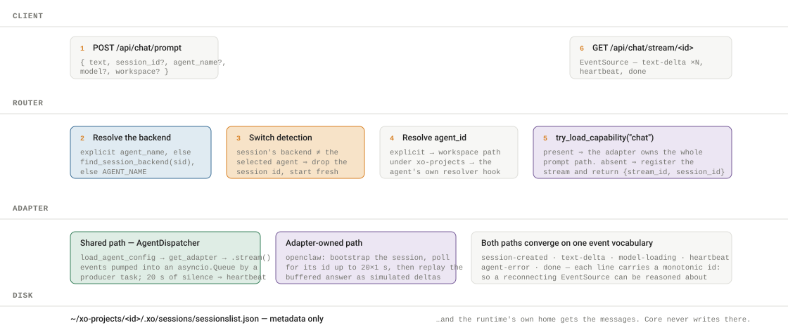
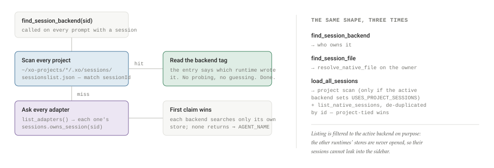
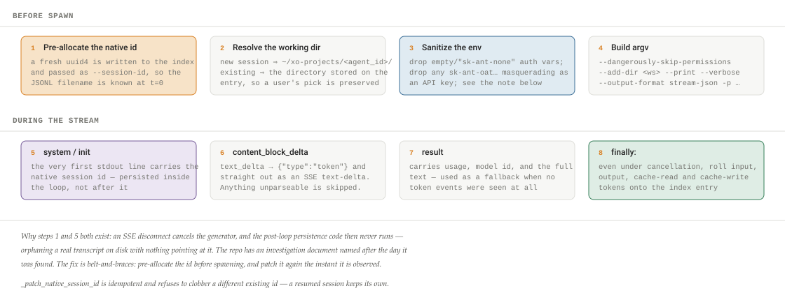
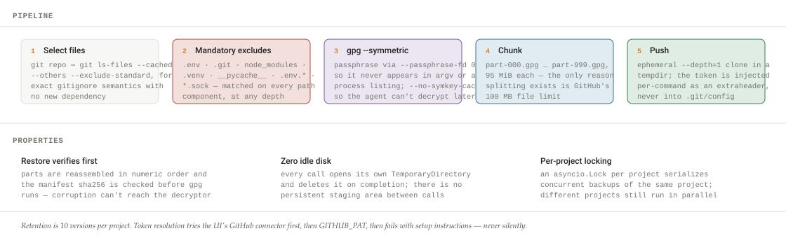

# Anatomy of an Agent Control Plane

A component-by-component teardown of xo-space, the local control plane that brokers Claude Code, OpenClaw, Hermes, and Antigravity behind one API: the single capability seam, agents declared as data, four transports under one streaming contract, a session index that deliberately holds no messages, encrypted GitHub-backed snapshots — and why the invariant that keeps agent names out of core is really an instrument.

By **Suraj Sharma**, XO Labs · Applied Agent Research. First published 31 July 2026 as *Anatomy of an Agent Control Plane* in [sharmasuraj0123/writings](https://github.com/sharmasuraj0123/writings/tree/a5a356d418d45b63d34624b12ec3d7809167b309/xo-space). Subject: xo-space @ f1fecdd (MIT, quirq-ai/xo-space)

Source: [`xo-space/index.html`](https://github.com/sharmasuraj0123/writings/blob/a5a356d418d45b63d34624b12ec3d7809167b309/xo-space/index.html) in [sharmasuraj0123/writings](https://github.com/sharmasuraj0123/writings) at `a5a356d`. Brought into this repo on 2026-10-15 with its text, tables and figures unchanged; only the format moved from HTML to Markdown.

## 01 · Why dissect a control plane

A memory engine answers "what does the environment remember?" A control plane answers a blunter question: *where does the work actually happen, and who is watching?* If a unit of work needs an owner, a budget, a workspace, and a durable result, then something has to own the workspace and meter the spend. That something is not the agent. It is the layer underneath it.

This piece dissects **xo-space**, the FastAPI service that powers an XO Cowork workspace: a local control plane that runs on your machine, brokers chat to whichever coding agent runtime you have installed, and owns the on-disk project model that travels with your work. It does not train, infer, or compete with the agents. It stitches them together and adds the boring-but-critical glue — sessions, files, secrets, OAuth flows, usage reporting — behind one HTTP/SSE surface.

The interesting thing about it is architectural rather than algorithmic. Most "multi-provider" software accretes a switch statement: `if provider == "openai": … elif …`. xo-space makes the opposite bet. It declares an invariant — *no core file may name a specific agent* — and then pays for that invariant everywhere: a dynamic capability loader instead of a registry dict, JSON manifests instead of hardcoded argv, per-agent route mounting instead of feature flags, capability-absence as a first-class graceful state instead of an error. Reading it is a study in what plugin architecture costs and what it buys.

Everything below was read from the source at commit `f1fecdd` — file paths, constants, and thresholds are cited as they appear in the repo. As with any infrastructure, the behaviour lives in the defaults: how long a reconnect window stays open, how many files the graph builder will walk before it gives up, which environment variables get stripped before a subprocess starts. Those are the numbers a README rounds away.

## 02 · The shape of the system

xo-space is one Python process — 42,580 lines across 221 modules, with `server.py` at 1,072 of them — that mounts roughly 169 route decorators and serves a dependency-free browser UI off the same port. Below it sit two worlds it does not own: the agent runtimes' native homes (`~/.claude/`, `~/.openclaw/`, `~/.hermes/`, `~/.gemini/`) and the portable project folders under `~/xo-projects/`. Almost every design decision in the codebase is about keeping those two worlds separate.

**Figure 1. The layer stack, client to disk**

- **Clients**: xo-cowork (Tauri desktop UI) · the bundled Space UI at /space/ · any HTTP/SSE consumer · curl
- **Routers**: 42 modules, 8,580 lines — thin handlers only, no agent branching: chat · sessions · files · secrets · usage · connectors/ · bff/ · legacy/
- **The seam**: adapters/loader.py — load_capability(name) resolves AGENT_NAME → a module. Nothing above this line knows which backend answered.
- **Adapters**: Per-agent trees: claude_code (16 modules) · openclaw (17) · hermes (19) · antigravity (15) · codex, cursor (telemetry-only). Each implements only the capabilities it has.
- **Services**: 183 modules, 30,184 lines: engine (dispatcher, sessions I/O) · registry · connectors · visualizer · xo_projects_sync · project_template
- **Disk**: Runtime homes (chat content, never touched by core) · ~/xo-projects/\<id\>/ (portable metadata) · ~/.quirq/ (machine-local state) · mcp-tokens.json (connector credentials)

The blue row is the whole architecture. Every agent-specific fact in the system — which binary to spawn, where its sessions live, what its streaming events look like — is reachable only by asking the loader for a capability. Remove that row and the codebase becomes an ordinary switch statement.

## 03 · Two planes, deliberately unmerged

Before the interesting part, an honest piece of the map: there are two execution paths in this service and they do not talk to each other. **Plane A** is the original direct-CLI path — `/ask_question` and `/ask_question_streaming`, selected by `AI_PROVIDER`, instantiated once as a module-level `ai_client` in `server.py`, backed by `config/models/<name>/client.py`. **Plane B** is the modular agent system: everything under `/api/*`, selected by `AGENT_NAME`, resolved per request through the capability loader.

Plane A is frozen. Plane B is where all new work happens. The codebase does not pretend otherwise, and `DEVELOPING.md` states the rule twice: Plane A never routes through the dispatcher; Plane B never touches `/ask_question`. Codex exists only as a Plane-A model client and a telemetry reader — it has no Plane-B adapter at all, which is why the README marks it *partial* rather than listing it with the others.

> **Why this is the right call**
>
> Keeping a frozen legacy plane visibly separate is cheaper than a migration that must preserve every response shape. The cost is one paragraph of documentation and two dead-ish files; the alternative cost is a compatibility layer inside the new architecture, which is exactly the kind of thing that erodes an invariant. "Backward compatibility is sacred" appears verbatim in the conventions.

## 04 · The one seam

`services/cowork_agent/adapters/loader.py` is 100 lines and it is the load-bearing wall of the project. A **capability** is nothing more than a module named `adapters/<agent>/<capability>.py`. Three functions reach them:

    load_capability("usage")                  # active agent; raises if absent
    try_load_capability("chat")               # returns None if the agent lacks it
    load_capability("usage", agent="hermes")  # target a specific agent
    list_capability_providers("session_telemetry")   # every agent that has it

Both the capability name and the agent name are validated with `str.isidentifier()` before they reach `importlib.import_module` — a small thing, but it means a hostile `AGENT_NAME` cannot walk the module path.

The subtlest ten lines in the file are inside `try_load_capability`. Returning `None` on `ModuleNotFoundError` is the obvious implementation and it is wrong: an adapter whose `usage.py` exists but imports a missing third-party package raises the same exception class, and the router would silently report "this agent has no usage" instead of surfacing a real bug. So the handler inspects `exc.name` and re-raises unless the thing that was not found is *exactly* the capability module or its package:

    except ModuleNotFoundError as exc:
        # A missing optional capability is normal. A missing dependency inside
        # an otherwise-present capability is a real implementation error and
        # must not be disguised as "unsupported".
        if exc.name not in {expected, provider_package}:
            raise
        return None

`list_capability_providers` is the deliberate exception to "resolve only the active agent." Space's session telemetry is a host-level view — it should show every runtime installed on the machine at once, not just the one selected for new chats — so it scans the adapters directory for anyone implementing `session_telemetry.py`. Its docstring notes that a provider does not need an `adapter.py`, which "permits read-only, telemetry-only integrations without falsely advertising a complete Plane-B chat backend." That is how `codex/` and `cursor/` exist as two- and three-module adapters: they can be *read*, not driven.

Which agent is active resolves through a four-step chain in `registry/agent_registry.py`: `AGENT_NAME` (runtime override) → `DEFAULT_AGENT` (baseline, what ships in `.env.example`) → if exactly one manifest exists, use it → otherwise fall back to `openclaw` with a `warnings.warn`. That last step is the one sanctioned agent literal in core code, and it exists so the server boots with no environment configured at all. Everything else raises rather than guesses, including a manifest whose `name` collides with another.

## 05 · Agents as data

The second half of "no agent names in core" is that argv, paths, and provider recipes are not code either. Each agent ships `config/agents/<name>/manifest.json`, discovered at startup by scanning subdirectories; a JSON file without a `binary` field is skipped as "not an agent manifest." The manifest is loaded into a frozen dataclass with paths pre-expanded, and the original JSON is kept under `raw` so call sites can reach provider and channel recipes without the loader needing to know their shape.

**Figure 2. What one manifest declares — config/agents/claude_code/manifest.json**

| Field | Value | What it decides |
|----|----|----|
| `binary` | `claude` | What gets spawned; injected into every command template as `{binary}` |
| `home_dir` | `~/.claude` | Where credentials, settings, and skills are installed — and which host dir Docker must mount |
| `agents_dir` | `~/.claude/projects` | The native session store the sessions capability reads |
| `env_file` | `~/.claude/.env` | Where the OAuth connect flow writes the token |
| `cli_timeout_seconds` | `300` | Non-streaming subprocess deadline |
| `model_capabilities` | context 200k, output 16,384 | Advertised limits in `/api/models` |
| `skills` | `code-writer` → `/code-writer` | Prompt prefix injected when a request carries an `agent_type` |
| `runtime_setup.extra_mounts` | `~/claude-cowork` | Additional host paths the installer binds into the container |
| `runtime_setup.secrets` | 3 labelled keys | What the Setup tab offers to collect, with human-readable descriptions |
| `providers.openrouter` | 3 env overrides | A recipe: point `ANTHROPIC_BASE_URL` at OpenRouter and blank the API key |

Nothing here is imperative. Adding OpenRouter support to an agent is editing a JSON object; adding a new agent is dropping this file plus an `adapter.py`. The rendering path is `manifest.command(key, **params)`, which runs `str.format_map` over the template and lets `KeyError` escape on a missing placeholder — so a recipe can never render to half-substituted argv that then reaches a shell.

## 06 · The adapter contract

`BaseAgentAdapter` is deliberately small. Three abstract members — `run()`, `stream()`, and an `adapter_name` property — and three concrete ones an adapter may override: `setup()`, `health()`, `load_commands()`. The streaming contract is one sentence long and it is the only thing the whole SSE layer depends on:

    Must yield dicts of shape { "type": "token", "token": str }
    and end with exactly one { "done": True, "native_session_id": str | None }.

Everything else an agent can provide is a separate capability module, and the matrix of which agent implements what is the honest picture of how uneven real integrations are.

**Figure 3. Capability coverage — and what absence does**

| Capability | Surface | claude_code | openclaw | hermes | antigravity |
|----|----|----|----|----|----|
| `adapter` | run / stream dispatch | ✓ | ✓ | ✓ | ✓ |
| `usage` | `/api/usage` | ✓ | ✓ | ✓ | ✓ |
| `models` | `/api/models` | ✓ | ✓ | ✓ | ✓ |
| `sessions` | session read / convert | ✓ | ✓ | ✓ | ✓ |
| `models_status` · `channels_status` · `providers_status` | the three status endpoints | ✓ | ✓ | ✓ | ✓ |
| `visualizer_source` | Space feed | ✓ | ✓ | ✓ | ✓ |
| `streaming` | SSE shaping | ✓ | ✓ | ✓ | — |
| `chat` | owns `/api/chat/prompt` | — | ✓ | ✓ | — |
| `routes` | agent-owned `APIRouter` | — | ✓ | ✓ | ✓ |
| `session_telemetry` | host-level Space view | ✓ | — | — | — |

Every dash is a designed behaviour, not a gap. claude_code has no `chat` capability *on purpose* — the router falls through to the shared dispatcher when `handle_prompt` is absent. A missing `routes` module means no extra endpoints get mounted, which is why per-agent OpenAPI path counts differ (146 / 149 / 173 / 148 for claude_code / openclaw / hermes / antigravity). Two additional providers — `codex` and `cursor` — implement `session_telemetry` and nothing else.

## 07 · Four runtimes, four transports

The uniform API hides four genuinely different integration problems. It is worth seeing them side by side, because the variance is the point: a plugin architecture that only ever absorbs one shape of backend has not been tested.

**Figure 4. The same contract, four times over**

| Runtime | Transport | Session store | The hard part |
|----|----|----|----|
| **Claude Code** | `claude` subprocess, `--output-format stream-json` | `~/.claude/projects/<encoded-cwd>/<sid>.jsonl` | The directory name is the absolute cwd with `/`→`-`, which is *lossy* to reverse when a folder contains a hyphen. Resolution is by longest match against real project directories, never by decoding. |
| **OpenClaw** | HTTP gateway on `:18789`, OpenAI-compatible SSE | `~/.openclaw/agents/<a>/sessions/<sid>.jsonl` | The session id is assigned by the gateway and only observable after the first completion — so a new session is bootstrapped, then polled for up to 20 seconds before the client is told its id. |
| **Hermes** | `hermes` CLI + per-profile gateway processes | SQLite WAL — `~/.hermes/state.db` or `profiles/<n>/state.db` | One gateway can only ever write to one profile's database, so xo-space runs a pool: ports 8643–8742, a JSON registry at `~/.hermes/.gateway-pool.json`, and messaging tokens de-duplicated across profiles so two gateways never race for the same Slack socket. |
| **Antigravity** | `agy` subprocess — no JSON mode, no auth CLI | `brain/<cid>/.system_generated/logs/transcript_full.jsonl` | Everything must be recovered indirectly: login state from the OAuth token file, the conversation id from a `--log-file` line, and the answer by tailing an event-sourced transcript for the last `PLANNER_RESPONSE` that has content and no tool calls. |

Two gotchas the antigravity command builder documents from live testing against agy v1.1.2: the CLI *ignores* its working directory (so the workspace is bound with `--add-dir`), and a fresh `-p` always starts a new conversation (resume is `--conversation <id>`, the analogue of claude_code's `--resume`). Hermes's read path opens SQLite with `mode=ro` so it never contends with the gateway's WAL write lock.

## 08 · A turn, end to end

The client-facing protocol is two HTTP calls, and the split is load-bearing. `POST /api/chat/prompt` returns `{stream_id, session_id}` fast; the browser then opens an `EventSource` on `GET /api/chat/stream/<stream_id>`. Between them sits a process-local dictionary, `active_streams`, whose module docstring is refreshingly blunt about its limits: "Process-local; not persisted. Incompatible with uvicorn `--workers > 1`."

**Figure 5. One turn — from prompt to done , and every fork on the way**

Step 3 is the kind of behaviour that only exists because someone hit it: a user with an open chat picks a different agent from the sidebar, and the incoming `session_id` now belongs to a backend that isn't the one selected. Rather than fail, or worse resume the wrong store, the router logs the switch and treats it as a new session.

## 09 · The streaming layer and its scar tissue

The SSE generator in `routers/cowork_agent/chat.py` is 195 lines, and roughly a third of it is comments explaining bugs. This is the most instructive file in the repository, because streaming to a browser is where clean architecture meets the real world.

### Keepalives, and why not `wait_for`

During a long tool-call run an agent can go quiet for minutes. The frontend has a heartbeat timer, so the server must emit something. The obvious implementation — wrap `__anext__()` in `asyncio.wait_for` and emit a heartbeat on timeout — is explicitly rejected in the docstring:

> **From the source**
>
> "Keepalives use an `asyncio.Queue` producer-task pattern — NOT `asyncio.wait_for(__anext__)` — because cancelling `__anext__` on an async generator corrupts its internal state and causes it to stop early (the bug that made text disappear after the first timeout)."

So a producer task drains the adapter into a queue and pushes a sentinel object at the end; the consumer waits on the *queue* with a 20-second timeout and emits `event: heartbeat` when it expires. Cancellation lands on the producer task, never on the generator mid-yield.

### The reconnect window

A native `EventSource` automatically reconnects the instant the server closes the connection — including immediately after `done`, before the client has called `.close()`. React Strict Mode's double-mount produces the same pattern. Either way the second request arrives for a `stream_id` that has already been consumed and removed.

The answer is a second dictionary, `_recently_started`, holding `{session_id, started_at, done_event}` for `_RECENTLY_STARTED_TTL = 600` seconds. The comment states the derivation rather than the number: it "must outlast `SSE_HEARTBEAT_TIMEOUT` (45 s) + full reconnect backoff." A reconnect that finds a record waits on the `asyncio.Event` for up to 300 seconds, then replays `session-created` and `done` so the client refetches the transcript from disk instead of showing an error.

There is one more wrinkle, and it is a nice illustration of the no-backend-names rule surviving contact with a real edge case. Adapter-owned streams don't know their session id up front — openclaw only learns it from the gateway mid-stream. So the router sniffs each outgoing chunk with `_session_id_from_sse`, which parses only the generic wire shape (`data: {…}` → `session_id`) and updates the reconnect record. It reads the stream it is proxying without knowing whose stream it is.

## 10 · The index that holds no messages

Here is the design decision the whole product rests on, stated in the module docstring of `engine/sessions_io.py`:

> **Security model**
>
> "The project folder (`.xo/sessions/`) holds only metadata (`sessionslist.json`). Chat messages are never written there. They live in each backend's own storage, reached only through that backend's `sessions` capability; core never reads a backend's message store directly and names no backend here."

A `sessionslist.json` entry is five fields and a usage counter: `sessionId`, `nativeSessionId`, `directory`, `backend`, `updatedAt`. That is the entire portable record of a conversation. It is enough to find the messages on the machine that has them and useless anywhere else — which is precisely what makes a project folder safe to sync, fork, or push to git. The confidentiality guarantee is structural rather than procedural: it holds because no code path exists to violate it, not because reviewers remember to check.

The cost is that "which backend owns this session?" becomes a real question with a real algorithm, run on every prompt to an existing conversation.

**Figure 6. Resolving the owner of a session id, without naming a backend**

Two properties fall out of this. A project folder can hold sessions from several runtimes at once and each row still resolves through its *own* backend, because enrichment routes by the row's tag rather than the active agent. And a listing under `AGENT_NAME=hermes` physically cannot show a Claude Code conversation — not filtered out, never read.

## 11 · Journey: a claude_code turn, in full

The claude_code adapter is the best worked example in the repository, because its failure modes have been ground down over several months and the fixes are all still legible in the code. It spawns a subprocess, parses newline-delimited JSON, and has to keep an on-disk mapping honest across a client that may vanish at any moment.

**Figure 7. A claude_code stream — pre-allocation, in-loop persistence, and a finally that always pays up**

`--resume` and `--session-id` are mutually exclusive at the CLI, so the builder picks exactly one: a resume id for existing sessions, the pre-allocated uuid for new ones.

Step 3 deserves its own paragraph, because it is a genuinely subtle piece of authentication reasoning. The Claude CLI has an auth precedence chain in which both `ANTHROPIC_API_KEY` and `CLAUDE_CODE_OAUTH_TOKEN` outrank a native subscription login. A native login is the durable, self-healing source — the CLI refreshes it itself. So when `~/.claude/.credentials.json` holds a usable login (a refresh token, or an unexpired access token — `expiresAt` is epoch milliseconds), the adapter *removes* all three token variables from the subprocess environment. Otherwise a stale token left over from a previous setup would override the fresh login and silently bill the API or fail outright. With no native login present they are left intact, so explicit API-key mode still works.

The adapter also carries a feature that is unusual for a broker: `remote_control.py` starts and stops a local `claude remote-control` server so the workspace can be driven from the Claude mobile app. Its docstring is refreshingly candid about what it is doing — "this builds on undocumented CLI internals… because `claude remote-control` has no headless API. Pin the claude CLI version and run a start→url→stop smoke test on upgrades" — and about why it filters the CLI's live dashboard instead of logging it: the dashboard repaints about six lines per second, roughly 1.3 MB per hour if captured.

## 12 · Usage: one shape from four ledgers

`/api/usage` has to answer the same question against four incompatible records. The solution is a normalized **entry** — one per message — and a `Source` object holding the only two things that differ per backend: `discover()`, which finds the session files, and `parse_file()`, which turns one record into entries. Everything downstream (windowing, per-session summaries, the analytics payload, the daily sync rollup) operates purely on entries and is therefore shared.

    assistant entry = {
      "role": "assistant", "timestamp": epoch_ms | None,
      "usage": {"input","output","cacheRead","cacheWrite","totalTokens","cost"},
      "provider": str, "model": str, "stopReason": str | None,
      "toolNames": [str], "toolResultCounts": {"total","errors"},
      "durationMs": int | None,
    }

The extraction note is worth quoting because it is the kind of claim most refactors make and few verify: "Output is byte-for-byte what the per-adapter copies produced before extraction." And the exception is stated rather than hidden — hermes does not use this module at all, because it reads rolled-up session rows from SQLite and no per-message entries exist to normalize.

One background job consumes all of this: a daily sync at `USAGE_SYNC_HOUR_UTC` (default 02:00) that posts aggregates to `${CHAT_API_BASE_URL}/usage/report`. Its watermark file is namespaced under the active agent, and the comment explains why that is a feature rather than an accident: switching `AGENT_NAME` lands on a path with no watermark, "which correctly triggers a full backfill for the new agent rather than reusing the previous agent's truncation point."

## 13 · The xo-projects model

A project is a folder. That is the whole model, and `project_layout.py` owns its shape — "the on-disk shape is what makes the agent perform well." Scaffolding is idempotent by construction: the template is copied recursively and a file that already exists is never overwritten, so re-running fills gaps without clobbering work. The template location itself is overridable with `XO_PROJECT_TEMPLATE`, falling back to the bundled `project_template/`.

**Figure 8. Three storage tiers, and what may live in each**

- **~/xo-projects/\<id\>/**: Portable AGENTS.md (the agent operating contract), CLAUDE.md (one line: @AGENTS.md ), PROJECT.md , OBJECTIVES.md , PLAN.md , PROGRESS.md , memory/ , and .xo/ — project.json, the metadata-only session index, todos, stats, an append-only timeline. Safe to share, fork, or push.
- **~/.quirq/**: Machine-local Onboarding state, runtime.env (a small allowlist of non-secret controls), secrets.env (write-only credentials), watcher cursors, advisory locks, and live presence snapshots. Explicitly not project metadata — presence is a property of this machine, not of the work.
- **~/.claude/ , ~/.openclaw/ , …**: Runtime-owned Every message of every conversation, plus each runtime's own credentials. xo-space reads these through a backend's sessions capability and writes only what the runtime's own auth flow requires. Nothing here is ever copied into the portable tier.

The rule that makes the three tiers stable is written as a convention and repeated in the agent contract: "The project folder is sacred. Never write chat content, credentials, or anything that wouldn't survive a `git push` into `~/xo-projects/<id>/`."

## 14 · Machine-local state, and the discipline of not lying

Two modules govern `~/.quirq/` and both are notable for what they refuse to do.

`runtime_config.py` maintains an allowlist — `AGENT_NAME`, `QUIRQ_WATCHER_ENABLED`, `QUIRQ_WATCHER_INTERVAL_SECONDS`, `QUIRQ_WATCHER_SOURCE_MODE`, plus two root paths — and nothing outside it can be set through the API. More interestingly, it does not pretend a change took effect. Runtime controls are read at process startup, so writing one produces "a truthful `restart_required` state instead of pretending import-time configuration changed live." When the UI needs to know whether secrets changed, it gets a SHA-256 fingerprint computed over sorted key/value pairs — the store is hashed without its values being retained or returned.

`quirq_catalog.py` serves the local Quirq tab and is described as "read-only, privacy-aware": it "deliberately reports structure and operational summaries rather than serving arbitrary files: credential values, native session contents, cursor paths, and symlink targets never leave the machine-local state service." It is bounded too — 500 files, 2 MiB of JSON — and `secrets.env` is named in a sensitive-files set so its existence can be reported without its contents.

The catalog also ships something I have rarely seen in a codebase: a declared **output contract**. Each file the system writes is listed with its producer, its purpose, and its consumers — `sessions/sessionslist.json` produced by the runtime source adapter and read by the projects APIs and the graph; `timeline.jsonl` produced by the watcher timeline sink; `stats.json` by the statistics sink. It is a data dictionary that lives next to the code, which means it can drift, but at least it can be checked.

## 15 · Backup: encrypted, chunked, GitHub-backed

The backup subsystem answers a question every local-first product eventually faces: how do you give people durability without becoming a place their data lives? The answer here is that the user keeps the key and GitHub keeps the bytes. Each project gets its own private repository named `xo-project-<id>`, lazily created on first backup — the prefix is what lets the API discover its own repos through `GET /user/repos` without colliding with anything else the user owns.

**Figure 9. One backup, end to end — and the four places a secret could have leaked but doesn't**

The mandatory-exclude list is the interesting call. Inside a git repo that happens to track `node_modules/`, it still gets skipped — and the reason given is not size: "The blob is encrypted but a leaked passphrase shouldn't also leak `.env`." Defense in depth, stated as such.

## 16 · Connectors

Five external services, three credential stores, and one shared lock. `token_store.py` is declared "the single owner of `mcp-tokens.json`" — the only module that knows the file's location, shape, and read/write semantics — so that locking or a format migration can later be added in one place instead of five.

**Figure 10. Five connectors, and where each credential lands**

| Service | Method | Store | Notable |
|----|----|----|----|
| Google Drive | `rclone authorize drive.file` + code paste | `rclone.conf` | Folder management and 500 MiB streaming uploads with no disk spool and no RAM buffer |
| OneDrive | `rclone authorize` (Microsoft Graph) | `rclone.conf` | Shares the OAuth callback port with Drive — hence the lock |
| GitHub | PAT paste *or* `gh auth login --web` device flow | `mcp-tokens.json` | Also the token source for project backup |
| Vercel | API token *or* OAuth 2.1 + PKCE | `mcp-tokens.json` | Registers its own OAuth client dynamically (RFC 7591) on first use |
| Manus | API key paste | `mcp-tokens.json` | The simple case, kept simple |

rclone's OAuth callback server binds one hardcoded port — `:53682` — for every backend that uses its bundled client, so only one flow may be live at a time across all connectors. A second `rclone authorize` would fail to bind and "crash silently." The fix is a registry of session getters plus a liveness window: a flow older than 300 seconds is presumed dead and the lock auto-releases, even if its background task hasn't yet flipped the status.

## 17 · Space: the workspace as a graph

Bundled with the API is a build-free ES-module UI served at `/space/` — 28 files, 6,672 lines, no bundler and no dependencies. It renders `~/xo-projects` as a force-directed graph, a scrubbable timeline, six-degrees pathfinding between artifacts, a telemetry dashboard, a projects view, a chat client, and a bundled wiki. Its view registry gives each view lazy mounting, hash routing, and failure isolation, so one broken view cannot take the page down.

The graph data is generated live on request by `visualizer/space_index.py`, and the module comment explains the constraint that shapes it: "the API runs inside every user's workspace, so the builder must stay cheap regardless of how much is on disk. Each stage is capped."

**Figure 11. Every stage of the graph build has a number attached**

- **2,000** · files walked per project before traversal stops
- **400** · leaves emitted per project, newest first
- **1,500** · total leaves — the browser has to render them
- **10.0 s** · whole-build wall-clock deadline
- **40** · leaves per group before a directory splits
- **60** · cross-ties kept, strongest first
- **30 s** · server-side cache TTL on the built payload
- **60** · units/tick velocity clamp in the simulation

That last number is a local divergence fix, documented as a deviation from the upstream UI: generated data can put 100+ leaves in one cluster, and the summed spring stiffness makes the original explicit-Euler integrator blow up — "positions hit 1e20 and the canvas goes blank."

Two details of the graph's epistemics are worth noting. Ties between files are "derived facts, never editorial": files that repeatedly share commits, documents whose text names another file's relative path, and `test_x` ↔ `x` filename pairs. And when the builder throws, the route answers 503 and the UI shows a "no data source" panel rather than a bundled demo map. The README states the preference outright: "a wrong-looking demo map beats nothing, but a truthful error panel beats both."

A second projection, `categorized_graph.py`, collapses every project to a single node and classifies it into five purpose categories — engineering, ops, documentation, research, marketing. Classification is heuristic, and the escape hatch is explicit: a manual `category` in `.xo/project.json` overrides the heuristics "so users can correct an ambiguous project without renaming files."

## 18 · The modularity invariant

One rule holds the architecture together: **no core file may name a specific agent in code.** Core is everything except the three agent-owned trees (`adapters/<name>/`, `config/agents/<name>/`, `config/models/<name>/`). Everywhere else, resolve through the loader.

What makes this credible rather than aspirational is that the exceptions are enumerated. There are exactly four, each with a stated reason:

1.  the `openclaw` safe-boot default in `agent_registry.py` — so the server starts with nothing configured;
2.  the `/providers/status` OAuth keys (`claude_code`, `codex`) in `providers_status_lib.py`;
3.  the frozen `/openclaw/usage` URL alias in `legacy/openclaw_usage.py`;
4.  codex's legacy openclaw-gateway credential writes in `routers/auth/codex_setup.py` — "old but needed; schema is openclaw-specific."

The enforcement story is the honest weak point, and the repo says so. An AST-based guard exists — it ignores docstrings and comments, and tolerates `config.models.*` imports — but it is "kept as local dev tooling, not committed." So the invariant is upheld in review, against a written allowlist, by humans. That is a real gap between the stated rule and the mechanized one, and it is precisely the sort of thing a control plane for verified work should eventually not tolerate in itself.

> **A small piece of evidence**
>
> The two agent-instruction files in the repo disagree about the route-parity numbers: `CLAUDE.md` says 144 / 147 / 171 OpenAPI paths for claude_code / openclaw / hermes, while `AGENTS.md` and `DEVELOPING.md` say 146 / 149 / 173 (plus 148 for antigravity). Both were true when written. Documented counts drift the moment a route is added; only the command that produces them (`AGENT_NAME=$a python -c "import server; …"`) stays correct. Which is an argument for measuring rather than recording — the same argument the quirq program makes about work itself.

## 19 · The tech stack, completely

**Figure 12. Bill of materials, by layer**

| Layer | What it is | Size |
|----|----|----|
| HTTP | FastAPI + uvicorn, Pydantic models, CORS, SSE via `StreamingResponse` | 169 route decorators |
| App entry | `server.py` — lifespan, router mounts, Plane-A endpoints, health, self-restart/update | 1,072 lines |
| Routers | auth · status · cowork_agent (chat, sessions, files, secrets, usage, connectors, bff, legacy) | 42 files · 8,580 lines |
| Services | adapters · engine · registry · connectors · visualizer · xo_projects_sync · project_template | 183 files · 30,184 lines |
| Agent config | 4 manifests + capabilities/settings/setup scripts + 2 Plane-A model clients | 27 files · 4,900 lines |
| Space UI | Hand-written ES modules and CSS, zero dependencies, canvas rendering | 28 files · 6,672 lines |
| Outbound HTTP | `httpx.AsyncClient` — gateways, GitHub REST, Vercel OAuth, usage sync | 1800 s stream timeout, 10 s connect |
| Subprocess | `asyncio.create_subprocess_exec` for every CLI; argv from manifests, never a shell string | 4 runtimes |
| Storage | JSON on disk (atomic temp-file + rename), SQLite read-only for hermes and antigravity, JSONL transcripts | no database of its own |
| External tools | `git`, `gh`, `gpg`, `rclone` — all invoked, none vendored | installed in the image |
| Packaging | `python:3.12-slim`, healthcheck every 10 s after a 20 s grace, host port 5003 → container 5002 | one `docker compose up` |
| Tests | pytest — activity state, agent env, local port, local state, quirq catalog, runtime config, session mounts, space dashboard/sessions/wiki | 11 files · 1,462 lines |

The container is not a shortcut around the plugin system. The installer asks the running image which host directories to mount by calling `scripts/list_runtime_mounts.py`, which enumerates manifest `home_dir`s plus any `extra_mounts`, then adds optional read-only homes contributed by telemetry-only providers. Adding an agent changes what Docker mounts, without editing the installer.

## 20 · What isn't built yet

A teardown that reports only the good parts is advertising. Four things are visibly unfinished, and the code says so.

**Workspace memory is a stub.** `routers/cowork_agent/workspace_memory.py` answers `{"memory": null}`, `[]`, and `{"ok": true}` to six endpoints the frontend calls. The full-text search index is the same: `/api/fts/index/*` reports `idle` forever. These are honest placeholders — the shape of the seam exists and nothing pretends to fill it — but they are also the two features that would make a workspace genuinely cumulative rather than merely organized.

**The watcher is elsewhere.** Much of what makes `.xo/` useful — todos, stats, the timeline, activity heartbeats, identity resolution — is produced by a watcher service that this repository documents, catalogs, and reads, but does not contain. The catalog's output contract names its sinks precisely; the sinks themselves live outside this teardown.

**Chat state is process-local.** One dictionary, no persistence, incompatible with more than one uvicorn worker. For a local single-user control plane that is the correct trade; it is also the first thing that has to change for anything multi-user, and the RBAC design is still a wiki page rather than code.

**The invariant guard isn't committed.** Discussed in §18 — the rule is real, the enforcement is manual.

## 21 · What this means for quirq

Read through the quirq lens, xo-space is three things at once.

**It is the environment the unit of work needs.** The proposal insists that a unit of work owns an outcome from definition through verification, and that it has one owner, a definition of done, a budget, a workspace, and a durable result. Three of those five are already materialized here as files and endpoints: the workspace is `~/xo-projects/<id>/` with a scaffolded contract at its root, the durable result is that same folder after the work (snapshot-able, restorable, portable), and the spend side of the budget is metered across every runtime by `/api/usage`. What the environment cannot yet do is *verify* — there is no definition-of-done evaluator and no budget that can refuse. Those are the missing halves, and they are where a quirq implementation would have to attach.

**It is instrumentation that does not distort what it measures.** The whitepaper's audit machinery needs an environment that can answer "what was true at time *t*" without the act of observing changing the run. xo-space's answers are structural: the session index records the mapping and never the content; the graph builder is a pure reader that writes nothing; the telemetry aggregator validates every number as finite and non-negative and rejects a provider's whole payload rather than passing a bad one through; backups are content-addressed by sha256 and verified before decryption. Even its retention rule (10 snapshots per project) is a decision about how much history a claim can be checked against.

**And it is the substrate a memory engine would plug into.** The tenure hypothesis — cost per unit of verified work falling as an environment's memory M_(t) accumulates — requires somewhere for M_(t) to live that outlasts any one agent session. Here that place has a name and a layout: `memory/` beside `PROGRESS.md`, inside a folder that survives a runtime switch. The control plane is deliberately agnostic about which agent does the work; that agnosticism is exactly what makes accumulated environment memory worth more than accumulated agent memory. Switch the backend and the project remembers; the agent doesn't have to.

The lesson I would take from the codebase is narrower and more practical than any of that. The invariant — *no core file may name a specific agent* — is not architectural elegance for its own sake. It is what makes cross-runtime measurement possible at all. You cannot compare the cost of a unit of work across four agents if the comparison logic has four branches in it. A single normalized entry shape, a single session record, a single event vocabulary: those are the preconditions for a meter. The plugin architecture isn't the point. It's the instrument.

Subject: xo-space at commit `f1fecdd`, github.com/quirq-ai/xo-space (MIT), 203 commits on `main`. All file paths, constants, and quoted comments verified against the source at that commit; line counts are from the working tree. Per-agent route counts are quoted from the repo's own validation playbook and were not re-run here (the checkout ships no virtualenv). This piece is an independent technical analysis.
